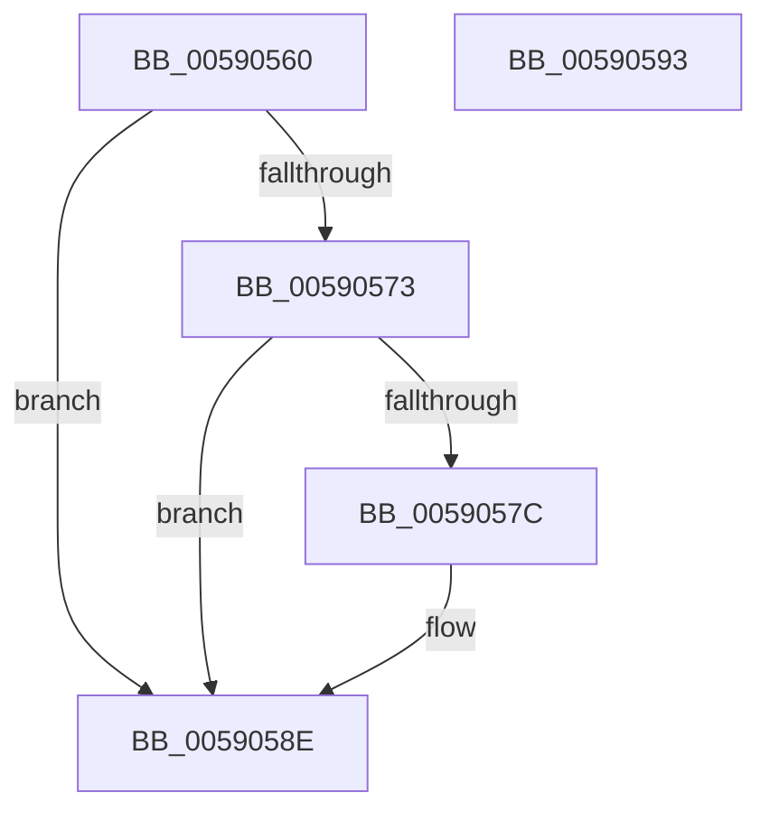

# InbvSolidColorFill

- RVA: `0x00590560`–`0x00590594` (길이 `52` bytes)
- VA: `0x0000000140590560`
- 실행 섹션: `.text`
- PDB 이름 있음: `예`; PDB Function 태그: `아니요`
- unwind 정보 RVA: `0x0005D2F4`
- 디코드: `15`개 명령, `52/52` bytes 표시
- 미해석 바이트: `0` (있으면 어셈블리에 `.byte`로 보존)

> 이 문서는 커널 이미지의 기계어와 PDB 기호를 분석해 생성했습니다. 4번과 5번은 함수 원형과 자료형을 바이너리 사용 방식에서 추정한 C 해석이며 원본 소스 복구 결과는 아닙니다.

## 1. Dependencies

- 직접 호출 지점: **1**; 고유 호출 대상: **1**
- 직접 호출자로 확인된 함수: **1**
- RIP 상대 이미지 참조: **1**

### Outgoing calls
- `0x00590589` → [guard_dispatch_icall](../6B/guard_dispatch_icall_function_006BAAD0.md) (function, `0x006BAAD0`)

### Direct callers
- [DisplayBootBitmap](../53/DisplayBootBitmap_function_0053B87C.md) at `0x0053B8D9`
- [DisplayBootBitmap](../53/DisplayBootBitmap_function_0053B87C.md) at `0x0053B8EE`

### Static image references
- `0x00590564` → RVA `0x00E65E58` (`.data`; read)

## 2. Other-region calls and transfers

- 다른 실행 섹션으로 향하는 call: **0**
- 별도 외부 분기/꼬리 이동을 확인하지 못했습니다.

## 3. Assembly (complete function range)

```asm
00590560  48 83 EC 38                     sub rsp, 0x38
00590564  48 8B 05 ED 58 8D 00            mov rax, qword ptr [rip + 0x8d58ed]
0059056B  45 8B D0                        mov r10d, r8d
0059056E  48 85 C0                        test rax, rax
00590571  74 1B                           je 0x14059058e
00590573  48 8B 40 20                     mov rax, qword ptr [rax + 0x20]
00590577  48 85 C0                        test rax, rax
0059057A  74 12                           je 0x14059058e
0059057C  44 8B 44 24 60                  mov r8d, dword ptr [rsp + 0x60]
00590581  44 89 44 24 20                  mov dword ptr [rsp + 0x20], r8d
00590586  45 8B C2                        mov r8d, r10d
00590589  E8 42 A5 12 00                  call 0x1406baad0
0059058E  48 83 C4 38                     add rsp, 0x38
00590592  C3                              ret
00590593  CC                              int3
```

## 4. C-style interpretation (structured pseudocode)

```c
__int64 __fastcall InbvSolidColorFill(__int64 a1, __int64 a2, int a3, __int64 a4, unsigned int a5)
{
    __int64 result;
    __int64 v_rsp;
    unsigned int v_stack_m18;

    v_rsp = (v_rsp) - (56);
    if (*(unsigned __int64 *)(v_rip + 9263341) == 0) goto loc_0059058E;
    result = *(unsigned __int64 *)(*(unsigned __int64 *)(v_rip + 9263341) + 32);
    if (*(unsigned __int64 *)(*(unsigned __int64 *)(v_rip + 9263341) + 32) != 0) {
        a3 = a5;
        v_stack_m18 = a3;
        a3 = (unsigned int)((unsigned int)(a3));
        result = guard_dispatch_icall(a1, a2, a3, a4);
    }
    v_rsp = (v_rsp) + (56);
    return result;
}
```

## 5. (Beta) C Style

```c
int64_t InbvSolidColorFill(int64_t Arg1, int64_t Arg2, int32_t Arg3, int64_t Arg4, uint32_t Arg5)
{
    int64_t result;
    int64_t local_rsp;
    uint32_t v_stack_m18;

    local_rsp = (local_rsp) - (56);
    if (*(uint64_t *)(v_rip + 0x8D58ED) == 0) goto loc_0059058E;
    result = *(uint64_t *)(*(uint64_t *)(v_rip + 0x8D58ED) + 0x20);
    if (*(uint64_t *)(*(uint64_t *)(v_rip + 0x8D58ED) + 0x20) != 0) {
        Arg3 = Arg5;
        v_stack_m18 = Arg3;
        Arg3 = (uint32_t)((uint32_t)(Arg3));
        result = guard_dispatch_icall(Arg1, Arg2, Arg3, Arg4);
    }
    local_rsp = (local_rsp) + (56);
    return result;
}
```

## 6. Execution-region graph

[열기: 2D/3D 그래프와 함수 탐색 컨트롤 패널](../../../control-panel.html?section=text&rva=0x00590560&view=graph)

- 2D 그래프는 위에서 아래로 흐르고, 3D 그래프는 빈 공간을 드래그해 회전합니다. Shift+드래그는 이동, 휠은 확대·축소, 함수 노드 선택은 대상 보고서 이동입니다.

### Static fallback


