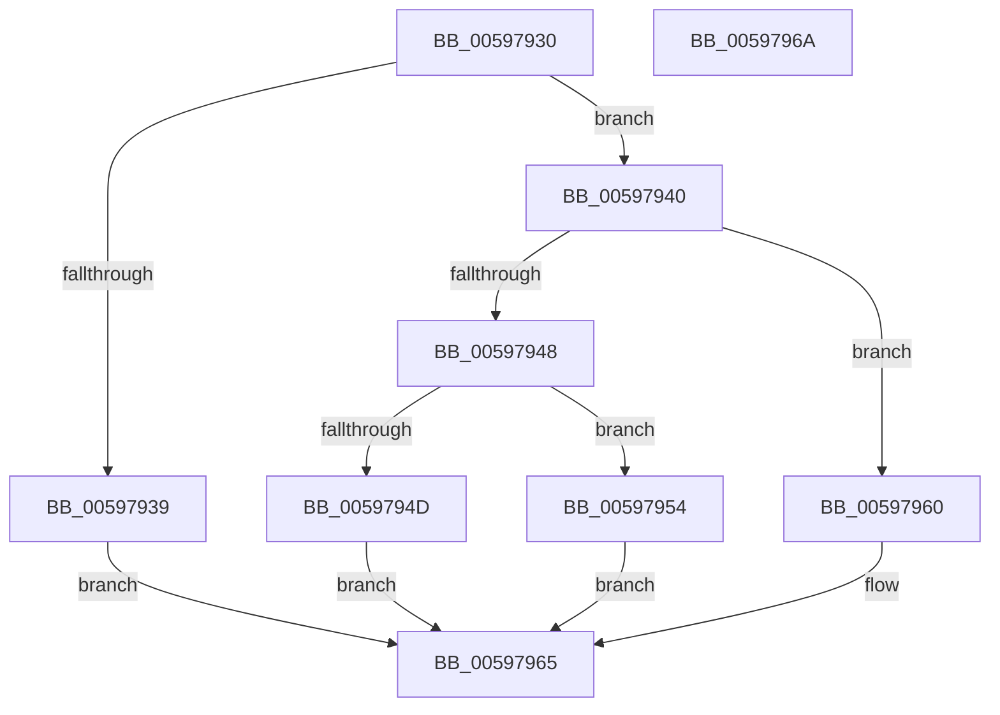

# IoAllocateSfioStreamIdentifier

- RVA: `0x00597930`–`0x0059796B` (길이 `59` bytes)
- VA: `0x0000000140597930`
- 실행 섹션: `.text`
- PDB 이름 있음: `예`; PDB Function 태그: `아니요`
- unwind 정보 RVA: `0x0005D2F4`
- 디코드: `19`개 명령, `59/59` bytes 표시
- 미해석 바이트: `0` (있으면 어셈블리에 `.byte`로 보존)

> 이 문서는 커널 이미지의 기계어와 PDB 기호를 분석해 생성했습니다. 4번과 5번은 함수 원형과 자료형을 바이너리 사용 방식에서 추정한 C 해석이며 원본 소스 복구 결과는 아닙니다.

## 1. Dependencies

- 직접 호출 지점: **1**; 고유 호출 대상: **1**
- 직접 호출자로 확인된 함수: **0**
- RIP 상대 이미지 참조: **0**

### Outgoing calls
- `0x00597959` → [IopGetSetStreamIdentifier](../42/IopGetSetStreamIdentifier_function_0042ED7C.md) (function, `0x0042ED7C`)

### Direct callers
- 이 함수 시작 RVA로 연결되는 직접 call은 확인되지 않았습니다. 간접 호출은 완전히 역산할 수 없습니다.

### Static image references
- 디코드된 RIP-relative 메모리 참조가 없습니다.

## 2. Other-region calls and transfers

- 다른 실행 섹션으로 향하는 call: **0**
- 별도 외부 분기/꼬리 이동을 확인하지 못했습니다.

## 3. Assembly (complete function range)

```asm
00597930  48 83 EC 38                     sub rsp, 0x38
00597934  48 85 C9                        test rcx, rcx
00597937  75 07                           jne 0x140597940
00597939  B8 EF 00 00 C0                  mov eax, 0xc00000ef
0059793E  EB 25                           jmp 0x140597965
00597940  8D 42 FF                        lea eax, [rdx - 1]
00597943  83 F8 DE                        cmp eax, -0x22
00597946  77 18                           ja 0x140597960
00597948  4D 85 C0                        test r8, r8
0059794B  75 07                           jne 0x140597954
0059794D  B8 F1 00 00 C0                  mov eax, 0xc00000f1
00597952  EB 11                           jmp 0x140597965
00597954  C6 44 24 20 01                  mov byte ptr [rsp + 0x20], 1
00597959  E8 1E 74 E9 FF                  call 0x14042ed7c
0059795E  EB 05                           jmp 0x140597965
00597960  B8 F0 00 00 C0                  mov eax, 0xc00000f0
00597965  48 83 C4 38                     add rsp, 0x38
00597969  C3                              ret
0059796A  CC                              int3
```

## 4. C-style interpretation (structured pseudocode)

```c
__int64 __fastcall IoAllocateSfioStreamIdentifier(__int64 a1, __int64 a2, __int64 a3)
{
    __int64 result;
    __int64 v_rsp;
    unsigned __int8 v_stack_m18;

    v_rsp = (v_rsp) - (56);
    if (a1 != 0) goto loc_00597940;
    goto loc_00597965;
loc_00597940:
    if (((unsigned int)(a2 - 1)) > -34) goto loc_00597960;
    if (a3 != 0) goto loc_00597954;
    goto loc_00597965;
loc_00597954:
    v_stack_m18 = 1;
    result = IopGetSetStreamIdentifier(a1, a2, a3, a4);
    goto loc_00597965;
loc_00597960:
loc_00597965:
    v_rsp = (v_rsp) + (56);
    return (unsigned int)(0xC00000F0ULL);
}
```

## 5. (Beta) C Style

```c
int64_t IoAllocateSfioStreamIdentifier(int64_t Arg1, void *Arg2, int64_t Arg3)
{
    uint8_t *arg2 = (uint8_t *)Arg2;

    int64_t result;
    int64_t local_rsp;
    uint8_t v_stack_m18;

    local_rsp = (local_rsp) - (56);
    if (Arg1 != 0) goto loc_00597940;
    goto loc_00597965;
loc_00597940:
    if (((uint32_t)(Arg2 - 1)) > -34) goto loc_00597960;
    if (Arg3 != 0) goto loc_00597954;
    goto loc_00597965;
loc_00597954:
    v_stack_m18 = 1;
    result = IopGetSetStreamIdentifier(Arg1, Arg2, Arg3, a4);
    goto loc_00597965;
loc_00597960:
loc_00597965:
    local_rsp = (local_rsp) + (56);
    return (uint32_t)(0xC00000F0ULL);
}
```

### 관측된 메모리 오프셋

구조체 형식이 확인되지 않은 접근은 인자 기준의 오프셋으로만 기록했습니다.

| 기준 인자 | 오프셋 표현 | 폭 (bit) | 접근 |
|---|---:|---:|---|
| `Arg2` | `- 0x1` | `32` | `R` |

## 6. Execution-region graph

[열기: 2D/3D 그래프와 함수 탐색 컨트롤 패널](../../../control-panel.html?section=text&rva=0x00597930&view=graph)

- 2D 그래프는 위에서 아래로 흐르고, 3D 그래프는 빈 공간을 드래그해 회전합니다. Shift+드래그는 이동, 휠은 확대·축소, 함수 노드 선택은 대상 보고서 이동입니다.

### Static fallback


