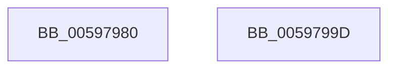

# IoAttachDeviceByPointer

- RVA: `0x00597980`–`0x0059799E` (길이 `30` bytes)
- VA: `0x0000000140597980`
- 실행 섹션: `.text`
- PDB 이름 있음: `예`; PDB Function 태그: `아니요`
- unwind 정보 RVA: `0x0005C788`
- 디코드: `10`개 명령, `30/30` bytes 표시
- 미해석 바이트: `0` (있으면 어셈블리에 `.byte`로 보존)

> 이 문서는 커널 이미지의 기계어와 PDB 기호를 분석해 생성했습니다. 4번과 5번은 함수 원형과 자료형을 바이너리 사용 방식에서 추정한 C 해석이며 원본 소스 복구 결과는 아닙니다.

## 1. Dependencies

- 직접 호출 지점: **1**; 고유 호출 대상: **1**
- 직접 호출자로 확인된 함수: **0**
- RIP 상대 이미지 참조: **0**

### Outgoing calls
- `0x00597987` → [IopAttachDeviceToDeviceStackSafe](../41/IopAttachDeviceToDeviceStackSafe_function_00410574.md) (function, `0x00410574`)

### Direct callers
- 이 함수 시작 RVA로 연결되는 직접 call은 확인되지 않았습니다. 간접 호출은 완전히 역산할 수 없습니다.

### Static image references
- 디코드된 RIP-relative 메모리 참조가 없습니다.

## 2. Other-region calls and transfers

- 다른 실행 섹션으로 향하는 call: **0**
- 별도 외부 분기/꼬리 이동을 확인하지 못했습니다.

## 3. Assembly (complete function range)

```asm
00597980  48 83 EC 28                     sub rsp, 0x28
00597984  45 33 C0                        xor r8d, r8d
00597987  E8 E8 8B E7 FF                  call 0x140410574
0059798C  48 F7 D8                        neg rax
0059798F  1B C0                           sbb eax, eax
00597991  F7 D0                           not eax
00597993  25 0E 00 00 C0                  and eax, 0xc000000e
00597998  48 83 C4 28                     add rsp, 0x28
0059799C  C3                              ret
0059799D  CC                              int3
```

## 4. C-style interpretation (structured pseudocode)

```c
__int64 __fastcall IoAttachDeviceByPointer(__int64 a1, __int64 a2, int a3)
{
    __int64 result;
    __int64 v_rsp;

    v_rsp = (v_rsp) - (40);
    a3 = 0;
    result = IopAttachDeviceToDeviceStackSafe(a1, a2, a3, a4);
    result = -(result);
    result = (unsigned int)(~(result));
    result = (unsigned int)((result) & (0xC000000EULL));
    v_rsp = (v_rsp) + (40);
    return result;
}
```

## 5. (Beta) C Style

```c
int64_t IoAttachDeviceByPointer(int64_t Arg1, int64_t Arg2, int32_t Arg3)
{
    int64_t result;
    int64_t local_rsp;

    local_rsp = (local_rsp) - (40);
    Arg3 = 0;
    result = IopAttachDeviceToDeviceStackSafe(Arg1, Arg2, Arg3, a4);
    result = -(result);
    result = (uint32_t)(~(result));
    result = (uint32_t)((result) & (0xC000000EULL));
    local_rsp = (local_rsp) + (40);
    return result;
}
```

## 6. Execution-region graph

[열기: 2D/3D 그래프와 함수 탐색 컨트롤 패널](../../../control-panel.html?section=text&rva=0x00597980&view=graph)

- 2D 그래프는 위에서 아래로 흐르고, 3D 그래프는 빈 공간을 드래그해 회전합니다. Shift+드래그는 이동, 휠은 확대·축소, 함수 노드 선택은 대상 보고서 이동입니다.

### Static fallback


