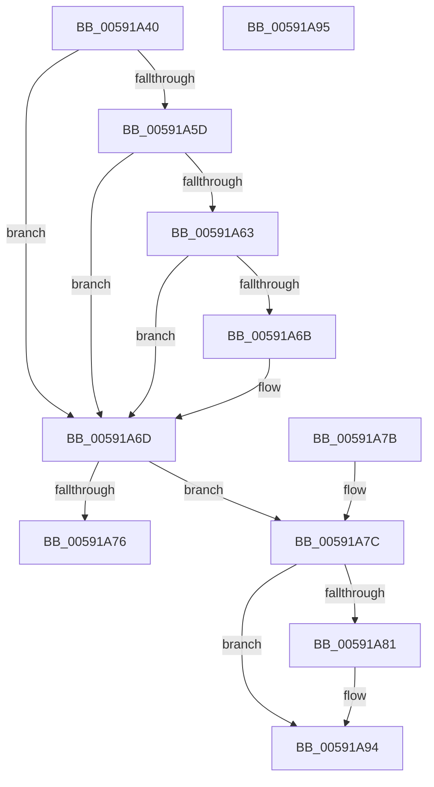

# IoBugCheckDriverDataCallback

- RVA: `0x00591A40`–`0x00591A96` (길이 `86` bytes)
- VA: `0x0000000140591A40`
- 실행 섹션: `.text`
- PDB 이름 있음: `예`; PDB Function 태그: `아니요`
- unwind 정보 RVA: `0x000DB714`
- 디코드: `27`개 명령, `86/86` bytes 표시
- 미해석 바이트: `0` (있으면 어셈블리에 `.byte`로 보존)

> 이 문서는 커널 이미지의 기계어와 PDB 기호를 분석해 생성했습니다. 4번과 5번은 함수 원형과 자료형을 바이너리 사용 방식에서 추정한 C 해석이며 원본 소스 복구 결과는 아닙니다.

## 1. Dependencies

- 직접 호출 지점: **0**; 고유 호출 대상: **0**
- 직접 호출자로 확인된 함수: **0**
- RIP 상대 이미지 참조: **2**

### Outgoing calls
- 직접 디코드된 call 명령이 없습니다.

### Direct callers
- 이 함수 시작 RVA로 연결되는 직접 call은 확인되지 않았습니다. 간접 호출은 완전히 역산할 수 없습니다.

### Static image references
- `0x00591A40` → RVA `0x000277D8` (`.rdata`; read)
- `0x00591A51` → RVA `0x00E667E0` (`.data`; read)

## 2. Other-region calls and transfers

- 다른 실행 섹션으로 향하는 call: **0**
- 별도 외부 분기/꼬리 이동을 확인하지 못했습니다.

## 3. Assembly (complete function range)

```asm
00591A40  0F 10 05 91 5D A9 FF            movups xmm0, xmmword ptr [rip - 0x56a26f]
00591A47  33 D2                           xor edx, edx
00591A49  8B C2                           mov eax, edx
00591A4B  F3 41 0F 7F 40 10               movdqu xmmword ptr [r8 + 0x10], xmm0
00591A51  48 8B 0D 88 4D 8D 00            mov rcx, qword ptr [rip + 0x8d4d88]
00591A58  48 85 C9                        test rcx, rcx
00591A5B  74 10                           je 0x140591a6d
00591A5D  48 39 51 08                     cmp qword ptr [rcx + 8], rdx
00591A61  74 0A                           je 0x140591a6d
00591A63  0F B7 09                        movzx ecx, word ptr [rcx]
00591A66  66 85 C9                        test cx, cx
00591A69  74 02                           je 0x140591a6d
00591A6B  8B C1                           mov eax, ecx
00591A6D  49 8B 48 20                     mov rcx, qword ptr [r8 + 0x20]
00591A71  48 85 C9                        test rcx, rcx
00591A74  75 06                           jne 0x140591a7c
00591A76  41 89 40 28                     mov dword ptr [r8 + 0x28], eax
00591A7A  C3                              ret
00591A7B  CC                              int3
00591A7C  49 3B 08                        cmp rcx, qword ptr [r8]
00591A7F  75 13                           jne 0x140591a94
00591A81  41 89 40 28                     mov dword ptr [r8 + 0x28], eax
00591A85  48 8B 05 54 4D 8D 00            mov rax, qword ptr [rip + 0x8d4d54]
00591A8C  48 8B 48 08                     mov rcx, qword ptr [rax + 8]
00591A90  49 89 48 20                     mov qword ptr [r8 + 0x20], rcx
00591A94  C3                              ret
00591A95  CC                              int3
```

## 4. C-style interpretation (structured pseudocode)

```c
__int64 __fastcall IoBugCheckDriverDataCallback(__int64 a1, int a2, __int64 a3)
{
    __int64 result;

    a2 = 0;
    *(unsigned __int64 *)(a3 + 16) = v_xmm0;
    if (*(unsigned __int64 *)(v_rip + 9260424) == 0) goto loc_00591A6D;
    if ((*(unsigned __int64 *)(*(unsigned __int64 *)(v_rip + 9260424) + 8)) == 0) goto loc_00591A6D;
    result = 0;
    if ((unsigned __int16)(*(unsigned __int16 *)(*(unsigned __int64 *)(v_rip + 9260424))) != 0) {
        result = (unsigned int)(*(unsigned __int16 *)(*(unsigned __int64 *)(v_rip + 9260424)));
    }
    if (*(unsigned __int64 *)(a3 + 32) != 0) goto loc_00591A7C;
    *(unsigned int *)(a3 + 40) = (unsigned int)(result);
    return result;
loc_00591A7C:
    if ((*(unsigned __int64 *)(a3 + 32)) == (*(unsigned __int64 *)(a3))) {
        *(unsigned int *)(a3 + 40) = (unsigned int)(result);
        result = *(unsigned __int64 *)(v_rip + 9260372);
        a1 = *(unsigned __int64 *)(result + 8);
        *(unsigned __int64 *)(a3 + 32) = a1;
    }
    return result;
}
```

## 5. (Beta) C Style

```c
int64_t IoBugCheckDriverDataCallback(int64_t Arg1, int32_t Arg2, void *Arg3)
{
    uint8_t *arg3 = (uint8_t *)Arg3;

    int64_t result;

    Arg2 = 0;
    *(uint64_t *)(arg3 + 0x10) = v_xmm0;
    if (*(uint64_t *)(v_rip + 0x8D4D88) == 0) goto loc_00591A6D;
    if ((*(uint64_t *)(*(uint64_t *)(v_rip + 0x8D4D88) + 0x8)) == 0) goto loc_00591A6D;
    result = 0;
    if ((uint16_t)(*(uint16_t *)(*(uint64_t *)(v_rip + 0x8D4D88))) != 0) {
        result = (uint32_t)(*(uint16_t *)(*(uint64_t *)(v_rip + 0x8D4D88)));
    }
    if (*(uint64_t *)(arg3 + 0x20) != 0) goto loc_00591A7C;
    *(uint32_t *)(arg3 + 0x28) = (uint32_t)(result);
    return result;
loc_00591A7C:
    if ((*(uint64_t *)(arg3 + 0x20)) == (*(uint64_t *)(arg3))) {
        *(uint32_t *)(arg3 + 0x28) = (uint32_t)(result);
        result = *(uint64_t *)(v_rip + 0x8D4D54);
        Arg1 = *(uint64_t *)(result + 0x8);
        *(uint64_t *)(arg3 + 0x20) = Arg1;
    }
    return result;
}
```

### 관측된 메모리 오프셋

구조체 형식이 확인되지 않은 접근은 인자 기준의 오프셋으로만 기록했습니다.

| 기준 인자 | 오프셋 표현 | 폭 (bit) | 접근 |
|---|---:|---:|---|
| `Arg3` | `+ 0x0` | `64` | `R` |
| `Arg3` | `+ 0x10` | `128` | `W` |
| `Arg3` | `+ 0x20` | `64` | `R` |
| `Arg3` | `+ 0x20` | `64` | `W` |
| `Arg3` | `+ 0x28` | `32` | `W` |

## 6. Execution-region graph

[열기: 2D/3D 그래프와 함수 탐색 컨트롤 패널](../../../control-panel.html?section=text&rva=0x00591A40&view=graph)

- 2D 그래프는 위에서 아래로 흐르고, 3D 그래프는 빈 공간을 드래그해 회전합니다. Shift+드래그는 이동, 휠은 확대·축소, 함수 노드 선택은 대상 보고서 이동입니다.

### Static fallback


