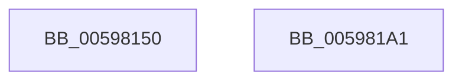

# IoCancelMiniCompletionPacket

- RVA: `0x00598150`–`0x005981A2` (길이 `82` bytes)
- VA: `0x0000000140598150`
- 실행 섹션: `.text`
- PDB 이름 있음: `예`; PDB Function 태그: `아니요`
- unwind 정보 RVA: `0x00065960`
- 디코드: `24`개 명령, `82/82` bytes 표시
- 미해석 바이트: `0` (있으면 어셈블리에 `.byte`로 보존)

> 이 문서는 커널 이미지의 기계어와 PDB 기호를 분석해 생성했습니다. 4번과 5번은 함수 원형과 자료형을 바이너리 사용 방식에서 추정한 C 해석이며 원본 소스 복구 결과는 아닙니다.

## 1. Dependencies

- 직접 호출 지점: **3**; 고유 호출 대상: **3**
- 직접 호출자로 확인된 함수: **0**
- RIP 상대 이미지 참조: **0**

### Outgoing calls
- `0x00598178` → [KeAcquireInStackQueuedSpinLock](../27/KeAcquireInStackQueuedSpinLock_function_002757A0.md) (function, `0x002757A0`)
- `0x00598183` → [KeRemoveQueueEntry](../42/KeRemoveQueueEntry_function_0042F770.md) (function, `0x0042F770`)
- `0x0059818F` → [KeReleaseInStackQueuedSpinLock](../34/KeReleaseInStackQueuedSpinLock_function_00342CE0.md) (function, `0x00342CE0`)

### Direct callers
- 이 함수 시작 RVA로 연결되는 직접 call은 확인되지 않았습니다. 간접 호출은 완전히 역산할 수 없습니다.

### Static image references
- 디코드된 RIP-relative 메모리 참조가 없습니다.

## 2. Other-region calls and transfers

- 다른 실행 섹션으로 향하는 call: **0**
- 별도 외부 분기/꼬리 이동을 확인하지 못했습니다.

## 3. Assembly (complete function range)

```asm
00598150  48 89 5C 24 08                  mov qword ptr [rsp + 8], rbx
00598155  57                              push rdi
00598156  48 83 EC 40                     sub rsp, 0x40
0059815A  48 8B DA                        mov rbx, rdx
0059815D  48 8B F9                        mov rdi, rcx
00598160  0F 57 C0                        xorps xmm0, xmm0
00598163  48 8D 54 24 20                  lea rdx, [rsp + 0x20]
00598168  33 C0                           xor eax, eax
0059816A  48 83 C1 40                     add rcx, 0x40
0059816E  0F 11 44 24 20                  movups xmmword ptr [rsp + 0x20], xmm0
00598173  48 89 44 24 30                  mov qword ptr [rsp + 0x30], rax
00598178  E8 23 D6 CD FF                  call 0x1402757a0
0059817D  48 8B D3                        mov rdx, rbx
00598180  48 8B CF                        mov rcx, rdi
00598183  E8 E8 75 E9 FF                  call 0x14042f770
00598188  48 8D 4C 24 20                  lea rcx, [rsp + 0x20]
0059818D  8A D8                           mov bl, al
0059818F  E8 4C AB DA FF                  call 0x140342ce0
00598194  8A C3                           mov al, bl
00598196  48 8B 5C 24 50                  mov rbx, qword ptr [rsp + 0x50]
0059819B  48 83 C4 40                     add rsp, 0x40
0059819F  5F                              pop rdi
005981A0  C3                              ret
005981A1  CC                              int3
```

## 4. C-style interpretation (structured pseudocode)

```c
__int64 __fastcall IoCancelMiniCompletionPacket(__int64 a1, __int64 a2)
{
    __int64 result;
    __int64 v_rsp;
    unsigned __int64 v_stack_m18;
    unsigned __int64 v_stack_m28;
    unsigned __int64 v_stack_p8;

    v_stack_p8 = v_rbx;
    v_rsp = (v_rsp) - (64);
    result = 0;
    a1 = (a1) + (64);
    v_stack_m28 = v_xmm0;
    v_stack_m18 = 0;
    result = KeAcquireInStackQueuedSpinLock(a1, v_stack_m28, a3, a4);
    result = KeRemoveQueueEntry(a1, a2, a3, a4);
    result = KeReleaseInStackQueuedSpinLock(v_stack_m28, a2, a3, a4);
    v_rsp = (v_rsp) + (64);
    return (unsigned __int8)((unsigned __int8)(result));
}
```

## 5. (Beta) C Style

```c
int64_t IoCancelMiniCompletionPacket(int64_t Arg1, int64_t Arg2)
{
    int64_t result;
    int64_t local_rsp;
    uint64_t v_stack_m18;
    uint64_t v_stack_m28;
    uint64_t v_stack_p8;

    v_stack_p8 = local_rbx;
    local_rsp = (local_rsp) - (64);
    result = 0;
    Arg1 = (Arg1) + (64);
    v_stack_m28 = v_xmm0;
    v_stack_m18 = 0;
    result = KeAcquireInStackQueuedSpinLock(Arg1, v_stack_m28, a3, a4);
    result = KeRemoveQueueEntry(Arg1, Arg2, a3, a4);
    result = KeReleaseInStackQueuedSpinLock(v_stack_m28, Arg2, a3, a4);
    local_rsp = (local_rsp) + (64);
    return (uint8_t)((uint8_t)(result));
}
```

## 6. Execution-region graph

[열기: 2D/3D 그래프와 함수 탐색 컨트롤 패널](../../../control-panel.html?section=text&rva=0x00598150&view=graph)

- 2D 그래프는 위에서 아래로 흐르고, 3D 그래프는 빈 공간을 드래그해 회전합니다. Shift+드래그는 이동, 휠은 확대·축소, 함수 노드 선택은 대상 보고서 이동입니다.

### Static fallback


