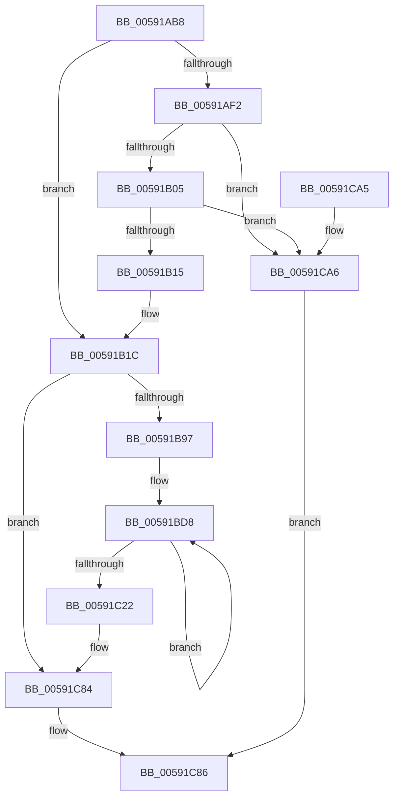

# IoCapturePristineTriageDump

- RVA: `0x00591AB8`–`0x00591CAD` (길이 `501` bytes)
- VA: `0x0000000140591AB8`
- 실행 섹션: `.text`
- PDB 이름 있음: `예`; PDB Function 태그: `아니요`
- unwind 정보 RVA: `0x000C7074`
- 디코드: `115`개 명령, `501/501` bytes 표시
- 미해석 바이트: `0` (있으면 어셈블리에 `.byte`로 보존)

> 이 문서는 커널 이미지의 기계어와 PDB 기호를 분석해 생성했습니다. 4번과 5번은 함수 원형과 자료형을 바이너리 사용 방식에서 추정한 C 해석이며 원본 소스 복구 결과는 아닙니다.

## 1. Dependencies

- 직접 호출 지점: **2**; 고유 호출 대상: **2**
- 직접 호출자로 확인된 함수: **1**
- RIP 상대 이미지 참조: **2**

### Outgoing calls
- `0x00591B49` → [IoFillDumpHeader](IoFillDumpHeader_function_00591ECC.md) (function, `0x00591ECC`)
- `0x00591B88` → [IopCollectTriageDumpData](IopCollectTriageDumpData_function_00594754.md) (function, `0x00594754`)

### Direct callers
- [KiCaptureDumpPreRecovery](../5C/KiCaptureDumpPreRecovery_function_005C74D0.md) at `0x005C757D`

### Static image references
- `0x00591AD5` → RVA `0x00F10898` (`.data`; read)
- `0x00591AF2` → RVA `0x00E66050` (`.data`; read)

## 2. Other-region calls and transfers

- 다른 실행 섹션으로 향하는 call: **0**
- 별도 외부 분기/꼬리 이동을 확인하지 못했습니다.

## 3. Assembly (complete function range)

```asm
00591AB8  48 8B C4                        mov rax, rsp
00591ABB  48 89 58 08                     mov qword ptr [rax + 8], rbx
00591ABF  48 89 68 10                     mov qword ptr [rax + 0x10], rbp
00591AC3  48 89 70 18                     mov qword ptr [rax + 0x18], rsi
00591AC7  48 89 78 20                     mov qword ptr [rax + 0x20], rdi
00591ACB  41 54                           push r12
00591ACD  41 56                           push r14
00591ACF  41 57                           push r15
00591AD1  48 83 EC 50                     sub rsp, 0x50
00591AD5  48 8B 35 BC ED 97 00            mov rsi, qword ptr [rip + 0x97edbc]
00591ADC  4C 8B FA                        mov r15, rdx
00591ADF  49 8B E9                        mov rbp, r9
00591AE2  4D 8B F0                        mov r14, r8
00591AE5  44 8B E1                        mov r12d, ecx
00591AE8  BA 04 00 00 00                  mov edx, 4
00591AED  48 85 F6                        test rsi, rsi
00591AF0  75 2A                           jne 0x140591b1c
00591AF2  48 8B 05 57 45 8D 00            mov rax, qword ptr [rip + 0x8d4557]
00591AF9  39 90 38 05 00 00               cmp dword ptr [rax + 0x538], edx
00591AFF  0F 85 A1 01 00 00               jne 0x140591ca6
00591B05  48 8B B0 30 05 00 00            mov rsi, qword ptr [rax + 0x530]
00591B0C  48 85 F6                        test rsi, rsi
00591B0F  0F 84 91 01 00 00               je 0x140591ca6
00591B15  48 81 C6 00 E0 FF FF            add rsi, -0x2000
00591B1C  48 8B 9C 24 A0 00 00 00         mov rbx, qword ptr [rsp + 0xa0]
00591B24  4D 8B CF                        mov r9, r15
00591B27  48 8B BC 24 90 00 00 00         mov rdi, qword ptr [rsp + 0x90]
00591B2F  45 8B C4                        mov r8d, r12d
00591B32  48 89 5C 24 38                  mov qword ptr [rsp + 0x38], rbx
00591B37  48 8B CE                        mov rcx, rsi
00591B3A  48 89 7C 24 30                  mov qword ptr [rsp + 0x30], rdi
00591B3F  48 89 6C 24 28                  mov qword ptr [rsp + 0x28], rbp
00591B44  4C 89 74 24 20                  mov qword ptr [rsp + 0x20], r14
00591B49  E8 7E 03 00 00                  call 0x140591ecc
00591B4E  48 8D 86 00 20 00 00            lea rax, [rsi + 0x2000]
00591B55  4C 8B CD                        mov r9, rbp
00591B58  48 89 44 24 48                  mov qword ptr [rsp + 0x48], rax
00591B5D  4D 8B C6                        mov r8, r14
00591B60  8A 84 24 A8 00 00 00            mov al, byte ptr [rsp + 0xa8]
00591B67  49 8B D7                        mov rdx, r15
00591B6A  88 44 24 38                     mov byte ptr [rsp + 0x38], al
00591B6E  41 8B CC                        mov ecx, r12d
00591B71  48 89 5C 24 30                  mov qword ptr [rsp + 0x30], rbx
00591B76  48 8B 9C 24 98 00 00 00         mov rbx, qword ptr [rsp + 0x98]
00591B7E  48 89 5C 24 28                  mov qword ptr [rsp + 0x28], rbx
00591B83  48 89 7C 24 20                  mov qword ptr [rsp + 0x20], rdi
00591B88  E8 C7 2B 00 00                  call 0x140594754
00591B8D  8B D0                           mov edx, eax
00591B8F  85 C0                           test eax, eax
00591B91  0F 88 ED 00 00 00               js 0x140591c84
00591B97  0F 57 C0                        xorps xmm0, xmm0
00591B9A  B8 09 00 00 00                  mov eax, 9
00591B9F  0F 11 46 60                     movups xmmword ptr [rsi + 0x60], xmm0
00591BA3  0F 11 46 70                     movups xmmword ptr [rsi + 0x70], xmm0
00591BA7  83 A6 3C 10 00 00 00            and dword ptr [rsi + 0x103c], 0
00591BAE  44 8D 40 77                     lea r8d, [rax + 0x77]
00591BB2  83 8E 50 10 00 00 08            or dword ptr [rsi + 0x1050], 8
00591BB9  C7 86 38 10 00 00 FF 0D 00 00   mov dword ptr [rsi + 0x1038], 0xdff
00591BC3  48 8B 8B F8 00 00 00            mov rcx, qword ptr [rbx + 0xf8]
00591BCA  48 89 8E 10 0F 00 00            mov qword ptr [rsi + 0xf10], rcx
00591BD1  48 8D 8E 48 03 00 00            lea rcx, [rsi + 0x348]
00591BD8  0F 10 03                        movups xmm0, xmmword ptr [rbx]
00591BDB  0F 11 01                        movups xmmword ptr [rcx], xmm0
00591BDE  0F 10 4B 10                     movups xmm1, xmmword ptr [rbx + 0x10]
00591BE2  0F 11 49 10                     movups xmmword ptr [rcx + 0x10], xmm1
00591BE6  0F 10 43 20                     movups xmm0, xmmword ptr [rbx + 0x20]
00591BEA  0F 11 41 20                     movups xmmword ptr [rcx + 0x20], xmm0
00591BEE  0F 10 4B 30                     movups xmm1, xmmword ptr [rbx + 0x30]
00591BF2  0F 11 49 30                     movups xmmword ptr [rcx + 0x30], xmm1
00591BF6  0F 10 43 40                     movups xmm0, xmmword ptr [rbx + 0x40]
00591BFA  0F 11 41 40                     movups xmmword ptr [rcx + 0x40], xmm0
00591BFE  0F 10 4B 50                     movups xmm1, xmmword ptr [rbx + 0x50]
00591C02  0F 11 49 50                     movups xmmword ptr [rcx + 0x50], xmm1
00591C06  0F 10 43 60                     movups xmm0, xmmword ptr [rbx + 0x60]
00591C0A  0F 11 41 60                     movups xmmword ptr [rcx + 0x60], xmm0
00591C0E  49 03 C8                        add rcx, r8
00591C11  0F 10 4B 70                     movups xmm1, xmmword ptr [rbx + 0x70]
00591C15  49 03 D8                        add rbx, r8
00591C18  0F 11 49 F0                     movups xmmword ptr [rcx - 0x10], xmm1
00591C1C  48 83 E8 01                     sub rax, 1
00591C20  75 B6                           jne 0x140591bd8
00591C22  0F 10 03                        movups xmm0, xmmword ptr [rbx]
00591C25  8B 86 04 20 00 00               mov eax, dword ptr [rsi + 0x2004]
00591C2B  05 FF 0F 00 00                  add eax, 0xfff
00591C30  0F 11 01                        movups xmmword ptr [rcx], xmm0
00591C33  25 00 F0 FF FF                  and eax, 0xfffff000
00591C38  0F 10 4B 10                     movups xmm1, xmmword ptr [rbx + 0x10]
00591C3C  0F 11 49 10                     movups xmmword ptr [rcx + 0x10], xmm1
00591C40  0F 10 43 20                     movups xmm0, xmmword ptr [rbx + 0x20]
00591C44  0F 11 41 20                     movups xmmword ptr [rcx + 0x20], xmm0
00591C48  0F 10 4B 30                     movups xmm1, xmmword ptr [rbx + 0x30]
00591C4C  0F 11 49 30                     movups xmmword ptr [rcx + 0x30], xmm1
00591C50  0F 10 43 40                     movups xmm0, xmmword ptr [rbx + 0x40]
00591C54  89 86 04 20 00 00               mov dword ptr [rsi + 0x2004], eax
00591C5A  05 FC DF FF FF                  add eax, 0xffffdffc
00591C5F  0F 11 41 40                     movups xmmword ptr [rcx + 0x40], xmm0
00591C63  C7 84 30 00 20 00 00 54 52 47 44  mov dword ptr [rax + rsi + 0x2000], 0x44475254
00591C6E  8B 8E 04 20 00 00               mov ecx, dword ptr [rsi + 0x2004]
00591C74  48 89 8E A0 0F 00 00            mov qword ptr [rsi + 0xfa0], rcx
00591C7B  8D 41 FC                        lea eax, [rcx - 4]
00591C7E  89 86 08 20 00 00               mov dword ptr [rsi + 0x2008], eax
00591C84  8B C2                           mov eax, edx
00591C86  4C 8D 5C 24 50                  lea r11, [rsp + 0x50]
00591C8B  49 8B 5B 20                     mov rbx, qword ptr [r11 + 0x20]
00591C8F  49 8B 6B 28                     mov rbp, qword ptr [r11 + 0x28]
00591C93  49 8B 73 30                     mov rsi, qword ptr [r11 + 0x30]
00591C97  49 8B 7B 38                     mov rdi, qword ptr [r11 + 0x38]
00591C9B  49 8B E3                        mov rsp, r11
00591C9E  41 5F                           pop r15
00591CA0  41 5E                           pop r14
00591CA2  41 5C                           pop r12
00591CA4  C3                              ret
00591CA5  CC                              int3
00591CA6  B8 9A 00 00 C0                  mov eax, 0xc000009a
00591CAB  EB D9                           jmp 0x140591c86
```

## 4. C-style interpretation (structured pseudocode)

```c
__int64 __fastcall IoCapturePristineTriageDump(int a1, __int64 a2, __int64 a3, __int64 a4, __int64 a5, __int64 a6, __int64 a7, unsigned __int8 a8)
{
    __int64 result;
    __int64 v_rbx;
    __int64 v_rsi;
    __int64 v_rsp;
    unsigned __int64 v_stack_m18;
    unsigned __int64 v_stack_m20;
    unsigned __int64 v_stack_m30;
    unsigned __int64 v_stack_m38;
    unsigned __int64 v_stack_m40;
    unsigned __int64 v_stack_m48;

    *(unsigned __int64 *)(v_rsp + 8) = v_rbx;
    *(unsigned __int64 *)(v_rsp + 16) = v_rbp;
    *(unsigned __int64 *)(v_rsp + 24) = v_rsi;
    *(unsigned __int64 *)(v_rsp + 32) = v_rdi;
    v_rsp = (v_rsp) - (80);
    if (*(unsigned __int64 *)(v_rip + 9956796) != 0) goto loc_00591B1C;
    if ((*(unsigned int *)(*(unsigned __int64 *)(v_rip + 9258327) + 1336)) != 4) goto loc_00591CA6;
    if (*(unsigned __int64 *)(*(unsigned __int64 *)(v_rip + 9258327) + 1328) == 0) goto loc_00591CA6;
    v_rsi = (*(unsigned __int64 *)(*(unsigned __int64 *)(v_rip + 9258327) + 1328)) + (0xFFFFFFFFFFFFE000ULL);
loc_00591B1C:
    v_stack_m30 = a7;
    v_stack_m38 = a5;
    v_stack_m40 = a4;
    v_stack_m48 = a3;
    result = IoFillDumpHeader(v_rsi, 4, (unsigned int)((unsigned int)((unsigned int)(a1))), a2);
    v_stack_m20 = v_rsi + 8192;
    v_stack_m30 = a8;
    v_stack_m38 = a7;
    v_stack_m40 = a6;
    v_stack_m48 = a5;
    result = IopCollectTriageDumpData((unsigned int)((unsigned int)((unsigned int)(a1))), a2, a3, a4);
    if (sign_flag) goto loc_00591C84;
    *(unsigned __int64 *)(v_rsi + 96) = v_xmm0;
    *(unsigned __int64 *)(v_rsi + 112) = v_xmm0;
    *(unsigned int *)(v_rsi + 4152) = 0xDFFULL;
    *(unsigned __int64 *)(v_rsi + 3856) = *(unsigned __int64 *)(a6 + 248);
loc_00591BD8:
    *(unsigned __int64 *)(v_rsi + 840) = v_xmm0;
    *(unsigned __int64 *)(v_rsi + 840 + 16) = v_xmm1;
    *(unsigned __int64 *)(v_rsi + 840 + 32) = v_xmm0;
    *(unsigned __int64 *)(v_rsi + 840 + 48) = v_xmm1;
    *(unsigned __int64 *)(v_rsi + 840 + 64) = v_xmm0;
    *(unsigned __int64 *)(v_rsi + 840 + 80) = v_xmm1;
    *(unsigned __int64 *)(v_rsi + 840 + 96) = v_xmm0;
    a1 = (v_rsi + 840) + (9 + 119);
    v_rbx = (a6) + (9 + 119);
    *(unsigned __int64 *)(a1 - 16) = v_xmm1;
    result = (9) - (1);
    if (condition_is_not_equal) goto loc_00591BD8;
    result = (unsigned int)(((unsigned int)(*(unsigned int *)(v_rsi + 8196))) + (0xFFFULL));
    *(unsigned __int64 *)(a1) = v_xmm0;
    result = (unsigned int)((result) & (0xFFFFF000ULL));
    *(unsigned __int64 *)(a1 + 16) = v_xmm1;
    *(unsigned __int64 *)(a1 + 32) = v_xmm0;
    *(unsigned __int64 *)(a1 + 48) = v_xmm1;
    *(unsigned int *)(v_rsi + 8196) = (unsigned int)(result);
    result = (unsigned int)((result) + (0xFFFFDFFCULL));
    *(unsigned __int64 *)(a1 + 64) = v_xmm0;
    *(unsigned int *)(result + v_rsi * 1 + 8192) = 0x44475254ULL;
    *(unsigned __int64 *)(v_rsi + 4000) = (unsigned int)(*(unsigned int *)(v_rsi + 8196));
    *(unsigned int *)(v_rsi + 8200) = (unsigned int)((unsigned int)(*(unsigned int *)(v_rsi + 8196)) - 4);
loc_00591C84:
loc_00591C86:
    return (unsigned int)((unsigned int)((unsigned int)((unsigned int)(result))));
loc_00591CA6:
    goto loc_00591C86;
}
```

## 5. (Beta) C Style

```c
int64_t IoCapturePristineTriageDump(int32_t Arg1, int64_t Arg2, int64_t Arg3, int64_t Arg4, int64_t Arg5, void *Arg6, int64_t Arg7, uint8_t Arg8)
{
    uint8_t *arg6 = (uint8_t *)Arg6;

    int64_t result;
    int64_t local_rbx;
    int64_t local_rsi;
    int64_t local_rsp;
    uint64_t v_stack_m18;
    uint64_t v_stack_m20;
    uint64_t v_stack_m30;
    uint64_t v_stack_m38;
    uint64_t v_stack_m40;
    uint64_t v_stack_m48;

    *(uint64_t *)(local_rsp + 0x8) = local_rbx;
    *(uint64_t *)(local_rsp + 0x10) = local_rbp;
    *(uint64_t *)(local_rsp + 0x18) = local_rsi;
    *(uint64_t *)(local_rsp + 0x20) = local_rdi;
    local_rsp = (local_rsp) - (80);
    if (*(uint64_t *)(v_rip + 0x97EDBC) != 0) goto loc_00591B1C;
    if ((*(uint32_t *)(*(uint64_t *)(v_rip + 0x8D4557) + 0x538)) != 4) goto loc_00591CA6;
    if (*(uint64_t *)(*(uint64_t *)(v_rip + 0x8D4557) + 0x530) == 0) goto loc_00591CA6;
    local_rsi = (*(uint64_t *)(*(uint64_t *)(v_rip + 0x8D4557) + 0x530)) + (0xFFFFFFFFFFFFE000ULL);
loc_00591B1C:
    v_stack_m30 = Arg7;
    v_stack_m38 = Arg5;
    v_stack_m40 = Arg4;
    v_stack_m48 = Arg3;
    result = IoFillDumpHeader(local_rsi, 4, (uint32_t)((uint32_t)((uint32_t)(Arg1))), Arg2);
    v_stack_m20 = local_rsi + 8192;
    v_stack_m30 = Arg8;
    v_stack_m38 = Arg7;
    v_stack_m40 = Arg6;
    v_stack_m48 = Arg5;
    result = IopCollectTriageDumpData((uint32_t)((uint32_t)((uint32_t)(Arg1))), Arg2, Arg3, Arg4);
    if (sign_flag) goto loc_00591C84;
    *(uint64_t *)(local_rsi + 0x60) = v_xmm0;
    *(uint64_t *)(local_rsi + 0x70) = v_xmm0;
    *(uint32_t *)(local_rsi + 0x1038) = 0xDFFULL;
    *(uint64_t *)(local_rsi + 0xF10) = *(uint64_t *)(arg6 + 0xF8);
loc_00591BD8:
    *(uint64_t *)(local_rsi + 0x348) = v_xmm0;
    *(uint64_t *)(local_rsi + 0x348 + 0x10) = v_xmm1;
    *(uint64_t *)(local_rsi + 0x348 + 0x20) = v_xmm0;
    *(uint64_t *)(local_rsi + 0x348 + 0x30) = v_xmm1;
    *(uint64_t *)(local_rsi + 0x348 + 0x40) = v_xmm0;
    *(uint64_t *)(local_rsi + 0x348 + 0x50) = v_xmm1;
    *(uint64_t *)(local_rsi + 0x348 + 0x60) = v_xmm0;
    Arg1 = (local_rsi + 840) + (9 + 119);
    local_rbx = (Arg6) + (9 + 119);
    *(uint64_t *)(Arg1 - 0x10) = v_xmm1;
    result = (9) - (1);
    if (condition_is_not_equal) goto loc_00591BD8;
    result = (uint32_t)(((uint32_t)(*(uint32_t *)(local_rsi + 0x2004))) + (0xFFFULL));
    *(uint64_t *)(Arg1) = v_xmm0;
    result = (uint32_t)((result) & (0xFFFFF000ULL));
    *(uint64_t *)(Arg1 + 0x10) = v_xmm1;
    *(uint64_t *)(Arg1 + 0x20) = v_xmm0;
    *(uint64_t *)(Arg1 + 0x30) = v_xmm1;
    *(uint32_t *)(local_rsi + 0x2004) = (uint32_t)(result);
    result = (uint32_t)((result) + (0xFFFFDFFCULL));
    *(uint64_t *)(Arg1 + 0x40) = v_xmm0;
    *(uint32_t *)(result + local_rsi * 1 + 0x2000) = 0x44475254ULL;
    *(uint64_t *)(local_rsi + 0xFA0) = (uint32_t)(*(uint32_t *)(local_rsi + 0x2004));
    *(uint32_t *)(local_rsi + 0x2008) = (uint32_t)((uint32_t)(*(uint32_t *)(local_rsi + 0x2004)) - 4);
loc_00591C84:
loc_00591C86:
    return (uint32_t)((uint32_t)((uint32_t)((uint32_t)(result))));
loc_00591CA6:
    goto loc_00591C86;
}
```

### 관측된 메모리 오프셋

구조체 형식이 확인되지 않은 접근은 인자 기준의 오프셋으로만 기록했습니다.

| 기준 인자 | 오프셋 표현 | 폭 (bit) | 접근 |
|---|---:|---:|---|
| `Arg6` | `+ 0x0` | `128` | `R` |
| `Arg6` | `+ 0x10` | `128` | `R` |
| `Arg6` | `+ 0x20` | `128` | `R` |
| `Arg6` | `+ 0x30` | `128` | `R` |
| `Arg6` | `+ 0x40` | `128` | `R` |
| `Arg6` | `+ 0x50` | `128` | `R` |
| `Arg6` | `+ 0x60` | `128` | `R` |
| `Arg6` | `+ 0x70` | `128` | `R` |
| `Arg6` | `+ 0xF8` | `64` | `R` |

## 6. Execution-region graph

[열기: 2D/3D 그래프와 함수 탐색 컨트롤 패널](../../../control-panel.html?section=text&rva=0x00591AB8&view=graph)

- 2D 그래프는 위에서 아래로 흐르고, 3D 그래프는 빈 공간을 드래그해 회전합니다. Shift+드래그는 이동, 휠은 확대·축소, 함수 노드 선택은 대상 보고서 이동입니다.

### Static fallback


