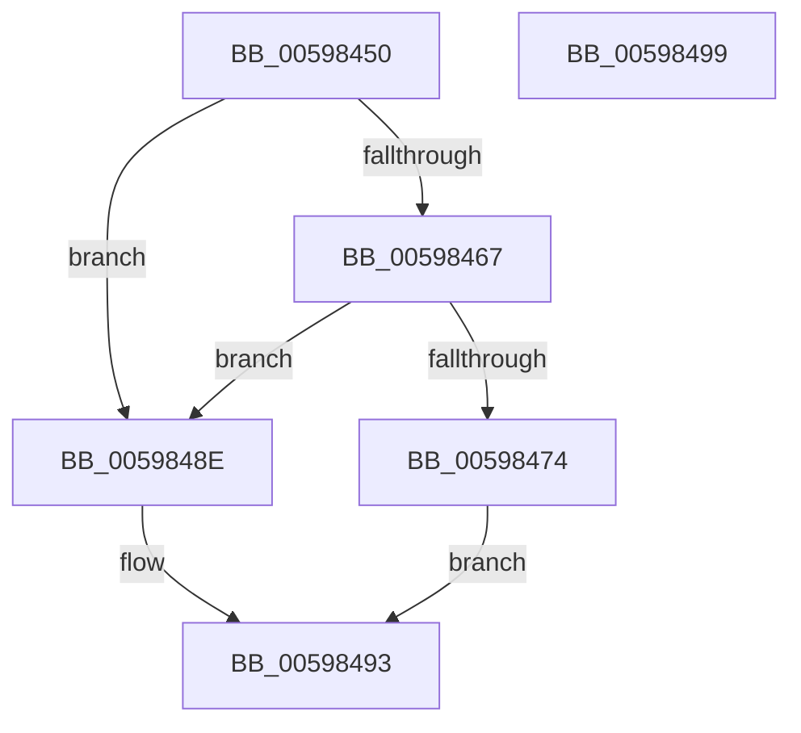

# IoClearAdapterCryptoEngineExtension

- RVA: `0x00598450`–`0x0059849A` (길이 `74` bytes)
- VA: `0x0000000140598450`
- 실행 섹션: `.text`
- PDB 이름 있음: `예`; PDB Function 태그: `아니요`
- unwind 정보 RVA: `0x0005CF00`
- 디코드: `24`개 명령, `74/74` bytes 표시
- 미해석 바이트: `0` (있으면 어셈블리에 `.byte`로 보존)

> 이 문서는 커널 이미지의 기계어와 PDB 기호를 분석해 생성했습니다. 4번과 5번은 함수 원형과 자료형을 바이너리 사용 방식에서 추정한 C 해석이며 원본 소스 복구 결과는 아닙니다.

## 1. Dependencies

- 직접 호출 지점: **3**; 고유 호출 대상: **3**
- 직접 호출자로 확인된 함수: **0**
- RIP 상대 이미지 참조: **0**

### Outgoing calls
- `0x0059845E` → [IopIrpHasExtensionType](../3F/IopIrpHasExtensionType_function_003F4080.md) (function, `0x003F4080`)
- `0x0059846A` → [IopAllocateIrpExtension](../44/IopAllocateIrpExtension_function_00444F30.md) (function, `0x00444F30`)
- `0x00598485` → [IopFreeIrpExtension](../24/IopFreeIrpExtension_function_0024EDB0.md) (function, `0x0024EDB0`)

### Direct callers
- 이 함수 시작 RVA로 연결되는 직접 call은 확인되지 않았습니다. 간접 호출은 완전히 역산할 수 없습니다.

### Static image references
- 디코드된 RIP-relative 메모리 참조가 없습니다.

## 2. Other-region calls and transfers

- 다른 실행 섹션으로 향하는 call: **0**
- 별도 외부 분기/꼬리 이동을 확인하지 못했습니다.

## 3. Assembly (complete function range)

```asm
00598450  40 53                           push rbx
00598452  48 83 EC 20                     sub rsp, 0x20
00598456  BA 07 00 00 00                  mov edx, 7
0059845B  48 8B D9                        mov rbx, rcx
0059845E  E8 1D BC E5 FF                  call 0x1403f4080
00598463  84 C0                           test al, al
00598465  74 27                           je 0x14059848e
00598467  48 8B CB                        mov rcx, rbx
0059846A  E8 C1 CA EA FF                  call 0x140444f30
0059846F  48 85 C0                        test rax, rax
00598472  74 1A                           je 0x14059848e
00598474  45 33 C0                        xor r8d, r8d
00598477  0F 57 C0                        xorps xmm0, xmm0
0059847A  48 8B CB                        mov rcx, rbx
0059847D  0F 11 40 28                     movups xmmword ptr [rax + 0x28], xmm0
00598481  41 8D 50 07                     lea edx, [r8 + 7]
00598485  E8 26 69 CB FF                  call 0x14024edb0
0059848A  33 C0                           xor eax, eax
0059848C  EB 05                           jmp 0x140598493
0059848E  B8 25 02 00 C0                  mov eax, 0xc0000225
00598493  48 83 C4 20                     add rsp, 0x20
00598497  5B                              pop rbx
00598498  C3                              ret
00598499  CC                              int3
```

## 4. C-style interpretation (structured pseudocode)

```c
__int64 __fastcall IoClearAdapterCryptoEngineExtension(__int64 a1, __int64 a2, int a3)
{
    __int64 result;
    __int64 v_rsp;

    v_rsp = (v_rsp) - (32);
    result = IopIrpHasExtensionType(a1, 7, a3, a4);
    if ((unsigned __int8)(result) == 0) goto loc_0059848E;
    result = IopAllocateIrpExtension(a1, 7, a3, a4);
    if (result == 0) goto loc_0059848E;
    a3 = 0;
    *(unsigned __int64 *)(result + 40) = v_xmm0;
    result = IopFreeIrpExtension(a1, a3 + 7, a3, a4);
    result = 0;
    goto loc_00598493;
loc_0059848E:
loc_00598493:
    v_rsp = (v_rsp) + (32);
    return (unsigned int)(0xC0000225ULL);
}
```

## 5. (Beta) C Style

```c
int64_t IoClearAdapterCryptoEngineExtension(int64_t Arg1, int64_t Arg2, int32_t Arg3)
{
    int64_t result;
    int64_t local_rsp;

    local_rsp = (local_rsp) - (32);
    result = IopIrpHasExtensionType(Arg1, 7, Arg3, a4);
    if ((uint8_t)(result) == 0) goto loc_0059848E;
    result = IopAllocateIrpExtension(Arg1, 7, Arg3, a4);
    if (result == 0) goto loc_0059848E;
    Arg3 = 0;
    *(uint64_t *)(result + 0x28) = v_xmm0;
    result = IopFreeIrpExtension(Arg1, Arg3 + 7, Arg3, a4);
    result = 0;
    goto loc_00598493;
loc_0059848E:
loc_00598493:
    local_rsp = (local_rsp) + (32);
    return (uint32_t)(0xC0000225ULL);
}
```

## 6. Execution-region graph

[열기: 2D/3D 그래프와 함수 탐색 컨트롤 패널](../../../control-panel.html?section=text&rva=0x00598450&view=graph)

- 2D 그래프는 위에서 아래로 흐르고, 3D 그래프는 빈 공간을 드래그해 회전합니다. Shift+드래그는 이동, 휠은 확대·축소, 함수 노드 선택은 대상 보고서 이동입니다.

### Static fallback


