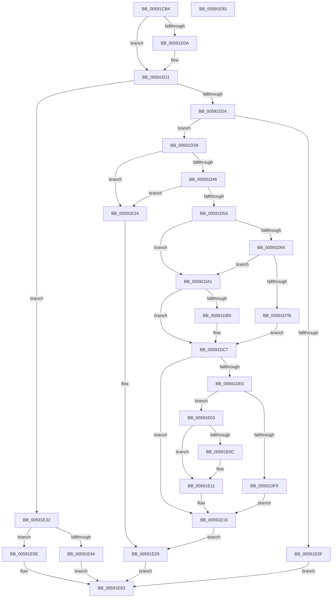

# IoConfigureCrashDump

- RVA: `0x00591CB4`–`0x00591E94` (길이 `480` bytes)
- VA: `0x0000000140591CB4`
- 실행 섹션: `.text`
- PDB 이름 있음: `예`; PDB Function 태그: `아니요`
- unwind 정보 RVA: `0x000C6FF0`
- 디코드: `124`개 명령, `480/480` bytes 표시
- 미해석 바이트: `0` (있으면 어셈블리에 `.byte`로 보존)

> 이 문서는 커널 이미지의 기계어와 PDB 기호를 분석해 생성했습니다. 4번과 5번은 함수 원형과 자료형을 바이너리 사용 방식에서 추정한 C 해석이며 원본 소스 복구 결과는 아닙니다.

## 1. Dependencies

- 직접 호출 지점: **18**; 고유 호출 대상: **14**
- 직접 호출자로 확인된 함수: **5**
- RIP 상대 이미지 참조: **8**

### Outgoing calls
- `0x00591D0C` → [IopReadDumpRegistry](IopReadDumpRegistry_function_00595CE0.md) (function, `0x00595CE0`)
- `0x00591D57` → [MmGetPageFileForCrashDump](../../page/80/MmGetPageFileForCrashDump_function_00800770.md) (function, `0x00800770`)
- `0x00591D72` → [RtlPrefixUnicodeString](../../page/8F/RtlPrefixUnicodeString_function_008F4F70.md) (function, `0x008F4F70`)
- `0x00591DA9` → [RtlInitUnicodeString](../42/RtlInitUnicodeString_function_0042A780.md) (function, `0x0042A780`)
- `0x00591DAE` → [RtlGetHostNtSystemRoot](../../page/AB/RtlGetHostNtSystemRoot_function_00AB7800.md) (function, `0x00AB7800`)
- `0x00591DD0` → [ExAcquireResourceExclusiveLite](../21/ExAcquireResourceExclusiveLite_function_00214E20.md) (function, `0x00214E20`)
- `0x00591DD5` → [IopDisableCrashDump](IopDisableCrashDump_function_005949A0.md) (function, `0x005949A0`)
- `0x00591DF0` → [IopInitializeCrashDump](../../page/71/IopInitializeCrashDump_function_0071A270.md) (function, `0x0071A270`)
- `0x00591DF9` → [IopRemoveDumpCapsuleSupport](IopRemoveDumpCapsuleSupport_function_00595E6C.md) (function, `0x00595E6C`)
- `0x00591E0C` → [IopInitDumpCapsuleSupport](IopInitDumpCapsuleSupport_function_0059578C.md) (function, `0x0059578C`)
- `0x00591E1D` → [ExReleaseResourceLite](../25/ExReleaseResourceLite_function_0025FA10.md) (function, `0x0025FA10`)
- `0x00591E2B` → [IopDumpTraceCrashDumpReconfiguration](IopDumpTraceCrashDumpReconfiguration_function_00594D68.md) (function, `0x00594D68`)
- `0x00591E3B` → [ExAcquireResourceExclusiveLite](../21/ExAcquireResourceExclusiveLite_function_00214E20.md) (function, `0x00214E20`)
- `0x00591E44` → [IopDisableCrashDump](IopDisableCrashDump_function_005949A0.md) (function, `0x005949A0`)
- `0x00591E4B` → [IopRemoveDumpCapsuleSupport](IopRemoveDumpCapsuleSupport_function_00595E6C.md) (function, `0x00595E6C`)
- `0x00591E57` → [ExReleaseResourceLite](../25/ExReleaseResourceLite_function_0025FA10.md) (function, `0x0025FA10`)
- `0x00591E66` → [KiLeaveCriticalRegionUnsafe](../25/KiLeaveCriticalRegionUnsafe_function_0025F010.md) (function, `0x0025F010`)
- `0x00591E74` → [_security_check_cookie](../6A/_security_check_cookie_function_006AC640.md) (function, `0x006AC640`)

### Direct callers
- [IopCrashDumpPolicyChangeWnfCallback](../../page/71/IopCrashDumpPolicyChangeWnfCallback_function_00719E40.md) at `0x00719F63`
- [PoShutdownBugCheck](../../page/75/PoShutdownBugCheck_function_0075E580.md) at `0x0075E5F9`
- [NtSetSystemInformation](../../page/AF/NtSetSystemInformation_function_00AF4A60.md) at `0x00AF50B2`
- [sub_00B80364](../../pagelk/B8/Unknown_function_00B80364.md) at `0x00B803AA`
- [IopInitCrashDumpDuringSysInit](../../init/C2/IopInitCrashDumpDuringSysInit_function_00C2CAE4.md) at `0x00C2CBA6`

### Static image references
- `0x00591CCF` → RVA `0x00E0A740` (`.data`; read)
- `0x00591CEC` → RVA `0x006C9C80` (` ?? ::FNODOBFM::`string'`; read)
- `0x00591CF7` → RVA `0x006C9C90` (`.text`; read)
- `0x00591D39` → RVA `0x00E660BC` (`.data`; read)
- `0x00591D46` → RVA `0x00E0A9BA` (`.data`; read)
- `0x00591D6B` → RVA `0x00009EC8` (`.rdata`; read)
- `0x00591DC9` → RVA `0x00F8E900` (`.data`; read)
- `0x00591E03` → RVA `0x00E0A9B9` (`.data`; read)

## 2. Other-region calls and transfers

- 다른 실행 섹션으로 향하는 call: **4**
  - `0x00591D57` → [MmGetPageFileForCrashDump](../../page/80/MmGetPageFileForCrashDump_function_00800770.md) (`.text` → `PAGE`)
  - `0x00591D72` → [RtlPrefixUnicodeString](../../page/8F/RtlPrefixUnicodeString_function_008F4F70.md) (`.text` → `PAGE`)
  - `0x00591DAE` → [RtlGetHostNtSystemRoot](../../page/AB/RtlGetHostNtSystemRoot_function_00AB7800.md) (`.text` → `PAGE`)
  - `0x00591DF0` → [IopInitializeCrashDump](../../page/71/IopInitializeCrashDump_function_0071A270.md) (`.text` → `PAGE`)
- 별도 외부 분기/꼬리 이동을 확인하지 못했습니다.

## 3. Assembly (complete function range)

```asm
00591CB4  48 8B C4                        mov rax, rsp
00591CB7  48 89 58 08                     mov qword ptr [rax + 8], rbx
00591CBB  48 89 70 10                     mov qword ptr [rax + 0x10], rsi
00591CBF  48 89 78 18                     mov qword ptr [rax + 0x18], rdi
00591CC3  4C 89 70 20                     mov qword ptr [rax + 0x20], r14
00591CC7  55                              push rbp
00591CC8  48 8B EC                        mov rbp, rsp
00591CCB  48 83 EC 70                     sub rsp, 0x70
00591CCF  48 8B 05 6A 8A 87 00            mov rax, qword ptr [rip + 0x878a6a]
00591CD6  48 33 C4                        xor rax, rsp
00591CD9  48 89 45 F0                     mov qword ptr [rbp - 0x10], rax
00591CDD  0F 57 C0                        xorps xmm0, xmm0
00591CE0  0F 57 C9                        xorps xmm1, xmm1
00591CE3  0F 11 45 C0                     movups xmmword ptr [rbp - 0x40], xmm0
00591CE7  45 33 F6                        xor r14d, r14d
00591CEA  8B D9                           mov ebx, ecx
00591CEC  0F 10 05 8D 7F 13 00            movups xmm0, xmmword ptr [rip + 0x137f8d]
00591CF3  0F 11 4D B0                     movups xmmword ptr [rbp - 0x50], xmm1
00591CF7  0F 10 0D 92 7F 13 00            movups xmm1, xmmword ptr [rip + 0x137f92]
00591CFE  0F 11 45 D0                     movups xmmword ptr [rbp - 0x30], xmm0
00591D02  0F 11 4D E0                     movups xmmword ptr [rbp - 0x20], xmm1
00591D06  84 D2                           test dl, dl
00591D08  75 07                           jne 0x140591d11
00591D0A  33 D2                           xor edx, edx
00591D0C  E8 CF 3F 00 00                  call 0x140595ce0
00591D11  65 48 8B 3C 25 88 01 00 00      mov rdi, qword ptr gs:[0x188]
00591D1A  66 FF 8F E4 01 00 00            dec word ptr [rdi + 0x1e4]
00591D21  90                              nop
00591D22  85 DB                           test ebx, ebx
00591D24  0F 84 08 01 00 00               je 0x140591e32
00591D2A  83 FB 01                        cmp ebx, 1
00591D2D  74 0A                           je 0x140591d39
00591D2F  BB 10 00 00 C0                  mov ebx, 0xc0000010
00591D34  E9 2A 01 00 00                  jmp 0x140591e63
00591D39  44 38 35 7C 43 8D 00            cmp byte ptr [rip + 0x8d437c], r14b
00591D40  0F 85 DE 00 00 00               jne 0x140591e24
00591D46  44 38 35 6D 8C 87 00            cmp byte ptr [rip + 0x878c6d], r14b
00591D4D  0F 84 D1 00 00 00               je 0x140591e24
00591D53  48 8D 4D B0                     lea rcx, [rbp - 0x50]
00591D57  E8 14 EA 26 00                  call 0x140800770
00591D5C  48 8B F0                        mov rsi, rax
00591D5F  48 85 C0                        test rax, rax
00591D62  74 3D                           je 0x140591da1
00591D64  41 B0 01                        mov r8b, 1
00591D67  48 8D 55 B0                     lea rdx, [rbp - 0x50]
00591D6B  48 8D 0D 56 81 A7 FF            lea rcx, [rip - 0x587eaa]
00591D72  E8 F9 31 36 00                  call 0x1408f4f70
00591D77  84 C0                           test al, al
00591D79  74 26                           je 0x140591da1
00591D7B  48 8B 45 B8                     mov rax, qword ptr [rbp - 0x48]
00591D7F  48 83 C0 08                     add rax, 8
00591D83  48 89 45 C8                     mov qword ptr [rbp - 0x38], rax
00591D87  0F B7 45 B0                     movzx eax, word ptr [rbp - 0x50]
00591D8B  66 83 E8 08                     sub ax, 8
00591D8F  66 89 45 C0                     mov word ptr [rbp - 0x40], ax
00591D93  0F B7 45 B2                     movzx eax, word ptr [rbp - 0x4e]
00591D97  66 83 E8 08                     sub ax, 8
00591D9B  66 89 45 C2                     mov word ptr [rbp - 0x3e], ax
00591D9F  EB 26                           jmp 0x140591dc7
00591DA1  48 8D 55 D0                     lea rdx, [rbp - 0x30]
00591DA5  48 8D 4D C0                     lea rcx, [rbp - 0x40]
00591DA9  E8 D2 89 E9 FF                  call 0x14042a780
00591DAE  E8 4D 5A 52 00                  call 0x140ab7800
00591DB3  66 44 39 30                     cmp word ptr [rax], r14w
00591DB7  76 0E                           jbe 0x140591dc7
00591DB9  48 8B 40 08                     mov rax, qword ptr [rax + 8]
00591DBD  0F B7 08                        movzx ecx, word ptr [rax]
00591DC0  48 8B 45 C8                     mov rax, qword ptr [rbp - 0x38]
00591DC4  66 89 08                        mov word ptr [rax], cx
00591DC7  B2 01                           mov dl, 1
00591DC9  48 8D 0D 30 CB 9F 00            lea rcx, [rip + 0x9fcb30]
00591DD0  E8 4B 30 C8 FF                  call 0x140214e20
00591DD5  E8 C6 2B 00 00                  call 0x1405949a0
00591DDA  8B D8                           mov ebx, eax
00591DDC  85 C0                           test eax, eax
00591DDE  78 36                           js 0x140591e16
00591DE0  0F 28 45 C0                     movaps xmm0, xmmword ptr [rbp - 0x40]
00591DE4  48 8D 55 B0                     lea rdx, [rbp - 0x50]
00591DE8  48 8B CE                        mov rcx, rsi
00591DEB  66 0F 7F 45 B0                  movdqa xmmword ptr [rbp - 0x50], xmm0
00591DF0  E8 7B 84 18 00                  call 0x14071a270
00591DF5  84 C0                           test al, al
00591DF7  74 0A                           je 0x140591e03
00591DF9  E8 6E 40 00 00                  call 0x140595e6c
00591DFE  41 8B DE                        mov ebx, r14d
00591E01  EB 13                           jmp 0x140591e16
00591E03  44 38 35 AF 8B 87 00            cmp byte ptr [rip + 0x878baf], r14b
00591E0A  74 05                           je 0x140591e11
00591E0C  E8 7B 39 00 00                  call 0x14059578c
00591E11  BB 01 00 00 C0                  mov ebx, 0xc0000001
00591E16  48 8D 0D E3 CA 9F 00            lea rcx, [rip + 0x9fcae3]
00591E1D  E8 EE DB CC FF                  call 0x14025fa10
00591E22  EB 05                           jmp 0x140591e29
00591E24  BB BB 00 00 C0                  mov ebx, 0xc00000bb
00591E29  8B CB                           mov ecx, ebx
00591E2B  E8 38 2F 00 00                  call 0x140594d68
00591E30  EB 31                           jmp 0x140591e63
00591E32  B2 01                           mov dl, 1
00591E34  48 8D 0D C5 CA 9F 00            lea rcx, [rip + 0x9fcac5]
00591E3B  E8 E0 2F C8 FF                  call 0x140214e20
00591E40  84 C0                           test al, al
00591E42  74 1A                           je 0x140591e5e
00591E44  E8 57 2B 00 00                  call 0x1405949a0
00591E49  8B D8                           mov ebx, eax
00591E4B  E8 1C 40 00 00                  call 0x140595e6c
00591E50  48 8D 0D A9 CA 9F 00            lea rcx, [rip + 0x9fcaa9]
00591E57  E8 B4 DB CC FF                  call 0x14025fa10
00591E5C  EB 05                           jmp 0x140591e63
00591E5E  BB 01 00 00 C0                  mov ebx, 0xc0000001
00591E63  48 8B CF                        mov rcx, rdi
00591E66  E8 A5 D1 CC FF                  call 0x14025f010
00591E6B  8B C3                           mov eax, ebx
00591E6D  48 8B 4D F0                     mov rcx, qword ptr [rbp - 0x10]
00591E71  48 33 CC                        xor rcx, rsp
00591E74  E8 C7 A7 11 00                  call 0x1406ac640
00591E79  4C 8D 5C 24 70                  lea r11, [rsp + 0x70]
00591E7E  49 8B 5B 10                     mov rbx, qword ptr [r11 + 0x10]
00591E82  49 8B 73 18                     mov rsi, qword ptr [r11 + 0x18]
00591E86  49 8B 7B 20                     mov rdi, qword ptr [r11 + 0x20]
00591E8A  4D 8B 73 28                     mov r14, qword ptr [r11 + 0x28]
00591E8E  49 8B E3                        mov rsp, r11
00591E91  5D                              pop rbp
00591E92  C3                              ret
00591E93  CC                              int3
```

## 4. C-style interpretation (structured pseudocode)

```c
__int64 __fastcall IoConfigureCrashDump(int a1, int a2)
{
    __int64 result;
    __int64 v_r14;
    __int64 v_rsp;
    unsigned __int64 v_stack_m18;
    unsigned __int64 v_stack_m28;
    unsigned __int64 v_stack_m38;
    unsigned __int64 v_stack_m40;
    unsigned __int16 v_stack_m46;
    unsigned __int64 v_stack_m48;
    unsigned __int64 v_stack_m50;
    unsigned __int16 v_stack_m56;
    unsigned __int64 v_stack_m58;
    unsigned __int64 v_stack_m8;

    *(unsigned __int64 *)(v_rsp + 8) = v_rbx;
    *(unsigned __int64 *)(v_rsp + 16) = v_rsi;
    *(unsigned __int64 *)(v_rsp + 24) = v_rdi;
    *(unsigned __int64 *)(v_rsp + 32) = v_r14;
    v_rsp = (v_rsp) - (112);
    result = (*(unsigned __int64 *)(v_rip + 8882794)) ^ (v_rsp);
    v_stack_m18 = result;
    v_stack_m48 = v_xmm0;
    v_r14 = 0;
    v_stack_m58 = v_xmm1;
    v_stack_m38 = v_xmm0;
    v_stack_m28 = v_xmm1;
    if ((unsigned __int8)(a2) == 0) {
        a2 = 0;
        result = IopReadDumpRegistry(a1, a2, a3, a4);
    }
    if ((unsigned int)((unsigned int)(a1)) == 0) goto loc_00591E32;
    if (((unsigned int)((unsigned int)(a1))) == 1) goto loc_00591D39;
    goto loc_00591E63;
loc_00591D39:
    if ((*(unsigned __int8 *)(v_rip + 9257852)) != 0) goto loc_00591E24;
    if ((*(unsigned __int8 *)(v_rip + 8883309)) == 0) goto loc_00591E24;
    result = MmGetPageFileForCrashDump(v_stack_m58, a2, a3, a4);
    if (result == 0) goto loc_00591DA1;
    result = RtlPrefixUnicodeString(v_rip - 5799594, v_stack_m58, 1, a4);
    if ((unsigned __int8)(result) == 0) goto loc_00591DA1;
    result = (v_stack_m50) + (8);
    v_stack_m40 = result;
    result = (unsigned __int16)((v_stack_m58) - (8));
    v_stack_m48 = (unsigned __int16)(result);
    result = (unsigned __int16)((v_stack_m56) - (8));
    v_stack_m46 = (unsigned __int16)(result);
    goto loc_00591DC7;
loc_00591DA1:
    result = RtlInitUnicodeString(v_stack_m48, v_stack_m38, 1, a4);
    result = RtlGetHostNtSystemRoot(v_stack_m48, v_stack_m38, 1, a4);
    if ((*(unsigned __int16 *)(result)) >= = 0) {
        result = *(unsigned __int64 *)(result + 8);
        a1 = *(unsigned __int16 *)(result);
        result = v_stack_m40;
        *(unsigned __int16 *)(result) = (unsigned __int16)(a1);
    }
    result = ExAcquireResourceExclusiveLite(v_rip + 10472240, 1, 1, a4);
    result = IopDisableCrashDump(v_rip + 10472240, 1, 1, a4);
    if (sign_flag) goto loc_00591E16;
    v_stack_m58 = v_xmm0;
    result = IopInitializeCrashDump(result, v_stack_m58, 1, a4);
    if ((unsigned __int8)(result) == 0) goto loc_00591E03;
    result = IopRemoveDumpCapsuleSupport(result, v_stack_m58, 1, a4);
    goto loc_00591E16;
loc_00591E03:
    if ((*(unsigned __int8 *)(v_rip + 8883119)) != 0) {
        result = IopInitDumpCapsuleSupport(result, v_stack_m58, 1, a4);
    }
loc_00591E16:
    result = ExReleaseResourceLite(v_rip + 10472163, v_stack_m58, 1, a4);
    goto loc_00591E29;
loc_00591E24:
loc_00591E29:
    result = IopDumpTraceCrashDumpReconfiguration((unsigned int)((unsigned int)((unsigned int)(0xC00000BBULL))), v_stack_m58, 1, a4);
    goto loc_00591E63;
loc_00591E32:
    result = ExAcquireResourceExclusiveLite(v_rip + 10472133, 1, 1, a4);
    if ((unsigned __int8)(result) == 0) goto loc_00591E5E;
    result = IopDisableCrashDump(v_rip + 10472133, 1, 1, a4);
    result = IopRemoveDumpCapsuleSupport(v_rip + 10472133, 1, 1, a4);
    result = ExReleaseResourceLite(v_rip + 10472105, 1, 1, a4);
    goto loc_00591E63;
loc_00591E5E:
loc_00591E63:
    result = KiLeaveCriticalRegionUnsafe(*(unsigned __int64 *)(gs_base + (0 + 392)), 1, 1, a4);
    a1 = (v_stack_m18) ^ (v_rsp);
    result = _security_check_cookie(a1, 1, 1, a4);
    return result;
}
```

## 5. (Beta) C Style

```c
int64_t IoConfigureCrashDump(int32_t Arg1, int32_t Arg2)
{
    int64_t result;
    int64_t local_r14;
    int64_t local_rsp;
    uint64_t v_stack_m18;
    uint64_t v_stack_m28;
    uint64_t v_stack_m38;
    uint64_t v_stack_m40;
    uint16_t v_stack_m46;
    uint64_t v_stack_m48;
    uint64_t v_stack_m50;
    uint16_t v_stack_m56;
    uint64_t v_stack_m58;
    uint64_t v_stack_m8;

    *(uint64_t *)(local_rsp + 0x8) = local_rbx;
    *(uint64_t *)(local_rsp + 0x10) = local_rsi;
    *(uint64_t *)(local_rsp + 0x18) = local_rdi;
    *(uint64_t *)(local_rsp + 0x20) = local_r14;
    local_rsp = (local_rsp) - (112);
    result = (*(uint64_t *)(v_rip + 0x878A6A)) ^ (local_rsp);
    v_stack_m18 = result;
    v_stack_m48 = v_xmm0;
    local_r14 = 0;
    v_stack_m58 = v_xmm1;
    v_stack_m38 = v_xmm0;
    v_stack_m28 = v_xmm1;
    if ((uint8_t)(Arg2) == 0) {
        Arg2 = 0;
        result = IopReadDumpRegistry(Arg1, Arg2, a3, a4);
    }
    if ((uint32_t)((uint32_t)(Arg1)) == 0) goto loc_00591E32;
    if (((uint32_t)((uint32_t)(Arg1))) == 1) goto loc_00591D39;
    goto loc_00591E63;
loc_00591D39:
    if ((*(uint8_t *)(v_rip + 0x8D437C)) != 0) goto loc_00591E24;
    if ((*(uint8_t *)(v_rip + 0x878C6D)) == 0) goto loc_00591E24;
    result = MmGetPageFileForCrashDump(v_stack_m58, Arg2, a3, a4);
    if (result == 0) goto loc_00591DA1;
    result = RtlPrefixUnicodeString(v_rip - 5799594, v_stack_m58, 1, a4);
    if ((uint8_t)(result) == 0) goto loc_00591DA1;
    result = (v_stack_m50) + (8);
    v_stack_m40 = result;
    result = (uint16_t)((v_stack_m58) - (8));
    v_stack_m48 = (uint16_t)(result);
    result = (uint16_t)((v_stack_m56) - (8));
    v_stack_m46 = (uint16_t)(result);
    goto loc_00591DC7;
loc_00591DA1:
    result = RtlInitUnicodeString(v_stack_m48, v_stack_m38, 1, a4);
    result = RtlGetHostNtSystemRoot(v_stack_m48, v_stack_m38, 1, a4);
    if ((*(uint16_t *)(result)) >= = 0) {
        result = *(uint64_t *)(result + 0x8);
        Arg1 = *(uint16_t *)(result);
        result = v_stack_m40;
        *(uint16_t *)(result) = (uint16_t)(Arg1);
    }
    result = ExAcquireResourceExclusiveLite(v_rip + 10472240, 1, 1, a4);
    result = IopDisableCrashDump(v_rip + 10472240, 1, 1, a4);
    if (sign_flag) goto loc_00591E16;
    v_stack_m58 = v_xmm0;
    result = IopInitializeCrashDump(result, v_stack_m58, 1, a4);
    if ((uint8_t)(result) == 0) goto loc_00591E03;
    result = IopRemoveDumpCapsuleSupport(result, v_stack_m58, 1, a4);
    goto loc_00591E16;
loc_00591E03:
    if ((*(uint8_t *)(v_rip + 0x878BAF)) != 0) {
        result = IopInitDumpCapsuleSupport(result, v_stack_m58, 1, a4);
    }
loc_00591E16:
    result = ExReleaseResourceLite(v_rip + 10472163, v_stack_m58, 1, a4);
    goto loc_00591E29;
loc_00591E24:
loc_00591E29:
    result = IopDumpTraceCrashDumpReconfiguration((uint32_t)((uint32_t)((uint32_t)(0xC00000BBULL))), v_stack_m58, 1, a4);
    goto loc_00591E63;
loc_00591E32:
    result = ExAcquireResourceExclusiveLite(v_rip + 10472133, 1, 1, a4);
    if ((uint8_t)(result) == 0) goto loc_00591E5E;
    result = IopDisableCrashDump(v_rip + 10472133, 1, 1, a4);
    result = IopRemoveDumpCapsuleSupport(v_rip + 10472133, 1, 1, a4);
    result = ExReleaseResourceLite(v_rip + 10472105, 1, 1, a4);
    goto loc_00591E63;
loc_00591E5E:
loc_00591E63:
    result = KiLeaveCriticalRegionUnsafe(*(uint64_t *)(gs_base + (0 + 0x188)), 1, 1, a4);
    Arg1 = (v_stack_m18) ^ (local_rsp);
    result = _security_check_cookie(Arg1, 1, 1, a4);
    return result;
}
```

## 6. Execution-region graph

[열기: 2D/3D 그래프와 함수 탐색 컨트롤 패널](../../../control-panel.html?section=text&rva=0x00591CB4&view=graph)

- 2D 그래프는 위에서 아래로 흐르고, 3D 그래프는 빈 공간을 드래그해 회전합니다. Shift+드래그는 이동, 휠은 확대·축소, 함수 노드 선택은 대상 보고서 이동입니다.

### Static fallback


