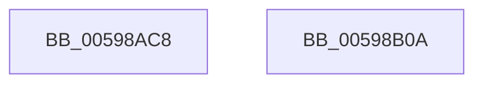

# IoDiscardDeferredLiveDumpData

- RVA: `0x00598AC8`–`0x00598B0B` (길이 `67` bytes)
- VA: `0x0000000140598AC8`
- 실행 섹션: `.text`
- PDB 이름 있음: `예`; PDB Function 태그: `아니요`
- unwind 정보 RVA: `0x0005CF00`
- 디코드: `20`개 명령, `67/67` bytes 표시
- 미해석 바이트: `0` (있으면 어셈블리에 `.byte`로 보존)

> 이 문서는 커널 이미지의 기계어와 PDB 기호를 분석해 생성했습니다. 4번과 5번은 함수 원형과 자료형을 바이너리 사용 방식에서 추정한 C 해석이며 원본 소스 복구 결과는 아닙니다.

## 1. Dependencies

- 직접 호출 지점: **4**; 고유 호출 대상: **4**
- 직접 호출자로 확인된 함수: **1**
- RIP 상대 이미지 참조: **0**

### Outgoing calls
- `0x00598AD6` → [IopLiveDumpTraceInterfaceStart](IopLiveDumpTraceInterfaceStart_function_0059EE0C.md) (function, `0x0059EE0C`)
- `0x00598AE8` → [IopLiveDumpTraceInterfaceEnd](IopLiveDumpTraceInterfaceEnd_function_0059EC24.md) (function, `0x0059EC24`)
- `0x00598AF0` → [IopLiveDumpReleaseResources](IopLiveDumpReleaseResources_function_0059DF1C.md) (function, `0x0059DF1C`)
- `0x00598AFD` → [ExFreePoolWithTag](../../poolcode/B8/ExFreePoolWithTag_function_00B82870.md) (function, `0x00B82870`)

### Direct callers
- [DbgkpWerCleanupContext](../../page/71/DbgkpWerCleanupContext_function_00712178.md) at `0x007121B6`

### Static image references
- 디코드된 RIP-relative 메모리 참조가 없습니다.

## 2. Other-region calls and transfers

- 다른 실행 섹션으로 향하는 call: **1**
  - `0x00598AFD` → [ExFreePoolWithTag](../../poolcode/B8/ExFreePoolWithTag_function_00B82870.md) (`.text` → `POOLCODE`)
- 별도 외부 분기/꼬리 이동을 확인하지 못했습니다.

## 3. Assembly (complete function range)

```asm
00598AC8  40 53                           push rbx
00598ACA  48 83 EC 20                     sub rsp, 0x20
00598ACE  48 8B D9                        mov rbx, rcx
00598AD1  B9 02 00 00 00                  mov ecx, 2
00598AD6  E8 31 63 00 00                  call 0x14059ee0c
00598ADB  45 33 C9                        xor r9d, r9d
00598ADE  45 33 C0                        xor r8d, r8d
00598AE1  48 8B CB                        mov rcx, rbx
00598AE4  41 8D 51 02                     lea edx, [r9 + 2]
00598AE8  E8 37 61 00 00                  call 0x14059ec24
00598AED  48 8B CB                        mov rcx, rbx
00598AF0  E8 27 54 00 00                  call 0x14059df1c
00598AF5  BA 4C 64 6D 70                  mov edx, 0x706d644c
00598AFA  48 8B CB                        mov rcx, rbx
00598AFD  E8 6E 9D 5E 00                  call 0x140b82870
00598B02  33 C0                           xor eax, eax
00598B04  48 83 C4 20                     add rsp, 0x20
00598B08  5B                              pop rbx
00598B09  C3                              ret
00598B0A  CC                              int3
```

## 4. C-style interpretation (structured pseudocode)

```c
__int64 __fastcall IoDiscardDeferredLiveDumpData(__int64 a1, __int64 a2, int a3, int a4)
{
    __int64 result;
    __int64 v_rsp;

    v_rsp = (v_rsp) - (32);
    result = IopLiveDumpTraceInterfaceStart(2, a2, a3, a4);
    a4 = 0;
    a3 = 0;
    result = IopLiveDumpTraceInterfaceEnd(a1, a4 + 2, a3, a4);
    result = IopLiveDumpReleaseResources(a1, a4 + 2, a3, a4);
    result = ExFreePoolWithTag(a1, (unsigned int)(0x706D644CULL), a3, a4);
    result = 0;
    v_rsp = (v_rsp) + (32);
    return result;
}
```

## 5. (Beta) C Style

```c
int64_t IoDiscardDeferredLiveDumpData(int64_t Arg1, int64_t Arg2, int32_t Arg3, int32_t Arg4)
{
    int64_t result;
    int64_t local_rsp;

    local_rsp = (local_rsp) - (32);
    result = IopLiveDumpTraceInterfaceStart(2, Arg2, Arg3, Arg4);
    Arg4 = 0;
    Arg3 = 0;
    result = IopLiveDumpTraceInterfaceEnd(Arg1, Arg4 + 2, Arg3, Arg4);
    result = IopLiveDumpReleaseResources(Arg1, Arg4 + 2, Arg3, Arg4);
    result = ExFreePoolWithTag(Arg1, (uint32_t)(0x706D644CULL), Arg3, Arg4);
    result = 0;
    local_rsp = (local_rsp) + (32);
    return result;
}
```

## 6. Execution-region graph

[열기: 2D/3D 그래프와 함수 탐색 컨트롤 패널](../../../control-panel.html?section=text&rva=0x00598AC8&view=graph)

- 2D 그래프는 위에서 아래로 흐르고, 3D 그래프는 빈 공간을 드래그해 회전합니다. Shift+드래그는 이동, 휠은 확대·축소, 함수 노드 선택은 대상 보고서 이동입니다.

### Static fallback


