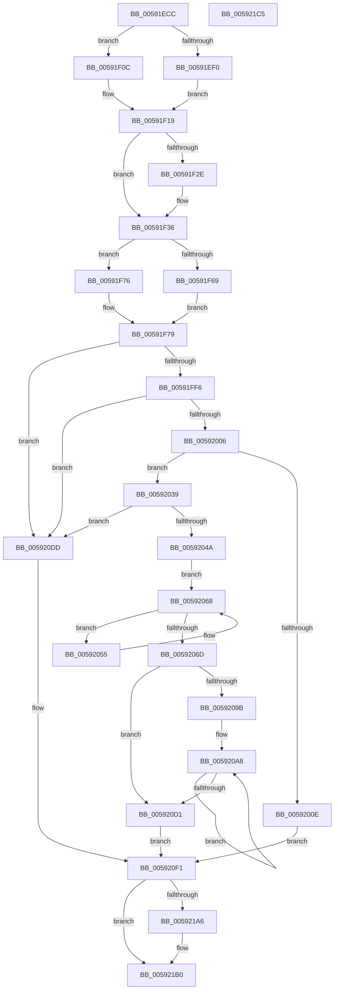

# IoFillDumpHeader

- RVA: `0x00591ECC`–`0x005921C6` (길이 `762` bytes)
- VA: `0x0000000140591ECC`
- 실행 섹션: `.text`
- PDB 이름 있음: `예`; PDB Function 태그: `아니요`
- unwind 정보 RVA: `0x0005C954`
- 디코드: `164`개 명령, `762/762` bytes 표시
- 미해석 바이트: `0` (있으면 어셈블리에 `.byte`로 보존)

> 이 문서는 커널 이미지의 기계어와 PDB 기호를 분석해 생성했습니다. 4번과 5번은 함수 원형과 자료형을 바이너리 사용 방식에서 추정한 C 해석이며 원본 소스 복구 결과는 아닙니다.

## 1. Dependencies

- 직접 호출 지점: **7**; 고유 호출 대상: **6**
- 직접 호출자로 확인된 함수: **6**
- RIP 상대 이미지 참조: **7**

### Outgoing calls
- `0x00591FCC` → [KeQueryActiveProcessorCountEx](../24/KeQueryActiveProcessorCountEx_function_00249EF0.md) (function, `0x00249EF0`)
- `0x0059202F` → [memcpy](../6C/memcpy_function_006C6840.md) (function, `0x006C6840`)
- `0x00592039` → [MmGetPhysicalMemoryRanges](../../page/7F/MmGetPhysicalMemoryRanges_function_007FB520.md) (function, `0x007FB520`)
- `0x005920D6` → [ExFreePoolWithTag](../../poolcode/B8/ExFreePoolWithTag_function_00B82870.md) (function, `0x00B82870`)
- `0x005920EC` → [memset](../6C/memset_function_006C6C40.md) (function, `0x006C6C40`)
- `0x00592100` → [memset](../6C/memset_function_006C6C40.md) (function, `0x006C6C40`)
- `0x00592173` → [RtlGetNtProductType](../43/RtlGetNtProductType_function_00436270.md) (function, `0x00436270`)

### Direct callers
- [IoCapturePristineTriageDump](IoCapturePristineTriageDump_function_00591AB8.md) at `0x00591B49`
- [IopConstructInMemoryDumpHeader](IopConstructInMemoryDumpHeader_function_005948A0.md) at `0x00594936`
- [IopWriteCapsuleTriageDumpToFirmware](IopWriteCapsuleTriageDumpToFirmware_function_005967AC.md) at `0x0059687A`
- [KeInitializeCrashDumpHeader](KeInitializeCrashDumpHeader_function_00596A70.md) at `0x00596AD7`
- [IopLiveDumpCollectPages](IopLiveDumpCollectPages_function_0059B328.md) at `0x0059B3B3`
- [DbgkpTriageDumpFillHeaders](../../page/71/DbgkpTriageDumpFillHeaders_function_00712950.md) at `0x0071299F`

### Static image references
- `0x00591F9D` → RVA `0x00FC6C38` (`ALMOSTRO`; read)
- `0x00591FA8` → RVA `0x00EF54C0` (`.data`; read)
- `0x00591FB3` → RVA `0x00F067C0` (`.data`; read)
- `0x00591FBE` → RVA `0x00E01060` (`.data`; read)
- `0x00591FD4` → RVA `0x00E0A74C` (`.data`; read)
- `0x00591FF6` → RVA `0x00FC6B88` (`ALMOSTRO`; read)
- `0x0059219D` → RVA `0x00FC6A84` (`ALMOSTRO`; read)

## 2. Other-region calls and transfers

- 다른 실행 섹션으로 향하는 call: **2**
  - `0x00592039` → [MmGetPhysicalMemoryRanges](../../page/7F/MmGetPhysicalMemoryRanges_function_007FB520.md) (`.text` → `PAGE`)
  - `0x005920D6` → [ExFreePoolWithTag](../../poolcode/B8/ExFreePoolWithTag_function_00B82870.md) (`.text` → `POOLCODE`)
- 별도 외부 분기/꼬리 이동을 확인하지 못했습니다.

## 3. Assembly (complete function range)

```asm
00591ECC  48 89 5C 24 08                  mov qword ptr [rsp + 8], rbx
00591ED1  48 89 6C 24 10                  mov qword ptr [rsp + 0x10], rbp
00591ED6  48 89 74 24 18                  mov qword ptr [rsp + 0x18], rsi
00591EDB  57                              push rdi
00591EDC  48 83 EC 20                     sub rsp, 0x20
00591EE0  41 8B F0                        mov esi, r8d
00591EE3  8B EA                           mov ebp, edx
00591EE5  48 8B D9                        mov rbx, rcx
00591EE8  4C 8B D9                        mov r11, rcx
00591EEB  F6 C1 04                        test cl, 4
00591EEE  74 1C                           je 0x140591f0c
00591EF0  C7 01 50 41 47 45               mov dword ptr [rcx], 0x45474150
00591EF6  4C 8D 59 04                     lea r11, [rcx + 4]
00591EFA  B9 FF 03 00 00                  mov ecx, 0x3ff
00591EFF  BA F8 1F 00 00                  mov edx, 0x1ff8
00591F04  41 B8 01 00 00 00               mov r8d, 1
00591F0A  EB 0D                           jmp 0x140591f19
00591F0C  B9 00 04 00 00                  mov ecx, 0x400
00591F11  45 33 C0                        xor r8d, r8d
00591F14  BA FC 1F 00 00                  mov edx, 0x1ffc
00591F19  48 B8 50 41 47 45 50 41 47 45   movabs rax, 0x4547415045474150
00591F23  49 8B FB                        mov rdi, r11
00591F26  F3 48 AB                        rep stosq qword ptr [rdi], rax
00591F29  4D 85 C0                        test r8, r8
00591F2C  74 08                           je 0x140591f36
00591F2E  42 C7 04 1A 50 41 47 45         mov dword ptr [rdx + r11], 0x45474150
00591F36  48 8B 44 24 50                  mov rax, qword ptr [rsp + 0x50]
00591F3B  48 89 43 48                     mov qword ptr [rbx + 0x48], rax
00591F3F  48 8B 44 24 58                  mov rax, qword ptr [rsp + 0x58]
00591F44  48 89 43 50                     mov qword ptr [rbx + 0x50], rax
00591F48  48 8B 44 24 60                  mov rax, qword ptr [rsp + 0x60]
00591F4D  48 89 43 58                     mov qword ptr [rbx + 0x58], rax
00591F51  48 8B 44 24 68                  mov rax, qword ptr [rsp + 0x68]
00591F56  C7 43 04 44 55 36 34            mov dword ptr [rbx + 4], 0x34365544
00591F5D  89 73 38                        mov dword ptr [rbx + 0x38], esi
00591F60  4C 89 4B 40                     mov qword ptr [rbx + 0x40], r9
00591F64  48 85 C0                        test rax, rax
00591F67  74 0D                           je 0x140591f76
00591F69  48 8B 80 B8 00 00 00            mov rax, qword ptr [rax + 0xb8]
00591F70  48 8B 48 28                     mov rcx, qword ptr [rax + 0x28]
00591F74  EB 03                           jmp 0x140591f79
00591F76  0F 20 D9                        mov rcx, cr3
00591F79  48 81 E1 00 F0 FF FF            and rcx, 0xfffffffffffff000
00591F80  48 89 4B 10                     mov qword ptr [rbx + 0x10], rcx
00591F84  B9 FF FF 00 00                  mov ecx, 0xffff
00591F89  C6 83 4E 10 00 00 04            mov byte ptr [rbx + 0x104e], 4
00591F90  C7 43 30 64 86 00 00            mov dword ptr [rbx + 0x30], 0x8664
00591F97  89 AB 98 0F 00 00               mov dword ptr [rbx + 0xf98], ebp
00591F9D  48 8B 05 94 4C A3 00            mov rax, qword ptr [rip + 0xa34c94]
00591FA4  48 89 43 18                     mov qword ptr [rbx + 0x18], rax
00591FA8  48 8D 05 11 35 96 00            lea rax, [rip + 0x963511]
00591FAF  48 89 43 20                     mov qword ptr [rbx + 0x20], rax
00591FB3  48 8D 05 06 48 97 00            lea rax, [rip + 0x974806]
00591FBA  48 89 43 28                     mov qword ptr [rbx + 0x28], rax
00591FBE  48 8D 05 9B F0 86 00            lea rax, [rip + 0x86f09b]
00591FC5  48 89 83 80 00 00 00            mov qword ptr [rbx + 0x80], rax
00591FCC  E8 1F 7F CB FF                  call 0x140249ef0
00591FD1  89 43 34                        mov dword ptr [rbx + 0x34], eax
00591FD4  8B 05 72 87 87 00               mov eax, dword ptr [rip + 0x878772]
00591FDA  C1 E8 1C                        shr eax, 0x1c
00591FDD  89 43 08                        mov dword ptr [rbx + 8], eax
00591FE0  0F B7 05 65 87 87 00            movzx eax, word ptr [rip + 0x878765]
00591FE7  89 43 0C                        mov dword ptr [rbx + 0xc], eax
00591FEA  8D 45 FB                        lea eax, [rbp - 5]
00591FED  83 F8 01                        cmp eax, 1
00591FF0  0F 86 E7 00 00 00               jbe 0x1405920dd
00591FF6  48 8B 15 8B 4B A3 00            mov rdx, qword ptr [rip + 0xa34b8b]
00591FFD  48 85 D2                        test rdx, rdx
00592000  0F 84 D7 00 00 00               je 0x1405920dd
00592006  44 0F 20 C0                     mov rax, cr8
0059200A  3C 01                           cmp al, 1
0059200C  76 2B                           jbe 0x140592039
0059200E  44 8B 02                        mov r8d, dword ptr [rdx]
00592011  48 8D 8B 88 00 00 00            lea rcx, [rbx + 0x88]
00592018  41 FF C8                        dec r8d
0059201B  B8 BC 02 00 00                  mov eax, 0x2bc
00592020  49 83 C0 02                     add r8, 2
00592024  49 C1 E0 04                     shl r8, 4
00592028  4C 3B C0                        cmp r8, rax
0059202B  4C 0F 47 C0                     cmova r8, rax
0059202F  E8 0C 48 13 00                  call 0x1406c6840
00592034  E9 B8 00 00 00                  jmp 0x1405920f1
00592039  E8 E2 94 26 00                  call 0x1407fb520
0059203E  48 8B F8                        mov rdi, rax
00592041  48 85 C0                        test rax, rax
00592044  0F 84 93 00 00 00               je 0x1405920dd
0059204A  48 8B 40 08                     mov rax, qword ptr [rax + 8]
0059204E  33 D2                           xor edx, edx
00592050  45 33 C0                        xor r8d, r8d
00592053  EB 13                           jmp 0x140592068
00592055  48 C1 E8 0C                     shr rax, 0xc
00592059  FF C2                           inc edx
0059205B  4C 03 C0                        add r8, rax
0059205E  8B C2                           mov eax, edx
00592060  48 03 C0                        add rax, rax
00592063  48 8B 44 C7 08                  mov rax, qword ptr [rdi + rax*8 + 8]
00592068  48 85 C0                        test rax, rax
0059206B  75 E8                           jne 0x140592055
0059206D  8D 4A FF                        lea ecx, [rdx - 1]
00592070  4C 89 83 90 00 00 00            mov qword ptr [rbx + 0x90], r8
00592077  48 83 C1 02                     add rcx, 2
0059207B  B8 BC 02 00 00                  mov eax, 0x2bc
00592080  48 C1 E1 04                     shl rcx, 4
00592084  41 B9 2A 00 00 00               mov r9d, 0x2a
0059208A  48 3B C8                        cmp rcx, rax
0059208D  41 0F 47 D1                     cmova edx, r9d
00592091  89 93 88 00 00 00               mov dword ptr [rbx + 0x88], edx
00592097  85 D2                           test edx, edx
00592099  74 36                           je 0x1405920d1
0059209B  4C 8B C3                        mov r8, rbx
0059209E  44 8B CA                        mov r9d, edx
005920A1  4C 2B C7                        sub r8, rdi
005920A4  48 8D 4F 08                     lea rcx, [rdi + 8]
005920A8  48 8B 41 F8                     mov rax, qword ptr [rcx - 8]
005920AC  48 C1 E8 0C                     shr rax, 0xc
005920B0  49 89 84 08 90 00 00 00         mov qword ptr [r8 + rcx + 0x90], rax
005920B8  48 8B 01                        mov rax, qword ptr [rcx]
005920BB  48 8D 49 10                     lea rcx, [rcx + 0x10]
005920BF  48 C1 E8 0C                     shr rax, 0xc
005920C3  49 89 84 08 88 00 00 00         mov qword ptr [r8 + rcx + 0x88], rax
005920CB  49 83 E9 01                     sub r9, 1
005920CF  75 D7                           jne 0x1405920a8
005920D1  33 D2                           xor edx, edx
005920D3  48 8B CF                        mov rcx, rdi
005920D6  E8 95 07 5F 00                  call 0x140b82870
005920DB  EB 14                           jmp 0x1405920f1
005920DD  48 8D 8B 88 00 00 00            lea rcx, [rbx + 0x88]
005920E4  33 D2                           xor edx, edx
005920E6  41 B8 BC 02 00 00               mov r8d, 0x2bc
005920EC  E8 4F 4B 13 00                  call 0x1406c6c40
005920F1  48 8D 8B 48 03 00 00            lea rcx, [rbx + 0x348]
005920F8  33 D2                           xor edx, edx
005920FA  41 B8 B8 0B 00 00               mov r8d, 0xbb8
00592100  E8 3B 4B 13 00                  call 0x1406c6c40
00592105  48 83 A3 08 0F 00 00 00         and qword ptr [rbx + 0xf08], 0
0059210D  48 8D 8B 40 10 00 00            lea rcx, [rbx + 0x1040]
00592114  83 A3 18 0F 00 00 00            and dword ptr [rbx + 0xf18], 0
0059211B  48 83 A3 10 0F 00 00 00         and qword ptr [rbx + 0xf10], 0
00592123  C7 83 00 0F 00 00 03 00 00 80   mov dword ptr [rbx + 0xf00], 0x80000003
0059212D  C7 83 04 0F 00 00 01 00 00 00   mov dword ptr [rbx + 0xf04], 1
00592137  A1 14 00 00 00 80 F7 FF FF      movabs eax, dword ptr [0xfffff78000000014]
00592140  89 83 A8 0F 00 00               mov dword ptr [rbx + 0xfa8], eax
00592146  A1 18 00 00 00 80 F7 FF FF      movabs eax, dword ptr [0xfffff78000000018]
0059214F  89 83 AC 0F 00 00               mov dword ptr [rbx + 0xfac], eax
00592155  A1 08 00 00 00 80 F7 FF FF      movabs eax, dword ptr [0xfffff78000000008]
0059215E  89 83 30 10 00 00               mov dword ptr [rbx + 0x1030], eax
00592164  A1 0C 00 00 00 80 F7 FF FF      movabs eax, dword ptr [0xfffff7800000000c]
0059216D  89 83 34 10 00 00               mov dword ptr [rbx + 0x1034], eax
00592173  E8 F8 40 EA FF                  call 0x140436270
00592178  A1 D0 02 00 00 80 F7 FF FF      movabs eax, dword ptr [0xfffff780000002d0]
00592181  89 83 44 10 00 00               mov dword ptr [rbx + 0x1044], eax
00592187  A1 C4 02 00 00 80 F7 FF FF      movabs eax, dword ptr [0xfffff780000002c4]
00592190  83 A3 50 10 00 00 00            and dword ptr [rbx + 0x1050], 0
00592197  89 83 54 10 00 00               mov dword ptr [rbx + 0x1054], eax
0059219D  80 3D E0 48 A3 00 00            cmp byte ptr [rip + 0xa348e0], 0
005921A4  74 0A                           je 0x1405921b0
005921A6  C7 83 50 10 00 00 00 08 00 00   mov dword ptr [rbx + 0x1050], 0x800
005921B0  48 8B 5C 24 30                  mov rbx, qword ptr [rsp + 0x30]
005921B5  48 8B 6C 24 38                  mov rbp, qword ptr [rsp + 0x38]
005921BA  48 8B 74 24 40                  mov rsi, qword ptr [rsp + 0x40]
005921BF  48 83 C4 20                     add rsp, 0x20
005921C3  5F                              pop rdi
005921C4  C3                              ret
005921C5  CC                              int3
```

## 4. C-style interpretation (structured pseudocode)

```c
__int64 __fastcall IoFillDumpHeader(__int64 a1, int a2, int a3, __int64 a4, __int64 a5, __int64 a6, __int64 a7, __int64 a8)
{
    __int64 result;
    __int64 v_rsp;
    unsigned __int64 v_stack_p10;
    unsigned __int64 v_stack_p18;
    unsigned __int64 v_stack_p8;

    v_stack_p8 = v_rbx;
    v_stack_p10 = v_rbp;
    v_stack_p18 = v_rsi;
    v_rsp = (v_rsp) - (32);
    if ((((unsigned __int8)(a1)) & (4)) == 0) goto loc_00591F0C;
    *(unsigned int *)(a1) = 0x45474150ULL;
    goto loc_00591F19;
loc_00591F0C:
    a3 = 0;
loc_00591F19:
    if (0 != 0) {
        *(unsigned int *)((unsigned int)(0x1FFCULL) + a1 + 4 * 1) = 0x45474150ULL;
    }
    *(unsigned __int64 *)(a1 + 72) = a5;
    *(unsigned __int64 *)(a1 + 80) = a6;
    *(unsigned __int64 *)(a1 + 88) = a7;
    *(unsigned int *)(a1 + 4) = 0x34365544ULL;
    *(unsigned int *)(a1 + 56) = (unsigned int)((unsigned int)(a3));
    *(unsigned __int64 *)(a1 + 64) = a4;
    if (a8 == 0) goto loc_00591F76;
    goto loc_00591F79;
loc_00591F76:
loc_00591F79:
    a1 = (v_cr3) & (0xFFFFFFFFFFFFF000ULL);
    *(unsigned __int64 *)(a1 + 16) = a1;
    *(unsigned __int8 *)(a1 + 4174) = 4;
    *(unsigned int *)(a1 + 48) = 0x8664ULL;
    *(unsigned int *)(a1 + 3992) = (unsigned int)((unsigned int)(a2));
    *(unsigned __int64 *)(a1 + 24) = *(unsigned __int64 *)(v_rip + 10701972);
    *(unsigned __int64 *)(a1 + 32) = v_rip + 9843985;
    *(unsigned __int64 *)(a1 + 40) = v_rip + 9914374;
    *(unsigned __int64 *)(a1 + 128) = v_rip + 8843419;
    result = KeQueryActiveProcessorCountEx((unsigned int)(0xFFFFULL), (unsigned int)(0x1FFCULL), a3, a4);
    *(unsigned int *)(a1 + 52) = (unsigned int)(result);
    result = (unsigned int)(((unsigned int)(*(unsigned int *)(v_rip + 8882034))) >> (28));
    *(unsigned int *)(a1 + 8) = (unsigned int)(result);
    *(unsigned int *)(a1 + 12) = (unsigned int)(*(unsigned __int16 *)(v_rip + 8882021));
    if (((unsigned int)((unsigned int)(a2) - 5)) <= 1) goto loc_005920DD;
    if (*(unsigned __int64 *)(v_rip + 10701707) == 0) goto loc_005920DD;
    if (((unsigned __int8)(v_cr8)) <= 1) goto loc_00592039;
    a3 = (unsigned int)(((unsigned int)(*(unsigned int *)(*(unsigned __int64 *)(v_rip + 10701707)))) - 1);
    a3 = (a3) + (2);
    a3 = (a3) << (4);
    if (a3 > 700) { a3 = 700; }
    result = memcpy(a1 + 136, *(unsigned __int64 *)(v_rip + 10701707), a3, a4);
    goto loc_005920F1;
loc_00592039:
    result = MmGetPhysicalMemoryRanges(a1 + 136, *(unsigned __int64 *)(v_rip + 10701707), a3, a4);
    if (result == 0) goto loc_005920DD;
    a2 = 0;
    a3 = 0;
    goto loc_00592068;
loc_00592055:
    result = (*(unsigned __int64 *)(result + 8)) >> (12);
    a2 = (unsigned int)((a2) + 1);
    a3 = (a3) + (result);
    result = ((unsigned int)(a2)) + ((unsigned int)(a2));
loc_00592068:
    if (*(unsigned __int64 *)(result + result * 8 + 8) != 0) goto loc_00592055;
    *(unsigned __int64 *)(a1 + 144) = a3;
    a1 = (a2 - 1) + (2);
    a1 = (a1) << (4);
    if (a1 > 700) { a2 = 42; }
    *(unsigned int *)(a1 + 136) = a2;
    if (a2 == 0) goto loc_005920D1;
    a3 = (a1) - (result);
loc_005920A8:
    result = (*(unsigned __int64 *)(result + 8 - 8)) >> (12);
    *(unsigned __int64 *)(a3 + result + 8 * 1 + 144) = result;
    result = (*(unsigned __int64 *)(result + 8)) >> (12);
    *(unsigned __int64 *)(a3 + result + 8 + 16 * 1 + 136) = result;
    a4 = ((unsigned int)(a2)) - (1);
    if (condition_is_not_equal) goto loc_005920A8;
loc_005920D1:
    a2 = 0;
    result = ExFreePoolWithTag(result, a2, a3, a4);
    goto loc_005920F1;
loc_005920DD:
    a2 = 0;
    result = memset(a1 + 136, a2, 700, a4);
loc_005920F1:
    a2 = 0;
    result = memset(a1 + 840, a2, (unsigned int)(0xBB8ULL), a4);
    *(unsigned int *)(a1 + 3840) = 0x80000003ULL;
    *(unsigned int *)(a1 + 3844) = 1;
    *(unsigned int *)(a1 + 4008) = (unsigned int)(result);
    *(unsigned int *)(a1 + 4012) = (unsigned int)(result);
    *(unsigned int *)(a1 + 4144) = (unsigned int)(result);
    *(unsigned int *)(a1 + 4148) = (unsigned int)(result);
    result = RtlGetNtProductType(a1 + 4160, a2, (unsigned int)(0xBB8ULL), a4);
    *(unsigned int *)(a1 + 4164) = (unsigned int)(result);
    *(unsigned int *)(a1 + 4180) = (unsigned int)(result);
    if ((*(unsigned __int8 *)(v_rip + 10701024)) != 0) {
        *(unsigned int *)(a1 + 4176) = 0x800ULL;
    }
    v_rsp = (v_rsp) + (32);
    return result;
}
```

## 5. (Beta) C Style

```c
int64_t IoFillDumpHeader(void *Arg1, void *Arg2, int32_t Arg3, int64_t Arg4, int64_t Arg5, int64_t Arg6, int64_t Arg7, int64_t Arg8)
{
    uint8_t *arg1 = (uint8_t *)Arg1;
    uint8_t *arg2 = (uint8_t *)Arg2;

    int64_t result;
    int64_t local_rsp;
    uint64_t v_stack_p10;
    uint64_t v_stack_p18;
    uint64_t v_stack_p8;

    v_stack_p8 = local_rbx;
    v_stack_p10 = local_rbp;
    v_stack_p18 = local_rsi;
    local_rsp = (local_rsp) - (32);
    if ((((uint8_t)(Arg1)) & (4)) == 0) goto loc_00591F0C;
    *(uint32_t *)(arg1) = 0x45474150ULL;
    goto loc_00591F19;
loc_00591F0C:
    Arg3 = 0;
loc_00591F19:
    if (0 != 0) {
        *(uint32_t *)((uint32_t)(0x1FFCULL) + arg1 + 0x4 * 1) = 0x45474150ULL;
    }
    *(uint64_t *)(arg1 + 0x48) = Arg5;
    *(uint64_t *)(arg1 + 0x50) = Arg6;
    *(uint64_t *)(arg1 + 0x58) = Arg7;
    *(uint32_t *)(arg1 + 0x4) = 0x34365544ULL;
    *(uint32_t *)(arg1 + 0x38) = (uint32_t)((uint32_t)(Arg3));
    *(uint64_t *)(arg1 + 0x40) = Arg4;
    if (Arg8 == 0) goto loc_00591F76;
    goto loc_00591F79;
loc_00591F76:
loc_00591F79:
    Arg1 = (v_cr3) & (0xFFFFFFFFFFFFF000ULL);
    *(void **)(arg1 + 0x10) = Arg1;
    *(uint8_t *)(arg1 + 0x104E) = 4;
    *(uint32_t *)(arg1 + 0x30) = 0x8664ULL;
    *(uint32_t *)(arg1 + 0xF98) = (uint32_t)((uint32_t)(Arg2));
    *(uint64_t *)(arg1 + 0x18) = *(uint64_t *)(v_rip + 0xA34C94);
    *(uint64_t *)(arg1 + 0x20) = v_rip + 9843985;
    *(uint64_t *)(arg1 + 0x28) = v_rip + 9914374;
    *(uint64_t *)(arg1 + 0x80) = v_rip + 8843419;
    result = KeQueryActiveProcessorCountEx((uint32_t)(0xFFFFULL), (uint32_t)(0x1FFCULL), Arg3, Arg4);
    *(uint32_t *)(arg1 + 0x34) = (uint32_t)(result);
    result = (uint32_t)(((uint32_t)(*(uint32_t *)(v_rip + 0x878772))) >> (28));
    *(uint32_t *)(arg1 + 0x8) = (uint32_t)(result);
    *(uint32_t *)(arg1 + 0xC) = (uint32_t)(*(uint16_t *)(v_rip + 0x878765));
    if (((uint32_t)((uint32_t)(Arg2) - 5)) <= 1) goto loc_005920DD;
    if (*(uint64_t *)(v_rip + 0xA34B8B) == 0) goto loc_005920DD;
    if (((uint8_t)(v_cr8)) <= 1) goto loc_00592039;
    Arg3 = (uint32_t)(((uint32_t)(*(uint32_t *)(*(uint64_t *)(v_rip + 0xA34B8B)))) - 1);
    Arg3 = (Arg3) + (2);
    Arg3 = (Arg3) << (4);
    if (Arg3 > 700) { Arg3 = 700; }
    result = memcpy(Arg1 + 136, *(uint64_t *)(v_rip + 0xA34B8B), Arg3, Arg4);
    goto loc_005920F1;
loc_00592039:
    result = MmGetPhysicalMemoryRanges(Arg1 + 136, *(uint64_t *)(v_rip + 0xA34B8B), Arg3, Arg4);
    if (result == 0) goto loc_005920DD;
    Arg2 = 0;
    Arg3 = 0;
    goto loc_00592068;
loc_00592055:
    result = (*(uint64_t *)(result + 0x8)) >> (12);
    Arg2 = (uint32_t)((Arg2) + 1);
    Arg3 = (Arg3) + (result);
    result = ((uint32_t)(Arg2)) + ((uint32_t)(Arg2));
loc_00592068:
    if (*(uint64_t *)(result + result * 8 + 0x8) != 0) goto loc_00592055;
    *(uint64_t *)(arg1 + 0x90) = Arg3;
    Arg1 = (Arg2 - 1) + (2);
    Arg1 = (Arg1) << (4);
    if (Arg1 > 700) { Arg2 = 42; }
    *(uint32_t *)(arg1 + 0x88) = Arg2;
    if (Arg2 == NULL) goto loc_005920D1;
    Arg3 = (Arg1) - (result);
loc_005920A8:
    result = (*(uint64_t *)(result + 0x8 - 0x8)) >> (12);
    *(uint64_t *)(Arg3 + result + 0x8 * 1 + 0x90) = result;
    result = (*(uint64_t *)(result + 0x8)) >> (12);
    *(uint64_t *)(Arg3 + result + 0x8 + 0x10 * 1 + 0x88) = result;
    Arg4 = ((uint32_t)(Arg2)) - (1);
    if (condition_is_not_equal) goto loc_005920A8;
loc_005920D1:
    Arg2 = 0;
    result = ExFreePoolWithTag(result, Arg2, Arg3, Arg4);
    goto loc_005920F1;
loc_005920DD:
    Arg2 = 0;
    result = memset(Arg1 + 136, Arg2, 700, Arg4);
loc_005920F1:
    Arg2 = 0;
    result = memset(Arg1 + 840, Arg2, (uint32_t)(0xBB8ULL), Arg4);
    *(uint32_t *)(arg1 + 0xF00) = 0x80000003ULL;
    *(uint32_t *)(arg1 + 0xF04) = 1;
    *(uint32_t *)(arg1 + 0xFA8) = (uint32_t)(result);
    *(uint32_t *)(arg1 + 0xFAC) = (uint32_t)(result);
    *(uint32_t *)(arg1 + 0x1030) = (uint32_t)(result);
    *(uint32_t *)(arg1 + 0x1034) = (uint32_t)(result);
    result = RtlGetNtProductType(Arg1 + 4160, Arg2, (uint32_t)(0xBB8ULL), Arg4);
    *(uint32_t *)(arg1 + 0x1044) = (uint32_t)(result);
    *(uint32_t *)(arg1 + 0x1054) = (uint32_t)(result);
    if ((*(uint8_t *)(v_rip + 0xA348E0)) != 0) {
        *(uint32_t *)(arg1 + 0x1050) = 0x800ULL;
    }
    local_rsp = (local_rsp) + (32);
    return result;
}
```

### 관측된 메모리 오프셋

구조체 형식이 확인되지 않은 접근은 인자 기준의 오프셋으로만 기록했습니다.

| 기준 인자 | 오프셋 표현 | 폭 (bit) | 접근 |
|---|---:|---:|---|
| `Arg1` | `+ 0x4` | `32` | `W` |
| `Arg1` | `+ 0x8` | `32` | `W` |
| `Arg1` | `+ 0xC` | `32` | `W` |
| `Arg1` | `+ 0x10` | `64` | `W` |
| `Arg1` | `+ 0x18` | `64` | `W` |
| `Arg1` | `+ 0x20` | `64` | `W` |
| `Arg1` | `+ 0x28` | `64` | `W` |
| `Arg1` | `+ 0x30` | `32` | `W` |
| `Arg1` | `+ 0x34` | `32` | `W` |
| `Arg1` | `+ 0x38` | `32` | `W` |
| `Arg1` | `+ 0x40` | `64` | `W` |
| `Arg1` | `+ 0x48` | `64` | `W` |
| `Arg1` | `+ 0x50` | `64` | `W` |
| `Arg1` | `+ 0x58` | `64` | `W` |
| `Arg1` | `+ 0x80` | `64` | `W` |
| `Arg1` | `+ 0x88` | `32` | `W` |
| `Arg1` | `+ 0x88` | `64` | `R` |
| `Arg1` | `+ 0x88 + rcx*1` | `64` | `W` |
| `Arg1` | `+ 0x90` | `64` | `W` |
| `Arg1` | `+ 0x90 + rcx*1` | `64` | `W` |
| `Arg1` | `+ 0x348` | `64` | `R` |
| `Arg1` | `+ 0xF00` | `32` | `W` |
| `Arg1` | `+ 0xF04` | `32` | `W` |
| `Arg1` | `+ 0xF08` | `64` | `R/W` |
| `Arg1` | `+ 0xF10` | `64` | `R/W` |
| `Arg1` | `+ 0xF18` | `32` | `R/W` |
| `Arg1` | `+ 0xF98` | `32` | `W` |
| `Arg1` | `+ 0xFA8` | `32` | `W` |
| `Arg1` | `+ 0xFAC` | `32` | `W` |
| `Arg1` | `+ 0x1030` | `32` | `W` |
| `Arg1` | `+ 0x1034` | `32` | `W` |
| `Arg1` | `+ 0x1040` | `64` | `R` |

추가 오프셋 6개는 표에서 생략했습니다.

## 6. Execution-region graph

[열기: 2D/3D 그래프와 함수 탐색 컨트롤 패널](../../../control-panel.html?section=text&rva=0x00591ECC&view=graph)

- 2D 그래프는 위에서 아래로 흐르고, 3D 그래프는 빈 공간을 드래그해 회전합니다. Shift+드래그는 이동, 휠은 확대·축소, 함수 노드 선택은 대상 보고서 이동입니다.

### Static fallback


