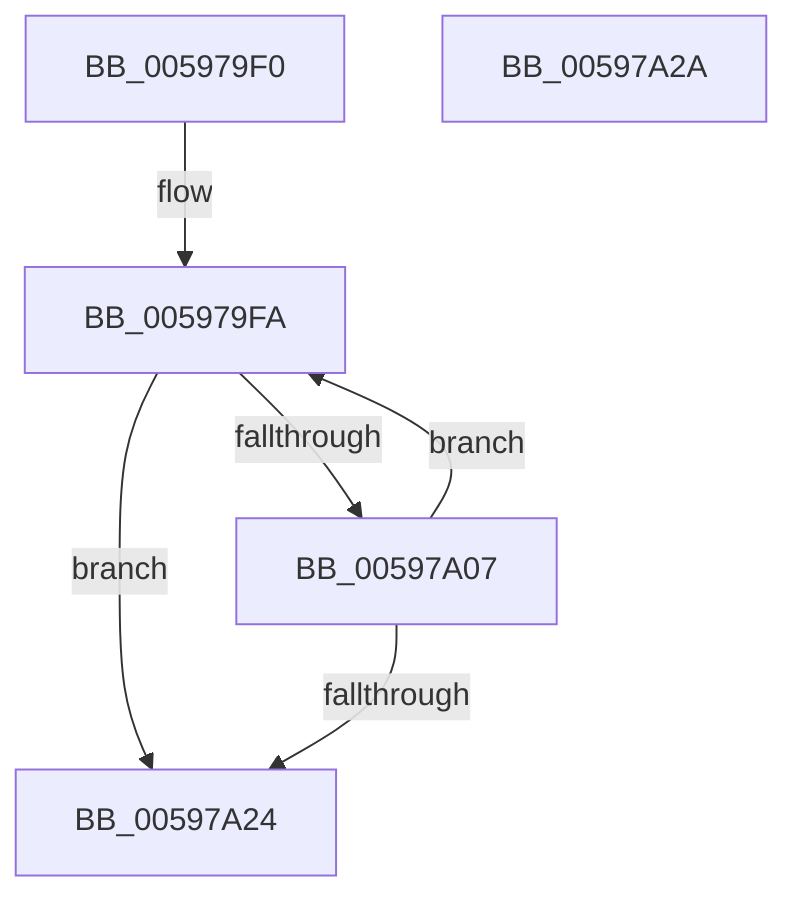

# IoFreeController

- RVA: `0x005979F0`–`0x00597A2B` (길이 `59` bytes)
- VA: `0x00000001405979F0`
- 실행 섹션: `.text`
- PDB 이름 있음: `예`; PDB Function 태그: `아니요`
- unwind 정보 RVA: `0x00064C80`
- 디코드: `19`개 명령, `59/59` bytes 표시
- 미해석 바이트: `0` (있으면 어셈블리에 `.byte`로 보존)

> 이 문서는 커널 이미지의 기계어와 PDB 기호를 분석해 생성했습니다. 4번과 5번은 함수 원형과 자료형을 바이너리 사용 방식에서 추정한 C 해석이며 원본 소스 복구 결과는 아닙니다.

## 1. Dependencies

- 직접 호출 지점: **2**; 고유 호출 대상: **2**
- 직접 호출자로 확인된 함수: **2**
- RIP 상대 이미지 참조: **0**

### Outgoing calls
- `0x005979FD` → [KeRemoveDeviceQueue](../3D/KeRemoveDeviceQueue_function_003DF890.md) (function, `0x003DF890`)
- `0x00597A1A` → [guard_dispatch_icall](../6B/guard_dispatch_icall_function_006BAAD0.md) (function, `0x006BAAD0`)

### Direct callers
- [IoAllocateController](../4C/IoAllocateController_function_004C9C50.md) at `0x004C9CA6`
- [DifIoFreeControllerWrapper](../62/DifIoFreeControllerWrapper_function_0062A310.md) at `0x0062A3D6`

### Static image references
- 디코드된 RIP-relative 메모리 참조가 없습니다.

## 2. Other-region calls and transfers

- 다른 실행 섹션으로 향하는 call: **0**
- 별도 외부 분기/꼬리 이동을 확인하지 못했습니다.

## 3. Assembly (complete function range)

```asm
005979F0  40 53                           push rbx
005979F2  48 83 EC 30                     sub rsp, 0x30
005979F6  48 8D 59 10                     lea rbx, [rcx + 0x10]
005979FA  48 8B CB                        mov rcx, rbx
005979FD  E8 8E 7E E4 FF                  call 0x1403df890
00597A02  48 85 C0                        test rax, rax
00597A05  74 1D                           je 0x140597a24
00597A07  48 8D 48 B0                     lea rcx, [rax - 0x50]
00597A0B  45 33 C0                        xor r8d, r8d
00597A0E  48 8B 41 68                     mov rax, qword ptr [rcx + 0x68]
00597A12  4C 8B 49 70                     mov r9, qword ptr [rcx + 0x70]
00597A16  48 8B 51 20                     mov rdx, qword ptr [rcx + 0x20]
00597A1A  E8 B1 30 12 00                  call 0x1406baad0
00597A1F  83 F8 02                        cmp eax, 2
00597A22  74 D6                           je 0x1405979fa
00597A24  48 83 C4 30                     add rsp, 0x30
00597A28  5B                              pop rbx
00597A29  C3                              ret
00597A2A  CC                              int3
```

## 4. C-style interpretation (structured pseudocode)

```c
__int64 __fastcall IoFreeController(__int64 a1, __int64 a2, int a3)
{
    __int64 result;
    __int64 v_rsp;

    v_rsp = (v_rsp) - (48);
loc_005979FA:
    result = KeRemoveDeviceQueue(a1 + 16, a2, a3, a4);
    if (result == 0) goto loc_00597A24;
    a3 = 0;
    result = guard_dispatch_icall(result - 80, *(unsigned __int64 *)(result - 80 + 32), a3, *(unsigned __int64 *)(result - 80 + 112));
    if (((unsigned int)(result)) == 2) goto loc_005979FA;
loc_00597A24:
    v_rsp = (v_rsp) + (48);
    return result;
}
```

## 5. (Beta) C Style

```c
int64_t IoFreeController(void *Arg1, int64_t Arg2, int32_t Arg3)
{
    uint8_t *arg1 = (uint8_t *)Arg1;

    int64_t result;
    int64_t local_rsp;

    local_rsp = (local_rsp) - (48);
loc_005979FA:
    result = KeRemoveDeviceQueue(Arg1 + 16, Arg2, Arg3, a4);
    if (result == 0) goto loc_00597A24;
    Arg3 = 0;
    result = guard_dispatch_icall(result - 80, *(uint64_t *)(result - 0x50 + 0x20), Arg3, *(uint64_t *)(result - 0x50 + 0x70));
    if (((uint32_t)(result)) == 2) goto loc_005979FA;
loc_00597A24:
    local_rsp = (local_rsp) + (48);
    return result;
}
```

### 관측된 메모리 오프셋

구조체 형식이 확인되지 않은 접근은 인자 기준의 오프셋으로만 기록했습니다.

| 기준 인자 | 오프셋 표현 | 폭 (bit) | 접근 |
|---|---:|---:|---|
| `Arg1` | `+ 0x10` | `64` | `R` |

## 6. Execution-region graph

[열기: 2D/3D 그래프와 함수 탐색 컨트롤 패널](../../../control-panel.html?section=text&rva=0x005979F0&view=graph)

- 2D 그래프는 위에서 아래로 흐르고, 3D 그래프는 빈 공간을 드래그해 회전합니다. Shift+드래그는 이동, 휠은 확대·축소, 함수 노드 선택은 대상 보고서 이동입니다.

### Static fallback


