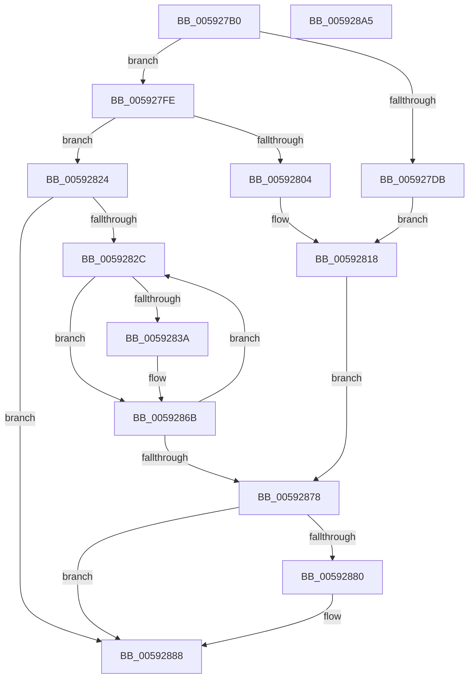

# IoFreeDumpRange

- RVA: `0x005927B0`–`0x005928A6` (길이 `246` bytes)
- VA: `0x00000001405927B0`
- 실행 섹션: `.text`
- PDB 이름 있음: `예`; PDB Function 태그: `아니요`
- unwind 정보 RVA: `0x000C5A00`
- 디코드: `72`개 명령, `246/246` bytes 표시
- 미해석 바이트: `0` (있으면 어셈블리에 `.byte`로 보존)

> 이 문서는 커널 이미지의 기계어와 PDB 기호를 분석해 생성했습니다. 4번과 5번은 함수 원형과 자료형을 바이너리 사용 방식에서 추정한 C 해석이며 원본 소스 복구 결과는 아닙니다.

## 1. Dependencies

- 직접 호출 지점: **5**; 고유 호출 대상: **3**
- 직접 호출자로 확인된 함수: **2**
- RIP 상대 이미지 참조: **0**

### Outgoing calls
- `0x005927DE` → [MmGetPhysicalAddress](../23/MmGetPhysicalAddress_function_0023A500.md) (function, `0x0023A500`)
- `0x0059281B` → [IopRemovePageFromPageMap](IopRemovePageFromPageMap_function_00596034.md) (function, `0x00596034`)
- `0x00592831` → [MmIsAddressValidEx](../27/MmIsAddressValidEx_function_0027FDD0.md) (function, `0x0027FDD0`)
- `0x0059283D` → [MmGetPhysicalAddress](../23/MmGetPhysicalAddress_function_0023A500.md) (function, `0x0023A500`)
- `0x00592861` → [IopRemovePageFromPageMap](IopRemovePageFromPageMap_function_00596034.md) (function, `0x00596034`)

### Direct callers
- [IopRemovePageDumpRange](IopRemovePageDumpRange_function_00595EAC.md) at `0x00595F74`
- [IopLiveDumpCallRemovePagesCallbacks](IopLiveDumpCallRemovePagesCallbacks_function_0059AC28.md) at `0x0059AEB5`

### Static image references
- 디코드된 RIP-relative 메모리 참조가 없습니다.

## 2. Other-region calls and transfers

- 다른 실행 섹션으로 향하는 call: **0**
- 별도 외부 분기/꼬리 이동을 확인하지 못했습니다.

## 3. Assembly (complete function range)

```asm
005927B0  48 8B C4                        mov rax, rsp
005927B3  48 89 58 08                     mov qword ptr [rax + 8], rbx
005927B7  48 89 68 10                     mov qword ptr [rax + 0x10], rbp
005927BB  48 89 70 18                     mov qword ptr [rax + 0x18], rsi
005927BF  48 89 78 20                     mov qword ptr [rax + 0x20], rdi
005927C3  41 57                           push r15
005927C5  48 83 EC 30                     sub rsp, 0x30
005927C9  45 33 FF                        xor r15d, r15d
005927CC  49 8B E8                        mov rbp, r8
005927CF  48 8B F2                        mov rsi, rdx
005927D2  48 8B F9                        mov rdi, rcx
005927D5  41 83 F9 01                     cmp r9d, 1
005927D9  75 23                           jne 0x1405927fe
005927DB  48 8B CA                        mov rcx, rdx
005927DE  E8 1D 7D CA FF                  call 0x14023a500
005927E3  8A 57 28                        mov dl, byte ptr [rdi + 0x28]
005927E6  48 8B 4F 10                     mov rcx, qword ptr [rdi + 0x10]
005927EA  80 E2 01                        and dl, 1
005927ED  48 C1 E8 0C                     shr rax, 0xc
005927F1  88 54 24 20                     mov byte ptr [rsp + 0x20], dl
005927F5  4C 8B C0                        mov r8, rax
005927F8  48 8B 57 20                     mov rdx, qword ptr [rdi + 0x20]
005927FC  EB 1A                           jmp 0x140592818
005927FE  41 83 F9 02                     cmp r9d, 2
00592802  75 20                           jne 0x140592824
00592804  8A 41 28                        mov al, byte ptr [rcx + 0x28]
00592807  4C 8B C2                        mov r8, rdx
0059280A  48 8B 51 20                     mov rdx, qword ptr [rcx + 0x20]
0059280E  24 01                           and al, 1
00592810  48 8B 49 10                     mov rcx, qword ptr [rcx + 0x10]
00592814  88 44 24 20                     mov byte ptr [rsp + 0x20], al
00592818  4C 8B CD                        mov r9, rbp
0059281B  E8 14 38 00 00                  call 0x140596034
00592820  8B D8                           mov ebx, eax
00592822  EB 54                           jmp 0x140592878
00592824  41 8B DF                        mov ebx, r15d
00592827  48 85 ED                        test rbp, rbp
0059282A  74 5C                           je 0x140592888
0059282C  33 D2                           xor edx, edx
0059282E  48 8B CE                        mov rcx, rsi
00592831  E8 9A D5 CE FF                  call 0x14027fdd0
00592836  84 C0                           test al, al
00592838  74 31                           je 0x14059286b
0059283A  48 8B CE                        mov rcx, rsi
0059283D  E8 BE 7C CA FF                  call 0x14023a500
00592842  8A 4F 28                        mov cl, byte ptr [rdi + 0x28]
00592845  41 B9 01 00 00 00               mov r9d, 1
0059284B  48 8B 57 20                     mov rdx, qword ptr [rdi + 0x20]
0059284F  80 E1 01                        and cl, 1
00592852  48 C1 E8 0C                     shr rax, 0xc
00592856  88 4C 24 20                     mov byte ptr [rsp + 0x20], cl
0059285A  4C 8B C0                        mov r8, rax
0059285D  48 8B 4F 10                     mov rcx, qword ptr [rdi + 0x10]
00592861  E8 CE 37 00 00                  call 0x140596034
00592866  85 C0                           test eax, eax
00592868  0F 48 D8                        cmovs ebx, eax
0059286B  48 81 C6 00 10 00 00            add rsi, 0x1000
00592872  48 83 ED 01                     sub rbp, 1
00592876  75 B4                           jne 0x14059282c
00592878  81 FB 41 01 00 C0               cmp ebx, 0xc0000141
0059287E  75 08                           jne 0x140592888
00592880  F6 47 28 01                     test byte ptr [rdi + 0x28], 1
00592884  41 0F 45 DF                     cmovne ebx, r15d
00592888  48 8B 6C 24 48                  mov rbp, qword ptr [rsp + 0x48]
0059288D  8B C3                           mov eax, ebx
0059288F  48 8B 5C 24 40                  mov rbx, qword ptr [rsp + 0x40]
00592894  48 8B 74 24 50                  mov rsi, qword ptr [rsp + 0x50]
00592899  48 8B 7C 24 58                  mov rdi, qword ptr [rsp + 0x58]
0059289E  48 83 C4 30                     add rsp, 0x30
005928A2  41 5F                           pop r15
005928A4  C3                              ret
005928A5  CC                              int3
```

## 4. C-style interpretation (structured pseudocode)

```c
__int64 __fastcall IoFreeDumpRange(__int64 a1, __int64 a2, __int64 a3, int a4)
{
    __int64 result;
    __int64 v_r15;
    __int64 v_rbp;
    __int64 v_rbx;
    __int64 v_rsi;
    __int64 v_rsp;
    unsigned __int8 v_stack_m18;
    unsigned __int64 v_stack_p10;
    unsigned __int64 v_stack_p18;
    unsigned __int64 v_stack_p20;
    unsigned __int64 v_stack_p8;

    *(unsigned __int64 *)(v_rsp + 8) = v_rbx;
    *(unsigned __int64 *)(v_rsp + 16) = v_rbp;
    *(unsigned __int64 *)(v_rsp + 24) = v_rsi;
    *(unsigned __int64 *)(v_rsp + 32) = v_rdi;
    v_rsp = (v_rsp) - (48);
    v_r15 = 0;
    if (a4 != 1) goto loc_005927FE;
    result = MmGetPhysicalAddress(a2, a2, a3, a4);
    a2 = (unsigned __int8)((*(unsigned __int8 *)(a1 + 40)) & (1));
    result = (result) >> (12);
    v_stack_m18 = (unsigned __int8)(a2);
    goto loc_00592818;
loc_005927FE:
    if (a4 != 2) goto loc_00592824;
    result = (unsigned __int8)((*(unsigned __int8 *)(*(unsigned __int64 *)(a1 + 16) + 40)) & (1));
    v_stack_m18 = (unsigned __int8)(result);
loc_00592818:
    result = IopRemovePageFromPageMap(*(unsigned __int64 *)(*(unsigned __int64 *)(a1 + 16) + 16), *(unsigned __int64 *)(*(unsigned __int64 *)(a1 + 16) + 32), *(unsigned __int64 *)(a1 + 32), a3);
    goto loc_00592878;
loc_00592824:
    if (a3 == 0) goto loc_00592888;
loc_0059282C:
    a2 = 0;
    result = MmIsAddressValidEx(0, a2, *(unsigned __int64 *)(a1 + 32), a3);
    v_rbx = 0;
    if ((unsigned __int8)(result) != 0) {
        a1 = 0;
        result = MmGetPhysicalAddress(a1, a2, *(unsigned __int64 *)(a1 + 32), a3);
        a1 = *(unsigned __int8 *)(a1 + 40);
        a4 = 1;
        a2 = *(unsigned __int64 *)(a1 + 32);
        a1 = (unsigned __int8)((a1) & (1));
        result = (result) >> (12);
        v_stack_m18 = (unsigned __int8)(a1);
        a3 = result;
        a1 = *(unsigned __int64 *)(a1 + 16);
        result = IopRemovePageFromPageMap(a1, a2, a3, a4);
        v_rbx = 0;
        if (sign_flag) { v_rbx = (unsigned int)(result); }
    }
    v_rsi = (a2) + (0x1000ULL);
    v_rbp = (a3) - (1);
    if (condition_is_not_equal) goto loc_0059282C;
loc_00592878:
    if (((unsigned int)(v_rbx)) == 0xC0000141ULL) {
        if (((*(unsigned __int8 *)(a1 + 40)) & (1)) != 0) { v_rbx = 0; }
    }
    v_rsp = (v_rsp) + (48);
    return (unsigned int)((unsigned int)(v_rbx));
}
```

## 5. (Beta) C Style

```c
int64_t IoFreeDumpRange(void *Arg1, int64_t Arg2, int64_t Arg3, int32_t Arg4)
{
    uint8_t *arg1 = (uint8_t *)Arg1;

    int64_t result;
    int64_t local_r15;
    int64_t local_rbp;
    int64_t local_rbx;
    int64_t local_rsi;
    int64_t local_rsp;
    uint8_t v_stack_m18;
    uint64_t v_stack_p10;
    uint64_t v_stack_p18;
    uint64_t v_stack_p20;
    uint64_t v_stack_p8;

    *(uint64_t *)(local_rsp + 0x8) = local_rbx;
    *(uint64_t *)(local_rsp + 0x10) = local_rbp;
    *(uint64_t *)(local_rsp + 0x18) = local_rsi;
    *(uint64_t *)(local_rsp + 0x20) = local_rdi;
    local_rsp = (local_rsp) - (48);
    local_r15 = 0;
    if (Arg4 != 1) goto loc_005927FE;
    result = MmGetPhysicalAddress(Arg2, Arg2, Arg3, Arg4);
    Arg2 = (uint8_t)((*(uint8_t *)(arg1 + 0x28)) & (1));
    result = (result) >> (12);
    v_stack_m18 = (uint8_t)(Arg2);
    goto loc_00592818;
loc_005927FE:
    if (Arg4 != 2) goto loc_00592824;
    result = (uint8_t)((*(uint8_t *)(*(uint64_t *)(arg1 + 0x10) + 0x28)) & (1));
    v_stack_m18 = (uint8_t)(result);
loc_00592818:
    result = IopRemovePageFromPageMap(*(uint64_t *)(*(uint64_t *)(arg1 + 0x10) + 0x10), *(uint64_t *)(*(uint64_t *)(arg1 + 0x10) + 0x20), *(uint64_t *)(arg1 + 0x20), Arg3);
    goto loc_00592878;
loc_00592824:
    if (Arg3 == 0) goto loc_00592888;
loc_0059282C:
    Arg2 = 0;
    result = MmIsAddressValidEx(0, Arg2, *(uint64_t *)(arg1 + 0x20), Arg3);
    local_rbx = 0;
    if ((uint8_t)(result) != 0) {
        Arg1 = 0;
        result = MmGetPhysicalAddress(Arg1, Arg2, *(uint64_t *)(arg1 + 0x20), Arg3);
        Arg1 = *(uint8_t *)(arg1 + 0x28);
        Arg4 = 1;
        Arg2 = *(uint64_t *)(arg1 + 0x20);
        Arg1 = (uint8_t)((Arg1) & (1));
        result = (result) >> (12);
        v_stack_m18 = (uint8_t)(Arg1);
        Arg3 = result;
        Arg1 = *(uint64_t *)(arg1 + 0x10);
        result = IopRemovePageFromPageMap(Arg1, Arg2, Arg3, Arg4);
        local_rbx = 0;
        if (sign_flag) { local_rbx = (uint32_t)(result); }
    }
    local_rsi = (Arg2) + (0x1000ULL);
    local_rbp = (Arg3) - (1);
    if (condition_is_not_equal) goto loc_0059282C;
loc_00592878:
    if (((uint32_t)(local_rbx)) == 0xC0000141ULL) {
        if (((*(uint8_t *)(arg1 + 0x28)) & (1)) != 0) { local_rbx = 0; }
    }
    local_rsp = (local_rsp) + (48);
    return (uint32_t)((uint32_t)(local_rbx));
}
```

### 관측된 메모리 오프셋

구조체 형식이 확인되지 않은 접근은 인자 기준의 오프셋으로만 기록했습니다.

| 기준 인자 | 오프셋 표현 | 폭 (bit) | 접근 |
|---|---:|---:|---|
| `Arg1` | `+ 0x10` | `64` | `R` |
| `Arg1` | `+ 0x20` | `64` | `R` |
| `Arg1` | `+ 0x28` | `8` | `R` |

## 6. Execution-region graph

[열기: 2D/3D 그래프와 함수 탐색 컨트롤 패널](../../../control-panel.html?section=text&rva=0x005927B0&view=graph)

- 2D 그래프는 위에서 아래로 흐르고, 3D 그래프는 빈 공간을 드래그해 회전합니다. Shift+드래그는 이동, 휠은 확대·축소, 함수 노드 선택은 대상 보고서 이동입니다.

### Static fallback


