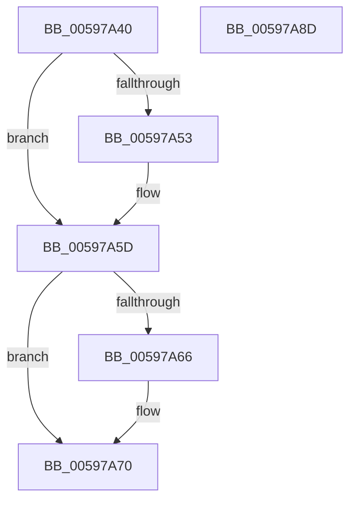

# IoFreeErrorLogEntry

- RVA: `0x00597A40`–`0x00597A8E` (길이 `78` bytes)
- VA: `0x0000000140597A40`
- 실행 섹션: `.text`
- PDB 이름 있음: `예`; PDB Function 태그: `아니요`
- unwind 정보 RVA: `0x0005CF00`
- 디코드: `23`개 명령, `78/78` bytes 표시
- 미해석 바이트: `0` (있으면 어셈블리에 `.byte`로 보존)

> 이 문서는 커널 이미지의 기계어와 PDB 기호를 분석해 생성했습니다. 4번과 5번은 함수 원형과 자료형을 바이너리 사용 방식에서 추정한 C 해석이며 원본 소스 복구 결과는 아닙니다.

## 1. Dependencies

- 직접 호출 지점: **3**; 고유 호출 대상: **2**
- 직접 호출자로 확인된 함수: **0**
- RIP 상대 이미지 참조: **1**

### Outgoing calls
- `0x00597A58` → [ObfDereferenceObjectWithTag](../2F/ObfDereferenceObjectWithTag_function_002F78E0.md) (function, `0x002F78E0`)
- `0x00597A6B` → [ObfDereferenceObjectWithTag](../2F/ObfDereferenceObjectWithTag_function_002F78E0.md) (function, `0x002F78E0`)
- `0x00597A82` → [ExFreePoolWithTag](../../poolcode/B8/ExFreePoolWithTag_function_00B82870.md) (function, `0x00B82870`)

### Direct callers
- 이 함수 시작 RVA로 연결되는 직접 call은 확인되지 않았습니다. 간접 호출은 완전히 역산할 수 없습니다.

### Static image references
- `0x00597A76` → RVA `0x00F8D168` (`.data`; read/write)

## 2. Other-region calls and transfers

- 다른 실행 섹션으로 향하는 call: **1**
  - `0x00597A82` → [ExFreePoolWithTag](../../poolcode/B8/ExFreePoolWithTag_function_00B82870.md) (`.text` → `POOLCODE`)
- 별도 외부 분기/꼬리 이동을 확인하지 못했습니다.

## 3. Assembly (complete function range)

```asm
00597A40  40 53                           push rbx
00597A42  48 83 EC 20                     sub rsp, 0x20
00597A46  48 8D 59 D0                     lea rbx, [rcx - 0x30]
00597A4A  48 8B 4B 18                     mov rcx, qword ptr [rbx + 0x18]
00597A4E  48 85 C9                        test rcx, rcx
00597A51  74 0A                           je 0x140597a5d
00597A53  BA 44 66 6C 74                  mov edx, 0x746c6644
00597A58  E8 83 FE D5 FF                  call 0x1402f78e0
00597A5D  48 8B 4B 20                     mov rcx, qword ptr [rbx + 0x20]
00597A61  48 85 C9                        test rcx, rcx
00597A64  74 0A                           je 0x140597a70
00597A66  BA 44 66 6C 74                  mov edx, 0x746c6644
00597A6B  E8 70 FE D5 FF                  call 0x1402f78e0
00597A70  0F B7 43 02                     movzx eax, word ptr [rbx + 2]
00597A74  F7 D8                           neg eax
00597A76  F0 01 05 EB 56 9F 00            lock add dword ptr [rip + 0x9f56eb], eax
00597A7D  33 D2                           xor edx, edx
00597A7F  48 8B CB                        mov rcx, rbx
00597A82  E8 E9 AD 5E 00                  call 0x140b82870
00597A87  48 83 C4 20                     add rsp, 0x20
00597A8B  5B                              pop rbx
00597A8C  C3                              ret
00597A8D  CC                              int3
```

## 4. C-style interpretation (structured pseudocode)

```c
__int64 __fastcall IoFreeErrorLogEntry(__int64 a1)
{
    __int64 result;
    __int64 v_rsp;

    v_rsp = (v_rsp) - (32);
    if (*(unsigned __int64 *)(a1 - 48 + 24) != 0) {
        a2 = 0x746C6644ULL;
        result = ObfDereferenceObjectWithTag(*(unsigned __int64 *)(a1 - 48 + 24), a2, a3, a4);
    }
    if (*(unsigned __int64 *)(a1 - 48 + 32) != 0) {
        a2 = 0x746C6644ULL;
        result = ObfDereferenceObjectWithTag(*(unsigned __int64 *)(a1 - 48 + 32), a2, a3, a4);
    }
    result = (unsigned int)(-(*(unsigned __int16 *)(a1 - 48 + 2)));
    a2 = 0;
    result = ExFreePoolWithTag(a1 - 48, a2, a3, a4);
    v_rsp = (v_rsp) + (32);
    return result;
}
```

## 5. (Beta) C Style

```c
int64_t IoFreeErrorLogEntry(void *Arg1)
{
    uint8_t *arg1 = (uint8_t *)Arg1;

    int64_t result;
    int64_t local_rsp;

    local_rsp = (local_rsp) - (32);
    if (*(uint64_t *)(arg1 - 0x30 + 0x18) != 0) {
        a2 = 0x746C6644ULL;
        result = ObfDereferenceObjectWithTag(*(uint64_t *)(arg1 - 0x30 + 0x18), a2, a3, a4);
    }
    if (*(uint64_t *)(arg1 - 0x30 + 0x20) != 0) {
        a2 = 0x746C6644ULL;
        result = ObfDereferenceObjectWithTag(*(uint64_t *)(arg1 - 0x30 + 0x20), a2, a3, a4);
    }
    result = (uint32_t)(-(*(uint16_t *)(arg1 - 0x30 + 0x2)));
    a2 = 0;
    result = ExFreePoolWithTag(Arg1 - 48, a2, a3, a4);
    local_rsp = (local_rsp) + (32);
    return result;
}
```

### 관측된 메모리 오프셋

구조체 형식이 확인되지 않은 접근은 인자 기준의 오프셋으로만 기록했습니다.

| 기준 인자 | 오프셋 표현 | 폭 (bit) | 접근 |
|---|---:|---:|---|
| `Arg1` | `- 0x30` | `64` | `R` |
| `Arg1` | `+ 0x2` | `16` | `R` |
| `Arg1` | `+ 0x18` | `64` | `R` |
| `Arg1` | `+ 0x20` | `64` | `R` |

## 6. Execution-region graph

[열기: 2D/3D 그래프와 함수 탐색 컨트롤 패널](../../../control-panel.html?section=text&rva=0x00597A40&view=graph)

- 2D 그래프는 위에서 아래로 흐르고, 3D 그래프는 빈 공간을 드래그해 회전합니다. Shift+드래그는 이동, 휠은 확대·축소, 함수 노드 선택은 대상 보고서 이동입니다.

### Static fallback


