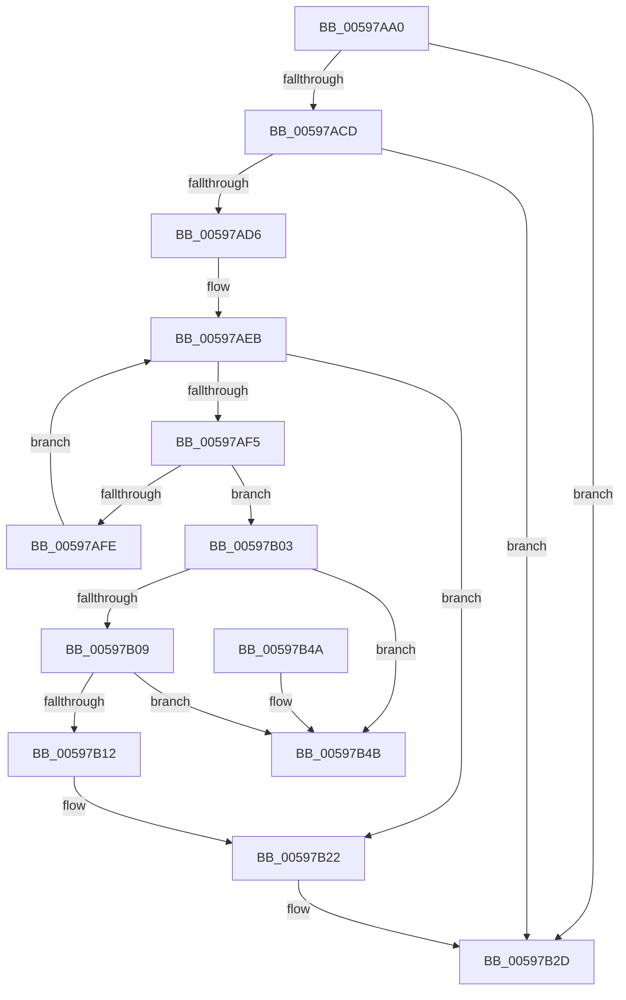

# IoFreeSfioStreamIdentifier

- RVA: `0x00597AA0`–`0x00597B52` (길이 `178` bytes)
- VA: `0x0000000140597AA0`
- 실행 섹션: `.text`
- PDB 이름 있음: `예`; PDB Function 태그: `아니요`
- unwind 정보 RVA: `0x0006B020`
- 디코드: `52`개 명령, `178/178` bytes 표시
- 미해석 바이트: `0` (있으면 어셈블리에 `.byte`로 보존)

> 이 문서는 커널 이미지의 기계어와 PDB 기호를 분석해 생성했습니다. 4번과 5번은 함수 원형과 자료형을 바이너리 사용 방식에서 추정한 C 해석이며 원본 소스 복구 결과는 아닙니다.

## 1. Dependencies

- 직접 호출 지점: **3**; 고유 호출 대상: **3**
- 직접 호출자로 확인된 함수: **0**
- RIP 상대 이미지 참조: **0**

### Outgoing calls
- `0x00597AE0` → [KeAcquireSpinLockRaiseToDpc](../20/KeAcquireSpinLockRaiseToDpc_function_00208470.md) (function, `0x00208470`)
- `0x00597B1B` → [ExFreePoolWithTag](../../poolcode/B8/ExFreePoolWithTag_function_00B82870.md) (function, `0x00B82870`)
- `0x00597B28` → [KeReleaseSpinLock](../39/KeReleaseSpinLock_function_00392BA0.md) (function, `0x00392BA0`)

### Direct callers
- 이 함수 시작 RVA로 연결되는 직접 call은 확인되지 않았습니다. 간접 호출은 완전히 역산할 수 없습니다.

### Static image references
- 디코드된 RIP-relative 메모리 참조가 없습니다.

## 2. Other-region calls and transfers

- 다른 실행 섹션으로 향하는 call: **1**
  - `0x00597B1B` → [ExFreePoolWithTag](../../poolcode/B8/ExFreePoolWithTag_function_00B82870.md) (`.text` → `POOLCODE`)
- 별도 외부 분기/꼬리 이동을 확인하지 못했습니다.

## 3. Assembly (complete function range)

```asm
00597AA0  48 8B C4                        mov rax, rsp
00597AA3  48 89 58 08                     mov qword ptr [rax + 8], rbx
00597AA7  48 89 68 10                     mov qword ptr [rax + 0x10], rbp
00597AAB  48 89 70 18                     mov qword ptr [rax + 0x18], rsi
00597AAF  48 89 78 20                     mov qword ptr [rax + 0x20], rdi
00597AB3  41 56                           push r14
00597AB5  48 83 EC 20                     sub rsp, 0x20
00597AB9  48 8B 81 D0 00 00 00            mov rax, qword ptr [rcx + 0xd0]
00597AC0  48 8B EA                        mov rbp, rdx
00597AC3  BB 25 02 00 C0                  mov ebx, 0xc0000225
00597AC8  48 85 C0                        test rax, rax
00597ACB  74 60                           je 0x140597b2d
00597ACD  48 8B 78 28                     mov rdi, qword ptr [rax + 0x28]
00597AD1  48 85 FF                        test rdi, rdi
00597AD4  74 57                           je 0x140597b2d
00597AD6  48 8D B1 B8 00 00 00            lea rsi, [rcx + 0xb8]
00597ADD  48 8B CE                        mov rcx, rsi
00597AE0  E8 8B 09 C7 FF                  call 0x140208470
00597AE5  48 8B 0F                        mov rcx, qword ptr [rdi]
00597AE8  44 8A F0                        mov r14b, al
00597AEB  BB 25 02 00 C0                  mov ebx, 0xc0000225
00597AF0  48 3B CF                        cmp rcx, rdi
00597AF3  74 2D                           je 0x140597b22
00597AF5  48 8B 01                        mov rax, qword ptr [rcx]
00597AF8  48 39 69 18                     cmp qword ptr [rcx + 0x18], rbp
00597AFC  74 05                           je 0x140597b03
00597AFE  48 8B C8                        mov rcx, rax
00597B01  EB E8                           jmp 0x140597aeb
00597B03  48 39 48 08                     cmp qword ptr [rax + 8], rcx
00597B07  75 42                           jne 0x140597b4b
00597B09  48 8B 51 08                     mov rdx, qword ptr [rcx + 8]
00597B0D  48 39 0A                        cmp qword ptr [rdx], rcx
00597B10  75 39                           jne 0x140597b4b
00597B12  48 89 02                        mov qword ptr [rdx], rax
00597B15  48 89 50 08                     mov qword ptr [rax + 8], rdx
00597B19  33 D2                           xor edx, edx
00597B1B  E8 50 AD 5E 00                  call 0x140b82870
00597B20  33 DB                           xor ebx, ebx
00597B22  41 8A D6                        mov dl, r14b
00597B25  48 8B CE                        mov rcx, rsi
00597B28  E8 73 B0 DF FF                  call 0x140392ba0
00597B2D  48 8B 6C 24 38                  mov rbp, qword ptr [rsp + 0x38]
00597B32  8B C3                           mov eax, ebx
00597B34  48 8B 5C 24 30                  mov rbx, qword ptr [rsp + 0x30]
00597B39  48 8B 74 24 40                  mov rsi, qword ptr [rsp + 0x40]
00597B3E  48 8B 7C 24 48                  mov rdi, qword ptr [rsp + 0x48]
00597B43  48 83 C4 20                     add rsp, 0x20
00597B47  41 5E                           pop r14
00597B49  C3                              ret
00597B4A  CC                              int3
00597B4B  B9 03 00 00 00                  mov ecx, 3
00597B50  CD 29                           int 0x29
```

## 4. C-style interpretation (structured pseudocode)

```c
__int64 __fastcall IoFreeSfioStreamIdentifier(__int64 a1, __int64 a2)
{
    __int64 result;
    __int64 v_rbx;
    __int64 v_rsp;
    unsigned __int64 v_stack_p10;
    unsigned __int64 v_stack_p18;
    unsigned __int64 v_stack_p20;
    unsigned __int64 v_stack_p8;

    *(unsigned __int64 *)(v_rsp + 8) = v_rbx;
    *(unsigned __int64 *)(v_rsp + 16) = v_rbp;
    *(unsigned __int64 *)(v_rsp + 24) = v_rsi;
    *(unsigned __int64 *)(v_rsp + 32) = v_rdi;
    v_rsp = (v_rsp) - (32);
    if (*(unsigned __int64 *)(a1 + 208) == 0) goto loc_00597B2D;
    if (*(unsigned __int64 *)(*(unsigned __int64 *)(a1 + 208) + 40) == 0) goto loc_00597B2D;
    result = KeAcquireSpinLockRaiseToDpc(a1 + 184, a2, a3, a4);
loc_00597AEB:
    if ((*(unsigned __int64 *)(*(unsigned __int64 *)(*(unsigned __int64 *)(a1 + 208) + 40))) == (*(unsigned __int64 *)(*(unsigned __int64 *)(a1 + 208) + 40))) goto loc_00597B22;
    if ((*(unsigned __int64 *)(*(unsigned __int64 *)(*(unsigned __int64 *)(*(unsigned __int64 *)(a1 + 208) + 40)) + 24)) == a2) goto loc_00597B03;
    goto loc_00597AEB;
loc_00597B03:
    if ((*(unsigned __int64 *)(*(unsigned __int64 *)(*(unsigned __int64 *)(*(unsigned __int64 *)(*(unsigned __int64 *)(a1 + 208) + 40))) + 8)) != (*(unsigned __int64 *)(*(unsigned __int64 *)(*(unsigned __int64 *)(*(unsigned __int64 *)(a1 + 208) + 40))))) goto loc_00597B4B;
    if ((*(unsigned __int64 *)(*(unsigned __int64 *)(*(unsigned __int64 *)(*(unsigned __int64 *)(*(unsigned __int64 *)(*(unsigned __int64 *)(a1 + 208) + 40))) + 8))) != (*(unsigned __int64 *)(*(unsigned __int64 *)(*(unsigned __int64 *)(*(unsigned __int64 *)(a1 + 208) + 40))))) goto loc_00597B4B;
    *(unsigned __int64 *)(*(unsigned __int64 *)(*(unsigned __int64 *)(*(unsigned __int64 *)(*(unsigned __int64 *)(*(unsigned __int64 *)(a1 + 208) + 40))) + 8)) = *(unsigned __int64 *)(*(unsigned __int64 *)(*(unsigned __int64 *)(*(unsigned __int64 *)(a1 + 208) + 40)));
    *(unsigned __int64 *)(*(unsigned __int64 *)(*(unsigned __int64 *)(*(unsigned __int64 *)(*(unsigned __int64 *)(a1 + 208) + 40))) + 8) = *(unsigned __int64 *)(*(unsigned __int64 *)(*(unsigned __int64 *)(*(unsigned __int64 *)(*(unsigned __int64 *)(a1 + 208) + 40))) + 8);
    a2 = 0;
    result = ExFreePoolWithTag(*(unsigned __int64 *)(*(unsigned __int64 *)(*(unsigned __int64 *)(*(unsigned __int64 *)(a1 + 208) + 40))), a2, a3, a4);
    v_rbx = 0;
loc_00597B22:
    result = KeReleaseSpinLock(a1 + 184, (unsigned __int8)((unsigned __int8)(result)), a3, a4);
loc_00597B2D:
    v_rsp = (v_rsp) + (32);
    return 0;
loc_00597B4B:
    return 0;
}
```

## 5. (Beta) C Style

```c
int64_t IoFreeSfioStreamIdentifier(void *Arg1, int64_t Arg2)
{
    uint8_t *arg1 = (uint8_t *)Arg1;

    int64_t result;
    int64_t local_rbx;
    int64_t local_rsp;
    uint64_t v_stack_p10;
    uint64_t v_stack_p18;
    uint64_t v_stack_p20;
    uint64_t v_stack_p8;

    *(uint64_t *)(local_rsp + 0x8) = local_rbx;
    *(uint64_t *)(local_rsp + 0x10) = local_rbp;
    *(uint64_t *)(local_rsp + 0x18) = local_rsi;
    *(uint64_t *)(local_rsp + 0x20) = local_rdi;
    local_rsp = (local_rsp) - (32);
    if (*(uint64_t *)(arg1 + 0xD0) == 0) goto loc_00597B2D;
    if (*(uint64_t *)(*(uint64_t *)(arg1 + 0xD0) + 0x28) == 0) goto loc_00597B2D;
    result = KeAcquireSpinLockRaiseToDpc(Arg1 + 184, Arg2, a3, a4);
loc_00597AEB:
    if ((*(uint64_t *)(*(uint64_t *)(*(uint64_t *)(arg1 + 0xD0) + 0x28))) == (*(uint64_t *)(*(uint64_t *)(arg1 + 0xD0) + 0x28))) goto loc_00597B22;
    if ((*(uint64_t *)(*(uint64_t *)(*(uint64_t *)(*(uint64_t *)(arg1 + 0xD0) + 0x28)) + 0x18)) == Arg2) goto loc_00597B03;
    goto loc_00597AEB;
loc_00597B03:
    if ((*(uint64_t *)(*(uint64_t *)(*(uint64_t *)(*(uint64_t *)(*(uint64_t *)(arg1 + 0xD0) + 0x28))) + 0x8)) != (*(uint64_t *)(*(uint64_t *)(*(uint64_t *)(*(uint64_t *)(arg1 + 0xD0) + 0x28))))) goto loc_00597B4B;
    if ((*(uint64_t *)(*(uint64_t *)(*(uint64_t *)(*(uint64_t *)(*(uint64_t *)(*(uint64_t *)(arg1 + 0xD0) + 0x28))) + 0x8))) != (*(uint64_t *)(*(uint64_t *)(*(uint64_t *)(*(uint64_t *)(arg1 + 0xD0) + 0x28))))) goto loc_00597B4B;
    *(uint64_t *)(*(uint64_t *)(*(uint64_t *)(*(uint64_t *)(*(uint64_t *)(*(uint64_t *)(arg1 + 0xD0) + 0x28))) + 0x8)) = *(uint64_t *)(*(uint64_t *)(*(uint64_t *)(*(uint64_t *)(arg1 + 0xD0) + 0x28)));
    *(uint64_t *)(*(uint64_t *)(*(uint64_t *)(*(uint64_t *)(*(uint64_t *)(arg1 + 0xD0) + 0x28))) + 0x8) = *(uint64_t *)(*(uint64_t *)(*(uint64_t *)(*(uint64_t *)(*(uint64_t *)(arg1 + 0xD0) + 0x28))) + 0x8);
    Arg2 = 0;
    result = ExFreePoolWithTag(*(uint64_t *)(*(uint64_t *)(*(uint64_t *)(*(uint64_t *)(arg1 + 0xD0) + 0x28))), Arg2, a3, a4);
    local_rbx = 0;
loc_00597B22:
    result = KeReleaseSpinLock(Arg1 + 184, (uint8_t)((uint8_t)(result)), a3, a4);
loc_00597B2D:
    local_rsp = (local_rsp) + (32);
    return 0;
loc_00597B4B:
    return 0;
}
```

### 관측된 메모리 오프셋

구조체 형식이 확인되지 않은 접근은 인자 기준의 오프셋으로만 기록했습니다.

| 기준 인자 | 오프셋 표현 | 폭 (bit) | 접근 |
|---|---:|---:|---|
| `Arg1` | `+ 0xB8` | `64` | `R` |
| `Arg1` | `+ 0xD0` | `64` | `R` |

## 6. Execution-region graph

[열기: 2D/3D 그래프와 함수 탐색 컨트롤 패널](../../../control-panel.html?section=text&rva=0x00597AA0&view=graph)

- 2D 그래프는 위에서 아래로 흐르고, 3D 그래프는 빈 공간을 드래그해 회전합니다. Shift+드래그는 이동, 휠은 확대·축소, 함수 노드 선택은 대상 보고서 이동입니다.

### Static fallback


