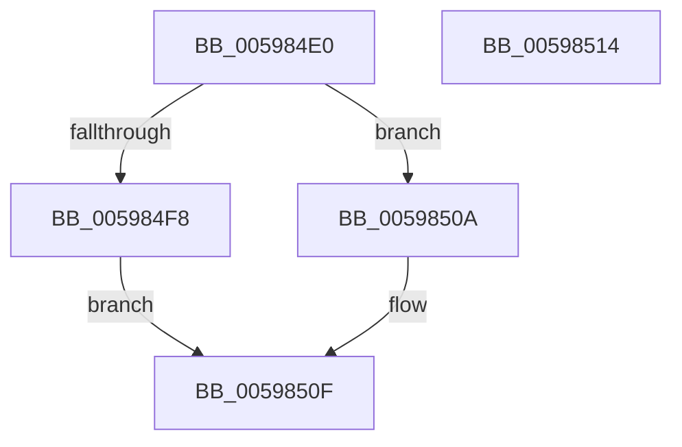

# IoGetAdapterCryptoEngineExtension

- RVA: `0x005984E0`–`0x00598515` (길이 `53` bytes)
- VA: `0x00000001405984E0`
- 실행 섹션: `.text`
- PDB 이름 있음: `예`; PDB Function 태그: `아니요`
- unwind 정보 RVA: `0x0005C788`
- 디코드: `16`개 명령, `53/53` bytes 표시
- 미해석 바이트: `0` (있으면 어셈블리에 `.byte`로 보존)

> 이 문서는 커널 이미지의 기계어와 PDB 기호를 분석해 생성했습니다. 4번과 5번은 함수 원형과 자료형을 바이너리 사용 방식에서 추정한 C 해석이며 원본 소스 복구 결과는 아닙니다.

## 1. Dependencies

- 직접 호출 지점: **1**; 고유 호출 대상: **1**
- 직접 호출자로 확인된 함수: **0**
- RIP 상대 이미지 참조: **0**

### Outgoing calls
- `0x005984EF` → [IopIrpHasExtensionType](../3F/IopIrpHasExtensionType_function_003F4080.md) (function, `0x003F4080`)

### Direct callers
- 이 함수 시작 RVA로 연결되는 직접 call은 확인되지 않았습니다. 간접 호출은 완전히 역산할 수 없습니다.

### Static image references
- 디코드된 RIP-relative 메모리 참조가 없습니다.

## 2. Other-region calls and transfers

- 다른 실행 섹션으로 향하는 call: **0**
- 별도 외부 분기/꼬리 이동을 확인하지 못했습니다.

## 3. Assembly (complete function range)

```asm
005984E0  48 83 EC 28                     sub rsp, 0x28
005984E4  4C 8B CA                        mov r9, rdx
005984E7  4C 8B C1                        mov r8, rcx
005984EA  BA 07 00 00 00                  mov edx, 7
005984EF  E8 8C BB E5 FF                  call 0x1403f4080
005984F4  84 C0                           test al, al
005984F6  74 12                           je 0x14059850a
005984F8  49 8B 80 C8 00 00 00            mov rax, qword ptr [r8 + 0xc8]
005984FF  48 83 C0 28                     add rax, 0x28
00598503  49 89 01                        mov qword ptr [r9], rax
00598506  33 C0                           xor eax, eax
00598508  EB 05                           jmp 0x14059850f
0059850A  B8 25 02 00 C0                  mov eax, 0xc0000225
0059850F  48 83 C4 28                     add rsp, 0x28
00598513  C3                              ret
00598514  CC                              int3
```

## 4. C-style interpretation (structured pseudocode)

```c
__int64 __fastcall IoGetAdapterCryptoEngineExtension(__int64 a1, __int64 a2)
{
    __int64 result;
    __int64 v_rsp;

    v_rsp = (v_rsp) - (40);
    result = IopIrpHasExtensionType(a1, 7, a1, a2);
    if ((unsigned __int8)(result) == 0) goto loc_0059850A;
    result = (*(unsigned __int64 *)(a1 + 200)) + (40);
    *(unsigned __int64 *)(a2) = result;
    result = 0;
    goto loc_0059850F;
loc_0059850A:
loc_0059850F:
    v_rsp = (v_rsp) + (40);
    return (unsigned int)(0xC0000225ULL);
}
```

## 5. (Beta) C Style

```c
int64_t IoGetAdapterCryptoEngineExtension(int64_t Arg1, int64_t Arg2)
{
    int64_t result;
    int64_t local_rsp;

    local_rsp = (local_rsp) - (40);
    result = IopIrpHasExtensionType(Arg1, 7, Arg1, Arg2);
    if ((uint8_t)(result) == 0) goto loc_0059850A;
    result = (*(uint64_t *)(Arg1 + 0xC8)) + (40);
    *(uint64_t *)(Arg2) = result;
    result = 0;
    goto loc_0059850F;
loc_0059850A:
loc_0059850F:
    local_rsp = (local_rsp) + (40);
    return (uint32_t)(0xC0000225ULL);
}
```

## 6. Execution-region graph

[열기: 2D/3D 그래프와 함수 탐색 컨트롤 패널](../../../control-panel.html?section=text&rva=0x005984E0&view=graph)

- 2D 그래프는 위에서 아래로 흐르고, 3D 그래프는 빈 공간을 드래그해 회전합니다. Shift+드래그는 이동, 휠은 확대·축소, 함수 노드 선택은 대상 보고서 이동입니다.

### Static fallback


