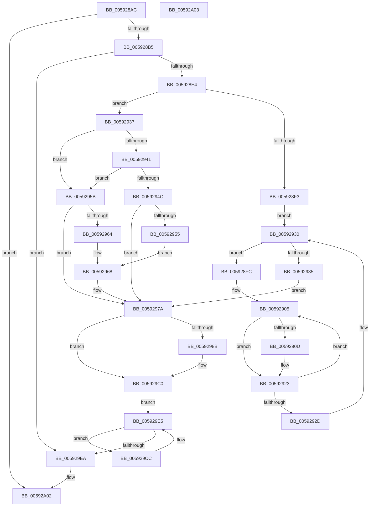

# IoGetDumpHiberRanges

- RVA: `0x005928AC`–`0x00592A04` (길이 `344` bytes)
- VA: `0x00000001405928AC`
- 실행 섹션: `.text`
- PDB 이름 있음: `예`; PDB Function 태그: `아니요`
- unwind 정보 RVA: `0x000C7140`
- 디코드: `96`개 명령, `344/344` bytes 표시
- 미해석 바이트: `0` (있으면 어셈블리에 `.byte`로 보존)

> 이 문서는 커널 이미지의 기계어와 PDB 기호를 분석해 생성했습니다. 4번과 5번은 함수 원형과 자료형을 바이너리 사용 방식에서 추정한 C 해석이며 원본 소스 복구 결과는 아닙니다.

## 1. Dependencies

- 직접 호출 지점: **5**; 고유 호출 대상: **2**
- 직접 호출자로 확인된 함수: **1**
- RIP 상대 이미지 참조: **1**

### Outgoing calls
- `0x0059291E` → [PoSetHiberRange](../47/PoSetHiberRange_function_0047C580.md) (function, `0x0047C580`)
- `0x00592975` → [PoSetHiberRange](../47/PoSetHiberRange_function_0047C580.md) (function, `0x0047C580`)
- `0x0059299D` → [RtlImageNtHeaderEx](../41/RtlImageNtHeaderEx_function_0041EAA0.md) (function, `0x0041EAA0`)
- `0x005929BB` → [PoSetHiberRange](../47/PoSetHiberRange_function_0047C580.md) (function, `0x0047C580`)
- `0x005929DD` → [PoSetHiberRange](../47/PoSetHiberRange_function_0047C580.md) (function, `0x0047C580`)

### Direct callers
- [PopSaveHiberContext](../../pagelk/B6/PopSaveHiberContext_function_00B6F050.md) at `0x00B6F509`

### Static image references
- `0x0059297A` → RVA `0x00E66060` (`.data`; read)

## 2. Other-region calls and transfers

- 다른 실행 섹션으로 향하는 call: **0**
- 별도 외부 분기/꼬리 이동을 확인하지 못했습니다.

## 3. Assembly (complete function range)

```asm
005928AC  48 85 D2                        test rdx, rdx
005928AF  0F 84 4D 01 00 00               je 0x140592a02
005928B5  48 8B C4                        mov rax, rsp
005928B8  48 89 58 10                     mov qword ptr [rax + 0x10], rbx
005928BC  48 89 68 18                     mov qword ptr [rax + 0x18], rbp
005928C0  48 89 70 20                     mov qword ptr [rax + 0x20], rsi
005928C4  48 89 48 08                     mov qword ptr [rax + 8], rcx
005928C8  57                              push rdi
005928C9  41 56                           push r14
005928CB  41 57                           push r15
005928CD  48 83 EC 30                     sub rsp, 0x30
005928D1  48 8B 8A 10 01 00 00            mov rcx, qword ptr [rdx + 0x110]
005928D8  48 8B FA                        mov rdi, rdx
005928DB  48 85 C9                        test rcx, rcx
005928DE  0F 84 06 01 00 00               je 0x1405929ea
005928E4  80 BA 18 01 00 00 00            cmp byte ptr [rdx + 0x118], 0
005928EB  41 BF 00 00 01 00               mov r15d, 0x10000
005928F1  74 44                           je 0x140592937
005928F3  48 8D 71 28                     lea rsi, [rcx + 0x28]
005928F7  48 8B 1E                        mov rbx, qword ptr [rsi]
005928FA  EB 34                           jmp 0x140592930
005928FC  4C 8D 73 48                     lea r14, [rbx + 0x48]
00592900  BD 02 00 00 00                  mov ebp, 2
00592905  4D 8B 06                        mov r8, qword ptr [r14]
00592908  4D 85 C0                        test r8, r8
0059290B  74 16                           je 0x140592923
0059290D  44 8B 4B 40                     mov r9d, dword ptr [rbx + 0x40]
00592911  41 8B D7                        mov edx, r15d
00592914  33 C9                           xor ecx, ecx
00592916  C7 44 24 20 63 62 75 66         mov dword ptr [rsp + 0x20], 0x66756263
0059291E  E8 5D 9C EE FF                  call 0x14047c580
00592923  49 83 C6 08                     add r14, 8
00592927  48 83 ED 01                     sub rbp, 1
0059292B  75 D8                           jne 0x140592905
0059292D  48 8B 1B                        mov rbx, qword ptr [rbx]
00592930  48 3B DE                        cmp rbx, rsi
00592933  75 C7                           jne 0x1405928fc
00592935  EB 43                           jmp 0x14059297a
00592937  8B 01                           mov eax, dword ptr [rcx]
00592939  83 E8 02                        sub eax, 2
0059293C  83 F8 02                        cmp eax, 2
0059293F  77 1A                           ja 0x14059295b
00592941  8B 41 04                        mov eax, dword ptr [rcx + 4]
00592944  83 E8 30                        sub eax, 0x30
00592947  83 F8 38                        cmp eax, 0x38
0059294A  77 0F                           ja 0x14059295b
0059294C  4C 8B 41 10                     mov r8, qword ptr [rcx + 0x10]
00592950  4D 85 C0                        test r8, r8
00592953  74 25                           je 0x14059297a
00592955  44 8B 49 18                     mov r9d, dword ptr [rcx + 0x18]
00592959  EB 0D                           jmp 0x140592968
0059295B  4C 8B 41 18                     mov r8, qword ptr [rcx + 0x18]
0059295F  4D 85 C0                        test r8, r8
00592962  74 16                           je 0x14059297a
00592964  44 8B 49 28                     mov r9d, dword ptr [rcx + 0x28]
00592968  41 8B D7                        mov edx, r15d
0059296B  C7 44 24 20 63 62 75 66         mov dword ptr [rsp + 0x20], 0x66756263
00592973  33 C9                           xor ecx, ecx
00592975  E8 06 9C EE FF                  call 0x14047c580
0059297A  48 8B 15 DF 36 8D 00            mov rdx, qword ptr [rip + 0x8d36df]
00592981  BE 44 49 6D 67                  mov esi, 0x676d4944
00592986  48 85 D2                        test rdx, rdx
00592989  74 35                           je 0x1405929c0
0059298B  48 83 64 24 50 00               and qword ptr [rsp + 0x50], 0
00592991  4C 8D 4C 24 50                  lea r9, [rsp + 0x50]
00592996  45 33 C0                        xor r8d, r8d
00592999  41 8D 48 01                     lea ecx, [r8 + 1]
0059299D  E8 FE C0 E8 FF                  call 0x14041eaa0
005929A2  48 8B 44 24 50                  mov rax, qword ptr [rsp + 0x50]
005929A7  41 8B D7                        mov edx, r15d
005929AA  4C 8B 05 AF 36 8D 00            mov r8, qword ptr [rip + 0x8d36af]
005929B1  33 C9                           xor ecx, ecx
005929B3  89 74 24 20                     mov dword ptr [rsp + 0x20], esi
005929B7  44 8B 48 50                     mov r9d, dword ptr [rax + 0x50]
005929BB  E8 C0 9B EE FF                  call 0x14047c580
005929C0  48 81 C7 28 01 00 00            add rdi, 0x128
005929C7  48 8B 1F                        mov rbx, qword ptr [rdi]
005929CA  EB 19                           jmp 0x1405929e5
005929CC  44 8B 4B 20                     mov r9d, dword ptr [rbx + 0x20]
005929D0  41 8B D7                        mov edx, r15d
005929D3  4C 8B 43 18                     mov r8, qword ptr [rbx + 0x18]
005929D7  33 C9                           xor ecx, ecx
005929D9  89 74 24 20                     mov dword ptr [rsp + 0x20], esi
005929DD  E8 9E 9B EE FF                  call 0x14047c580
005929E2  48 8B 1B                        mov rbx, qword ptr [rbx]
005929E5  48 3B DF                        cmp rbx, rdi
005929E8  75 E2                           jne 0x1405929cc
005929EA  48 8B 5C 24 58                  mov rbx, qword ptr [rsp + 0x58]
005929EF  48 8B 6C 24 60                  mov rbp, qword ptr [rsp + 0x60]
005929F4  48 8B 74 24 68                  mov rsi, qword ptr [rsp + 0x68]
005929F9  48 83 C4 30                     add rsp, 0x30
005929FD  41 5F                           pop r15
005929FF  41 5E                           pop r14
00592A01  5F                              pop rdi
00592A02  C3                              ret
00592A03  CC                              int3
```

## 4. C-style interpretation (structured pseudocode)

```c
__int64 __fastcall IoGetDumpHiberRanges(__int64 a1, __int64 a2)
{
    __int64 result;
    __int64 v_r14;
    __int64 v_rbp;
    __int64 v_rdi;
    __int64 v_rsp;
    unsigned int v_stack_m28;
    unsigned __int64 v_stack_p10;
    unsigned __int64 v_stack_p18;
    unsigned __int64 v_stack_p20;
    unsigned __int64 v_stack_p8;

    if (a2 == 0) goto loc_00592A02;
    *(unsigned __int64 *)(v_rsp + 16) = v_rbx;
    *(unsigned __int64 *)(v_rsp + 24) = v_rbp;
    *(unsigned __int64 *)(v_rsp + 32) = v_rsi;
    *(unsigned __int64 *)(v_rsp + 8) = a1;
    v_rsp = (v_rsp) - (48);
    if (*(unsigned __int64 *)(a2 + 272) == 0) goto loc_005929EA;
    if ((*(unsigned __int8 *)(a2 + 280)) == 0) goto loc_00592937;
    goto loc_00592930;
loc_005928FC:
loc_00592905:
    result = v_rsp;
    if (*(unsigned __int64 *)(*(unsigned __int64 *)(*(unsigned __int64 *)(a2 + 272) + 40) + 72) != 0) {
        a4 = *(unsigned int *)(*(unsigned __int64 *)(*(unsigned __int64 *)(a2 + 272) + 40) + 64);
        a2 = (unsigned int)((unsigned int)(0x10000ULL));
        a1 = 0;
        v_stack_m28 = 0x66756263ULL;
        result = PoSetHiberRange(a1, a2, *(unsigned __int64 *)(*(unsigned __int64 *)(*(unsigned __int64 *)(a2 + 272) + 40) + 72), a4);
    }
    v_r14 = (*(unsigned __int64 *)(*(unsigned __int64 *)(a2 + 272) + 40) + 72) + (8);
    v_rbp = (2) - (1);
    if (condition_is_not_equal) goto loc_00592905;
loc_00592930:
    if ((*(unsigned __int64 *)(*(unsigned __int64 *)(*(unsigned __int64 *)(a2 + 272) + 40))) != (*(unsigned __int64 *)(a2 + 272) + 40)) goto loc_005928FC;
    goto loc_0059297A;
loc_00592937:
    result = (unsigned int)(((unsigned int)(*(unsigned int *)(a1))) - (2));
    if (((unsigned int)(result)) > 2) goto loc_0059295B;
    result = (unsigned int)(((unsigned int)(*(unsigned int *)(a1 + 4))) - (48));
    if (((unsigned int)(result)) > 56) goto loc_0059295B;
    if (*(unsigned __int64 *)(a1 + 16) == 0) goto loc_0059297A;
    goto loc_00592968;
loc_0059295B:
    if (*(unsigned __int64 *)(a1 + 24) == 0) goto loc_0059297A;
loc_00592968:
    v_stack_m28 = 0x66756263ULL;
    a1 = 0;
    result = PoSetHiberRange(a1, (unsigned int)((unsigned int)((unsigned int)(0x10000ULL))), *(unsigned __int64 *)(a1 + 24), (unsigned int)(*(unsigned int *)(a1 + 40)));
loc_0059297A:
    if (*(unsigned __int64 *)(v_rip + 9254623) != 0) {
        a4 = v_stack_p8;
        a3 = 0;
        a1 = a3 + 1;
        result = RtlImageNtHeaderEx(a1, *(unsigned __int64 *)(v_rip + 9254623), a3, a4);
        result = v_stack_p8;
        a2 = (unsigned int)((unsigned int)(0x10000ULL));
        a3 = *(unsigned __int64 *)(v_rip + 9254575);
        a1 = 0;
        v_stack_m28 = (unsigned int)((unsigned int)(0x676D4944ULL));
        a4 = *(unsigned int *)(result + 80);
        result = PoSetHiberRange(a1, a2, a3, a4);
    }
    v_rdi = (a2) + (296);
    goto loc_005929E5;
loc_005929CC:
    a1 = 0;
    v_stack_m28 = (unsigned int)((unsigned int)(0x676D4944ULL));
    result = PoSetHiberRange(a1, (unsigned int)((unsigned int)((unsigned int)(0x10000ULL))), *(unsigned __int64 *)(*(unsigned __int64 *)(v_rdi) + 24), (unsigned int)(*(unsigned int *)(*(unsigned __int64 *)(v_rdi) + 32)));
loc_005929E5:
    if ((*(unsigned __int64 *)(*(unsigned __int64 *)(v_rdi))) != v_rdi) goto loc_005929CC;
loc_005929EA:
    v_rsp = (v_rsp) + (48);
loc_00592A02:
    return result;
}
```

## 5. (Beta) C Style

```c
int64_t IoGetDumpHiberRanges(int64_t Arg1, int64_t Arg2)
{
    int64_t result;
    int64_t local_r14;
    int64_t local_rbp;
    int64_t local_rdi;
    int64_t local_rsp;
    uint32_t v_stack_m28;
    uint64_t v_stack_p10;
    uint64_t v_stack_p18;
    uint64_t v_stack_p20;
    uint64_t v_stack_p8;

    if (Arg2 == 0) goto loc_00592A02;
    *(uint64_t *)(local_rsp + 0x10) = local_rbx;
    *(uint64_t *)(local_rsp + 0x18) = local_rbp;
    *(uint64_t *)(local_rsp + 0x20) = local_rsi;
    *(uint64_t *)(local_rsp + 0x8) = Arg1;
    local_rsp = (local_rsp) - (48);
    if (*(uint64_t *)(Arg2 + 0x110) == 0) goto loc_005929EA;
    if ((*(uint8_t *)(Arg2 + 0x118)) == 0) goto loc_00592937;
    goto loc_00592930;
loc_005928FC:
loc_00592905:
    result = local_rsp;
    if (*(uint64_t *)(*(uint64_t *)(*(uint64_t *)(Arg2 + 0x110) + 0x28) + 0x48) != 0) {
        a4 = *(uint32_t *)(*(uint64_t *)(*(uint64_t *)(Arg2 + 0x110) + 0x28) + 0x40);
        Arg2 = (uint32_t)((uint32_t)(0x10000ULL));
        Arg1 = 0;
        v_stack_m28 = 0x66756263ULL;
        result = PoSetHiberRange(Arg1, Arg2, *(uint64_t *)(*(uint64_t *)(*(uint64_t *)(Arg2 + 0x110) + 0x28) + 0x48), a4);
    }
    local_r14 = (*(uint64_t *)(*(uint64_t *)(Arg2 + 0x110) + 0x28) + 72) + (8);
    local_rbp = (2) - (1);
    if (condition_is_not_equal) goto loc_00592905;
loc_00592930:
    if ((*(uint64_t *)(*(uint64_t *)(*(uint64_t *)(Arg2 + 0x110) + 0x28))) != (*(uint64_t *)(Arg2 + 0x110) + 40)) goto loc_005928FC;
    goto loc_0059297A;
loc_00592937:
    result = (uint32_t)(((uint32_t)(*(uint32_t *)(Arg1))) - (2));
    if (((uint32_t)(result)) > 2) goto loc_0059295B;
    result = (uint32_t)(((uint32_t)(*(uint32_t *)(Arg1 + 0x4))) - (48));
    if (((uint32_t)(result)) > 56) goto loc_0059295B;
    if (*(uint64_t *)(Arg1 + 0x10) == 0) goto loc_0059297A;
    goto loc_00592968;
loc_0059295B:
    if (*(uint64_t *)(Arg1 + 0x18) == 0) goto loc_0059297A;
loc_00592968:
    v_stack_m28 = 0x66756263ULL;
    Arg1 = 0;
    result = PoSetHiberRange(Arg1, (uint32_t)((uint32_t)((uint32_t)(0x10000ULL))), *(uint64_t *)(Arg1 + 0x18), (uint32_t)(*(uint32_t *)(Arg1 + 0x28)));
loc_0059297A:
    if (*(uint64_t *)(v_rip + 0x8D36DF) != 0) {
        a4 = v_stack_p8;
        a3 = 0;
        Arg1 = a3 + 1;
        result = RtlImageNtHeaderEx(Arg1, *(uint64_t *)(v_rip + 0x8D36DF), a3, a4);
        result = v_stack_p8;
        Arg2 = (uint32_t)((uint32_t)(0x10000ULL));
        a3 = *(uint64_t *)(v_rip + 0x8D36AF);
        Arg1 = 0;
        v_stack_m28 = (uint32_t)((uint32_t)(0x676D4944ULL));
        a4 = *(uint32_t *)(result + 0x50);
        result = PoSetHiberRange(Arg1, Arg2, a3, a4);
    }
    local_rdi = (Arg2) + (296);
    goto loc_005929E5;
loc_005929CC:
    Arg1 = 0;
    v_stack_m28 = (uint32_t)((uint32_t)(0x676D4944ULL));
    result = PoSetHiberRange(Arg1, (uint32_t)((uint32_t)((uint32_t)(0x10000ULL))), *(uint64_t *)(*(uint64_t *)(local_rdi) + 0x18), (uint32_t)(*(uint32_t *)(*(uint64_t *)(local_rdi) + 0x20)));
loc_005929E5:
    if ((*(uint64_t *)(*(uint64_t *)(local_rdi))) != local_rdi) goto loc_005929CC;
loc_005929EA:
    local_rsp = (local_rsp) + (48);
loc_00592A02:
    return result;
}
```

## 6. Execution-region graph

[열기: 2D/3D 그래프와 함수 탐색 컨트롤 패널](../../../control-panel.html?section=text&rva=0x005928AC&view=graph)

- 2D 그래프는 위에서 아래로 흐르고, 3D 그래프는 빈 공간을 드래그해 회전합니다. Shift+드래그는 이동, 휠은 확대·축소, 함수 노드 선택은 대상 보고서 이동입니다.

### Static fallback


