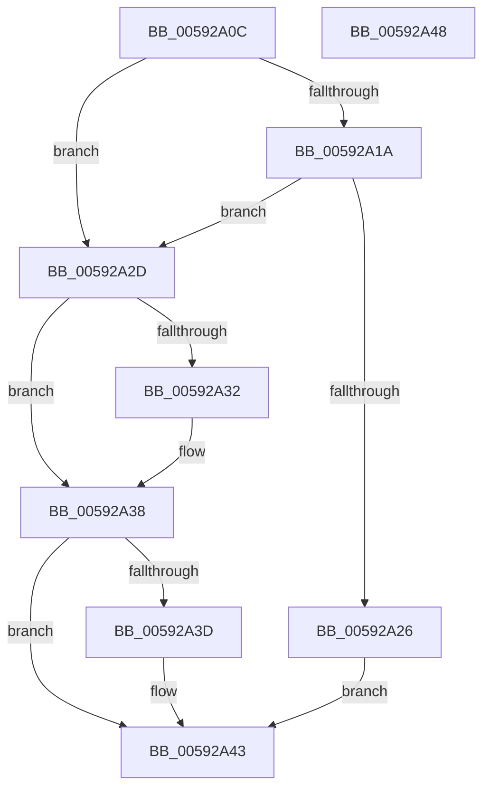

# IoGetDumpStackTransferSizes

- RVA: `0x00592A0C`–`0x00592A49` (길이 `61` bytes)
- VA: `0x0000000140592A0C`
- 실행 섹션: `.text`
- PDB 이름 있음: `예`; PDB Function 태그: `아니요`
- unwind 정보 RVA: `0x0005C788`
- 디코드: `17`개 명령, `61/61` bytes 표시
- 미해석 바이트: `0` (있으면 어셈블리에 `.byte`로 보존)

> 이 문서는 커널 이미지의 기계어와 PDB 기호를 분석해 생성했습니다. 4번과 5번은 함수 원형과 자료형을 바이너리 사용 방식에서 추정한 C 해석이며 원본 소스 복구 결과는 아닙니다.

## 1. Dependencies

- 직접 호출 지점: **1**; 고유 호출 대상: **1**
- 직접 호출자로 확인된 함수: **2**
- RIP 상대 이미지 참조: **2**

### Outgoing calls
- `0x00592A26` → [guard_dispatch_icall](../6B/guard_dispatch_icall_function_006BAAD0.md) (function, `0x006BAAD0`)

### Direct callers
- [PopHiberInitializeResources](../../page/75/PopHiberInitializeResources_function_0075D5FC.md) at `0x0075D6D1`
- [PopSaveHiberContext](../../pagelk/B6/PopSaveHiberContext_function_00B6F050.md) at `0x00B6F54A`

### Static image references
- `0x00592A10` → RVA `0x00E66058` (`.data`; read)
- `0x00592A1A` → RVA `0x00E66020` (`.data`; read)

## 2. Other-region calls and transfers

- 다른 실행 섹션으로 향하는 call: **0**
- 별도 외부 분기/꼬리 이동을 확인하지 못했습니다.

## 3. Assembly (complete function range)

```asm
00592A0C  48 83 EC 28                     sub rsp, 0x28
00592A10  48 83 3D 40 36 8D 00 00         cmp qword ptr [rip + 0x8d3640], 0
00592A18  74 13                           je 0x140592a2d
00592A1A  48 8B 05 FF 35 8D 00            mov rax, qword ptr [rip + 0x8d35ff]
00592A21  48 85 C0                        test rax, rax
00592A24  74 07                           je 0x140592a2d
00592A26  E8 A5 80 12 00                  call 0x1406baad0
00592A2B  EB 16                           jmp 0x140592a43
00592A2D  48 85 C9                        test rcx, rcx
00592A30  74 06                           je 0x140592a38
00592A32  C7 01 00 10 00 00               mov dword ptr [rcx], 0x1000
00592A38  48 85 D2                        test rdx, rdx
00592A3B  74 06                           je 0x140592a43
00592A3D  C7 02 00 00 01 00               mov dword ptr [rdx], 0x10000
00592A43  48 83 C4 28                     add rsp, 0x28
00592A47  C3                              ret
00592A48  CC                              int3
```

## 4. C-style interpretation (structured pseudocode)

```c
__int64 __fastcall IoGetDumpStackTransferSizes(__int64 a1, __int64 a2)
{
    __int64 result;
    __int64 v_rsp;

    v_rsp = (v_rsp) - (40);
    if ((*(unsigned __int64 *)(v_rip + 9254464)) == 0) goto loc_00592A2D;
    if (*(unsigned __int64 *)(v_rip + 9254399) == 0) goto loc_00592A2D;
    result = guard_dispatch_icall(a1, a2, a3, a4);
    goto loc_00592A43;
loc_00592A2D:
    if (a1 != 0) {
        *(unsigned int *)(a1) = 0x1000ULL;
    }
    if (a2 != 0) {
        *(unsigned int *)(a2) = 0x10000ULL;
    }
    v_rsp = (v_rsp) + (40);
    return result;
}
```

## 5. (Beta) C Style

```c
int64_t IoGetDumpStackTransferSizes(int64_t Arg1, int64_t Arg2)
{
    int64_t result;
    int64_t local_rsp;

    local_rsp = (local_rsp) - (40);
    if ((*(uint64_t *)(v_rip + 0x8D3640)) == 0) goto loc_00592A2D;
    if (*(uint64_t *)(v_rip + 0x8D35FF) == 0) goto loc_00592A2D;
    result = guard_dispatch_icall(Arg1, Arg2, a3, a4);
    goto loc_00592A43;
loc_00592A2D:
    if (Arg1 != 0) {
        *(uint32_t *)(Arg1) = 0x1000ULL;
    }
    if (Arg2 != 0) {
        *(uint32_t *)(Arg2) = 0x10000ULL;
    }
    local_rsp = (local_rsp) + (40);
    return result;
}
```

## 6. Execution-region graph

[열기: 2D/3D 그래프와 함수 탐색 컨트롤 패널](../../../control-panel.html?section=text&rva=0x00592A0C&view=graph)

- 2D 그래프는 위에서 아래로 흐르고, 3D 그래프는 빈 공간을 드래그해 회전합니다. Shift+드래그는 이동, 휠은 확대·축소, 함수 노드 선택은 대상 보고서 이동입니다.

### Static fallback


