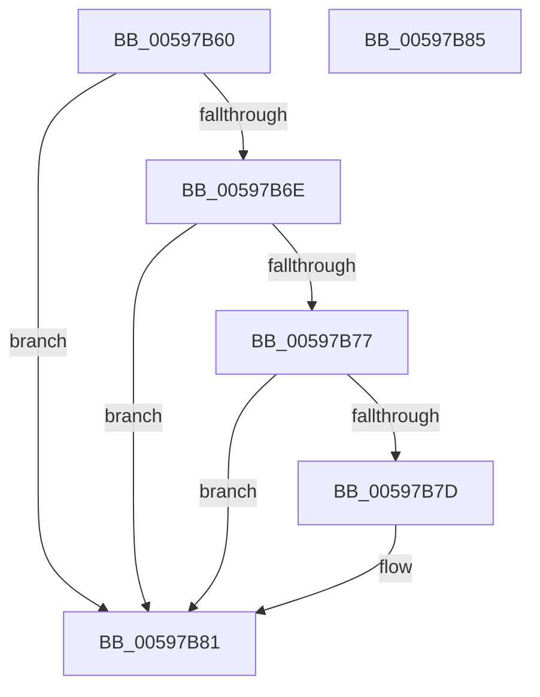

# IoGetOplockKeyContext

- RVA: `0x00597B60`–`0x00597B86` (길이 `38` bytes)
- VA: `0x0000000140597B60`
- 실행 섹션: `.text`
- PDB 이름 있음: `예`; PDB Function 태그: `아니요`
- unwind 정보 RVA: `0x000DB714`
- 디코드: `13`개 명령, `38/38` bytes 표시
- 미해석 바이트: `0` (있으면 어셈블리에 `.byte`로 보존)

> 이 문서는 커널 이미지의 기계어와 PDB 기호를 분석해 생성했습니다. 4번과 5번은 함수 원형과 자료형을 바이너리 사용 방식에서 추정한 C 해석이며 원본 소스 복구 결과는 아닙니다.

## 1. Dependencies

- 직접 호출 지점: **0**; 고유 호출 대상: **0**
- 직접 호출자로 확인된 함수: **0**
- RIP 상대 이미지 참조: **0**

### Outgoing calls
- 직접 디코드된 call 명령이 없습니다.

### Direct callers
- 이 함수 시작 RVA로 연결되는 직접 call은 확인되지 않았습니다. 간접 호출은 완전히 역산할 수 없습니다.

### Static image references
- 디코드된 RIP-relative 메모리 참조가 없습니다.

## 2. Other-region calls and transfers

- 다른 실행 섹션으로 향하는 call: **0**
- 별도 외부 분기/꼬리 이동을 확인하지 못했습니다.

## 3. Assembly (complete function range)

```asm
00597B60  48 8B 89 D0 00 00 00            mov rcx, qword ptr [rcx + 0xd0]
00597B67  33 D2                           xor edx, edx
00597B69  48 85 C9                        test rcx, rcx
00597B6C  74 13                           je 0x140597b81
00597B6E  48 8B 49 38                     mov rcx, qword ptr [rcx + 0x38]
00597B72  48 85 C9                        test rcx, rcx
00597B75  74 0A                           je 0x140597b81
00597B77  F6 41 02 02                     test byte ptr [rcx + 2], 2
00597B7B  74 04                           je 0x140597b81
00597B7D  48 8D 51 14                     lea rdx, [rcx + 0x14]
00597B81  48 8B C2                        mov rax, rdx
00597B84  C3                              ret
00597B85  CC                              int3
```

## 4. C-style interpretation (structured pseudocode)

```c
__int64 __fastcall IoGetOplockKeyContext(__int64 a1, int a2)
{
    a2 = 0;
    if (*(unsigned __int64 *)(a1 + 208) == 0) goto loc_00597B81;
    if (*(unsigned __int64 *)(*(unsigned __int64 *)(a1 + 208) + 56) == 0) goto loc_00597B81;
    if (((*(unsigned __int8 *)(*(unsigned __int64 *)(*(unsigned __int64 *)(a1 + 208) + 56) + 2)) & (2)) != 0) {
        a2 = *(unsigned __int64 *)(*(unsigned __int64 *)(a1 + 208) + 56) + 20;
    }
    return a2;
}
```

## 5. (Beta) C Style

```c
int64_t IoGetOplockKeyContext(void *Arg1, int32_t Arg2)
{
    uint8_t *arg1 = (uint8_t *)Arg1;

    Arg2 = 0;
    if (*(uint64_t *)(arg1 + 0xD0) == 0) goto loc_00597B81;
    if (*(uint64_t *)(*(uint64_t *)(arg1 + 0xD0) + 0x38) == 0) goto loc_00597B81;
    if (((*(uint8_t *)(*(uint64_t *)(*(uint64_t *)(arg1 + 0xD0) + 0x38) + 0x2)) & (2)) != 0) {
        Arg2 = *(uint64_t *)(*(uint64_t *)(arg1 + 0xD0) + 0x38) + 20;
    }
    return Arg2;
}
```

### 관측된 메모리 오프셋

구조체 형식이 확인되지 않은 접근은 인자 기준의 오프셋으로만 기록했습니다.

| 기준 인자 | 오프셋 표현 | 폭 (bit) | 접근 |
|---|---:|---:|---|
| `Arg1` | `+ 0xD0` | `64` | `R` |

## 6. Execution-region graph

[열기: 2D/3D 그래프와 함수 탐색 컨트롤 패널](../../../control-panel.html?section=text&rva=0x00597B60&view=graph)

- 2D 그래프는 위에서 아래로 흐르고, 3D 그래프는 빈 공간을 드래그해 회전합니다. Shift+드래그는 이동, 휠은 확대·축소, 함수 노드 선택은 대상 보고서 이동입니다.

### Static fallback


