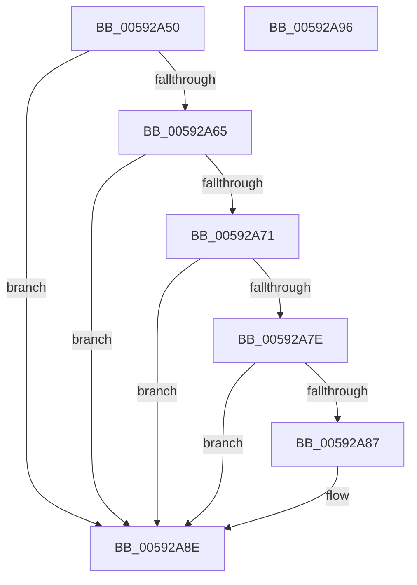

# IoInitializeDumpStack

- RVA: `0x00592A50`–`0x00592A97` (길이 `71` bytes)
- VA: `0x0000000140592A50`
- 실행 섹션: `.text`
- PDB 이름 있음: `예`; PDB Function 태그: `아니요`
- unwind 정보 RVA: `0x0005CF00`
- 디코드: `23`개 명령, `71/71` bytes 표시
- 미해석 바이트: `0` (있으면 어셈블리에 `.byte`로 보존)

> 이 문서는 커널 이미지의 기계어와 PDB 기호를 분석해 생성했습니다. 4번과 5번은 함수 원형과 자료형을 바이너리 사용 방식에서 추정한 C 해석이며 원본 소스 복구 결과는 아닙니다.

## 1. Dependencies

- 직접 호출 지점: **2**; 고유 호출 대상: **2**
- 직접 호출자로 확인된 함수: **2**
- RIP 상대 이미지 참조: **2**

### Outgoing calls
- `0x00592A73` → [guard_dispatch_icall](../6B/guard_dispatch_icall_function_006BAAD0.md) (function, `0x006BAAD0`)
- `0x00592A89` → [IopDumpTraceInitializeDumpStackFailure](IopDumpTraceInitializeDumpStackFailure_function_005951A8.md) (function, `0x005951A8`)

### Direct callers
- [PopSaveHiberContext](../../pagelk/B6/PopSaveHiberContext_function_00B6F050.md) at `0x00B6F532`
- [PopRestoreHiberContext](../../pagelk/B7/PopRestoreHiberContext_function_00B777F0.md) at `0x00B7796E`

### Static image references
- `0x00592A56` → RVA `0x00E66058` (`.data`; read)
- `0x00592A65` → RVA `0x00E65FE8` (`.data`; read)

## 2. Other-region calls and transfers

- 다른 실행 섹션으로 향하는 call: **0**
- 별도 외부 분기/꼬리 이동을 확인하지 못했습니다.

## 3. Assembly (complete function range)

```asm
00592A50  40 53                           push rbx
00592A52  48 83 EC 20                     sub rsp, 0x20
00592A56  48 83 3D FA 35 8D 00 00         cmp qword ptr [rip + 0x8d35fa], 0
00592A5E  BB 01 00 00 C0                  mov ebx, 0xc0000001
00592A63  74 29                           je 0x140592a8e
00592A65  48 8B 05 7C 35 8D 00            mov rax, qword ptr [rip + 0x8d357c]
00592A6C  48 85 C0                        test rax, rax
00592A6F  74 1D                           je 0x140592a8e
00592A71  33 D2                           xor edx, edx
00592A73  E8 58 80 12 00                  call 0x1406baad0
00592A78  8B D8                           mov ebx, eax
00592A7A  85 C0                           test eax, eax
00592A7C  79 10                           jns 0x140592a8e
00592A7E  44 0F 20 C1                     mov rcx, cr8
00592A82  80 F9 0F                        cmp cl, 0xf
00592A85  73 07                           jae 0x140592a8e
00592A87  8B C8                           mov ecx, eax
00592A89  E8 1A 27 00 00                  call 0x1405951a8
00592A8E  8B C3                           mov eax, ebx
00592A90  48 83 C4 20                     add rsp, 0x20
00592A94  5B                              pop rbx
00592A95  C3                              ret
00592A96  CC                              int3
```

## 4. C-style interpretation (structured pseudocode)

```c
__int64 __fastcall IoInitializeDumpStack(__int64 a1, int a2)
{
    __int64 result;
    __int64 v_rsp;

    v_rsp = (v_rsp) - (32);
    if ((*(unsigned __int64 *)(v_rip + 9254394)) == 0) goto loc_00592A8E;
    if (*(unsigned __int64 *)(v_rip + 9254268) == 0) goto loc_00592A8E;
    a2 = 0;
    result = guard_dispatch_icall(a1, a2, a3, a4);
    if (!sign_flag) goto loc_00592A8E;
    if (((unsigned __int8)(v_cr8)) < 15) {
        a1 = (unsigned int)(result);
        result = IopDumpTraceInitializeDumpStackFailure(a1, a2, a3, a4);
    }
    v_rsp = (v_rsp) + (32);
    return (unsigned int)((unsigned int)((unsigned int)((unsigned int)(result))));
}
```

## 5. (Beta) C Style

```c
int64_t IoInitializeDumpStack(int64_t Arg1, int32_t Arg2)
{
    int64_t result;
    int64_t local_rsp;

    local_rsp = (local_rsp) - (32);
    if ((*(uint64_t *)(v_rip + 0x8D35FA)) == 0) goto loc_00592A8E;
    if (*(uint64_t *)(v_rip + 0x8D357C) == 0) goto loc_00592A8E;
    Arg2 = 0;
    result = guard_dispatch_icall(Arg1, Arg2, a3, a4);
    if (!sign_flag) goto loc_00592A8E;
    if (((uint8_t)(v_cr8)) < 15) {
        Arg1 = (uint32_t)(result);
        result = IopDumpTraceInitializeDumpStackFailure(Arg1, Arg2, a3, a4);
    }
    local_rsp = (local_rsp) + (32);
    return (uint32_t)((uint32_t)((uint32_t)((uint32_t)(result))));
}
```

## 6. Execution-region graph

[열기: 2D/3D 그래프와 함수 탐색 컨트롤 패널](../../../control-panel.html?section=text&rva=0x00592A50&view=graph)

- 2D 그래프는 위에서 아래로 흐르고, 3D 그래프는 빈 공간을 드래그해 회전합니다. Shift+드래그는 이동, 휠은 확대·축소, 함수 노드 선택은 대상 보고서 이동입니다.

### Static fallback


