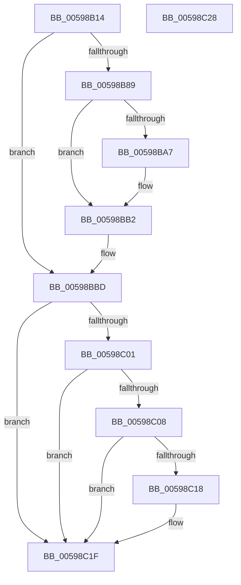

# IoInitializeLiveDump

- RVA: `0x00598B14`–`0x00598C29` (길이 `277` bytes)
- VA: `0x0000000140598B14`
- 실행 섹션: `.text`
- PDB 이름 있음: `예`; PDB Function 태그: `아니요`
- unwind 정보 RVA: `0x000C7C4C`
- 디코드: `65`개 명령, `277/277` bytes 표시
- 미해석 바이트: `0` (있으면 어셈블리에 `.byte`로 보존)

> 이 문서는 커널 이미지의 기계어와 PDB 기호를 분석해 생성했습니다. 4번과 5번은 함수 원형과 자료형을 바이너리 사용 방식에서 추정한 C 해석이며 원본 소스 복구 결과는 아닙니다.

## 1. Dependencies

- 직접 호출 지점: **8**; 고유 호출 대상: **7**
- 직접 호출자로 확인된 함수: **1**
- RIP 상대 이미지 참조: **7**

### Outgoing calls
- `0x00598B55` → [EtwRegister](../../page/92/EtwRegister_function_00920960.md) (function, `0x00920960`)
- `0x00598B66` → [TraceLoggingRegisterEx_EtwRegister_EtwSetInformation](../../page/92/TraceLoggingRegisterEx_EtwRegister_EtwSetInformation_function_009208A0.md) (function, `0x009208A0`)
- `0x00598B80` → [IopOpenRegistryKey](../../page/A8/IopOpenRegistryKey_function_00A8F200.md) (function, `0x00A8F200`)
- `0x00598B9E` → [IopGetRegistryValue](../../page/99/IopGetRegistryValue_function_009990EC.md) (function, `0x009990EC`)
- `0x00598BAD` → [ExFreePoolWithTag](../../poolcode/B8/ExFreePoolWithTag_function_00B82870.md) (function, `0x00B82870`)
- `0x00598BB8` → [ObCloseHandle](../../page/8A/ObCloseHandle_function_008A1870.md) (function, `0x008A1870`)
- `0x00598BF8` → [MmQueryMemoryRanges](../../page/7F/MmQueryMemoryRanges_function_007FC3A0.md) (function, `0x007FC3A0`)
- `0x00598C1A` → [ExFreePoolWithTag](../../poolcode/B8/ExFreePoolWithTag_function_00B82870.md) (function, `0x00B82870`)

### Direct callers
- [IoInitSystemPreDrivers](../../init/C2/IoInitSystemPreDrivers_function_00C2AC3C.md) at `0x00C2BC77`

### Static image references
- `0x00598B25` → RVA `0x006C9FF0` (` ?? ::FNODOBFM::`string'`; read)
- `0x00598B31` → RVA `0x00E66228` (`.data`; read)
- `0x00598B3F` → RVA `0x005A4520` (`IopLiveDumpTracingControlCallback`; read)
- `0x00598B4E` → RVA `0x000221E8` (`.rdata`; read)
- `0x00598B5D` → RVA `0x00E06EA0` (`.data`; read)
- `0x00598B97` → RVA `0x006CA070` (` ?? ::FNODOBFM::`string'`; read)
- `0x00598C0C` → RVA `0x00E66181` (`.data`; write)

## 2. Other-region calls and transfers

- 다른 실행 섹션으로 향하는 call: **8**
  - `0x00598B55` → [EtwRegister](../../page/92/EtwRegister_function_00920960.md) (`.text` → `PAGE`)
  - `0x00598B66` → [TraceLoggingRegisterEx_EtwRegister_EtwSetInformation](../../page/92/TraceLoggingRegisterEx_EtwRegister_EtwSetInformation_function_009208A0.md) (`.text` → `PAGE`)
  - `0x00598B80` → [IopOpenRegistryKey](../../page/A8/IopOpenRegistryKey_function_00A8F200.md) (`.text` → `PAGE`)
  - `0x00598B9E` → [IopGetRegistryValue](../../page/99/IopGetRegistryValue_function_009990EC.md) (`.text` → `PAGE`)
  - `0x00598BAD` → [ExFreePoolWithTag](../../poolcode/B8/ExFreePoolWithTag_function_00B82870.md) (`.text` → `POOLCODE`)
  - `0x00598BB8` → [ObCloseHandle](../../page/8A/ObCloseHandle_function_008A1870.md) (`.text` → `PAGE`)
  - `0x00598BF8` → [MmQueryMemoryRanges](../../page/7F/MmQueryMemoryRanges_function_007FC3A0.md) (`.text` → `PAGE`)
  - `0x00598C1A` → [ExFreePoolWithTag](../../poolcode/B8/ExFreePoolWithTag_function_00B82870.md) (`.text` → `POOLCODE`)
- 별도 외부 분기/꼬리 이동을 확인하지 못했습니다.

## 3. Assembly (complete function range)

```asm
00598B14  40 55                           push rbp
00598B16  48 8B EC                        mov rbp, rsp
00598B19  48 81 EC 80 00 00 00            sub rsp, 0x80
00598B20  48 83 65 10 00                  and qword ptr [rbp + 0x10], 0
00598B25  48 8D 05 C4 14 13 00            lea rax, [rip + 0x1314c4]
00598B2C  48 83 65 18 00                  and qword ptr [rbp + 0x18], 0
00598B31  4C 8D 0D F0 D6 8C 00            lea r9, [rip + 0x8cd6f0]
00598B38  45 33 C0                        xor r8d, r8d
00598B3B  48 89 45 B8                     mov qword ptr [rbp - 0x48], rax
00598B3F  48 8D 15 DA B9 00 00            lea rdx, [rip + 0xb9da]
00598B46  48 C7 45 B0 7C 00 7E 00         mov qword ptr [rbp - 0x50], 0x7e007c
00598B4E  48 8D 0D 93 96 A8 FF            lea rcx, [rip - 0x57696d]
00598B55  E8 06 7E 38 00                  call 0x140920960
00598B5A  45 33 C0                        xor r8d, r8d
00598B5D  48 8D 0D 3C E3 86 00            lea rcx, [rip + 0x86e33c]
00598B64  33 D2                           xor edx, edx
00598B66  E8 35 7D 38 00                  call 0x1409208a0
00598B6B  41 B9 19 00 02 00               mov r9d, 0x20019
00598B71  C6 44 24 20 00                  mov byte ptr [rsp + 0x20], 0
00598B76  4C 8D 45 B0                     lea r8, [rbp - 0x50]
00598B7A  33 D2                           xor edx, edx
00598B7C  48 8D 4D 10                     lea rcx, [rbp + 0x10]
00598B80  E8 7B 66 4F 00                  call 0x140a8f200
00598B85  85 C0                           test eax, eax
00598B87  78 34                           js 0x140598bbd
00598B89  48 8B 4D 10                     mov rcx, qword ptr [rbp + 0x10]
00598B8D  4C 8D 4D 18                     lea r9, [rbp + 0x18]
00598B91  41 B8 04 00 00 00               mov r8d, 4
00598B97  48 8D 15 D2 14 13 00            lea rdx, [rip + 0x1314d2]
00598B9E  E8 49 05 40 00                  call 0x1409990ec
00598BA3  85 C0                           test eax, eax
00598BA5  78 0B                           js 0x140598bb2
00598BA7  48 8B 4D 18                     mov rcx, qword ptr [rbp + 0x18]
00598BAB  33 D2                           xor edx, edx
00598BAD  E8 BE 9C 5E 00                  call 0x140b82870
00598BB2  48 8B 4D 10                     mov rcx, qword ptr [rbp + 0x10]
00598BB6  33 D2                           xor edx, edx
00598BB8  E8 B3 8C 30 00                  call 0x1408a1870
00598BBD  0F 57 C0                        xorps xmm0, xmm0
00598BC0  48 8D 4D C0                     lea rcx, [rbp - 0x40]
00598BC4  0F 11 45 C0                     movups xmmword ptr [rbp - 0x40], xmm0
00598BC8  83 4D C4 0F                     or dword ptr [rbp - 0x3c], 0xf
00598BCC  33 C0                           xor eax, eax
00598BCE  0F 11 45 D0                     movups xmmword ptr [rbp - 0x30], xmm0
00598BD2  C7 45 C0 01 00 00 00            mov dword ptr [rbp - 0x40], 1
00598BD9  0F 11 45 E0                     movups xmmword ptr [rbp - 0x20], xmm0
00598BDD  48 C7 45 D8 00 00 00 40         mov qword ptr [rbp - 0x28], 0x40000000
00598BE5  48 C7 45 C8 FE FF FF FF         mov qword ptr [rbp - 0x38], 0xfffffffffffffffe
00598BED  C7 45 E0 00 00 00 80            mov dword ptr [rbp - 0x20], 0x80000000
00598BF4  48 89 45 F0                     mov qword ptr [rbp - 0x10], rax
00598BF8  E8 A3 37 26 00                  call 0x1407fc3a0
00598BFD  85 C0                           test eax, eax
00598BFF  78 1E                           js 0x140598c1f
00598C01  48 83 7D E8 00                  cmp qword ptr [rbp - 0x18], 0
00598C06  76 17                           jbe 0x140598c1f
00598C08  48 8B 4D F0                     mov rcx, qword ptr [rbp - 0x10]
00598C0C  C6 05 6E D5 8C 00 01            mov byte ptr [rip + 0x8cd56e], 1
00598C13  48 85 C9                        test rcx, rcx
00598C16  74 07                           je 0x140598c1f
00598C18  33 D2                           xor edx, edx
00598C1A  E8 51 9C 5E 00                  call 0x140b82870
00598C1F  48 81 C4 80 00 00 00            add rsp, 0x80
00598C26  5D                              pop rbp
00598C27  C3                              ret
00598C28  CC                              int3
```

## 4. C-style interpretation (structured pseudocode)

```c
__int64 __fastcall IoInitializeLiveDump(__int64 a1, __int64 a2, int a3)
{
    __int64 result;
    __int64 v_rsp;
    unsigned __int64 v_stack_m18;
    unsigned __int64 v_stack_m20;
    unsigned __int64 v_stack_m28;
    unsigned __int64 v_stack_m30;
    unsigned __int64 v_stack_m38;
    unsigned __int64 v_stack_m40;
    unsigned int v_stack_m44;
    unsigned __int64 v_stack_m48;
    unsigned __int64 v_stack_m50;
    unsigned __int64 v_stack_m58;
    unsigned __int8 v_stack_m68;
    unsigned __int64 v_stack_p10;
    unsigned __int64 v_stack_p8;

    v_rsp = (v_rsp) - (128);
    a3 = 0;
    v_stack_m50 = v_rip + 1250500;
    v_stack_m58 = 0x7E007CULL;
    result = EtwRegister(v_rip - 5728621, v_rip + 47578, a3, v_rip + 9230064);
    a3 = 0;
    a2 = 0;
    result = TraceLoggingRegisterEx_EtwRegister_EtwSetInformation(v_rip + 8839996, a2, a3, v_rip + 9230064);
    v_stack_m68 = 0;
    a2 = 0;
    result = IopOpenRegistryKey(v_stack_p8, a2, v_stack_m58, (unsigned int)(0x20019ULL));
    if (sign_flag) goto loc_00598BBD;
    result = IopGetRegistryValue(v_stack_p8, v_rip + 1250514, 4, v_stack_p10);
    if (!(sign_flag)) {
        a1 = v_stack_p10;
        a2 = 0;
        result = ExFreePoolWithTag(a1, a2, 4, v_stack_p10);
    }
    a2 = 0;
    result = ObCloseHandle(v_stack_p8, a2, 4, v_stack_p10);
loc_00598BBD:
    v_stack_m48 = v_xmm0;
    result = 0;
    v_stack_m38 = v_xmm0;
    v_stack_m48 = 1;
    v_stack_m28 = v_xmm0;
    v_stack_m30 = 0x40000000ULL;
    v_stack_m40 = -2;
    v_stack_m28 = 0x80000000ULL;
    v_stack_m18 = 0;
    result = MmQueryMemoryRanges(v_stack_m48, a2, 4, v_stack_p10);
    if (sign_flag) goto loc_00598C1F;
    if (v_stack_m20 <= 0) goto loc_00598C1F;
    *(unsigned __int8 *)(v_rip + 9229678) = 1;
    if (v_stack_m18 != 0) {
        a2 = 0;
        result = ExFreePoolWithTag(v_stack_m18, a2, 4, v_stack_p10);
    }
    v_rsp = (v_rsp) + (128);
    return result;
}
```

## 5. (Beta) C Style

```c
int64_t IoInitializeLiveDump(int64_t Arg1, int64_t Arg2, int32_t Arg3)
{
    int64_t result;
    int64_t local_rsp;
    uint64_t v_stack_m18;
    uint64_t v_stack_m20;
    uint64_t v_stack_m28;
    uint64_t v_stack_m30;
    uint64_t v_stack_m38;
    uint64_t v_stack_m40;
    uint32_t v_stack_m44;
    uint64_t v_stack_m48;
    uint64_t v_stack_m50;
    uint64_t v_stack_m58;
    uint8_t v_stack_m68;
    uint64_t v_stack_p10;
    uint64_t v_stack_p8;

    local_rsp = (local_rsp) - (128);
    Arg3 = 0;
    v_stack_m50 = v_rip + 1250500;
    v_stack_m58 = 0x7E007CULL;
    result = EtwRegister(v_rip - 5728621, v_rip + 47578, Arg3, v_rip + 9230064);
    Arg3 = 0;
    Arg2 = 0;
    result = TraceLoggingRegisterEx_EtwRegister_EtwSetInformation(v_rip + 8839996, Arg2, Arg3, v_rip + 9230064);
    v_stack_m68 = 0;
    Arg2 = 0;
    result = IopOpenRegistryKey(v_stack_p8, Arg2, v_stack_m58, (uint32_t)(0x20019ULL));
    if (sign_flag) goto loc_00598BBD;
    result = IopGetRegistryValue(v_stack_p8, v_rip + 1250514, 4, v_stack_p10);
    if (!(sign_flag)) {
        Arg1 = v_stack_p10;
        Arg2 = 0;
        result = ExFreePoolWithTag(Arg1, Arg2, 4, v_stack_p10);
    }
    Arg2 = 0;
    result = ObCloseHandle(v_stack_p8, Arg2, 4, v_stack_p10);
loc_00598BBD:
    v_stack_m48 = v_xmm0;
    result = 0;
    v_stack_m38 = v_xmm0;
    v_stack_m48 = 1;
    v_stack_m28 = v_xmm0;
    v_stack_m30 = 0x40000000ULL;
    v_stack_m40 = -2;
    v_stack_m28 = 0x80000000ULL;
    v_stack_m18 = 0;
    result = MmQueryMemoryRanges(v_stack_m48, Arg2, 4, v_stack_p10);
    if (sign_flag) goto loc_00598C1F;
    if (v_stack_m20 <= 0) goto loc_00598C1F;
    *(uint8_t *)(v_rip + 0x8CD56E) = 1;
    if (v_stack_m18 != 0) {
        Arg2 = 0;
        result = ExFreePoolWithTag(v_stack_m18, Arg2, 4, v_stack_p10);
    }
    local_rsp = (local_rsp) + (128);
    return result;
}
```

## 6. Execution-region graph

[열기: 2D/3D 그래프와 함수 탐색 컨트롤 패널](../../../control-panel.html?section=text&rva=0x00598B14&view=graph)

- 2D 그래프는 위에서 아래로 흐르고, 3D 그래프는 빈 공간을 드래그해 회전합니다. Shift+드래그는 이동, 휠은 확대·축소, 함수 노드 선택은 대상 보고서 이동입니다.

### Static fallback


