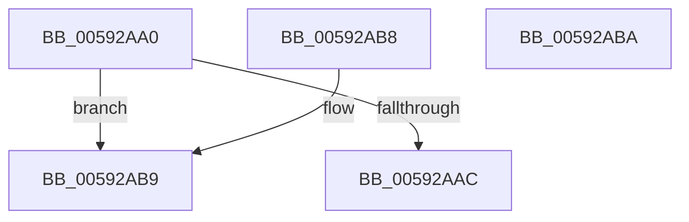

# IoIsPartialDumpRetry

- RVA: `0x00592AA0`–`0x00592ABB` (길이 `27` bytes)
- VA: `0x0000000140592AA0`
- 실행 섹션: `.text`
- PDB 이름 있음: `예`; PDB Function 태그: `아니요`
- unwind 정보 RVA: `0x000DB714`
- 디코드: `10`개 명령, `27/27` bytes 표시
- 미해석 바이트: `0` (있으면 어셈블리에 `.byte`로 보존)

> 이 문서는 커널 이미지의 기계어와 PDB 기호를 분석해 생성했습니다. 4번과 5번은 함수 원형과 자료형을 바이너리 사용 방식에서 추정한 C 해석이며 원본 소스 복구 결과는 아닙니다.

## 1. Dependencies

- 직접 호출 지점: **0**; 고유 호출 대상: **0**
- 직접 호출자로 확인된 함수: **5**
- RIP 상대 이미지 참조: **1**

### Outgoing calls
- 직접 디코드된 call 명령이 없습니다.

### Direct callers
- [HvlAddPagesCallbackRoutine](../58/HvlAddPagesCallbackRoutine_function_0058AF50.md) at `0x0058AFB9`
- [HvlAddSecureHvPagesCallbackRoutine](../58/HvlAddSecureHvPagesCallbackRoutine_function_0058B070.md) at `0x0058B090`
- [HvlAddSecurePagesCallbackRoutine](../58/HvlAddSecurePagesCallbackRoutine_function_0058B0C8.md) at `0x0058B0FD`
- [HvlAddSecureSkPagesCallbackRoutine](../58/HvlAddSecureSkPagesCallbackRoutine_function_0058B2F0.md) at `0x0058B30D`
- [KeValidateBugCheckCallbackRecord](../5B/KeValidateBugCheckCallbackRecord_function_005B39C0.md) at `0x005B3A40`

### Static image references
- `0x00592AA0` → RVA `0x00E66050` (`.data`; read)

## 2. Other-region calls and transfers

- 다른 실행 섹션으로 향하는 call: **0**
- 별도 외부 분기/꼬리 이동을 확인하지 못했습니다.

## 3. Assembly (complete function range)

```asm
00592AA0  48 8B 05 A9 35 8D 00            mov rax, qword ptr [rip + 0x8d35a9]
00592AA7  48 85 C0                        test rax, rax
00592AAA  74 0D                           je 0x140592ab9
00592AAC  8B 80 58 05 00 00               mov eax, dword ptr [rax + 0x558]
00592AB2  C1 E8 03                        shr eax, 3
00592AB5  24 01                           and al, 1
00592AB7  C3                              ret
00592AB8  CC                              int3
00592AB9  C3                              ret
00592ABA  CC                              int3
```

## 4. C-style interpretation (structured pseudocode)

```c
__int64 __fastcall IoIsPartialDumpRetry(void)
{
    __int64 result;

    if (*(unsigned __int64 *)(v_rip + 9254313) == 0) goto loc_00592AB9;
    result = (unsigned int)(((unsigned int)(*(unsigned int *)(*(unsigned __int64 *)(v_rip + 9254313) + 1368))) >> (3));
    result = (unsigned __int8)((result) & (1));
    return result;
loc_00592AB9:
    return result;
}
```

## 5. (Beta) C Style

```c
void IoIsPartialDumpRetry(void)
{
    int64_t result;

    if (*(uint64_t *)(v_rip + 0x8D35A9) == 0) goto loc_00592AB9;
    result = (uint32_t)(((uint32_t)(*(uint32_t *)(*(uint64_t *)(v_rip + 0x8D35A9) + 0x558))) >> (3));
    result = (uint8_t)((result) & (1));
    return result;
loc_00592AB9:
    return result;
}
```

## 6. Execution-region graph

[열기: 2D/3D 그래프와 함수 탐색 컨트롤 패널](../../../control-panel.html?section=text&rva=0x00592AA0&view=graph)

- 2D 그래프는 위에서 아래로 흐르고, 3D 그래프는 빈 공간을 드래그해 회전합니다. Shift+드래그는 이동, 휠은 확대·축소, 함수 노드 선택은 대상 보고서 이동입니다.

### Static fallback


