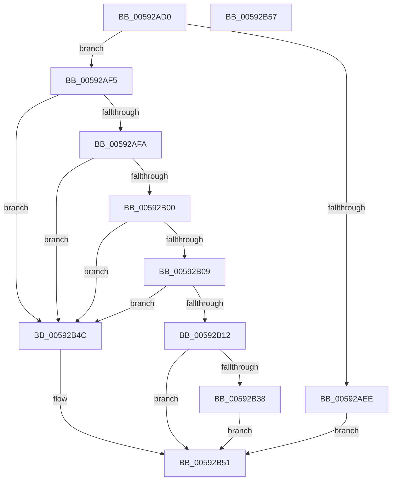

# IoLoadCrashDumpDriver

- RVA: `0x00592AD0`–`0x00592B58` (길이 `136` bytes)
- VA: `0x0000000140592AD0`
- 실행 섹션: `.text`
- PDB 이름 있음: `예`; PDB Function 태그: `아니요`
- unwind 정보 RVA: `0x000697A4`
- 디코드: `38`개 명령, `136/136` bytes 표시
- 미해석 바이트: `0` (있으면 어셈블리에 `.byte`로 보존)

> 이 문서는 커널 이미지의 기계어와 PDB 기호를 분석해 생성했습니다. 4번과 5번은 함수 원형과 자료형을 바이너리 사용 방식에서 추정한 C 해석이며 원본 소스 복구 결과는 아닙니다.

## 1. Dependencies

- 직접 호출 지점: **1**; 고유 호출 대상: **1**
- 직접 호출자로 확인된 함수: **0**
- RIP 상대 이미지 참조: **1**

### Outgoing calls
- `0x00592B2F` → [MmLoadSystemImage](../../page/99/MmLoadSystemImage_function_0099A9A0.md) (function, `0x0099A9A0`)

### Direct callers
- 이 함수 시작 RVA로 연결되는 직접 call은 확인되지 않았습니다. 간접 호출은 완전히 역산할 수 없습니다.

### Static image references
- `0x00592AE5` → RVA `0x00E660F8` (`.data`; read)

## 2. Other-region calls and transfers

- 다른 실행 섹션으로 향하는 call: **1**
  - `0x00592B2F` → [MmLoadSystemImage](../../page/99/MmLoadSystemImage_function_0099A9A0.md) (`.text` → `PAGE`)
- 별도 외부 분기/꼬리 이동을 확인하지 못했습니다.

## 3. Assembly (complete function range)

```asm
00592AD0  40 53                           push rbx
00592AD2  48 83 EC 40                     sub rsp, 0x40
00592AD6  48 83 64 24 68 00               and qword ptr [rsp + 0x68], 0
00592ADC  49 8B D8                        mov rbx, r8
00592ADF  48 83 64 24 30 00               and qword ptr [rsp + 0x30], 0
00592AE5  83 3D 0C 36 8D 00 00            cmp dword ptr [rip + 0x8d360c], 0
00592AEC  75 07                           jne 0x140592af5
00592AEE  B8 02 00 00 C0                  mov eax, 0xc0000002
00592AF3  EB 5C                           jmp 0x140592b51
00592AF5  83 3A 18                        cmp dword ptr [rdx], 0x18
00592AF8  75 52                           jne 0x140592b4c
00592AFA  41 83 38 18                     cmp dword ptr [r8], 0x18
00592AFE  75 4C                           jne 0x140592b4c
00592B00  48 8B 42 08                     mov rax, qword ptr [rdx + 8]
00592B04  48 85 C0                        test rax, rax
00592B07  74 43                           je 0x140592b4c
00592B09  4C 8B 42 10                     mov r8, qword ptr [rdx + 0x10]
00592B0D  4D 85 C0                        test r8, r8
00592B10  74 3A                           je 0x140592b4c
00592B12  48 8D 54 24 30                  lea rdx, [rsp + 0x30]
00592B17  41 B9 02 00 00 00               mov r9d, 2
00592B1D  48 89 54 24 28                  mov qword ptr [rsp + 0x28], rdx
00592B22  48 8D 54 24 68                  lea rdx, [rsp + 0x68]
00592B27  48 89 54 24 20                  mov qword ptr [rsp + 0x20], rdx
00592B2C  48 8B D0                        mov rdx, rax
00592B2F  E8 6C 7E 40 00                  call 0x14099a9a0
00592B34  85 C0                           test eax, eax
00592B36  78 19                           js 0x140592b51
00592B38  48 8B 4C 24 68                  mov rcx, qword ptr [rsp + 0x68]
00592B3D  48 89 4B 08                     mov qword ptr [rbx + 8], rcx
00592B41  48 8B 4C 24 30                  mov rcx, qword ptr [rsp + 0x30]
00592B46  48 89 4B 10                     mov qword ptr [rbx + 0x10], rcx
00592B4A  EB 05                           jmp 0x140592b51
00592B4C  B8 0D 00 00 C0                  mov eax, 0xc000000d
00592B51  48 83 C4 40                     add rsp, 0x40
00592B55  5B                              pop rbx
00592B56  C3                              ret
00592B57  CC                              int3
```

## 4. C-style interpretation (structured pseudocode)

```c
__int64 __fastcall IoLoadCrashDumpDriver(__int64 a1, __int64 a2, __int64 a3)
{
    __int64 result;
    __int64 v_rsp;
    unsigned __int64 v_stack_m18;
    unsigned __int64 v_stack_m20;
    unsigned __int64 v_stack_m28;
    unsigned __int64 v_stack_p20;

    v_rsp = (v_rsp) - (64);
    if ((*(unsigned int *)(v_rip + 9254412)) != 0) goto loc_00592AF5;
    goto loc_00592B51;
loc_00592AF5:
    if ((*(unsigned int *)(a2)) != 24) goto loc_00592B4C;
    if ((*(unsigned int *)(a3)) != 24) goto loc_00592B4C;
    if (*(unsigned __int64 *)(a2 + 8) == 0) goto loc_00592B4C;
    if (*(unsigned __int64 *)(a2 + 16) == 0) goto loc_00592B4C;
    v_stack_m20 = v_stack_m18;
    v_stack_m28 = v_stack_p20;
    result = MmLoadSystemImage(a1, *(unsigned __int64 *)(a2 + 8), *(unsigned __int64 *)(a2 + 16), 2);
    if (sign_flag) goto loc_00592B51;
    *(unsigned __int64 *)(a3 + 8) = v_stack_p20;
    *(unsigned __int64 *)(a3 + 16) = v_stack_m18;
    goto loc_00592B51;
loc_00592B4C:
loc_00592B51:
    v_rsp = (v_rsp) + (64);
    return (unsigned int)(0xC000000DULL);
}
```

## 5. (Beta) C Style

```c
int64_t IoLoadCrashDumpDriver(int64_t Arg1, void *Arg2, void *Arg3)
{
    uint8_t *arg2 = (uint8_t *)Arg2;
    uint8_t *arg3 = (uint8_t *)Arg3;

    int64_t result;
    int64_t local_rsp;
    uint64_t v_stack_m18;
    uint64_t v_stack_m20;
    uint64_t v_stack_m28;
    uint64_t v_stack_p20;

    local_rsp = (local_rsp) - (64);
    if ((*(uint32_t *)(v_rip + 0x8D360C)) != 0) goto loc_00592AF5;
    goto loc_00592B51;
loc_00592AF5:
    if ((*(uint32_t *)(arg2)) != 24) goto loc_00592B4C;
    if ((*(uint32_t *)(arg3)) != 24) goto loc_00592B4C;
    if (*(uint64_t *)(arg2 + 0x8) == 0) goto loc_00592B4C;
    if (*(uint64_t *)(arg2 + 0x10) == 0) goto loc_00592B4C;
    v_stack_m20 = v_stack_m18;
    v_stack_m28 = v_stack_p20;
    result = MmLoadSystemImage(Arg1, *(uint64_t *)(arg2 + 0x8), *(uint64_t *)(arg2 + 0x10), 2);
    if (sign_flag) goto loc_00592B51;
    *(uint64_t *)(arg3 + 0x8) = v_stack_p20;
    *(uint64_t *)(arg3 + 0x10) = v_stack_m18;
    goto loc_00592B51;
loc_00592B4C:
loc_00592B51:
    local_rsp = (local_rsp) + (64);
    return (uint32_t)(0xC000000DULL);
}
```

### 관측된 메모리 오프셋

구조체 형식이 확인되지 않은 접근은 인자 기준의 오프셋으로만 기록했습니다.

| 기준 인자 | 오프셋 표현 | 폭 (bit) | 접근 |
|---|---:|---:|---|
| `Arg2` | `+ 0x0` | `32` | `R` |
| `Arg2` | `+ 0x8` | `64` | `R` |
| `Arg2` | `+ 0x10` | `64` | `R` |
| `Arg3` | `+ 0x0` | `32` | `R` |
| `Arg3` | `+ 0x8` | `64` | `W` |
| `Arg3` | `+ 0x10` | `64` | `W` |

## 6. Execution-region graph

[열기: 2D/3D 그래프와 함수 탐색 컨트롤 패널](../../../control-panel.html?section=text&rva=0x00592AD0&view=graph)

- 2D 그래프는 위에서 아래로 흐르고, 3D 그래프는 빈 공간을 드래그해 회전합니다. Shift+드래그는 이동, 휠은 확대·축소, 함수 노드 선택은 대상 보고서 이동입니다.

### Static fallback


