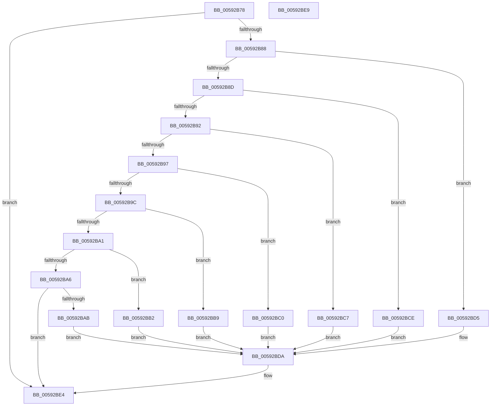

# IoNotifyDumpEx

- RVA: `0x00592B78`–`0x00592BEA` (길이 `114` bytes)
- VA: `0x0000000140592B78`
- 실행 섹션: `.text`
- PDB 이름 있음: `예`; PDB Function 태그: `아니요`
- unwind 정보 RVA: `0x0005C788`
- 디코드: `37`개 명령, `114/114` bytes 표시
- 미해석 바이트: `0` (있으면 어셈블리에 `.byte`로 보존)

> 이 문서는 커널 이미지의 기계어와 PDB 기호를 분석해 생성했습니다. 4번과 5번은 함수 원형과 자료형을 바이너리 사용 방식에서 추정한 C 해석이며 원본 소스 복구 결과는 아닙니다.

## 1. Dependencies

- 직접 호출 지점: **1**; 고유 호출 대상: **1**
- 직접 호출자로 확인된 함수: **2**
- RIP 상대 이미지 참조: **1**

### Outgoing calls
- `0x00592BDF` → [guard_dispatch_icall](../6B/guard_dispatch_icall_function_006BAAD0.md) (function, `0x006BAAD0`)

### Direct callers
- [IoNotifyDump](IoNotifyDump_function_00592B60.md) at `0x00592B67`
- [KeBugCheck2](../5B/KeBugCheck2_function_005B27D0.md) at `0x005B28D2`
- [KeBugCheck2](../5B/KeBugCheck2_function_005B27D0.md) at `0x005B29C2`
- [KeBugCheck2](../5B/KeBugCheck2_function_005B27D0.md) at `0x005B2A50`

### Static image references
- `0x00592B7C` → RVA `0x00E66000` (`.data`; read)

## 2. Other-region calls and transfers

- 다른 실행 섹션으로 향하는 call: **0**
- 별도 외부 분기/꼬리 이동을 확인하지 못했습니다.

## 3. Assembly (complete function range)

```asm
00592B78  48 83 EC 28                     sub rsp, 0x28
00592B7C  4C 8B 0D 7D 34 8D 00            mov r9, qword ptr [rip + 0x8d347d]
00592B83  4D 85 C9                        test r9, r9
00592B86  74 5C                           je 0x140592be4
00592B88  83 E9 01                        sub ecx, 1
00592B8B  74 48                           je 0x140592bd5
00592B8D  83 E9 01                        sub ecx, 1
00592B90  74 3C                           je 0x140592bce
00592B92  83 E9 01                        sub ecx, 1
00592B95  74 30                           je 0x140592bc7
00592B97  83 E9 01                        sub ecx, 1
00592B9A  74 24                           je 0x140592bc0
00592B9C  83 E9 01                        sub ecx, 1
00592B9F  74 18                           je 0x140592bb9
00592BA1  83 E9 01                        sub ecx, 1
00592BA4  74 0C                           je 0x140592bb2
00592BA6  83 F9 01                        cmp ecx, 1
00592BA9  75 39                           jne 0x140592be4
00592BAB  B9 0C 00 00 00                  mov ecx, 0xc
00592BB0  EB 28                           jmp 0x140592bda
00592BB2  B9 0B 00 00 00                  mov ecx, 0xb
00592BB7  EB 21                           jmp 0x140592bda
00592BB9  B9 09 00 00 00                  mov ecx, 9
00592BBE  EB 1A                           jmp 0x140592bda
00592BC0  B9 07 00 00 00                  mov ecx, 7
00592BC5  EB 13                           jmp 0x140592bda
00592BC7  B9 05 00 00 00                  mov ecx, 5
00592BCC  EB 0C                           jmp 0x140592bda
00592BCE  B9 04 00 00 00                  mov ecx, 4
00592BD3  EB 05                           jmp 0x140592bda
00592BD5  B9 03 00 00 00                  mov ecx, 3
00592BDA  33 D2                           xor edx, edx
00592BDC  49 8B C1                        mov rax, r9
00592BDF  E8 EC 7E 12 00                  call 0x1406baad0
00592BE4  48 83 C4 28                     add rsp, 0x28
00592BE8  C3                              ret
00592BE9  CC                              int3
```

## 4. C-style interpretation (structured pseudocode)

```c
__int64 __fastcall IoNotifyDumpEx(int a1, int a2)
{
    __int64 result;
    __int64 v_rsp;

    v_rsp = (v_rsp) - (40);
    if (*(unsigned __int64 *)(v_rip + 9254013) == 0) goto loc_00592BE4;
    a1 = (unsigned int)((a1) - (1));
    if (condition_is_equal) goto loc_00592BD5;
    a1 = (unsigned int)((a1) - (1));
    if (condition_is_equal) goto loc_00592BCE;
    a1 = (unsigned int)((a1) - (1));
    if (condition_is_equal) goto loc_00592BC7;
    a1 = (unsigned int)((a1) - (1));
    if (condition_is_equal) goto loc_00592BC0;
    a1 = (unsigned int)((a1) - (1));
    if (condition_is_equal) goto loc_00592BB9;
    a1 = (unsigned int)((a1) - (1));
    if (condition_is_equal) goto loc_00592BB2;
    if (a1 != 1) goto loc_00592BE4;
    goto loc_00592BDA;
loc_00592BB2:
    goto loc_00592BDA;
loc_00592BB9:
    goto loc_00592BDA;
loc_00592BC0:
    goto loc_00592BDA;
loc_00592BC7:
    goto loc_00592BDA;
loc_00592BCE:
    goto loc_00592BDA;
loc_00592BD5:
loc_00592BDA:
    a2 = 0;
    result = guard_dispatch_icall(3, a2, a3, *(unsigned __int64 *)(v_rip + 9254013));
loc_00592BE4:
    v_rsp = (v_rsp) + (40);
    return result;
}
```

## 5. (Beta) C Style

```c
int64_t IoNotifyDumpEx(int32_t Arg1, int32_t Arg2)
{
    int64_t result;
    int64_t local_rsp;

    local_rsp = (local_rsp) - (40);
    if (*(uint64_t *)(v_rip + 0x8D347D) == 0) goto loc_00592BE4;
    Arg1 = (uint32_t)((Arg1) - (1));
    if (condition_is_equal) goto loc_00592BD5;
    Arg1 = (uint32_t)((Arg1) - (1));
    if (condition_is_equal) goto loc_00592BCE;
    Arg1 = (uint32_t)((Arg1) - (1));
    if (condition_is_equal) goto loc_00592BC7;
    Arg1 = (uint32_t)((Arg1) - (1));
    if (condition_is_equal) goto loc_00592BC0;
    Arg1 = (uint32_t)((Arg1) - (1));
    if (condition_is_equal) goto loc_00592BB9;
    Arg1 = (uint32_t)((Arg1) - (1));
    if (condition_is_equal) goto loc_00592BB2;
    if (Arg1 != 1) goto loc_00592BE4;
    goto loc_00592BDA;
loc_00592BB2:
    goto loc_00592BDA;
loc_00592BB9:
    goto loc_00592BDA;
loc_00592BC0:
    goto loc_00592BDA;
loc_00592BC7:
    goto loc_00592BDA;
loc_00592BCE:
    goto loc_00592BDA;
loc_00592BD5:
loc_00592BDA:
    Arg2 = 0;
    result = guard_dispatch_icall(3, Arg2, a3, *(uint64_t *)(v_rip + 0x8D347D));
loc_00592BE4:
    local_rsp = (local_rsp) + (40);
    return result;
}
```

## 6. Execution-region graph

[열기: 2D/3D 그래프와 함수 탐색 컨트롤 패널](../../../control-panel.html?section=text&rva=0x00592B78&view=graph)

- 2D 그래프는 위에서 아래로 흐르고, 3D 그래프는 빈 공간을 드래그해 회전합니다. Shift+드래그는 이동, 휠은 확대·축소, 함수 노드 선택은 대상 보고서 이동입니다.

### Static fallback


