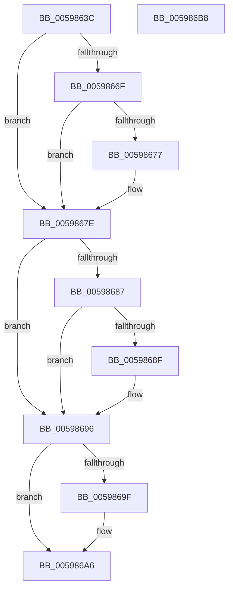

# IoPerfReset

- RVA: `0x0059863C`–`0x005986B9` (길이 `125` bytes)
- VA: `0x000000014059863C`
- 실행 섹션: `.text`
- PDB 이름 있음: `예`; PDB Function 태그: `아니요`
- unwind 정보 RVA: `0x000697A4`
- 디코드: `34`개 명령, `125/125` bytes 표시
- 미해석 바이트: `0` (있으면 어셈블리에 `.byte`로 보존)

> 이 문서는 커널 이미지의 기계어와 PDB 기호를 분석해 생성했습니다. 4번과 5번은 함수 원형과 자료형을 바이너리 사용 방식에서 추정한 C 해석이며 원본 소스 복구 결과는 아닙니다.

## 1. Dependencies

- 직접 호출 지점: **3**; 고유 호출 대상: **3**
- 직접 호출자로 확인된 함수: **2**
- RIP 상대 이미지 참조: **5**

### Outgoing calls
- `0x0059865F` → [KeAcquireInStackQueuedSpinLock](../27/KeAcquireInStackQueuedSpinLock_function_002757A0.md) (function, `0x002757A0`)
- `0x005986A1` → [IopUpdateFunctionPointers](IopUpdateFunctionPointers_function_0059762C.md) (function, `0x0059762C`)
- `0x005986AB` → [KeReleaseInStackQueuedSpinLock](../34/KeReleaseInStackQueuedSpinLock_function_00342CE0.md) (function, `0x00342CE0`)

### Direct callers
- [IoUnregisterIoTracking](../../page/71/IoUnregisterIoTracking_function_0071F750.md) at `0x0071F76C`
- [EtwpDisableKernelTrace](../../page/A4/EtwpDisableKernelTrace_function_00A4F7D8.md) at `0x00A4FAB5`

### Static image references
- `0x0059864C` → RVA `0x00F8D430` (`.data`; read)
- `0x0059866F` → RVA `0x00E6613C` (`.data`; read/write)
- `0x00598677` → RVA `0x00E66138` (`.data`; read/write)
- `0x00598687` → RVA `0x00E66140` (`.data`; read/write)
- `0x00598696` → RVA `0x00E66138` (`.data`; read)

## 2. Other-region calls and transfers

- 다른 실행 섹션으로 향하는 call: **0**
- 별도 외부 분기/꼬리 이동을 확인하지 못했습니다.

## 3. Assembly (complete function range)

```asm
0059863C  40 53                           push rbx
0059863E  48 83 EC 40                     sub rsp, 0x40
00598642  8B D9                           mov ebx, ecx
00598644  48 8D 54 24 20                  lea rdx, [rsp + 0x20]
00598649  0F 57 C0                        xorps xmm0, xmm0
0059864C  48 8D 0D DD 4D 9F 00            lea rcx, [rip + 0x9f4ddd]
00598653  33 C0                           xor eax, eax
00598655  0F 11 44 24 20                  movups xmmword ptr [rsp + 0x20], xmm0
0059865A  48 89 44 24 30                  mov qword ptr [rsp + 0x30], rax
0059865F  E8 3C D1 CD FF                  call 0x1402757a0
00598664  83 C8 FF                        or eax, 0xffffffff
00598667  41 B0 01                        mov r8b, 1
0059866A  41 84 D8                        test r8b, bl
0059866D  74 0F                           je 0x14059867e
0059866F  01 05 C7 DA 8C 00               add dword ptr [rip + 0x8cdac7], eax
00598675  75 07                           jne 0x14059867e
00598677  83 25 BA DA 8C 00 FE            and dword ptr [rip + 0x8cdaba], 0xfffffffe
0059867E  B9 02 00 00 00                  mov ecx, 2
00598683  84 D9                           test cl, bl
00598685  74 0F                           je 0x140598696
00598687  01 05 B3 DA 8C 00               add dword ptr [rip + 0x8cdab3], eax
0059868D  75 07                           jne 0x140598696
0059868F  83 25 A2 DA 8C 00 FD            and dword ptr [rip + 0x8cdaa2], 0xfffffffd
00598696  83 3D 9B DA 8C 00 00            cmp dword ptr [rip + 0x8cda9b], 0
0059869D  75 07                           jne 0x1405986a6
0059869F  33 D2                           xor edx, edx
005986A1  E8 86 EF FF FF                  call 0x14059762c
005986A6  48 8D 4C 24 20                  lea rcx, [rsp + 0x20]
005986AB  E8 30 A6 DA FF                  call 0x140342ce0
005986B0  33 C0                           xor eax, eax
005986B2  48 83 C4 40                     add rsp, 0x40
005986B6  5B                              pop rbx
005986B7  C3                              ret
005986B8  CC                              int3
```

## 4. C-style interpretation (structured pseudocode)

```c
__int64 __fastcall IoPerfReset(int a1)
{
    __int64 result;
    __int64 v_rsp;
    unsigned __int64 v_stack_m18;
    unsigned __int64 v_stack_m28;

    v_rsp = (v_rsp) - (64);
    result = 0;
    v_stack_m28 = v_xmm0;
    v_stack_m18 = 0;
    result = KeAcquireInStackQueuedSpinLock(v_rip + 10440157, v_stack_m28, a3, a4);
    result = (unsigned int)((result) | (0xFFFFFFFFULL));
    if (((1) & ((unsigned __int8)((unsigned int)(a1)))) == 0) goto loc_0059867E;
    if (((1) & ((unsigned __int8)((unsigned int)(a1)))) == 0) {
    }
    if (((2) & ((unsigned __int8)((unsigned int)(a1)))) == 0) goto loc_00598696;
    if (((2) & ((unsigned __int8)((unsigned int)(a1)))) == 0) {
    }
    if ((*(unsigned int *)(v_rip + 9231003)) == 0) {
        a2 = 0;
        result = IopUpdateFunctionPointers(2, a2, 1, a4);
    }
    result = KeReleaseInStackQueuedSpinLock(v_stack_m28, a2, 1, a4);
    result = 0;
    v_rsp = (v_rsp) + (64);
    return result;
}
```

## 5. (Beta) C Style

```c
int64_t IoPerfReset(int32_t Arg1)
{
    int64_t result;
    int64_t local_rsp;
    uint64_t v_stack_m18;
    uint64_t v_stack_m28;

    local_rsp = (local_rsp) - (64);
    result = 0;
    v_stack_m28 = v_xmm0;
    v_stack_m18 = 0;
    result = KeAcquireInStackQueuedSpinLock(v_rip + 10440157, v_stack_m28, a3, a4);
    result = (uint32_t)((result) | (0xFFFFFFFFULL));
    if (((1) & ((uint8_t)((uint32_t)(Arg1)))) == 0) goto loc_0059867E;
    if (((1) & ((uint8_t)((uint32_t)(Arg1)))) == 0) {
    }
    if (((2) & ((uint8_t)((uint32_t)(Arg1)))) == 0) goto loc_00598696;
    if (((2) & ((uint8_t)((uint32_t)(Arg1)))) == 0) {
    }
    if ((*(uint32_t *)(v_rip + 0x8CDA9B)) == 0) {
        a2 = 0;
        result = IopUpdateFunctionPointers(2, a2, 1, a4);
    }
    result = KeReleaseInStackQueuedSpinLock(v_stack_m28, a2, 1, a4);
    result = 0;
    local_rsp = (local_rsp) + (64);
    return result;
}
```

## 6. Execution-region graph

[열기: 2D/3D 그래프와 함수 탐색 컨트롤 패널](../../../control-panel.html?section=text&rva=0x0059863C&view=graph)

- 2D 그래프는 위에서 아래로 흐르고, 3D 그래프는 빈 공간을 드래그해 회전합니다. Shift+드래그는 이동, 휠은 확대·축소, 함수 노드 선택은 대상 보고서 이동입니다.

### Static fallback


