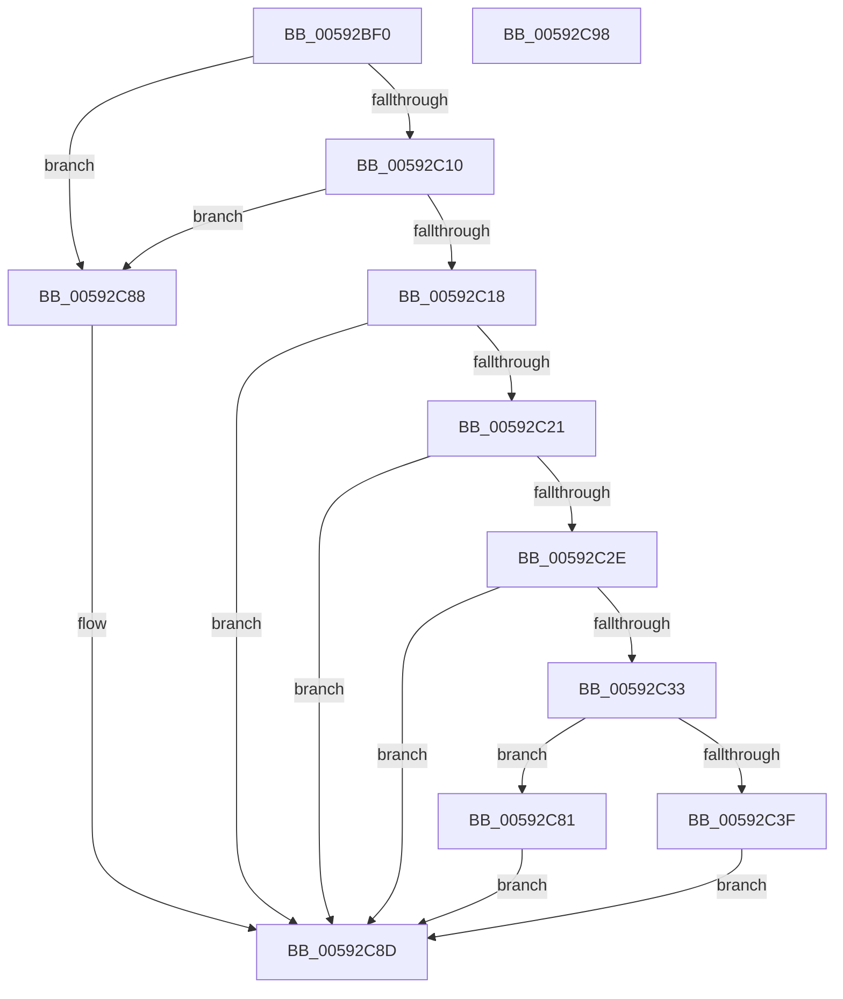

# IoProvisionCrashDumpKey

- RVA: `0x00592BF0`–`0x00592C99` (길이 `169` bytes)
- VA: `0x0000000140592BF0`
- 실행 섹션: `.text`
- PDB 이름 있음: `예`; PDB Function 태그: `아니요`
- unwind 정보 RVA: `0x0009EAB4`
- 디코드: `48`개 명령, `169/169` bytes 표시
- 미해석 바이트: `0` (있으면 어셈블리에 `.byte`로 보존)

> 이 문서는 커널 이미지의 기계어와 PDB 기호를 분석해 생성했습니다. 4번과 5번은 함수 원형과 자료형을 바이너리 사용 방식에서 추정한 C 해석이며 원본 소스 복구 결과는 아닙니다.

## 1. Dependencies

- 직접 호출 지점: **3**; 고유 호출 대상: **3**
- 직접 호출자로 확인된 함수: **1**
- RIP 상대 이미지 참조: **5**

### Outgoing calls
- `0x00592C18` → [SecureDump_ReInitialize](../5A/SecureDump_ReInitialize_function_005A348C.md) (function, `0x005A348C`)
- `0x00592C25` → [SecureDump_GetSecureDumpSettings](../4F/SecureDump_GetSecureDumpSettings_function_004F8128.md) (function, `0x004F8128`)
- `0x00592C7A` → [guard_dispatch_icall](../6B/guard_dispatch_icall_function_006BAAD0.md) (function, `0x006BAAD0`)

### Direct callers
- [NtSetSystemInformation](../../page/AF/NtSetSystemInformation_function_00AF4A60.md) at `0x00AF63C8`

### Static image references
- `0x00592C01` → RVA `0x00E660BC` (`.data`; read)
- `0x00592C10` → RVA `0x00E0A9BA` (`.data`; read)
- `0x00592C33` → RVA `0x00E66038` (`.data`; read)
- `0x00592C51` → RVA `0x005A2B60` (`SecureDump_Get_SecureDumpHeader`; read)
- `0x00592C5C` → RVA `0x005A2A10` (`SecureDump_Encrypt_DmpData`; read)

## 2. Other-region calls and transfers

- 다른 실행 섹션으로 향하는 call: **0**
- 별도 외부 분기/꼬리 이동을 확인하지 못했습니다.

## 3. Assembly (complete function range)

```asm
00592BF0  48 89 5C 24 08                  mov qword ptr [rsp + 8], rbx
00592BF5  55                              push rbp
00592BF6  48 8B EC                        mov rbp, rsp
00592BF9  48 83 EC 60                     sub rsp, 0x60
00592BFD  33 C0                           xor eax, eax
00592BFF  33 DB                           xor ebx, ebx
00592C01  38 1D B5 34 8D 00               cmp byte ptr [rip + 0x8d34b5], bl
00592C07  48 89 45 C0                     mov qword ptr [rbp - 0x40], rax
00592C0B  89 45 C8                        mov dword ptr [rbp - 0x38], eax
00592C0E  75 78                           jne 0x140592c88
00592C10  38 1D A4 7D 87 00               cmp byte ptr [rip + 0x877da4], bl
00592C16  74 70                           je 0x140592c88
00592C18  E8 6F 08 01 00                  call 0x1405a348c
00592C1D  85 C0                           test eax, eax
00592C1F  78 6C                           js 0x140592c8d
00592C21  48 8D 4D C0                     lea rcx, [rbp - 0x40]
00592C25  E8 FE 54 F6 FF                  call 0x1404f8128
00592C2A  85 C0                           test eax, eax
00592C2C  78 5F                           js 0x140592c8d
00592C2E  38 5D C0                        cmp byte ptr [rbp - 0x40], bl
00592C31  74 5A                           je 0x140592c8d
00592C33  48 8B 05 FE 33 8D 00            mov rax, qword ptr [rip + 0x8d33fe]
00592C3A  48 85 C0                        test rax, rax
00592C3D  74 42                           je 0x140592c81
00592C3F  8B 4D C4                        mov ecx, dword ptr [rbp - 0x3c]
00592C42  89 4D E8                        mov dword ptr [rbp - 0x18], ecx
00592C45  8B 4D C8                        mov ecx, dword ptr [rbp - 0x38]
00592C48  89 4D EC                        mov dword ptr [rbp - 0x14], ecx
00592C4B  8A 4D C1                        mov cl, byte ptr [rbp - 0x3f]
00592C4E  88 4D F0                        mov byte ptr [rbp - 0x10], cl
00592C51  48 8D 0D 08 FF 00 00            lea rcx, [rip + 0xff08]
00592C58  48 89 4D D8                     mov qword ptr [rbp - 0x28], rcx
00592C5C  48 8D 0D AD FD 00 00            lea rcx, [rip + 0xfdad]
00592C63  48 89 4D E0                     mov qword ptr [rbp - 0x20], rcx
00592C67  48 8D 4D D0                     lea rcx, [rbp - 0x30]
00592C6B  48 C7 45 D0 28 00 00 00         mov qword ptr [rbp - 0x30], 0x28
00592C73  66 89 5D F1                     mov word ptr [rbp - 0xf], bx
00592C77  88 5D F3                        mov byte ptr [rbp - 0xd], bl
00592C7A  E8 51 7E 12 00                  call 0x1406baad0
00592C7F  EB 0C                           jmp 0x140592c8d
00592C81  B8 01 00 00 C0                  mov eax, 0xc0000001
00592C86  EB 05                           jmp 0x140592c8d
00592C88  B8 BB 00 00 C0                  mov eax, 0xc00000bb
00592C8D  48 8B 5C 24 70                  mov rbx, qword ptr [rsp + 0x70]
00592C92  48 83 C4 60                     add rsp, 0x60
00592C96  5D                              pop rbp
00592C97  C3                              ret
00592C98  CC                              int3
```

## 4. C-style interpretation (structured pseudocode)

```c
__int64 __fastcall IoProvisionCrashDumpKey(void)
{
    __int64 result;
    __int64 v_rbx;
    __int64 v_rsp;
    unsigned __int8 v_stack_m15;
    unsigned __int16 v_stack_m17;
    unsigned __int8 v_stack_m18;
    unsigned int v_stack_m1C;
    unsigned int v_stack_m20;
    unsigned __int64 v_stack_m28;
    unsigned __int64 v_stack_m30;
    unsigned __int64 v_stack_m38;
    unsigned int v_stack_m40;
    unsigned int v_stack_m44;
    unsigned __int8 v_stack_m47;
    unsigned __int64 v_stack_m48;
    unsigned __int64 v_stack_p8;

    v_stack_p8 = v_rbx;
    v_rsp = (v_rsp) - (96);
    result = 0;
    v_rbx = 0;
    v_stack_m48 = 0;
    v_stack_m40 = 0;
    if ((*(unsigned __int8 *)(v_rip + 9254069)) != 0) goto loc_00592C88;
    if ((*(unsigned __int8 *)(v_rip + 8879524)) == 0) goto loc_00592C88;
    result = SecureDump_ReInitialize(a1, a2, a3, a4);
    if (sign_flag) goto loc_00592C8D;
    result = SecureDump_GetSecureDumpSettings(v_stack_m48, a2, a3, a4);
    if (sign_flag) goto loc_00592C8D;
    if (v_stack_m48 == 0) goto loc_00592C8D;
    if (*(unsigned __int64 *)(v_rip + 9253886) == 0) goto loc_00592C81;
    v_stack_m20 = (unsigned int)((unsigned int)(v_stack_m44));
    v_stack_m1C = (unsigned int)((unsigned int)(v_stack_m40));
    v_stack_m18 = (unsigned __int8)(v_stack_m47);
    v_stack_m30 = v_rip + 65288;
    v_stack_m28 = v_rip + 64941;
    v_stack_m38 = 40;
    v_stack_m17 = 0;
    v_stack_m15 = 0;
    result = guard_dispatch_icall(v_stack_m38, a2, a3, a4);
    goto loc_00592C8D;
loc_00592C81:
    goto loc_00592C8D;
loc_00592C88:
loc_00592C8D:
    v_rsp = (v_rsp) + (96);
    return (unsigned int)(0xC00000BBULL);
}
```

## 5. (Beta) C Style

```c
void IoProvisionCrashDumpKey(void)
{
    int64_t result;
    int64_t local_rbx;
    int64_t local_rsp;
    uint8_t v_stack_m15;
    uint16_t v_stack_m17;
    uint8_t v_stack_m18;
    uint32_t v_stack_m1C;
    uint32_t v_stack_m20;
    uint64_t v_stack_m28;
    uint64_t v_stack_m30;
    uint64_t v_stack_m38;
    uint32_t v_stack_m40;
    uint32_t v_stack_m44;
    uint8_t v_stack_m47;
    uint64_t v_stack_m48;
    uint64_t v_stack_p8;

    v_stack_p8 = local_rbx;
    local_rsp = (local_rsp) - (96);
    result = 0;
    local_rbx = 0;
    v_stack_m48 = 0;
    v_stack_m40 = 0;
    if ((*(uint8_t *)(v_rip + 0x8D34B5)) != 0) goto loc_00592C88;
    if ((*(uint8_t *)(v_rip + 0x877DA4)) == 0) goto loc_00592C88;
    result = SecureDump_ReInitialize(a1, a2, a3, a4);
    if (sign_flag) goto loc_00592C8D;
    result = SecureDump_GetSecureDumpSettings(v_stack_m48, a2, a3, a4);
    if (sign_flag) goto loc_00592C8D;
    if (v_stack_m48 == 0) goto loc_00592C8D;
    if (*(uint64_t *)(v_rip + 0x8D33FE) == 0) goto loc_00592C81;
    v_stack_m20 = (uint32_t)((uint32_t)(v_stack_m44));
    v_stack_m1C = (uint32_t)((uint32_t)(v_stack_m40));
    v_stack_m18 = (uint8_t)(v_stack_m47);
    v_stack_m30 = v_rip + 65288;
    v_stack_m28 = v_rip + 64941;
    v_stack_m38 = 40;
    v_stack_m17 = 0;
    v_stack_m15 = 0;
    result = guard_dispatch_icall(v_stack_m38, a2, a3, a4);
    goto loc_00592C8D;
loc_00592C81:
    goto loc_00592C8D;
loc_00592C88:
loc_00592C8D:
    local_rsp = (local_rsp) + (96);
    return (uint32_t)(0xC00000BBULL);
}
```

## 6. Execution-region graph

[열기: 2D/3D 그래프와 함수 탐색 컨트롤 패널](../../../control-panel.html?section=text&rva=0x00592BF0&view=graph)

- 2D 그래프는 위에서 아래로 흐르고, 3D 그래프는 빈 공간을 드래그해 회전합니다. Shift+드래그는 이동, 휠은 확대·축소, 함수 노드 선택은 대상 보고서 이동입니다.

### Static fallback


