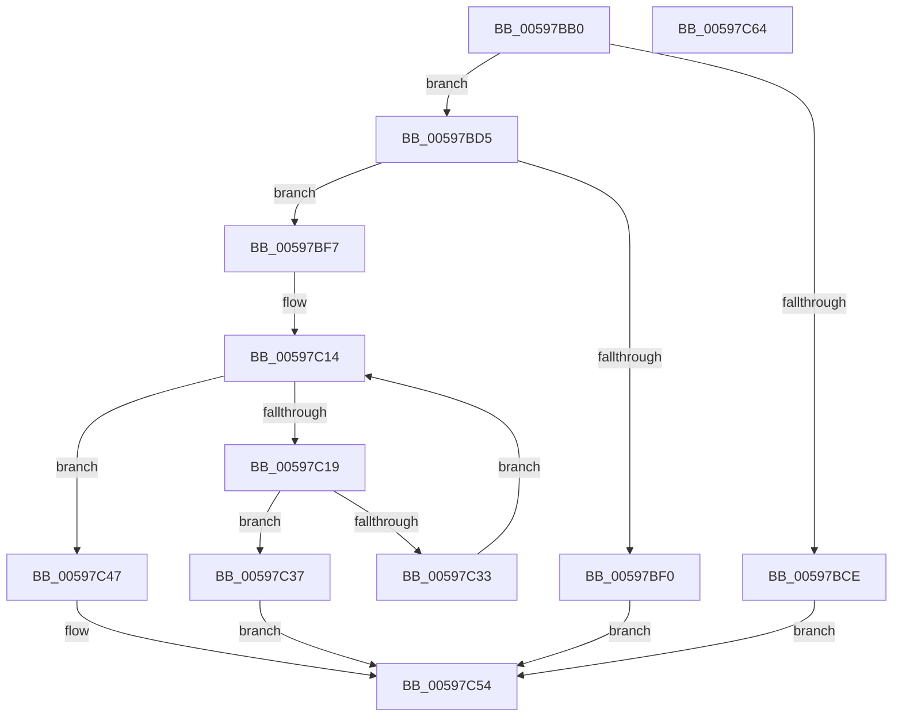

# IoRegisterPriorityCallback

- RVA: `0x00597BB0`–`0x00597C65` (길이 `181` bytes)
- VA: `0x0000000140597BB0`
- 실행 섹션: `.text`
- PDB 이름 있음: `예`; PDB Function 태그: `아니요`
- unwind 정보 RVA: `0x00060BC4`
- 디코드: `50`개 명령, `181/181` bytes 표시
- 미해석 바이트: `0` (있으면 어셈블리에 `.byte`로 보존)

> 이 문서는 커널 이미지의 기계어와 PDB 기호를 분석해 생성했습니다. 4번과 5번은 함수 원형과 자료형을 바이너리 사용 방식에서 추정한 C 해석이며 원본 소스 복구 결과는 아닙니다.

## 1. Dependencies

- 직접 호출 지점: **3**; 고유 호출 대상: **3**
- 직접 호출자로 확인된 함수: **0**
- RIP 상대 이미지 참조: **3**

### Outgoing calls
- `0x00597BE3` → [ExAllocatePool2](../../poolcode/B8/ExAllocatePool2_function_00B820F0.md) (function, `0x00B820F0`)
- `0x00597C2A` → [ExCompareExchangeCallBack](../41/ExCompareExchangeCallBack_function_0041BCD0.md) (function, `0x0041BCD0`)
- `0x00597C4A` → [AlpcpFreeBuffer](../../page/90/AlpcpFreeBuffer_function_009071C0.md) (function, `0x009071C0`)

### Direct callers
- 이 함수 시작 RVA로 연결되는 직접 call은 확인되지 않았습니다. 간접 호출은 완전히 역산할 수 없습니다.

### Static image references
- `0x00597BFB` → RVA `0x00265C30` (`IopBoostThreadCallback`; read)
- `0x00597C19` → RVA `0x00F8D1A0` (`.data`; read)
- `0x00597C37` → RVA `0x00E66124` (`.data`; read/write)

## 2. Other-region calls and transfers

- 다른 실행 섹션으로 향하는 call: **2**
  - `0x00597BE3` → [ExAllocatePool2](../../poolcode/B8/ExAllocatePool2_function_00B820F0.md) (`.text` → `POOLCODE`)
  - `0x00597C4A` → [AlpcpFreeBuffer](../../page/90/AlpcpFreeBuffer_function_009071C0.md) (`.text` → `PAGE`)
- 별도 외부 분기/꼬리 이동을 확인하지 못했습니다.

## 3. Assembly (complete function range)

```asm
00597BB0  48 89 5C 24 08                  mov qword ptr [rsp + 8], rbx
00597BB5  48 89 74 24 10                  mov qword ptr [rsp + 0x10], rsi
00597BBA  57                              push rdi
00597BBB  48 83 EC 20                     sub rsp, 0x20
00597BBF  F7 41 10 00 02 00 00            test dword ptr [rcx + 0x10], 0x200
00597BC6  48 8B F2                        mov rsi, rdx
00597BC9  48 8B F9                        mov rdi, rcx
00597BCC  74 07                           je 0x140597bd5
00597BCE  B8 18 07 00 C0                  mov eax, 0xc0000718
00597BD3  EB 7F                           jmp 0x140597c54
00597BD5  BA 28 00 00 00                  mov edx, 0x28
00597BDA  41 B8 49 6F 43 62               mov r8d, 0x62436f49
00597BE0  8D 4A 18                        lea ecx, [rdx + 0x18]
00597BE3  E8 08 A5 5E 00                  call 0x140b820f0
00597BE8  48 8B D8                        mov rbx, rax
00597BEB  48 85 C0                        test rax, rax
00597BEE  75 07                           jne 0x140597bf7
00597BF0  B8 9A 00 00 C0                  mov eax, 0xc000009a
00597BF5  EB 5D                           jmp 0x140597c54
00597BF7  48 83 23 00                     and qword ptr [rbx], 0
00597BFB  48 8D 05 2E E0 CC FF            lea rax, [rip - 0x331fd2]
00597C02  48 89 73 18                     mov qword ptr [rbx + 0x18], rsi
00597C06  33 F6                           xor esi, esi
00597C08  48 89 43 08                     mov qword ptr [rbx + 8], rax
00597C0C  48 89 5B 10                     mov qword ptr [rbx + 0x10], rbx
00597C10  48 89 7B 20                     mov qword ptr [rbx + 0x20], rdi
00597C14  83 FE 08                        cmp esi, 8
00597C17  73 2E                           jae 0x140597c47
00597C19  48 8D 0D 80 55 9F 00            lea rcx, [rip + 0x9f5580]
00597C20  45 33 C0                        xor r8d, r8d
00597C23  48 8D 0C F1                     lea rcx, [rcx + rsi*8]
00597C27  48 8B D3                        mov rdx, rbx
00597C2A  E8 A1 40 E8 FF                  call 0x14041bcd0
00597C2F  84 C0                           test al, al
00597C31  75 04                           jne 0x140597c37
00597C33  FF C6                           inc esi
00597C35  EB DD                           jmp 0x140597c14
00597C37  F0 FF 05 E6 E4 8C 00            lock inc dword ptr [rip + 0x8ce4e6]
00597C3E  0F BA 6F 10 09                  bts dword ptr [rdi + 0x10], 9
00597C43  33 C0                           xor eax, eax
00597C45  EB 0D                           jmp 0x140597c54
00597C47  48 8B CB                        mov rcx, rbx
00597C4A  E8 71 F5 36 00                  call 0x1409071c0
00597C4F  B8 0D 00 00 C0                  mov eax, 0xc000000d
00597C54  48 8B 5C 24 30                  mov rbx, qword ptr [rsp + 0x30]
00597C59  48 8B 74 24 38                  mov rsi, qword ptr [rsp + 0x38]
00597C5E  48 83 C4 20                     add rsp, 0x20
00597C62  5F                              pop rdi
00597C63  C3                              ret
00597C64  CC                              int3
```

## 4. C-style interpretation (structured pseudocode)

```c
__int64 __fastcall IoRegisterPriorityCallback(__int64 a1, __int64 a2)
{
    __int64 result;
    __int64 v_rsi;
    __int64 v_rsp;
    unsigned __int64 v_stack_p10;
    unsigned __int64 v_stack_p8;

    v_stack_p8 = v_rbx;
    v_stack_p10 = v_rsi;
    v_rsp = (v_rsp) - (32);
    if (((*(unsigned int *)(a1 + 16)) & (512)) == 0) goto loc_00597BD5;
    goto loc_00597C54;
loc_00597BD5:
    result = ExAllocatePool2(40 + 24, 40, (unsigned int)(0x62436F49ULL), a4);
    if (result != 0) goto loc_00597BF7;
    goto loc_00597C54;
loc_00597BF7:
    *(unsigned __int64 *)(result + 24) = a2;
    v_rsi = 0;
    *(unsigned __int64 *)(result + 8) = v_rip - 3350482;
    *(unsigned __int64 *)(result + 16) = result;
    *(unsigned __int64 *)(result + 32) = a1;
loc_00597C14:
    if (0 >= 8) goto loc_00597C47;
    a3 = 0;
    result = ExCompareExchangeCallBack(v_rip + 10442112 + v_rsi * 8, result, a3, a4);
    if ((unsigned __int8)(result) != 0) goto loc_00597C37;
    v_rsi = (unsigned int)((v_rsi) + 1);
    goto loc_00597C14;
loc_00597C37:
    result = 0;
    goto loc_00597C54;
loc_00597C47:
    result = AlpcpFreeBuffer(0, result, a3, a4);
loc_00597C54:
    v_rsp = (v_rsp) + (32);
    return (unsigned int)(0xC000000DULL);
}
```

## 5. (Beta) C Style

```c
int64_t IoRegisterPriorityCallback(void *Arg1, int64_t Arg2)
{
    uint8_t *arg1 = (uint8_t *)Arg1;

    int64_t result;
    int64_t local_rsi;
    int64_t local_rsp;
    uint64_t v_stack_p10;
    uint64_t v_stack_p8;

    v_stack_p8 = local_rbx;
    v_stack_p10 = local_rsi;
    local_rsp = (local_rsp) - (32);
    if (((*(uint32_t *)(arg1 + 0x10)) & (512)) == 0) goto loc_00597BD5;
    goto loc_00597C54;
loc_00597BD5:
    result = ExAllocatePool2(40 + 24, 40, (uint32_t)(0x62436F49ULL), a4);
    if (result != 0) goto loc_00597BF7;
    goto loc_00597C54;
loc_00597BF7:
    *(uint64_t *)(result + 0x18) = Arg2;
    local_rsi = 0;
    *(uint64_t *)(result + 0x8) = v_rip - 3350482;
    *(uint64_t *)(result + 0x10) = result;
    *(void **)(result + 0x20) = Arg1;
loc_00597C14:
    if (0 >= 8) goto loc_00597C47;
    a3 = 0;
    result = ExCompareExchangeCallBack(v_rip + 10442112 + local_rsi * 8, result, a3, a4);
    if ((uint8_t)(result) != 0) goto loc_00597C37;
    local_rsi = (uint32_t)((local_rsi) + 1);
    goto loc_00597C14;
loc_00597C37:
    result = 0;
    goto loc_00597C54;
loc_00597C47:
    result = AlpcpFreeBuffer(0, result, a3, a4);
loc_00597C54:
    local_rsp = (local_rsp) + (32);
    return (uint32_t)(0xC000000DULL);
}
```

### 관측된 메모리 오프셋

구조체 형식이 확인되지 않은 접근은 인자 기준의 오프셋으로만 기록했습니다.

| 기준 인자 | 오프셋 표현 | 폭 (bit) | 접근 |
|---|---:|---:|---|
| `Arg1` | `+ 0x10` | `32` | `R` |
| `Arg1` | `+ 0x10` | `32` | `R/W` |

## 6. Execution-region graph

[열기: 2D/3D 그래프와 함수 탐색 컨트롤 패널](../../../control-panel.html?section=text&rva=0x00597BB0&view=graph)

- 2D 그래프는 위에서 아래로 흐르고, 3D 그래프는 빈 공간을 드래그해 회전합니다. Shift+드래그는 이동, 휠은 확대·축소, 함수 노드 선택은 대상 보고서 이동입니다.

### Static fallback


