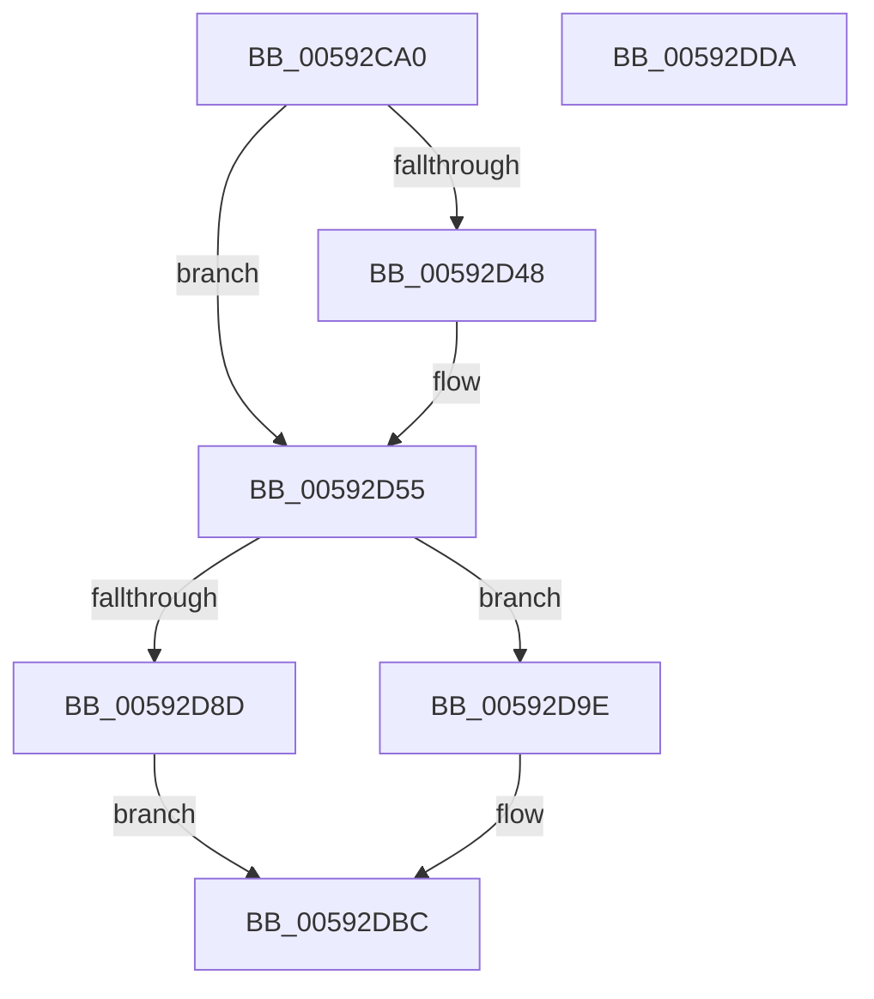

# IoRetryAsMiniDump

- RVA: `0x00592CA0`–`0x00592DDB` (길이 `315` bytes)
- VA: `0x0000000140592CA0`
- 실행 섹션: `.text`
- PDB 이름 있음: `예`; PDB Function 태그: `아니요`
- unwind 정보 RVA: `0x000C3AF8`
- 디코드: `79`개 명령, `315/315` bytes 표시
- 미해석 바이트: `0` (있으면 어셈블리에 `.byte`로 보존)

> 이 문서는 커널 이미지의 기계어와 PDB 기호를 분석해 생성했습니다. 4번과 5번은 함수 원형과 자료형을 바이너리 사용 방식에서 추정한 C 해석이며 원본 소스 복구 결과는 아닙니다.

## 1. Dependencies

- 직접 호출 지점: **7**; 고유 호출 대상: **4**
- 직접 호출자로 확인된 함수: **1**
- RIP 상대 이미지 참조: **5**

### Outgoing calls
- `0x00592CF1` → [DbgPrintEx](../35/DbgPrintEx_function_00359290.md) (function, `0x00359290`)
- `0x00592D37` → [DbgPrintEx](../35/DbgPrintEx_function_00359290.md) (function, `0x00359290`)
- `0x00592D50` → [guard_dispatch_icall](../6B/guard_dispatch_icall_function_006BAAD0.md) (function, `0x006BAAD0`)
- `0x00592D7F` → [IoWriteCrashDump](IoWriteCrashDump_function_005936D8.md) (function, `0x005936D8`)
- `0x00592D97` → [DbgPrintEx](../35/DbgPrintEx_function_00359290.md) (function, `0x00359290`)
- `0x00592DAD` → [DbgPrintEx](../35/DbgPrintEx_function_00359290.md) (function, `0x00359290`)
- `0x00592DB7` → [IoSetBugCheckProgressFlag](IoSetBugCheckProgressFlag_function_005931C0.md) (function, `0x005931C0`)

### Direct callers
- [KeBugCheck2](../5B/KeBugCheck2_function_005B27D0.md) at `0x005B3452`

### Static image references
- `0x00592CDF` → RVA `0x006C9AB0` (` ?? ::FNODOBFM::`string'`; read)
- `0x00592CFE` → RVA `0x006C9A50` (` ?? ::FNODOBFM::`string'`; read)
- `0x00592D3C` → RVA `0x00E66000` (`.data`; read)
- `0x00592D8D` → RVA `0x006C9C60` (` ?? ::FNODOBFM::`string'`; read)
- `0x00592DA4` → RVA `0x006C9C30` (` ?? ::FNODOBFM::`string'`; read)

## 2. Other-region calls and transfers

- 다른 실행 섹션으로 향하는 call: **0**
- 별도 외부 분기/꼬리 이동을 확인하지 못했습니다.

## 3. Assembly (complete function range)

```asm
00592CA0  48 8B C4                        mov rax, rsp
00592CA3  48 89 58 08                     mov qword ptr [rax + 8], rbx
00592CA7  48 89 68 10                     mov qword ptr [rax + 0x10], rbp
00592CAB  48 89 70 18                     mov qword ptr [rax + 0x18], rsi
00592CAF  57                              push rdi
00592CB0  41 54                           push r12
00592CB2  41 55                           push r13
00592CB4  41 56                           push r14
00592CB6  41 57                           push r15
00592CB8  48 83 EC 50                     sub rsp, 0x50
00592CBC  4C 8B B4 24 A0 00 00 00         mov r14, qword ptr [rsp + 0xa0]
00592CC4  49 8B D9                        mov rbx, r9
00592CC7  4C 89 70 C0                     mov qword ptr [rax - 0x40], r14
00592CCB  48 8B F2                        mov rsi, rdx
00592CCE  48 89 58 B8                     mov qword ptr [rax - 0x48], rbx
00592CD2  49 8B F8                        mov rdi, r8
00592CD5  4C 89 40 B0                     mov qword ptr [rax - 0x50], r8
00592CD9  8B E9                           mov ebp, ecx
00592CDB  48 89 50 A8                     mov qword ptr [rax - 0x58], rdx
00592CDF  4C 8D 05 CA 6D 13 00            lea r8, [rip + 0x136dca]
00592CE6  BA 02 00 00 00                  mov edx, 2
00592CEB  44 8B C9                        mov r9d, ecx
00592CEE  8D 4A 03                        lea ecx, [rdx + 3]
00592CF1  E8 9A 65 DC FF                  call 0x140359290
00592CF6  48 8B 84 24 C8 00 00 00         mov rax, qword ptr [rsp + 0xc8]
00592CFE  4C 8D 05 4B 6D 13 00            lea r8, [rip + 0x136d4b]
00592D05  4C 8B BC 24 B8 00 00 00         mov r15, qword ptr [rsp + 0xb8]
00592D0D  BA 02 00 00 00                  mov edx, 2
00592D12  4C 8B AC 24 A8 00 00 00         mov r13, qword ptr [rsp + 0xa8]
00592D1A  4C 8B A4 24 B0 00 00 00         mov r12, qword ptr [rsp + 0xb0]
00592D22  4D 8B CD                        mov r9, r13
00592D25  48 89 44 24 30                  mov qword ptr [rsp + 0x30], rax
00592D2A  8D 4A 03                        lea ecx, [rdx + 3]
00592D2D  4C 89 7C 24 28                  mov qword ptr [rsp + 0x28], r15
00592D32  4C 89 64 24 20                  mov qword ptr [rsp + 0x20], r12
00592D37  E8 54 65 DC FF                  call 0x140359290
00592D3C  48 8B 05 BD 32 8D 00            mov rax, qword ptr [rip + 0x8d32bd]
00592D43  48 85 C0                        test rax, rax
00592D46  74 0D                           je 0x140592d55
00592D48  33 D2                           xor edx, edx
00592D4A  45 33 C0                        xor r8d, r8d
00592D4D  8D 4A 0A                        lea ecx, [rdx + 0xa]
00592D50  E8 7B 7D 12 00                  call 0x1406baad0
00592D55  8A 84 24 C0 00 00 00            mov al, byte ptr [rsp + 0xc0]
00592D5C  4C 8B CB                        mov r9, rbx
00592D5F  88 44 24 40                     mov byte ptr [rsp + 0x40], al
00592D63  4C 8B C7                        mov r8, rdi
00592D66  4C 89 7C 24 38                  mov qword ptr [rsp + 0x38], r15
00592D6B  48 8B D6                        mov rdx, rsi
00592D6E  4C 89 64 24 30                  mov qword ptr [rsp + 0x30], r12
00592D73  8B CD                           mov ecx, ebp
00592D75  4C 89 6C 24 28                  mov qword ptr [rsp + 0x28], r13
00592D7A  4C 89 74 24 20                  mov qword ptr [rsp + 0x20], r14
00592D7F  E8 54 09 00 00                  call 0x1405936d8
00592D84  B9 05 00 00 00                  mov ecx, 5
00592D89  84 C0                           test al, al
00592D8B  74 11                           je 0x140592d9e
00592D8D  4C 8D 05 CC 6E 13 00            lea r8, [rip + 0x136ecc]
00592D94  8D 51 FD                        lea edx, [rcx - 3]
00592D97  E8 F4 64 DC FF                  call 0x140359290
00592D9C  EB 1E                           jmp 0x140592dbc
00592D9E  41 B9 01 00 00 C0               mov r9d, 0xc0000001
00592DA4  4C 8D 05 85 6E 13 00            lea r8, [rip + 0x136e85]
00592DAB  33 D2                           xor edx, edx
00592DAD  E8 DE 64 DC FF                  call 0x140359290
00592DB2  B9 00 00 00 02                  mov ecx, 0x2000000
00592DB7  E8 04 04 00 00                  call 0x1405931c0
00592DBC  4C 8D 5C 24 50                  lea r11, [rsp + 0x50]
00592DC1  49 8B 5B 30                     mov rbx, qword ptr [r11 + 0x30]
00592DC5  49 8B 6B 38                     mov rbp, qword ptr [r11 + 0x38]
00592DC9  49 8B 73 40                     mov rsi, qword ptr [r11 + 0x40]
00592DCD  49 8B E3                        mov rsp, r11
00592DD0  41 5F                           pop r15
00592DD2  41 5E                           pop r14
00592DD4  41 5D                           pop r13
00592DD6  41 5C                           pop r12
00592DD8  5F                              pop rdi
00592DD9  C3                              ret
00592DDA  CC                              int3
```

## 4. C-style interpretation (structured pseudocode)

```c
__int64 __fastcall IoRetryAsMiniDump(int a1, __int64 a2, __int64 a3, __int64 a4, __int64 a5, __int64 a6, __int64 a7, __int64 a8, unsigned __int8 a9, __int64 a10)
{
    __int64 result;
    __int64 v_rsp;
    unsigned __int64 v_stack_m28;
    unsigned __int8 v_stack_m38;
    unsigned __int64 v_stack_m40;
    unsigned __int64 v_stack_m48;
    unsigned __int64 v_stack_m50;
    unsigned __int64 v_stack_m58;

    *(unsigned __int64 *)(v_rsp + 8) = v_rbx;
    *(unsigned __int64 *)(v_rsp + 16) = v_rbp;
    *(unsigned __int64 *)(v_rsp + 24) = v_rsi;
    v_rsp = (v_rsp) - (80);
    *(unsigned __int64 *)(v_rsp - 64) = a5;
    *(unsigned __int64 *)(v_rsp - 72) = a4;
    *(unsigned __int64 *)(v_rsp - 80) = a3;
    *(unsigned __int64 *)(v_rsp - 88) = a2;
    result = DbgPrintEx(2 + 3, 2, v_rip + 1273290, (unsigned int)(a1));
    v_stack_m48 = a10;
    v_stack_m50 = a8;
    v_stack_m58 = a7;
    result = DbgPrintEx(2 + 3, 2, v_rip + 1273163, a6);
    result = *(unsigned __int64 *)(v_rip + 9253565);
    if (*(unsigned __int64 *)(v_rip + 9253565) != 0) {
        a2 = 0;
        a3 = 0;
        a1 = a2 + 10;
        result = guard_dispatch_icall(a1, a2, a3, a6);
    }
    v_stack_m38 = a9;
    v_stack_m40 = a8;
    v_stack_m48 = a7;
    v_stack_m50 = a6;
    v_stack_m58 = a5;
    result = IoWriteCrashDump((unsigned int)((unsigned int)((unsigned int)(a1))), 0, 0, a4);
    if ((unsigned __int8)(result) == 0) goto loc_00592D9E;
    result = DbgPrintEx(5, 5 - 3, v_rip + 1273548, a4);
    goto loc_00592DBC;
loc_00592D9E:
    a2 = 0;
    result = DbgPrintEx(5, a2, v_rip + 1273477, (unsigned int)(0xC0000001ULL));
    result = IoSetBugCheckProgressFlag((unsigned int)(0x2000000ULL), a2, v_rip + 1273477, (unsigned int)(0xC0000001ULL));
loc_00592DBC:
    return result;
}
```

## 5. (Beta) C Style

```c
int64_t IoRetryAsMiniDump(int32_t Arg1, int64_t Arg2, int64_t Arg3, int64_t Arg4, int64_t Arg5, int64_t Arg6, int64_t Arg7, int64_t Arg8, uint8_t Arg9, int64_t Arg10)
{
    int64_t result;
    int64_t local_rsp;
    uint64_t v_stack_m28;
    uint8_t v_stack_m38;
    uint64_t v_stack_m40;
    uint64_t v_stack_m48;
    uint64_t v_stack_m50;
    uint64_t v_stack_m58;

    *(uint64_t *)(local_rsp + 0x8) = local_rbx;
    *(uint64_t *)(local_rsp + 0x10) = local_rbp;
    *(uint64_t *)(local_rsp + 0x18) = local_rsi;
    local_rsp = (local_rsp) - (80);
    *(uint64_t *)(local_rsp - 0x40) = Arg5;
    *(uint64_t *)(local_rsp - 0x48) = Arg4;
    *(uint64_t *)(local_rsp - 0x50) = Arg3;
    *(uint64_t *)(local_rsp - 0x58) = Arg2;
    result = DbgPrintEx(2 + 3, 2, v_rip + 1273290, (uint32_t)(Arg1));
    v_stack_m48 = Arg10;
    v_stack_m50 = Arg8;
    v_stack_m58 = Arg7;
    result = DbgPrintEx(2 + 3, 2, v_rip + 1273163, Arg6);
    result = *(uint64_t *)(v_rip + 0x8D32BD);
    if (*(uint64_t *)(v_rip + 0x8D32BD) != 0) {
        Arg2 = 0;
        Arg3 = 0;
        Arg1 = Arg2 + 10;
        result = guard_dispatch_icall(Arg1, Arg2, Arg3, Arg6);
    }
    v_stack_m38 = Arg9;
    v_stack_m40 = Arg8;
    v_stack_m48 = Arg7;
    v_stack_m50 = Arg6;
    v_stack_m58 = Arg5;
    result = IoWriteCrashDump((uint32_t)((uint32_t)((uint32_t)(Arg1))), 0, 0, Arg4);
    if ((uint8_t)(result) == 0) goto loc_00592D9E;
    result = DbgPrintEx(5, 5 - 3, v_rip + 1273548, Arg4);
    goto loc_00592DBC;
loc_00592D9E:
    Arg2 = 0;
    result = DbgPrintEx(5, Arg2, v_rip + 1273477, (uint32_t)(0xC0000001ULL));
    result = IoSetBugCheckProgressFlag((uint32_t)(0x2000000ULL), Arg2, v_rip + 1273477, (uint32_t)(0xC0000001ULL));
loc_00592DBC:
    return result;
}
```

## 6. Execution-region graph

[열기: 2D/3D 그래프와 함수 탐색 컨트롤 패널](../../../control-panel.html?section=text&rva=0x00592CA0&view=graph)

- 2D 그래프는 위에서 아래로 흐르고, 3D 그래프는 빈 공간을 드래그해 회전합니다. Shift+드래그는 이동, 휠은 확대·축소, 함수 노드 선택은 대상 보고서 이동입니다.

### Static fallback


