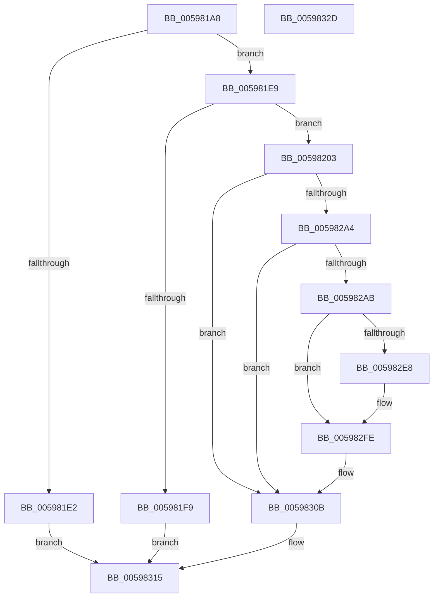

# IoRevokeHandlesForProcess

- RVA: `0x005981A8`–`0x0059832E` (길이 `390` bytes)
- VA: `0x00000001405981A8`
- 실행 섹션: `.text`
- PDB 이름 있음: `예`; PDB Function 태그: `아니요`
- unwind 정보 RVA: `0x000C7678`
- 디코드: `98`개 명령, `390/390` bytes 표시
- 미해석 바이트: `0` (있으면 어셈블리에 `.byte`로 보존)

> 이 문서는 커널 이미지의 기계어와 PDB 기호를 분석해 생성했습니다. 4번과 5번은 함수 원형과 자료형을 바이너리 사용 방식에서 추정한 C 해석이며 원본 소스 복구 결과는 아닙니다.

## 1. Dependencies

- 직접 호출 지점: **11**; 고유 호출 대상: **10**
- 직접 호출자로 확인된 함수: **1**
- RIP 상대 이미지 참조: **2**

### Outgoing calls
- `0x005981D9` → [PsIsProcessAppContainer](../../page/A3/PsIsProcessAppContainer_function_00A38C44.md) (function, `0x00A38C44`)
- `0x005981EC` → [ObReferenceProcessHandleTable](../../page/89/ObReferenceProcessHandleTable_function_00893B70.md) (function, `0x00893B70`)
- `0x0059820F` → [memset](../6C/memset_function_006C6C40.md) (function, `0x006C6C40`)
- `0x0059825A` → [PsGetCurrentSilo](../40/PsGetCurrentSilo_function_004094A0.md) (function, `0x004094A0`)
- `0x00598294` → [ObOpenObjectByNameEx](../../page/89/ObOpenObjectByNameEx_function_0089A8A0.md) (function, `0x0089A8A0`)
- `0x005982CB` → [ExEnumHandleTable](../../page/91/ExEnumHandleTable_function_0091DB20.md) (function, `0x0091DB20`)
- `0x005982D5` → [IopGetDevicePDO](../27/IopGetDevicePDO_function_002724D8.md) (function, `0x002724D8`)
- `0x005982EE` → [PnpDisableUserModeNotifications](../5A/PnpDisableUserModeNotifications_function_005A78F8.md) (function, `0x005A78F8`)
- `0x005982F9` → [ObfDereferenceObjectWithTag](../2F/ObfDereferenceObjectWithTag_function_002F78E0.md) (function, `0x002F78E0`)
- `0x00598306` → [ObfDereferenceObjectWithTag](../2F/ObfDereferenceObjectWithTag_function_002F78E0.md) (function, `0x002F78E0`)
- `0x0059830E` → [ObDereferenceProcessHandleTable](../../page/9E/ObDereferenceProcessHandleTable_function_009EB950.md) (function, `0x009EB950`)

### Direct callers
- [NtSetInformationProcess](../../page/AE/NtSetInformationProcess_function_00AE5370.md) at `0x00AE8C28`

### Static image references
- `0x0059825F` → RVA `0x00FC6AE0` (`ALMOSTRO`; read)
- `0x005982BC` → RVA `0x00598340` (`IopCheckHandleForRevocation`; read)

## 2. Other-region calls and transfers

- 다른 실행 섹션으로 향하는 call: **5**
  - `0x005981D9` → [PsIsProcessAppContainer](../../page/A3/PsIsProcessAppContainer_function_00A38C44.md) (`.text` → `PAGE`)
  - `0x005981EC` → [ObReferenceProcessHandleTable](../../page/89/ObReferenceProcessHandleTable_function_00893B70.md) (`.text` → `PAGE`)
  - `0x00598294` → [ObOpenObjectByNameEx](../../page/89/ObOpenObjectByNameEx_function_0089A8A0.md) (`.text` → `PAGE`)
  - `0x005982CB` → [ExEnumHandleTable](../../page/91/ExEnumHandleTable_function_0091DB20.md) (`.text` → `PAGE`)
  - `0x0059830E` → [ObDereferenceProcessHandleTable](../../page/9E/ObDereferenceProcessHandleTable_function_009EB950.md) (`.text` → `PAGE`)
- 별도 외부 분기/꼬리 이동을 확인하지 못했습니다.

## 3. Assembly (complete function range)

```asm
005981A8  48 89 5C 24 08                  mov qword ptr [rsp + 8], rbx
005981AD  48 89 74 24 10                  mov qword ptr [rsp + 0x10], rsi
005981B2  55                              push rbp
005981B3  57                              push rdi
005981B4  41 56                           push r14
005981B6  48 8D 6C 24 A0                  lea rbp, [rsp - 0x60]
005981BB  48 81 EC 60 01 00 00            sub rsp, 0x160
005981C2  33 C0                           xor eax, eax
005981C4  48 8B F9                        mov rdi, rcx
005981C7  21 44 24 6C                     and dword ptr [rsp + 0x6c], eax
005981CB  48 8B CA                        mov rcx, rdx
005981CE  89 44 24 54                     mov dword ptr [rsp + 0x54], eax
005981D2  48 8B DA                        mov rbx, rdx
005981D5  21 44 24 54                     and dword ptr [rsp + 0x54], eax
005981D9  E8 66 0A 4A 00                  call 0x140a38c44
005981DE  84 C0                           test al, al
005981E0  75 07                           jne 0x1405981e9
005981E2  33 C0                           xor eax, eax
005981E4  E9 2C 01 00 00                  jmp 0x140598315
005981E9  48 8B CB                        mov rcx, rbx
005981EC  E8 7F B9 2F 00                  call 0x140893b70
005981F1  48 8B F0                        mov rsi, rax
005981F4  48 85 C0                        test rax, rax
005981F7  75 0A                           jne 0x140598203
005981F9  B8 0D 00 00 C0                  mov eax, 0xc000000d
005981FE  E9 12 01 00 00                  jmp 0x140598315
00598203  33 D2                           xor edx, edx
00598205  48 8D 4D 80                     lea rcx, [rbp - 0x80]
00598209  41 B8 E0 00 00 00               mov r8d, 0xe0
0059820F  E8 2C EA 12 00                  call 0x1406c6c40
00598214  48 83 64 24 58 00               and qword ptr [rsp + 0x58], 0
0059821A  B9 01 00 00 00                  mov ecx, 1
0059821F  0F 57 C0                        xorps xmm0, xmm0
00598222  C7 44 24 50 30 00 00 00         mov dword ptr [rsp + 0x50], 0x30
0059822A  0F 11 45 20                     movups xmmword ptr [rbp + 0x20], xmm0
0059822E  C7 44 24 68 40 02 00 00         mov dword ptr [rsp + 0x68], 0x240
00598236  8D 41 27                        lea eax, [rcx + 0x27]
00598239  48 89 7C 24 60                  mov qword ptr [rsp + 0x60], rdi
0059823E  66 89 45 20                     mov word ptr [rbp + 0x20], ax
00598242  F3 0F 7F 44 24 70               movdqu xmmword ptr [rsp + 0x70], xmm0
00598248  C7 45 80 08 00 E0 00            mov dword ptr [rbp - 0x80], 0xe00008
0059824F  89 4D A0                        mov dword ptr [rbp - 0x60], ecx
00598252  0F 11 45 30                     movups xmmword ptr [rbp + 0x30], xmm0
00598256  48 89 4D 40                     mov qword ptr [rbp + 0x40], rcx
0059825A  E8 41 12 E7 FF                  call 0x1404094a0
0059825F  48 8B 15 7A E8 A2 00            mov rdx, qword ptr [rip + 0xa2e87a]
00598266  48 8D 8D 90 00 00 00            lea rcx, [rbp + 0x90]
0059826D  48 89 4C 24 38                  mov qword ptr [rsp + 0x38], rcx
00598272  45 33 C9                        xor r9d, r9d
00598275  48 89 44 24 30                  mov qword ptr [rsp + 0x30], rax
0059827A  48 8D 4C 24 50                  lea rcx, [rsp + 0x50]
0059827F  48 89 45 40                     mov qword ptr [rbp + 0x40], rax
00598283  45 33 C0                        xor r8d, r8d
00598286  48 8D 45 80                     lea rax, [rbp - 0x80]
0059828A  48 89 44 24 28                  mov qword ptr [rsp + 0x28], rax
0059828F  83 64 24 20 00                  and dword ptr [rsp + 0x20], 0
00598294  E8 07 26 30 00                  call 0x14089a8a0
00598299  81 7D A0 51 02 AA BE            cmp dword ptr [rbp - 0x60], 0xbeaa0251
005982A0  8B F8                           mov edi, eax
005982A2  75 67                           jne 0x14059830b
005982A4  8B 7D 90                        mov edi, dword ptr [rbp - 0x70]
005982A7  85 FF                           test edi, edi
005982A9  78 60                           js 0x14059830b
005982AB  48 8B 45 A8                     mov rax, qword ptr [rbp - 0x58]
005982AF  4C 8D 44 24 40                  lea r8, [rsp + 0x40]
005982B4  45 33 C9                        xor r9d, r9d
005982B7  48 89 44 24 40                  mov qword ptr [rsp + 0x40], rax
005982BC  48 8D 15 7D 00 00 00            lea rdx, [rip + 0x7d]
005982C3  48 89 5C 24 48                  mov qword ptr [rsp + 0x48], rbx
005982C8  48 8B CE                        mov rcx, rsi
005982CB  E8 50 58 38 00                  call 0x14091db20
005982D0  48 8B 4C 24 40                  mov rcx, qword ptr [rsp + 0x40]
005982D5  E8 FE A1 CD FF                  call 0x1402724d8
005982DA  48 8B F0                        mov rsi, rax
005982DD  41 BE 44 66 6C 74               mov r14d, 0x746c6644
005982E3  48 85 C0                        test rax, rax
005982E6  74 16                           je 0x1405982fe
005982E8  48 8B D3                        mov rdx, rbx
005982EB  48 8B C8                        mov rcx, rax
005982EE  E8 05 F6 00 00                  call 0x1405a78f8
005982F3  41 8B D6                        mov edx, r14d
005982F6  48 8B CE                        mov rcx, rsi
005982F9  E8 E2 F5 D5 FF                  call 0x1402f78e0
005982FE  48 8B 4C 24 40                  mov rcx, qword ptr [rsp + 0x40]
00598303  41 8B D6                        mov edx, r14d
00598306  E8 D5 F5 D5 FF                  call 0x1402f78e0
0059830B  48 8B CB                        mov rcx, rbx
0059830E  E8 3D 36 45 00                  call 0x1409eb950
00598313  8B C7                           mov eax, edi
00598315  4C 8D 9C 24 60 01 00 00         lea r11, [rsp + 0x160]
0059831D  49 8B 5B 20                     mov rbx, qword ptr [r11 + 0x20]
00598321  49 8B 73 28                     mov rsi, qword ptr [r11 + 0x28]
00598325  49 8B E3                        mov rsp, r11
00598328  41 5E                           pop r14
0059832A  5F                              pop rdi
0059832B  5D                              pop rbp
0059832C  C3                              ret
0059832D  CC                              int3
```

## 4. C-style interpretation (structured pseudocode)

```c
__int64 __fastcall IoRevokeHandlesForProcess(__int64 a1, __int64 a2, __int64 a3, int a4)
{
    __int64 result;
    __int64 v_rsp;
    unsigned __int64 v_stack_m108;
    unsigned int v_stack_m10C;
    unsigned int v_stack_m110;
    unsigned __int64 v_stack_m118;
    unsigned __int64 v_stack_m120;
    unsigned int v_stack_m124;
    unsigned int v_stack_m128;
    unsigned __int64 v_stack_m130;
    unsigned __int64 v_stack_m138;
    unsigned __int64 v_stack_m140;
    unsigned __int64 v_stack_m148;
    unsigned __int64 v_stack_m150;
    unsigned int v_stack_m158;
    unsigned __int64 v_stack_m18;
    unsigned __int64 v_stack_m38;
    unsigned __int64 v_stack_m48;
    unsigned __int64 v_stack_m58;
    unsigned __int64 v_stack_m78;
    unsigned __int64 v_stack_mD0;
    unsigned int v_stack_mD8;
    unsigned int v_stack_mE8;
    unsigned __int64 v_stack_mF8;
    unsigned __int64 v_stack_p10;
    unsigned __int64 v_stack_p18;
    unsigned __int64 v_stack_p8;

    v_stack_p8 = v_rbx;
    v_stack_p10 = v_rsi;
    v_rsp = (v_rsp) - (352);
    result = 0;
    v_stack_m124 = 0;
    result = PsIsProcessAppContainer(a2, a2, a3, a4);
    if ((unsigned __int8)(result) != 0) goto loc_005981E9;
    result = 0;
    goto loc_00598315;
loc_005981E9:
    result = ObReferenceProcessHandleTable(a2, a2, a3, a4);
    if (result != 0) goto loc_00598203;
    goto loc_00598315;
loc_00598203:
    a2 = 0;
    result = memset(v_stack_mF8, a2, 224, a4);
    v_stack_m128 = 48;
    v_stack_m58 = v_xmm0;
    v_stack_m110 = 576;
    v_stack_m118 = a1;
    v_stack_m58 = (unsigned __int16)(1 + 39);
    v_stack_m108 = v_xmm0;
    v_stack_mF8 = 0xE00008ULL;
    v_stack_mD8 = 1;
    v_stack_m48 = v_xmm0;
    v_stack_m38 = 1;
    result = PsGetCurrentSilo(1, a2, 224, a4);
    v_stack_m140 = v_stack_p18;
    a4 = 0;
    v_stack_m148 = result;
    v_stack_m38 = result;
    a3 = 0;
    v_stack_m150 = v_stack_mF8;
    result = ObOpenObjectByNameEx(v_stack_m128, *(unsigned __int64 *)(v_rip + 10676346), a3, a4);
    if (v_stack_mD8 != 0xBEAA0251ULL) goto loc_0059830B;
    if (sign_flag) goto loc_0059830B;
    a4 = 0;
    v_stack_m138 = v_stack_mD0;
    v_stack_m130 = 0;
    result = ExEnumHandleTable(result, v_rip + 125, v_stack_m138, a4);
    result = IopGetDevicePDO(v_stack_m138, v_rip + 125, v_stack_m138, a4);
    if (result != 0) {
        a2 = 0;
        a1 = result;
        result = PnpDisableUserModeNotifications(a1, a2, v_stack_m138, a4);
        a2 = (unsigned int)((unsigned int)(0x746C6644ULL));
        a1 = result;
        result = ObfDereferenceObjectWithTag(a1, a2, v_stack_m138, a4);
    }
    result = ObfDereferenceObjectWithTag(v_stack_m138, (unsigned int)((unsigned int)((unsigned int)(0x746C6644ULL))), v_stack_m138, a4);
loc_0059830B:
    result = ObDereferenceProcessHandleTable(a2, (unsigned int)((unsigned int)((unsigned int)(0x746C6644ULL))), v_stack_m138, a4);
loc_00598315:
    return (unsigned int)((unsigned int)((unsigned int)(v_stack_mE8)));
}
```

## 5. (Beta) C Style

```c
int64_t IoRevokeHandlesForProcess(int64_t Arg1, int64_t Arg2, int64_t Arg3, int32_t Arg4)
{
    int64_t result;
    int64_t local_rsp;
    uint64_t v_stack_m108;
    uint32_t v_stack_m10C;
    uint32_t v_stack_m110;
    uint64_t v_stack_m118;
    uint64_t v_stack_m120;
    uint32_t v_stack_m124;
    uint32_t v_stack_m128;
    uint64_t v_stack_m130;
    uint64_t v_stack_m138;
    uint64_t v_stack_m140;
    uint64_t v_stack_m148;
    uint64_t v_stack_m150;
    uint32_t v_stack_m158;
    uint64_t v_stack_m18;
    uint64_t v_stack_m38;
    uint64_t v_stack_m48;
    uint64_t v_stack_m58;
    uint64_t v_stack_m78;
    uint64_t v_stack_mD0;
    uint32_t v_stack_mD8;
    uint32_t v_stack_mE8;
    uint64_t v_stack_mF8;
    uint64_t v_stack_p10;
    uint64_t v_stack_p18;
    uint64_t v_stack_p8;

    v_stack_p8 = local_rbx;
    v_stack_p10 = local_rsi;
    local_rsp = (local_rsp) - (352);
    result = 0;
    v_stack_m124 = 0;
    result = PsIsProcessAppContainer(Arg2, Arg2, Arg3, Arg4);
    if ((uint8_t)(result) != 0) goto loc_005981E9;
    result = 0;
    goto loc_00598315;
loc_005981E9:
    result = ObReferenceProcessHandleTable(Arg2, Arg2, Arg3, Arg4);
    if (result != 0) goto loc_00598203;
    goto loc_00598315;
loc_00598203:
    Arg2 = 0;
    result = memset(v_stack_mF8, Arg2, 224, Arg4);
    v_stack_m128 = 48;
    v_stack_m58 = v_xmm0;
    v_stack_m110 = 576;
    v_stack_m118 = Arg1;
    v_stack_m58 = (uint16_t)(1 + 39);
    v_stack_m108 = v_xmm0;
    v_stack_mF8 = 0xE00008ULL;
    v_stack_mD8 = 1;
    v_stack_m48 = v_xmm0;
    v_stack_m38 = 1;
    result = PsGetCurrentSilo(1, Arg2, 224, Arg4);
    v_stack_m140 = v_stack_p18;
    Arg4 = 0;
    v_stack_m148 = result;
    v_stack_m38 = result;
    Arg3 = 0;
    v_stack_m150 = v_stack_mF8;
    result = ObOpenObjectByNameEx(v_stack_m128, *(uint64_t *)(v_rip + 0xA2E87A), Arg3, Arg4);
    if (v_stack_mD8 != 0xBEAA0251ULL) goto loc_0059830B;
    if (sign_flag) goto loc_0059830B;
    Arg4 = 0;
    v_stack_m138 = v_stack_mD0;
    v_stack_m130 = 0;
    result = ExEnumHandleTable(result, v_rip + 125, v_stack_m138, Arg4);
    result = IopGetDevicePDO(v_stack_m138, v_rip + 125, v_stack_m138, Arg4);
    if (result != 0) {
        Arg2 = 0;
        Arg1 = result;
        result = PnpDisableUserModeNotifications(Arg1, Arg2, v_stack_m138, Arg4);
        Arg2 = (uint32_t)((uint32_t)(0x746C6644ULL));
        Arg1 = result;
        result = ObfDereferenceObjectWithTag(Arg1, Arg2, v_stack_m138, Arg4);
    }
    result = ObfDereferenceObjectWithTag(v_stack_m138, (uint32_t)((uint32_t)((uint32_t)(0x746C6644ULL))), v_stack_m138, Arg4);
loc_0059830B:
    result = ObDereferenceProcessHandleTable(Arg2, (uint32_t)((uint32_t)((uint32_t)(0x746C6644ULL))), v_stack_m138, Arg4);
loc_00598315:
    return (uint32_t)((uint32_t)((uint32_t)(v_stack_mE8)));
}
```

## 6. Execution-region graph

[열기: 2D/3D 그래프와 함수 탐색 컨트롤 패널](../../../control-panel.html?section=text&rva=0x005981A8&view=graph)

- 2D 그래프는 위에서 아래로 흐르고, 3D 그래프는 빈 공간을 드래그해 회전합니다. Shift+드래그는 이동, 휠은 확대·축소, 함수 노드 선택은 대상 보고서 이동입니다.

### Static fallback


