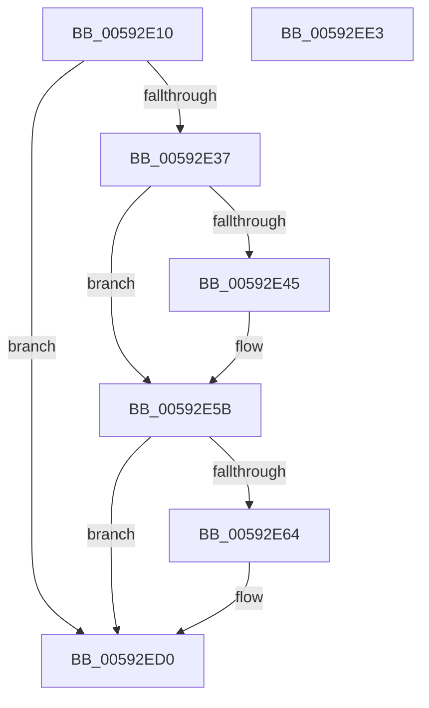

# IoSaveBugCheckProgress

- RVA: `0x00592E10`–`0x00592EE4` (길이 `212` bytes)
- VA: `0x0000000140592E10`
- 실행 섹션: `.text`
- PDB 이름 있음: `예`; PDB Function 태그: `아니요`
- unwind 정보 RVA: `0x000A06A8`
- 디코드: `48`개 명령, `212/212` bytes 표시
- 미해석 바이트: `0` (있으면 어셈블리에 `.byte`로 보존)

> 이 문서는 커널 이미지의 기계어와 PDB 기호를 분석해 생성했습니다. 4번과 5번은 함수 원형과 자료형을 바이너리 사용 방식에서 추정한 C 해석이며 원본 소스 복구 결과는 아닙니다.

## 1. Dependencies

- 직접 호출 지점: **3**; 고유 호출 대상: **3**
- 직접 호출자로 확인된 함수: **9**
- RIP 상대 이미지 참조: **2**

### Outgoing calls
- `0x00592E56` → [IoUpdateBugCheckProgressEnvVariable](IoUpdateBugCheckProgressEnvVariable_function_005933E0.md) (function, `0x005933E0`)
- `0x00592ECB` → [WheaLogInternalEvent](../66/WheaLogInternalEvent_function_006605B0.md) (function, `0x006605B0`)
- `0x00592ED8` → [_security_check_cookie](../6A/_security_check_cookie_function_006AC640.md) (function, `0x006AC640`)

### Direct callers
- [IoWriteCrashDump](IoWriteCrashDump_function_005936D8.md) at `0x0059389E`
- [IoWriteCrashDump](IoWriteCrashDump_function_005936D8.md) at `0x00593BE7`
- [IoWriteCrashDump](IoWriteCrashDump_function_005936D8.md) at `0x00593C02`
- [IoWriteCrashDump](IoWriteCrashDump_function_005936D8.md) at `0x00593C14`
- [IoWriteCrashDump](IoWriteCrashDump_function_005936D8.md) at `0x00593C6C`
- [IoWriteCrashDump](IoWriteCrashDump_function_005936D8.md) at `0x00593D63`
- [IoWriteCrashDump](IoWriteCrashDump_function_005936D8.md) at `0x00593D84`
- [IoAddPagesForPartialKernelDump](../5A/IoAddPagesForPartialKernelDump_function_005A0F3C.md) at `0x005A0F83`
- [IoAddPagesForPartialKernelDump](../5A/IoAddPagesForPartialKernelDump_function_005A0F3C.md) at `0x005A0FE3`
- [IoAddPagesForPartialKernelDump](../5A/IoAddPagesForPartialKernelDump_function_005A0F3C.md) at `0x005A107F`
- [IopAddLiveDumpPagesToPartialKernelDump](../5A/IopAddLiveDumpPagesToPartialKernelDump_function_005A13AC.md) at `0x005A164D`
- [IopAddLiveDumpPagesToPartialKernelDump](../5A/IopAddLiveDumpPagesToPartialKernelDump_function_005A13AC.md) at `0x005A16B4`
- [KeBugCheck2](../5B/KeBugCheck2_function_005B27D0.md) at `0x005B3196`
- [KeBugCheck2](../5B/KeBugCheck2_function_005B27D0.md) at `0x005B3538`
- [KeBugCheck2](../5B/KeBugCheck2_function_005B27D0.md) at `0x005B35E5`
- [KeBugCheck2](../5B/KeBugCheck2_function_005B27D0.md) at `0x005B3616`
- [KeBugCheck2](../5B/KeBugCheck2_function_005B27D0.md) at `0x005B3722`
- [KeBugCheck2](../5B/KeBugCheck2_function_005B27D0.md) at `0x005B3742`
- [KiBugCheckWriteCrashDump](../5B/KiBugCheckWriteCrashDump_function_005B4148.md) at `0x005B41A0`
- [KiDisplayBlueScreen](../5B/KiDisplayBlueScreen_function_005B494C.md) at `0x005B4A07`
- [KiDisplayBlueScreen](../5B/KiDisplayBlueScreen_function_005B494C.md) at `0x005B4B56`
- [KiDisplayBlueScreen](../5B/KiDisplayBlueScreen_function_005B494C.md) at `0x005B4BAA`
- [KiUpdateBugcheckRecoveryProgress](../5C/KiUpdateBugcheckRecoveryProgress_function_005C7E1C.md) at `0x005C7EB9`
- [BgpFwDisplayBugCheckScreen](../6A/BgpFwDisplayBugCheckScreen_function_006A0FE8.md) at `0x006A1039`
- [BgpFwDisplayBugCheckScreen](../6A/BgpFwDisplayBugCheckScreen_function_006A0FE8.md) at `0x006A10AE`
- [BgpFwDisplayBugCheckScreen](../6A/BgpFwDisplayBugCheckScreen_function_006A0FE8.md) at `0x006A1271`
- [BgpFwDisplayBugCheckScreen](../6A/BgpFwDisplayBugCheckScreen_function_006A0FE8.md) at `0x006A130B`
- [BgpFwDisplayBugCheckScreenModernized](../6A/BgpFwDisplayBugCheckScreenModernized_function_006A1338.md) at `0x006A139B`
- [BgpFwDisplayBugCheckScreenModernized](../6A/BgpFwDisplayBugCheckScreenModernized_function_006A1338.md) at `0x006A145E`
- [BgpFwDisplayBugCheckScreenModernized](../6A/BgpFwDisplayBugCheckScreenModernized_function_006A1338.md) at `0x006A180B`

### Static image references
- `0x00592E16` → RVA `0x00E0A740` (`.data`; read)
- `0x00592E25` → RVA `0x00E66050` (`.data`; read)

## 2. Other-region calls and transfers

- 다른 실행 섹션으로 향하는 call: **0**
- 별도 외부 분기/꼬리 이동을 확인하지 못했습니다.

## 3. Assembly (complete function range)

```asm
00592E10  40 53                           push rbx
00592E12  48 83 EC 50                     sub rsp, 0x50
00592E16  48 8B 05 23 79 87 00            mov rax, qword ptr [rip + 0x877923]
00592E1D  48 33 C4                        xor rax, rsp
00592E20  48 89 44 24 48                  mov qword ptr [rsp + 0x48], rax
00592E25  48 8B 15 24 32 8D 00            mov rdx, qword ptr [rip + 0x8d3224]
00592E2C  8B D9                           mov ebx, ecx
00592E2E  48 85 D2                        test rdx, rdx
00592E31  0F 84 99 00 00 00               je 0x140592ed0
00592E37  8B 8A 7C 05 00 00               mov ecx, dword ptr [rdx + 0x57c]
00592E3D  F7 C1 00 00 86 00               test ecx, 0x860000
00592E43  75 16                           jne 0x140592e5b
00592E45  8B C1                           mov eax, ecx
00592E47  33 C3                           xor eax, ebx
00592E49  25 FF 01 00 00                  and eax, 0x1ff
00592E4E  33 C1                           xor eax, ecx
00592E50  89 82 7C 05 00 00               mov dword ptr [rdx + 0x57c], eax
00592E56  E8 85 05 00 00                  call 0x1405933e0
00592E5B  BA 04 00 00 00                  mov edx, 4
00592E60  3B DA                           cmp ebx, edx
00592E62  75 6C                           jne 0x140592ed0
00592E64  48 8B 0D E5 31 8D 00            mov rcx, qword ptr [rip + 0x8d31e5]
00592E6B  8B 81 38 05 00 00               mov eax, dword ptr [rcx + 0x538]
00592E71  2B D0                           sub edx, eax
00592E73  83 64 24 2C 00                  and dword ptr [rsp + 0x2c], 0
00592E78  C7 44 24 20 57 68 4C 67         mov dword ptr [rsp + 0x20], 0x674c6857
00592E80  F7 DA                           neg edx
00592E82  C7 44 24 24 01 00 00 00         mov dword ptr [rsp + 0x24], 1
00592E8A  1B C0                           sbb eax, eax
00592E8C  C7 44 24 28 28 00 00 00         mov dword ptr [rsp + 0x28], 0x28
00592E94  05 01 23 00 00                  add eax, 0x2301
00592E99  C7 44 24 34 23 00 00 80         mov dword ptr [rsp + 0x34], 0x80000023
00592EA1  89 44 24 30                     mov dword ptr [rsp + 0x30], eax
00592EA5  C7 44 24 38 18 00 00 00         mov dword ptr [rsp + 0x38], 0x18
00592EAD  C7 44 24 3C 08 00 00 00         mov dword ptr [rsp + 0x3c], 8
00592EB5  8B 81 7C 05 00 00               mov eax, dword ptr [rcx + 0x57c]
00592EBB  89 44 24 44                     mov dword ptr [rsp + 0x44], eax
00592EBF  8B 41 18                        mov eax, dword ptr [rcx + 0x18]
00592EC2  48 8D 4C 24 20                  lea rcx, [rsp + 0x20]
00592EC7  89 44 24 40                     mov dword ptr [rsp + 0x40], eax
00592ECB  E8 E0 D6 0C 00                  call 0x1406605b0
00592ED0  48 8B 4C 24 48                  mov rcx, qword ptr [rsp + 0x48]
00592ED5  48 33 CC                        xor rcx, rsp
00592ED8  E8 63 97 11 00                  call 0x1406ac640
00592EDD  48 83 C4 50                     add rsp, 0x50
00592EE1  5B                              pop rbx
00592EE2  C3                              ret
00592EE3  CC                              int3
```

## 4. C-style interpretation (structured pseudocode)

```c
__int64 __fastcall IoSaveBugCheckProgress(int a1)
{
    __int64 result;
    __int64 v_rsp;
    unsigned __int64 v_stack_m10;
    unsigned int v_stack_m14;
    unsigned int v_stack_m18;
    unsigned int v_stack_m1C;
    unsigned int v_stack_m20;
    unsigned int v_stack_m24;
    unsigned int v_stack_m28;
    unsigned int v_stack_m2C;
    unsigned int v_stack_m30;
    unsigned int v_stack_m34;
    unsigned int v_stack_m38;

    v_rsp = (v_rsp) - (80);
    result = (*(unsigned __int64 *)(v_rip + 8878371)) ^ (v_rsp);
    v_stack_m10 = result;
    if (*(unsigned __int64 *)(v_rip + 9253412) == 0) goto loc_00592ED0;
    if ((((unsigned int)((unsigned int)(*(unsigned int *)(*(unsigned __int64 *)(v_rip + 9253412) + 1404)))) & (0x860000ULL)) == 0) {
        result = (unsigned int)((unsigned int)(*(unsigned int *)(*(unsigned __int64 *)(v_rip + 9253412) + 1404)));
        result = (unsigned int)((result) ^ ((unsigned int)((unsigned int)(a1))));
        result = (unsigned int)((result) & (511));
        result = (unsigned int)((result) ^ ((unsigned int)((unsigned int)(*(unsigned int *)(*(unsigned __int64 *)(v_rip + 9253412) + 1404)))));
        *(unsigned int *)(*(unsigned __int64 *)(v_rip + 9253412) + 1404) = (unsigned int)(result);
        result = IoUpdateBugCheckProgressEnvVariable((unsigned int)(*(unsigned int *)(*(unsigned __int64 *)(v_rip + 9253412) + 1404)), *(unsigned __int64 *)(v_rip + 9253412), a3, a4);
    }
    if (((unsigned int)((unsigned int)(a1))) == 4) {
        a1 = *(unsigned __int64 *)(v_rip + 9253349);
        result = *(unsigned int *)(a1 + 1336);
        a2 = (unsigned int)((4) - ((unsigned int)(result)));
        v_stack_m38 = 0x674C6857ULL;
        a2 = (unsigned int)(-(a2));
        v_stack_m34 = 1;
        v_stack_m30 = 40;
        result = (unsigned int)((result) + (0x2301ULL));
        v_stack_m24 = 0x80000023ULL;
        v_stack_m28 = (unsigned int)(result);
        v_stack_m20 = 24;
        v_stack_m1C = 8;
        result = *(unsigned int *)(a1 + 1404);
        v_stack_m14 = (unsigned int)(result);
        result = *(unsigned int *)(a1 + 24);
        a1 = v_stack_m38;
        v_stack_m18 = (unsigned int)(result);
        result = WheaLogInternalEvent(a1, a2, a3, a4);
    }
    a1 = (v_stack_m10) ^ (v_rsp);
    result = _security_check_cookie(a1, a2, a3, a4);
    v_rsp = (v_rsp) + (80);
    return result;
}
```

## 5. (Beta) C Style

```c
int64_t IoSaveBugCheckProgress(int32_t Arg1)
{
    int64_t result;
    int64_t local_rsp;
    uint64_t v_stack_m10;
    uint32_t v_stack_m14;
    uint32_t v_stack_m18;
    uint32_t v_stack_m1C;
    uint32_t v_stack_m20;
    uint32_t v_stack_m24;
    uint32_t v_stack_m28;
    uint32_t v_stack_m2C;
    uint32_t v_stack_m30;
    uint32_t v_stack_m34;
    uint32_t v_stack_m38;

    local_rsp = (local_rsp) - (80);
    result = (*(uint64_t *)(v_rip + 0x877923)) ^ (local_rsp);
    v_stack_m10 = result;
    if (*(uint64_t *)(v_rip + 0x8D3224) == 0) goto loc_00592ED0;
    if ((((uint32_t)((uint32_t)(*(uint32_t *)(*(uint64_t *)(v_rip + 0x8D3224) + 0x57C)))) & (0x860000ULL)) == 0) {
        result = (uint32_t)((uint32_t)(*(uint32_t *)(*(uint64_t *)(v_rip + 0x8D3224) + 0x57C)));
        result = (uint32_t)((result) ^ ((uint32_t)((uint32_t)(Arg1))));
        result = (uint32_t)((result) & (511));
        result = (uint32_t)((result) ^ ((uint32_t)((uint32_t)(*(uint32_t *)(*(uint64_t *)(v_rip + 0x8D3224) + 0x57C)))));
        *(uint32_t *)(*(uint64_t *)(v_rip + 0x8D3224) + 0x57C) = (uint32_t)(result);
        result = IoUpdateBugCheckProgressEnvVariable((uint32_t)(*(uint32_t *)(*(uint64_t *)(v_rip + 0x8D3224) + 0x57C)), *(uint64_t *)(v_rip + 0x8D3224), a3, a4);
    }
    if (((uint32_t)((uint32_t)(Arg1))) == 4) {
        Arg1 = *(uint64_t *)(v_rip + 0x8D31E5);
        result = *(uint32_t *)(Arg1 + 0x538);
        a2 = (uint32_t)((4) - ((uint32_t)(result)));
        v_stack_m38 = 0x674C6857ULL;
        a2 = (uint32_t)(-(a2));
        v_stack_m34 = 1;
        v_stack_m30 = 40;
        result = (uint32_t)((result) + (0x2301ULL));
        v_stack_m24 = 0x80000023ULL;
        v_stack_m28 = (uint32_t)(result);
        v_stack_m20 = 24;
        v_stack_m1C = 8;
        result = *(uint32_t *)(Arg1 + 0x57C);
        v_stack_m14 = (uint32_t)(result);
        result = *(uint32_t *)(Arg1 + 0x18);
        Arg1 = v_stack_m38;
        v_stack_m18 = (uint32_t)(result);
        result = WheaLogInternalEvent(Arg1, a2, a3, a4);
    }
    Arg1 = (v_stack_m10) ^ (local_rsp);
    result = _security_check_cookie(Arg1, a2, a3, a4);
    local_rsp = (local_rsp) + (80);
    return result;
}
```

## 6. Execution-region graph

[열기: 2D/3D 그래프와 함수 탐색 컨트롤 패널](../../../control-panel.html?section=text&rva=0x00592E10&view=graph)

- 2D 그래프는 위에서 아래로 흐르고, 3D 그래프는 빈 공간을 드래그해 회전합니다. Shift+드래그는 이동, 휠은 확대·축소, 함수 노드 선택은 대상 보고서 이동입니다.

### Static fallback


