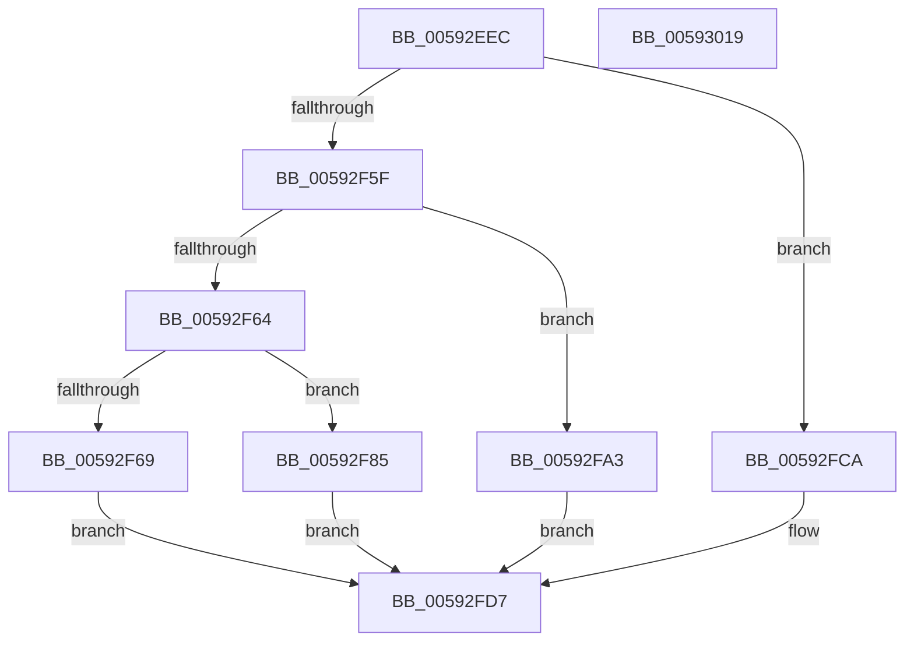

# IoSaveBugCheckRecoveryStatus

- RVA: `0x00592EEC`–`0x0059301A` (길이 `302` bytes)
- VA: `0x0000000140592EEC`
- 실행 섹션: `.text`
- PDB 이름 있음: `예`; PDB Function 태그: `아니요`
- unwind 정보 RVA: `0x000BAEE4`
- 디코드: `84`개 명령, `302/302` bytes 표시
- 미해석 바이트: `0` (있으면 어셈블리에 `.byte`로 보존)

> 이 문서는 커널 이미지의 기계어와 PDB 기호를 분석해 생성했습니다. 4번과 5번은 함수 원형과 자료형을 바이너리 사용 방식에서 추정한 C 해석이며 원본 소스 복구 결과는 아닙니다.

## 1. Dependencies

- 직접 호출 지점: **2**; 고유 호출 대상: **2**
- 직접 호출자로 확인된 함수: **3**
- RIP 상대 이미지 참조: **1**

### Outgoing calls
- `0x00592FFF` → [WheaLogInternalEvent](../66/WheaLogInternalEvent_function_006605B0.md) (function, `0x006605B0`)
- `0x0059300B` → [_security_check_cookie](../6A/_security_check_cookie_function_006AC640.md) (function, `0x006AC640`)

### Direct callers
- [KiAttemptBugcheckRecovery](../5C/KiAttemptBugcheckRecovery_function_005C6D24.md) at `0x005C6DFB`
- [KiAttemptBugcheckRecovery](../5C/KiAttemptBugcheckRecovery_function_005C6D24.md) at `0x005C6E68`
- [KiDeferredBugcheckRecoveryWorker](../5C/KiDeferredBugcheckRecoveryWorker_function_005C75A0.md) at `0x005C7688`
- [KiHandleMultipleBugchecksDuringRecovery](../5C/KiHandleMultipleBugchecksDuringRecovery_function_005C7860.md) at `0x005C78F3`

### Static image references
- `0x00592EFA` → RVA `0x00E0A740` (`.data`; read)

## 2. Other-region calls and transfers

- 다른 실행 섹션으로 향하는 call: **0**
- 별도 외부 분기/꼬리 이동을 확인하지 못했습니다.

## 3. Assembly (complete function range)

```asm
00592EEC  40 55                           push rbp
00592EEE  48 8D 6C 24 A9                  lea rbp, [rsp - 0x57]
00592EF3  48 81 EC D0 00 00 00            sub rsp, 0xd0
00592EFA  48 8B 05 3F 78 87 00            mov rax, qword ptr [rip + 0x87783f]
00592F01  48 33 C4                        xor rax, rsp
00592F04  48 89 45 47                     mov qword ptr [rbp + 0x47], rax
00592F08  33 C0                           xor eax, eax
00592F0A  0F 57 C0                        xorps xmm0, xmm0
00592F0D  0F 57 C9                        xorps xmm1, xmm1
00592F10  66 89 45 EF                     mov word ptr [rbp - 0x11], ax
00592F14  48 8B D1                        mov rdx, rcx
00592F17  88 45 F1                        mov byte ptr [rbp - 0xf], al
00592F1A  8B 09                           mov ecx, dword ptr [rcx]
00592F1C  44 8B C9                        mov r9d, ecx
00592F1F  41 81 C9 00 2A 00 00            or r9d, 0x2a00
00592F26  48 89 45 C7                     mov qword ptr [rbp - 0x39], rax
00592F2A  89 45 17                        mov dword ptr [rbp + 0x17], eax
00592F2D  44 8D 58 08                     lea r11d, [rax + 8]
00592F31  88 45 1B                        mov byte ptr [rbp + 0x1b], al
00592F34  44 8D 50 01                     lea r10d, [rax + 1]
00592F38  88 45 3F                        mov byte ptr [rbp + 0x3f], al
00592F3B  0F 11 45 CF                     movups xmmword ptr [rbp - 0x31], xmm0
00592F3F  0F 11 45 DF                     movups xmmword ptr [rbp - 0x21], xmm0
00592F43  0F 11 45 A7                     movups xmmword ptr [rbp - 0x59], xmm0
00592F47  0F 11 45 B7                     movups xmmword ptr [rbp - 0x49], xmm0
00592F4B  0F 11 4D F7                     movups xmmword ptr [rbp - 9], xmm1
00592F4F  0F 11 4D 07                     movups xmmword ptr [rbp + 7], xmm1
00592F53  0F 11 45 1F                     movups xmmword ptr [rbp + 0x1f], xmm0
00592F57  0F 11 45 2F                     movups xmmword ptr [rbp + 0x2f], xmm0
00592F5B  85 C9                           test ecx, ecx
00592F5D  74 6B                           je 0x140592fca
00592F5F  41 2B CA                        sub ecx, r10d
00592F62  74 3F                           je 0x140592fa3
00592F64  41 3B CA                        cmp ecx, r10d
00592F67  74 1C                           je 0x140592f85
00592F69  44 8D 40 03                     lea r8d, [rax + 3]
00592F6D  8A 42 04                        mov al, byte ptr [rdx + 4]
00592F70  88 45 EF                        mov byte ptr [rbp - 0x11], al
00592F73  48 8D 4D CF                     lea rcx, [rbp - 0x31]
00592F77  8A 42 05                        mov al, byte ptr [rdx + 5]
00592F7A  88 45 F0                        mov byte ptr [rbp - 0x10], al
00592F7D  8A 42 06                        mov al, byte ptr [rdx + 6]
00592F80  88 45 F1                        mov byte ptr [rbp - 0xf], al
00592F83  EB 52                           jmp 0x140592fd7
00592F85  A1 C4 02 00 00 80 F7 FF FF      movabs eax, dword ptr [0xfffff780000002c4]
00592F8E  48 8D 4D F7                     lea rcx, [rbp - 9]
00592F92  89 45 17                        mov dword ptr [rbp + 0x17], eax
00592F95  41 B8 05 00 00 00               mov r8d, 5
00592F9B  8A 42 04                        mov al, byte ptr [rdx + 4]
00592F9E  88 45 1B                        mov byte ptr [rbp + 0x1b], al
00592FA1  EB 34                           jmp 0x140592fd7
00592FA3  8A 42 04                        mov al, byte ptr [rdx + 4]
00592FA6  48 8D 4D A7                     lea rcx, [rbp - 0x59]
00592FAA  88 45 C7                        mov byte ptr [rbp - 0x39], al
00592FAD  45 8B C3                        mov r8d, r11d
00592FB0  8A 42 08                        mov al, byte ptr [rdx + 8]
00592FB3  88 45 CB                        mov byte ptr [rbp - 0x35], al
00592FB6  33 C0                           xor eax, eax
00592FB8  66 89 45 CC                     mov word ptr [rbp - 0x34], ax
00592FBC  88 45 CE                        mov byte ptr [rbp - 0x32], al
00592FBF  44 88 55 C8                     mov byte ptr [rbp - 0x38], r10b
00592FC3  66 44 89 55 C9                  mov word ptr [rbp - 0x37], r10w
00592FC8  EB 0D                           jmp 0x140592fd7
00592FCA  8A 42 04                        mov al, byte ptr [rdx + 4]
00592FCD  48 8D 4D 1F                     lea rcx, [rbp + 0x1f]
00592FD1  88 45 3F                        mov byte ptr [rbp + 0x3f], al
00592FD4  45 8B C2                        mov r8d, r10d
00592FD7  83 61 0C 00                     and dword ptr [rcx + 0xc], 0
00592FDB  41 8D 40 20                     lea eax, [r8 + 0x20]
00592FDF  89 41 08                        mov dword ptr [rcx + 8], eax
00592FE2  C7 01 57 68 4C 67               mov dword ptr [rcx], 0x674c6857
00592FE8  44 89 51 04                     mov dword ptr [rcx + 4], r10d
00592FEC  C7 41 14 2A 00 00 80            mov dword ptr [rcx + 0x14], 0x8000002a
00592FF3  44 89 49 10                     mov dword ptr [rcx + 0x10], r9d
00592FF7  44 89 59 18                     mov dword ptr [rcx + 0x18], r11d
00592FFB  44 89 41 1C                     mov dword ptr [rcx + 0x1c], r8d
00592FFF  E8 AC D5 0C 00                  call 0x1406605b0
00593004  48 8B 4D 47                     mov rcx, qword ptr [rbp + 0x47]
00593008  48 33 CC                        xor rcx, rsp
0059300B  E8 30 96 11 00                  call 0x1406ac640
00593010  48 81 C4 D0 00 00 00            add rsp, 0xd0
00593017  5D                              pop rbp
00593018  C3                              ret
00593019  CC                              int3
```

## 4. C-style interpretation (structured pseudocode)

```c
__int64 __fastcall IoSaveBugCheckRecoveryStatus(__int64 a1)
{
    __int64 result;
    __int64 v_rsp;
    unsigned __int64 v_stack_m18;
    unsigned __int8 v_stack_m20;
    unsigned __int64 v_stack_m30;
    unsigned __int64 v_stack_m40;
    unsigned __int8 v_stack_m44;
    unsigned int v_stack_m48;
    unsigned __int64 v_stack_m58;
    unsigned __int64 v_stack_m5F;
    unsigned __int64 v_stack_m68;
    unsigned __int8 v_stack_m6E;
    unsigned __int8 v_stack_m6F;
    unsigned __int16 v_stack_m70;
    unsigned __int64 v_stack_m80;
    unsigned __int64 v_stack_m90;
    unsigned __int8 v_stack_m91;
    unsigned __int16 v_stack_m93;
    unsigned __int8 v_stack_m94;
    unsigned __int16 v_stack_m96;
    unsigned __int8 v_stack_m97;
    unsigned __int64 v_stack_m98;
    unsigned __int64 v_stack_mA8;
    unsigned __int64 v_stack_mB8;

    v_rsp = (v_rsp) - (208);
    result = (*(unsigned __int64 *)(v_rip + 8878143)) ^ (v_rsp);
    v_stack_m18 = result;
    result = 0;
    v_stack_m70 = 0;
    v_stack_m6E = 0;
    a4 = (unsigned int)(((unsigned int)((unsigned int)((unsigned int)(*(unsigned int *)(a1))))) | (0x2A00ULL));
    v_stack_m98 = 0;
    v_stack_m48 = 0;
    v_stack_m44 = 0;
    v_stack_m20 = 0;
    v_stack_m90 = v_xmm0;
    v_stack_m80 = v_xmm0;
    v_stack_mB8 = v_xmm0;
    v_stack_mA8 = v_xmm0;
    v_stack_m68 = v_xmm1;
    v_stack_m58 = v_xmm1;
    v_stack_m40 = v_xmm0;
    v_stack_m30 = v_xmm0;
    if ((unsigned int)((unsigned int)(*(unsigned int *)(a1))) == 0) goto loc_00592FCA;
    a1 = (unsigned int)(((unsigned int)(*(unsigned int *)(a1))) - ((unsigned int)(result + 1)));
    if (condition_is_equal) goto loc_00592FA3;
    if (((unsigned int)(a1)) == ((unsigned int)(result + 1))) goto loc_00592F85;
    v_stack_m70 = (unsigned __int8)(*(unsigned __int8 *)(a1 + 4));
    v_stack_m6F = (unsigned __int8)(*(unsigned __int8 *)(a1 + 5));
    v_stack_m6E = (unsigned __int8)(*(unsigned __int8 *)(a1 + 6));
    goto loc_00592FD7;
loc_00592F85:
    v_stack_m48 = (unsigned int)(*(unsigned __int8 *)(a1 + 6));
    v_stack_m44 = (unsigned __int8)(*(unsigned __int8 *)(a1 + 4));
    goto loc_00592FD7;
loc_00592FA3:
    v_stack_m98 = (unsigned __int8)(*(unsigned __int8 *)(a1 + 4));
    v_stack_m94 = (unsigned __int8)(*(unsigned __int8 *)(a1 + 8));
    result = 0;
    v_stack_m93 = 0;
    v_stack_m91 = 0;
    v_stack_m97 = (unsigned __int8)(result + 1);
    v_stack_m96 = (unsigned __int16)(result + 1);
    goto loc_00592FD7;
loc_00592FCA:
    v_stack_m20 = (unsigned __int8)(*(unsigned __int8 *)(a1 + 4));
loc_00592FD7:
    *(unsigned int *)(v_stack_m40 + 8) = (unsigned int)((unsigned int)((unsigned int)(result + 1)) + 32);
    *(unsigned int *)(v_stack_m40) = 0x674C6857ULL;
    *(unsigned int *)(v_stack_m40 + 4) = (unsigned int)(result + 1);
    *(unsigned int *)(v_stack_m40 + 20) = 0x8000002AULL;
    *(unsigned int *)(v_stack_m40 + 16) = (unsigned int)(a4);
    *(unsigned int *)(v_stack_m40 + 24) = (unsigned int)(result + 8);
    *(unsigned int *)(v_stack_m40 + 28) = (unsigned int)((unsigned int)((unsigned int)(result + 1)));
    result = WheaLogInternalEvent(v_stack_m40, a1, (unsigned int)((unsigned int)(result + 1)), a4);
    a1 = (v_stack_m18) ^ (v_rsp);
    result = _security_check_cookie(a1, a1, (unsigned int)((unsigned int)(result + 1)), a4);
    v_rsp = (v_rsp) + (208);
    return result;
}
```

## 5. (Beta) C Style

```c
int64_t IoSaveBugCheckRecoveryStatus(void *Arg1)
{
    uint8_t *arg1 = (uint8_t *)Arg1;

    int64_t result;
    int64_t local_rsp;
    uint64_t v_stack_m18;
    uint8_t v_stack_m20;
    uint64_t v_stack_m30;
    uint64_t v_stack_m40;
    uint8_t v_stack_m44;
    uint32_t v_stack_m48;
    uint64_t v_stack_m58;
    uint64_t v_stack_m5F;
    uint64_t v_stack_m68;
    uint8_t v_stack_m6E;
    uint8_t v_stack_m6F;
    uint16_t v_stack_m70;
    uint64_t v_stack_m80;
    uint64_t v_stack_m90;
    uint8_t v_stack_m91;
    uint16_t v_stack_m93;
    uint8_t v_stack_m94;
    uint16_t v_stack_m96;
    uint8_t v_stack_m97;
    uint64_t v_stack_m98;
    uint64_t v_stack_mA8;
    uint64_t v_stack_mB8;

    local_rsp = (local_rsp) - (208);
    result = (*(uint64_t *)(v_rip + 0x87783F)) ^ (local_rsp);
    v_stack_m18 = result;
    result = 0;
    v_stack_m70 = 0;
    v_stack_m6E = 0;
    a4 = (uint32_t)(((uint32_t)((uint32_t)((uint32_t)(*(uint32_t *)(arg1))))) | (0x2A00ULL));
    v_stack_m98 = 0;
    v_stack_m48 = 0;
    v_stack_m44 = 0;
    v_stack_m20 = 0;
    v_stack_m90 = v_xmm0;
    v_stack_m80 = v_xmm0;
    v_stack_mB8 = v_xmm0;
    v_stack_mA8 = v_xmm0;
    v_stack_m68 = v_xmm1;
    v_stack_m58 = v_xmm1;
    v_stack_m40 = v_xmm0;
    v_stack_m30 = v_xmm0;
    if ((uint32_t)((uint32_t)(*(uint32_t *)(arg1))) == 0) goto loc_00592FCA;
    Arg1 = (uint32_t)(((uint32_t)(*(uint32_t *)(arg1))) - ((uint32_t)(result + 1)));
    if (condition_is_equal) goto loc_00592FA3;
    if (((uint32_t)(Arg1)) == ((uint32_t)(result + 1))) goto loc_00592F85;
    v_stack_m70 = (uint8_t)(*(uint8_t *)(arg1 + 0x4));
    v_stack_m6F = (uint8_t)(*(uint8_t *)(arg1 + 0x5));
    v_stack_m6E = (uint8_t)(*(uint8_t *)(arg1 + 0x6));
    goto loc_00592FD7;
loc_00592F85:
    v_stack_m48 = (uint32_t)(*(uint8_t *)(arg1 + 0x6));
    v_stack_m44 = (uint8_t)(*(uint8_t *)(arg1 + 0x4));
    goto loc_00592FD7;
loc_00592FA3:
    v_stack_m98 = (uint8_t)(*(uint8_t *)(arg1 + 0x4));
    v_stack_m94 = (uint8_t)(*(uint8_t *)(arg1 + 0x8));
    result = 0;
    v_stack_m93 = 0;
    v_stack_m91 = 0;
    v_stack_m97 = (uint8_t)(result + 1);
    v_stack_m96 = (uint16_t)(result + 1);
    goto loc_00592FD7;
loc_00592FCA:
    v_stack_m20 = (uint8_t)(*(uint8_t *)(arg1 + 0x4));
loc_00592FD7:
    *(uint32_t *)(v_stack_m40 + 0x8) = (uint32_t)((uint32_t)((uint32_t)(result + 1)) + 32);
    *(uint32_t *)(v_stack_m40) = 0x674C6857ULL;
    *(uint32_t *)(v_stack_m40 + 0x4) = (uint32_t)(result + 1);
    *(uint32_t *)(v_stack_m40 + 0x14) = 0x8000002AULL;
    *(uint32_t *)(v_stack_m40 + 0x10) = (uint32_t)(a4);
    *(uint32_t *)(v_stack_m40 + 0x18) = (uint32_t)(result + 8);
    *(uint32_t *)(v_stack_m40 + 0x1C) = (uint32_t)((uint32_t)((uint32_t)(result + 1)));
    result = WheaLogInternalEvent(v_stack_m40, Arg1, (uint32_t)((uint32_t)(result + 1)), a4);
    Arg1 = (v_stack_m18) ^ (local_rsp);
    result = _security_check_cookie(Arg1, Arg1, (uint32_t)((uint32_t)(result + 1)), a4);
    local_rsp = (local_rsp) + (208);
    return result;
}
```

### 관측된 메모리 오프셋

구조체 형식이 확인되지 않은 접근은 인자 기준의 오프셋으로만 기록했습니다.

| 기준 인자 | 오프셋 표현 | 폭 (bit) | 접근 |
|---|---:|---:|---|
| `Arg1` | `+ 0x0` | `32` | `R` |
| `Arg1` | `+ 0x4` | `8` | `R` |
| `Arg1` | `+ 0x5` | `8` | `R` |
| `Arg1` | `+ 0x6` | `8` | `R` |
| `Arg1` | `+ 0x8` | `8` | `R` |

## 6. Execution-region graph

[열기: 2D/3D 그래프와 함수 탐색 컨트롤 패널](../../../control-panel.html?section=text&rva=0x00592EEC&view=graph)

- 2D 그래프는 위에서 아래로 흐르고, 3D 그래프는 빈 공간을 드래그해 회전합니다. Shift+드래그는 이동, 휠은 확대·축소, 함수 노드 선택은 대상 보고서 이동입니다.

### Static fallback


