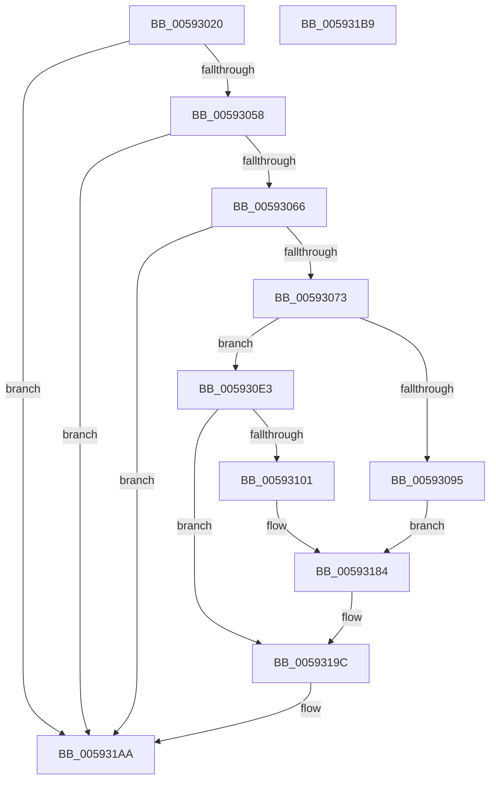

# IoSaveInitialBugCheckProgress

- RVA: `0x00593020`–`0x005931BA` (길이 `410` bytes)
- VA: `0x0000000140593020`
- 실행 섹션: `.text`
- PDB 이름 있음: `예`; PDB Function 태그: `아니요`
- unwind 정보 RVA: `0x000C6F80`
- 디코드: `85`개 명령, `410/410` bytes 표시
- 미해석 바이트: `0` (있으면 어셈블리에 `.byte`로 보존)

> 이 문서는 커널 이미지의 기계어와 PDB 기호를 분석해 생성했습니다. 4번과 5번은 함수 원형과 자료형을 바이너리 사용 방식에서 추정한 C 해석이며 원본 소스 복구 결과는 아닙니다.

## 1. Dependencies

- 직접 호출 지점: **6**; 고유 호출 대상: **3**
- 직접 호출자로 확인된 함수: **2**
- RIP 상대 이미지 참조: **10**

### Outgoing calls
- `0x00593066` → [IopBugCheckProgressEfiVariableServicesAvailable](IopBugCheckProgressEfiVariableServicesAvailable_function_00594708.md) (function, `0x00594708`)
- `0x005930CB` → [guard_dispatch_icall](../6B/guard_dispatch_icall_function_006BAAD0.md) (function, `0x006BAAD0`)
- `0x005930F4` → [HalGetEnvironmentVariableEx](../44/HalGetEnvironmentVariableEx_function_00449100.md) (function, `0x00449100`)
- `0x00593148` → [guard_dispatch_icall](../6B/guard_dispatch_icall_function_006BAAD0.md) (function, `0x006BAAD0`)
- `0x0059316E` → [guard_dispatch_icall](../6B/guard_dispatch_icall_function_006BAAD0.md) (function, `0x006BAAD0`)
- `0x00593197` → [guard_dispatch_icall](../6B/guard_dispatch_icall_function_006BAAD0.md) (function, `0x006BAAD0`)

### Direct callers
- [KeBugCheck2](../5B/KeBugCheck2_function_005B27D0.md) at `0x005B3530`
- [KiUpdateBugcheckRecoveryProgress](../5C/KiUpdateBugcheckRecoveryProgress_function_005C7E1C.md) at `0x005C7EC7`

### Static image references
- `0x00593047` → RVA `0x00E65EDC` (`.data`; read)
- `0x00593058` → RVA `0x00F8E968` (`.data`; read)
- `0x00593073` → RVA `0x00E66050` (`.data`; read)
- `0x0059307E` → RVA `0x00E65ED8` (`.data`; write)
- `0x00593089` → RVA `0x00020910` (`.rdata`; read)
- `0x005930B0` → RVA `0x006C9D70` (` ?? ::FNODOBFM::`string'`; read)
- `0x005930D7` → RVA `0x006C9D40` (` ?? ::FNODOBFM::`string'`; read)
- `0x0059317D` → RVA `0x006C9E40` (` ?? ::FNODOBFM::`string'`; read)
- `0x0059319C` → RVA `0x00E65ED8` (`.data`; read/write)
- `0x005931A3` → RVA `0x00E65EDC` (`.data`; write)

## 2. Other-region calls and transfers

- 다른 실행 섹션으로 향하는 call: **0**
- 별도 외부 분기/꼬리 이동을 확인하지 못했습니다.

## 3. Assembly (complete function range)

```asm
00593020  48 89 7C 24 08                  mov qword ptr [rsp + 8], rdi
00593025  48 89 54 24 10                  mov qword ptr [rsp + 0x10], rdx
0059302A  55                              push rbp
0059302B  41 56                           push r14
0059302D  41 57                           push r15
0059302F  48 8B EC                        mov rbp, rsp
00593032  48 83 EC 40                     sub rsp, 0x40
00593036  48 83 65 F0 00                  and qword ptr [rbp - 0x10], 0
0059303B  41 BF 08 00 00 00               mov r15d, 8
00593041  83 65 30 00                     and dword ptr [rbp + 0x30], 0
00593045  8B F9                           mov edi, ecx
00593047  83 3D 8E 2E 8D 00 00            cmp dword ptr [rip + 0x8d2e8e], 0
0059304E  44 89 7D 38                     mov dword ptr [rbp + 0x38], r15d
00593052  0F 85 52 01 00 00               jne 0x1405931aa
00593058  48 83 3D 08 B9 9F 00 00         cmp qword ptr [rip + 0x9fb908], 0
00593060  0F 84 44 01 00 00               je 0x1405931aa
00593066  E8 9D 16 00 00                  call 0x140594708
0059306B  84 C0                           test al, al
0059306D  0F 84 37 01 00 00               je 0x1405931aa
00593073  48 8B 0D D6 2F 8D 00            mov rcx, qword ptr [rip + 0x8d2fd6]
0059307A  45 8D 77 F9                     lea r14d, [r15 - 7]
0059307E  44 89 35 53 2E 8D 00            mov dword ptr [rip + 0x8d2e53], r14d
00593085  4C 8D 45 F0                     lea r8, [rbp - 0x10]
00593089  48 8D 15 80 D8 A8 FF            lea rdx, [rip - 0x572780]
00593090  48 85 C9                        test rcx, rcx
00593093  74 4E                           je 0x1405930e3
00593095  89 7D F0                        mov dword ptr [rbp - 0x10], edi
00593098  45 8B CF                        mov r9d, r15d
0059309B  66 A1 C4 02 00 00 80 F7 FF FF   movabs ax, word ptr [0xfffff780000002c4]
005930A5  66 89 45 F4                     mov word ptr [rbp - 0xc], ax
005930A9  0F B7 81 80 05 00 00            movzx eax, word ptr [rcx + 0x580]
005930B0  48 8D 0D B9 6C 13 00            lea rcx, [rip + 0x136cb9]
005930B7  66 41 03 C6                     add ax, r14w
005930BB  44 89 74 24 20                  mov dword ptr [rsp + 0x20], r14d
005930C0  66 89 45 F6                     mov word ptr [rbp - 0xa], ax
005930C4  48 8B 05 9D B8 9F 00            mov rax, qword ptr [rip + 0x9fb89d]
005930CB  E8 00 7A 12 00                  call 0x1406baad0
005930D0  45 8B CF                        mov r9d, r15d
005930D3  4C 8D 45 28                     lea r8, [rbp + 0x28]
005930D7  48 8D 0D 62 6C 13 00            lea rcx, [rip + 0x136c62]
005930DE  E9 A1 00 00 00                  jmp 0x140593184
005930E3  48 83 64 24 20 00               and qword ptr [rsp + 0x20], 0
005930E9  4C 8D 4D 38                     lea r9, [rbp + 0x38]
005930ED  48 8D 0D 7C 6C 13 00            lea rcx, [rip + 0x136c7c]
005930F4  E8 07 60 EB FF                  call 0x140449100
005930F9  85 C0                           test eax, eax
005930FB  0F 85 9B 00 00 00               jne 0x14059319c
00593101  89 7D F0                        mov dword ptr [rbp - 0x10], edi
00593104  4C 8D 45 F0                     lea r8, [rbp - 0x10]
00593108  66 A1 C4 02 00 00 80 F7 FF FF   movabs ax, word ptr [0xfffff780000002c4]
00593112  48 8D 15 F7 D7 A8 FF            lea rdx, [rip - 0x572809]
00593119  66 44 01 75 F6                  add word ptr [rbp - 0xa], r14w
0059311E  48 8D 0D 4B 6C 13 00            lea rcx, [rip + 0x136c4b]
00593125  66 89 45 F4                     mov word ptr [rbp - 0xc], ax
00593129  45 8B CF                        mov r9d, r15d
0059312C  8B 45 30                        mov eax, dword ptr [rbp + 0x30]
0059312F  25 4F FE FF FF                  and eax, 0xfffffe4f
00593134  44 89 74 24 20                  mov dword ptr [rsp + 0x20], r14d
00593139  0D 4F 00 04 00                  or eax, 0x4004f
0059313E  89 45 30                        mov dword ptr [rbp + 0x30], eax
00593141  48 8B 05 20 B8 9F 00            mov rax, qword ptr [rip + 0x9fb820]
00593148  E8 83 79 12 00                  call 0x1406baad0
0059314D  48 8B 05 14 B8 9F 00            mov rax, qword ptr [rip + 0x9fb814]
00593154  4C 8D 45 28                     lea r8, [rbp + 0x28]
00593158  45 8B CF                        mov r9d, r15d
0059315B  44 89 74 24 20                  mov dword ptr [rsp + 0x20], r14d
00593160  48 8D 15 A9 D7 A8 FF            lea rdx, [rip - 0x572857]
00593167  48 8D 0D D2 6B 13 00            lea rcx, [rip + 0x136bd2]
0059316E  E8 5D 79 12 00                  call 0x1406baad0
00593173  41 B9 04 00 00 00               mov r9d, 4
00593179  4C 8D 45 30                     lea r8, [rbp + 0x30]
0059317D  48 8D 0D BC 6C 13 00            lea rcx, [rip + 0x136cbc]
00593184  48 8B 05 DD B7 9F 00            mov rax, qword ptr [rip + 0x9fb7dd]
0059318B  48 8D 15 7E D7 A8 FF            lea rdx, [rip - 0x572882]
00593192  44 89 74 24 20                  mov dword ptr [rsp + 0x20], r14d
00593197  E8 34 79 12 00                  call 0x1406baad0
0059319C  83 25 35 2D 8D 00 00            and dword ptr [rip + 0x8d2d35], 0
005931A3  44 89 35 32 2D 8D 00            mov dword ptr [rip + 0x8d2d32], r14d
005931AA  48 8B 7C 24 60                  mov rdi, qword ptr [rsp + 0x60]
005931AF  48 83 C4 40                     add rsp, 0x40
005931B3  41 5F                           pop r15
005931B5  41 5E                           pop r14
005931B7  5D                              pop rbp
005931B8  C3                              ret
005931B9  CC                              int3
```

## 4. C-style interpretation (structured pseudocode)

```c
__int64 __fastcall IoSaveInitialBugCheckProgress(int a1, __int64 a2)
{
    __int64 result;
    __int64 v_rsp;
    unsigned __int16 v_stack_m22;
    unsigned __int16 v_stack_m24;
    unsigned __int64 v_stack_m28;
    unsigned int v_stack_m38;
    unsigned __int64 v_stack_p10;
    unsigned int v_stack_p18;
    unsigned int v_stack_p20;
    unsigned __int64 v_stack_p8;

    v_stack_p8 = v_rdi;
    v_stack_p10 = a2;
    v_rsp = (v_rsp) - (64);
    v_stack_p20 = 8;
    if ((*(unsigned int *)(v_rip + 9252494)) != 0) goto loc_005931AA;
    if ((*(unsigned __int64 *)(v_rip + 10467592)) == 0) goto loc_005931AA;
    result = IopBugCheckProgressEfiVariableServicesAvailable(a1, a2, a3, a4);
    if ((unsigned __int8)(result) == 0) goto loc_005931AA;
    *(unsigned int *)(v_rip + 9252435) = (unsigned int)(8 - 7);
    if (*(unsigned __int64 *)(v_rip + 9252822) == 0) goto loc_005930E3;
    v_stack_m28 = (unsigned int)((unsigned int)(a1));
    v_stack_m24 = (unsigned __int16)(result);
    result = (unsigned __int16)((*(unsigned __int16 *)(*(unsigned __int64 *)(v_rip + 9252822) + 1408)) + ((unsigned __int16)(8 - 7)));
    v_stack_m38 = (unsigned int)(8 - 7);
    v_stack_m22 = (unsigned __int16)(result);
    result = guard_dispatch_icall(v_rip + 1273017, v_rip - 5711744, v_stack_m28, 8);
    goto loc_00593184;
loc_005930E3:
    result = HalGetEnvironmentVariableEx(v_rip + 1272956, v_rip - 5711744, v_stack_p10, v_stack_p20);
    if ((unsigned int)(result) != 0) goto loc_0059319C;
    v_stack_m28 = (unsigned int)((unsigned int)(a1));
    v_stack_m24 = (unsigned __int16)(result);
    result = (unsigned int)(((unsigned int)(v_stack_p18)) & (0xFFFFFE4FULL));
    v_stack_m38 = (unsigned int)(8 - 7);
    result = (unsigned int)((result) | (0x4004FULL));
    v_stack_p18 = (unsigned int)(result);
    result = guard_dispatch_icall(v_rip + 1272907, v_rip - 5711881, v_stack_m28, 8);
    v_stack_m38 = (unsigned int)(8 - 7);
    result = guard_dispatch_icall(v_rip + 1272786, v_rip - 5711959, v_stack_p10, 8);
loc_00593184:
    v_stack_m38 = (unsigned int)(8 - 7);
    result = guard_dispatch_icall(v_rip + 1273020, v_rip - 5712002, v_stack_p18, 4);
loc_0059319C:
    *(unsigned int *)(v_rip + 9252146) = (unsigned int)(8 - 7);
loc_005931AA:
    v_rsp = (v_rsp) + (64);
    return result;
}
```

## 5. (Beta) C Style

```c
int64_t IoSaveInitialBugCheckProgress(int32_t Arg1, int64_t Arg2)
{
    int64_t result;
    int64_t local_rsp;
    uint16_t v_stack_m22;
    uint16_t v_stack_m24;
    uint64_t v_stack_m28;
    uint32_t v_stack_m38;
    uint64_t v_stack_p10;
    uint32_t v_stack_p18;
    uint32_t v_stack_p20;
    uint64_t v_stack_p8;

    v_stack_p8 = local_rdi;
    v_stack_p10 = Arg2;
    local_rsp = (local_rsp) - (64);
    v_stack_p20 = 8;
    if ((*(uint32_t *)(v_rip + 0x8D2E8E)) != 0) goto loc_005931AA;
    if ((*(uint64_t *)(v_rip + 0x9FB908)) == 0) goto loc_005931AA;
    result = IopBugCheckProgressEfiVariableServicesAvailable(Arg1, Arg2, a3, a4);
    if ((uint8_t)(result) == 0) goto loc_005931AA;
    *(uint32_t *)(v_rip + 0x8D2E53) = (uint32_t)(8 - 7);
    if (*(uint64_t *)(v_rip + 0x8D2FD6) == 0) goto loc_005930E3;
    v_stack_m28 = (uint32_t)((uint32_t)(Arg1));
    v_stack_m24 = (uint16_t)(result);
    result = (uint16_t)((*(uint16_t *)(*(uint64_t *)(v_rip + 0x8D2FD6) + 0x580)) + ((uint16_t)(8 - 7)));
    v_stack_m38 = (uint32_t)(8 - 7);
    v_stack_m22 = (uint16_t)(result);
    result = guard_dispatch_icall(v_rip + 1273017, v_rip - 5711744, v_stack_m28, 8);
    goto loc_00593184;
loc_005930E3:
    result = HalGetEnvironmentVariableEx(v_rip + 1272956, v_rip - 5711744, v_stack_p10, v_stack_p20);
    if ((uint32_t)(result) != 0) goto loc_0059319C;
    v_stack_m28 = (uint32_t)((uint32_t)(Arg1));
    v_stack_m24 = (uint16_t)(result);
    result = (uint32_t)(((uint32_t)(v_stack_p18)) & (0xFFFFFE4FULL));
    v_stack_m38 = (uint32_t)(8 - 7);
    result = (uint32_t)((result) | (0x4004FULL));
    v_stack_p18 = (uint32_t)(result);
    result = guard_dispatch_icall(v_rip + 1272907, v_rip - 5711881, v_stack_m28, 8);
    v_stack_m38 = (uint32_t)(8 - 7);
    result = guard_dispatch_icall(v_rip + 1272786, v_rip - 5711959, v_stack_p10, 8);
loc_00593184:
    v_stack_m38 = (uint32_t)(8 - 7);
    result = guard_dispatch_icall(v_rip + 1273020, v_rip - 5712002, v_stack_p18, 4);
loc_0059319C:
    *(uint32_t *)(v_rip + 0x8D2D32) = (uint32_t)(8 - 7);
loc_005931AA:
    local_rsp = (local_rsp) + (64);
    return result;
}
```

## 6. Execution-region graph

[열기: 2D/3D 그래프와 함수 탐색 컨트롤 패널](../../../control-panel.html?section=text&rva=0x00593020&view=graph)

- 2D 그래프는 위에서 아래로 흐르고, 3D 그래프는 빈 공간을 드래그해 회전합니다. Shift+드래그는 이동, 휠은 확대·축소, 함수 노드 선택은 대상 보고서 이동입니다.

### Static fallback


