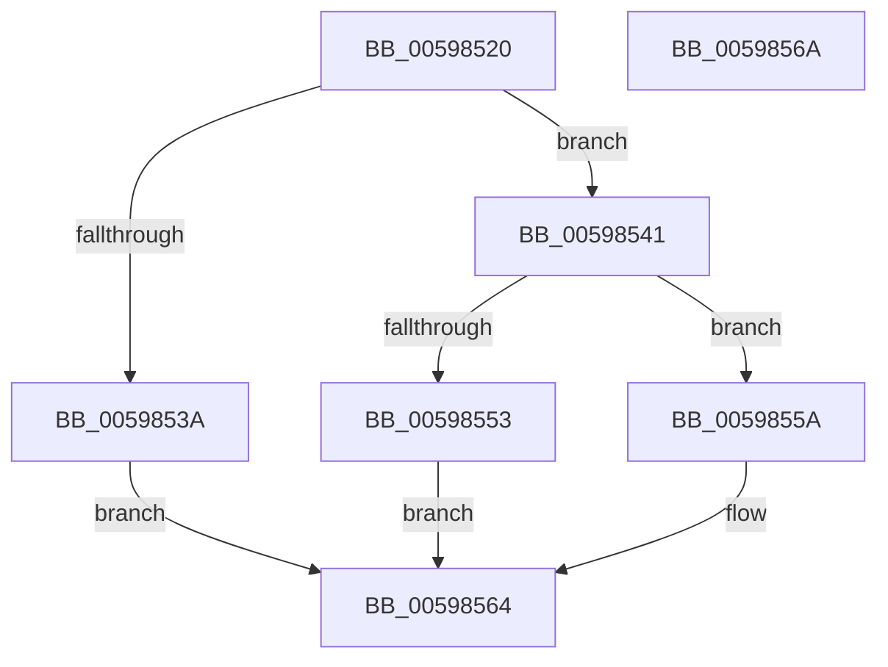

# IoSetAdapterCryptoEngineExtension

- RVA: `0x00598520`–`0x0059856B` (길이 `75` bytes)
- VA: `0x0000000140598520`
- 실행 섹션: `.text`
- PDB 이름 있음: `예`; PDB Function 태그: `아니요`
- unwind 정보 RVA: `0x0005CF00`
- 디코드: `24`개 명령, `75/75` bytes 표시
- 미해석 바이트: `0` (있으면 어셈블리에 `.byte`로 보존)

> 이 문서는 커널 이미지의 기계어와 PDB 기호를 분석해 생성했습니다. 4번과 5번은 함수 원형과 자료형을 바이너리 사용 방식에서 추정한 C 해석이며 원본 소스 복구 결과는 아닙니다.

## 1. Dependencies

- 직접 호출 지점: **2**; 고유 호출 대상: **2**
- 직접 호출자로 확인된 함수: **0**
- RIP 상대 이미지 참조: **0**

### Outgoing calls
- `0x00598531` → [IopIrpHasValidCombinationOfExtensionTypes](../48/IopIrpHasValidCombinationOfExtensionTypes_function_0048C070.md) (function, `0x0048C070`)
- `0x00598549` → [IopAllocateIrpExtension](../44/IopAllocateIrpExtension_function_00444F30.md) (function, `0x00444F30`)

### Direct callers
- 이 함수 시작 RVA로 연결되는 직접 call은 확인되지 않았습니다. 간접 호출은 완전히 역산할 수 없습니다.

### Static image references
- 디코드된 RIP-relative 메모리 참조가 없습니다.

## 2. Other-region calls and transfers

- 다른 실행 섹션으로 향하는 call: **0**
- 별도 외부 분기/꼬리 이동을 확인하지 못했습니다.

## 3. Assembly (complete function range)

```asm
00598520  40 53                           push rbx
00598522  48 83 EC 20                     sub rsp, 0x20
00598526  48 8B DA                        mov rbx, rdx
00598529  4C 8B D9                        mov r11, rcx
0059852C  BA 07 00 00 00                  mov edx, 7
00598531  E8 3A 3B EF FF                  call 0x14048c070
00598536  84 C0                           test al, al
00598538  75 07                           jne 0x140598541
0059853A  B8 BB 00 00 C0                  mov eax, 0xc00000bb
0059853F  EB 23                           jmp 0x140598564
00598541  BA 07 00 00 00                  mov edx, 7
00598546  49 8B CB                        mov rcx, r11
00598549  E8 E2 C9 EA FF                  call 0x140444f30
0059854E  48 85 C0                        test rax, rax
00598551  75 07                           jne 0x14059855a
00598553  B8 9A 00 00 C0                  mov eax, 0xc000009a
00598558  EB 0A                           jmp 0x140598564
0059855A  0F 10 03                        movups xmm0, xmmword ptr [rbx]
0059855D  F3 0F 7F 40 28                  movdqu xmmword ptr [rax + 0x28], xmm0
00598562  33 C0                           xor eax, eax
00598564  48 83 C4 20                     add rsp, 0x20
00598568  5B                              pop rbx
00598569  C3                              ret
0059856A  CC                              int3
```

## 4. C-style interpretation (structured pseudocode)

```c
__int64 __fastcall IoSetAdapterCryptoEngineExtension(__int64 a1, __int64 a2)
{
    __int64 result;
    __int64 v_rsp;

    v_rsp = (v_rsp) - (32);
    result = IopIrpHasValidCombinationOfExtensionTypes(a1, 7, a3, a4);
    if ((unsigned __int8)(result) != 0) goto loc_00598541;
    goto loc_00598564;
loc_00598541:
    result = IopAllocateIrpExtension(a1, 7, a3, a4);
    if (result != 0) goto loc_0059855A;
    goto loc_00598564;
loc_0059855A:
    *(unsigned __int64 *)((unsigned int)(0xC000009AULL) + 40) = v_xmm0;
    result = 0;
loc_00598564:
    v_rsp = (v_rsp) + (32);
    return result;
}
```

## 5. (Beta) C Style

```c
int64_t IoSetAdapterCryptoEngineExtension(int64_t Arg1, void *Arg2)
{
    uint8_t *arg2 = (uint8_t *)Arg2;

    int64_t result;
    int64_t local_rsp;

    local_rsp = (local_rsp) - (32);
    result = IopIrpHasValidCombinationOfExtensionTypes(Arg1, 7, a3, a4);
    if ((uint8_t)(result) != 0) goto loc_00598541;
    goto loc_00598564;
loc_00598541:
    result = IopAllocateIrpExtension(Arg1, 7, a3, a4);
    if (result != 0) goto loc_0059855A;
    goto loc_00598564;
loc_0059855A:
    *(uint64_t *)((uint32_t)(0xC000009AULL) + 0x28) = v_xmm0;
    result = 0;
loc_00598564:
    local_rsp = (local_rsp) + (32);
    return result;
}
```

### 관측된 메모리 오프셋

구조체 형식이 확인되지 않은 접근은 인자 기준의 오프셋으로만 기록했습니다.

| 기준 인자 | 오프셋 표현 | 폭 (bit) | 접근 |
|---|---:|---:|---|
| `Arg2` | `+ 0x0` | `128` | `R` |

## 6. Execution-region graph

[열기: 2D/3D 그래프와 함수 탐색 컨트롤 패널](../../../control-panel.html?section=text&rva=0x00598520&view=graph)

- 2D 그래프는 위에서 아래로 흐르고, 3D 그래프는 빈 공간을 드래그해 회전합니다. Shift+드래그는 이동, 휠은 확대·축소, 함수 노드 선택은 대상 보고서 이동입니다.

### Static fallback


