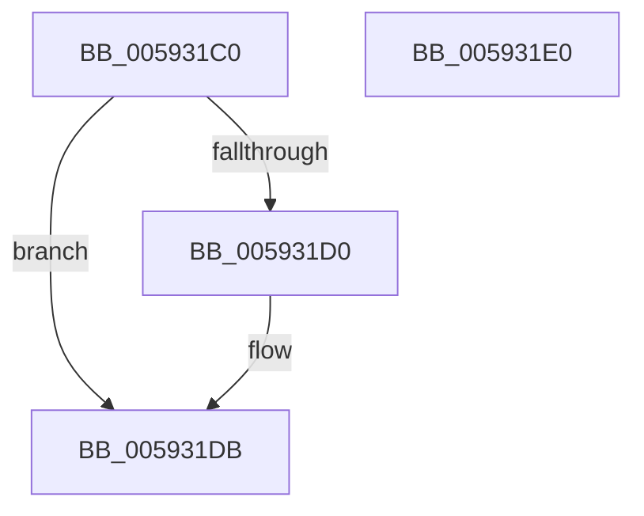

# IoSetBugCheckProgressFlag

- RVA: `0x005931C0`–`0x005931E1` (길이 `33` bytes)
- VA: `0x00000001405931C0`
- 실행 섹션: `.text`
- PDB 이름 있음: `예`; PDB Function 태그: `아니요`
- unwind 정보 RVA: `0x0005C788`
- 디코드: `9`개 명령, `33/33` bytes 표시
- 미해석 바이트: `0` (있으면 어셈블리에 `.byte`로 보존)

> 이 문서는 커널 이미지의 기계어와 PDB 기호를 분석해 생성했습니다. 4번과 5번은 함수 원형과 자료형을 바이너리 사용 방식에서 추정한 C 해석이며 원본 소스 복구 결과는 아닙니다.

## 1. Dependencies

- 직접 호출 지점: **1**; 고유 호출 대상: **1**
- 직접 호출자로 확인된 함수: **7**
- RIP 상대 이미지 참조: **1**

### Outgoing calls
- `0x005931D6` → [IoUpdateBugCheckProgressEnvVariable](IoUpdateBugCheckProgressEnvVariable_function_005933E0.md) (function, `0x005933E0`)

### Direct callers
- [IoRetryAsMiniDump](IoRetryAsMiniDump_function_00592CA0.md) at `0x00592DB7`
- [IoWriteCrashDump](IoWriteCrashDump_function_005936D8.md) at `0x00593797`
- [IoWriteCrashDump](IoWriteCrashDump_function_005936D8.md) at `0x00593CEA`
- [IoWriteCrashDump](IoWriteCrashDump_function_005936D8.md) at `0x00593DA4`
- [IoWriteCrashDump](IoWriteCrashDump_function_005936D8.md) at `0x00593E1E`
- [IopDumpCallAddPagesCallbacks](IopDumpCallAddPagesCallbacks_function_005949FC.md) at `0x00594AB3`
- [IopDumpCallRemovePagesCallbacks](IopDumpCallRemovePagesCallbacks_function_00594B44.md) at `0x00594BFB`
- [IopFillTriageDumpDataBlocks](IopFillTriageDumpDataBlocks_function_005953E8.md) at `0x00595513`
- [KeBugCheck2](../5B/KeBugCheck2_function_005B27D0.md) at `0x005B33BA`
- [KiUpdateBugcheckRecoveryProgress](../5C/KiUpdateBugcheckRecoveryProgress_function_005C7E1C.md) at `0x005C7EAF`

### Static image references
- `0x005931C4` → RVA `0x00E66050` (`.data`; read)

## 2. Other-region calls and transfers

- 다른 실행 섹션으로 향하는 call: **0**
- 별도 외부 분기/꼬리 이동을 확인하지 못했습니다.

## 3. Assembly (complete function range)

```asm
005931C0  48 83 EC 28                     sub rsp, 0x28
005931C4  48 8B 05 85 2E 8D 00            mov rax, qword ptr [rip + 0x8d2e85]
005931CB  48 85 C0                        test rax, rax
005931CE  74 0B                           je 0x1405931db
005931D0  09 88 7C 05 00 00               or dword ptr [rax + 0x57c], ecx
005931D6  E8 05 02 00 00                  call 0x1405933e0
005931DB  48 83 C4 28                     add rsp, 0x28
005931DF  C3                              ret
005931E0  CC                              int3
```

## 4. C-style interpretation (structured pseudocode)

```c
__int64 __fastcall IoSetBugCheckProgressFlag(int a1)
{
    __int64 result;
    __int64 v_rsp;

    v_rsp = (v_rsp) - (40);
    result = *(unsigned __int64 *)(v_rip + 9252485);
    if (*(unsigned __int64 *)(v_rip + 9252485) != 0) {
        result = IoUpdateBugCheckProgressEnvVariable(a1, a2, a3, a4);
    }
    v_rsp = (v_rsp) + (40);
    return result;
}
```

## 5. (Beta) C Style

```c
int64_t IoSetBugCheckProgressFlag(int32_t Arg1)
{
    int64_t result;
    int64_t local_rsp;

    local_rsp = (local_rsp) - (40);
    result = *(uint64_t *)(v_rip + 0x8D2E85);
    if (*(uint64_t *)(v_rip + 0x8D2E85) != 0) {
        result = IoUpdateBugCheckProgressEnvVariable(Arg1, a2, a3, a4);
    }
    local_rsp = (local_rsp) + (40);
    return result;
}
```

## 6. Execution-region graph

[열기: 2D/3D 그래프와 함수 탐색 컨트롤 패널](../../../control-panel.html?section=text&rva=0x005931C0&view=graph)

- 2D 그래프는 위에서 아래로 흐르고, 3D 그래프는 빈 공간을 드래그해 회전합니다. Shift+드래그는 이동, 휠은 확대·축소, 함수 노드 선택은 대상 보고서 이동입니다.

### Static fallback


