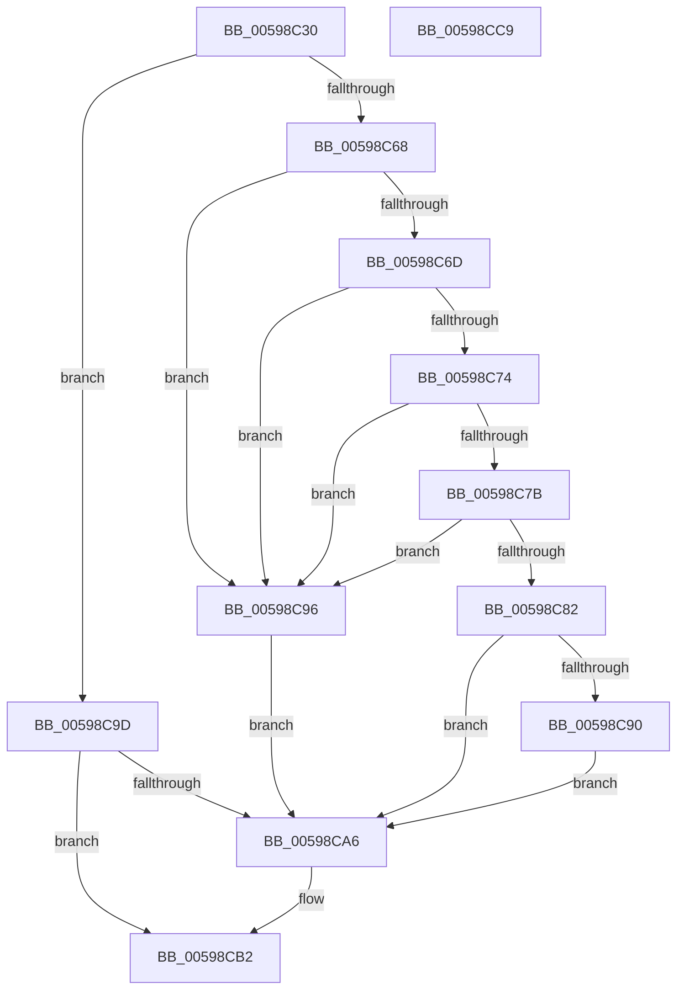

# IoSetDeferredLiveDumpFileHandle

- RVA: `0x00598C30`–`0x00598CCA` (길이 `154` bytes)
- VA: `0x0000000140598C30`
- 실행 섹션: `.text`
- PDB 이름 있음: `예`; PDB Function 태그: `아니요`
- unwind 정보 RVA: `0x0005FD94`
- 디코드: `46`개 명령, `154/154` bytes 표시
- 미해석 바이트: `0` (있으면 어셈블리에 `.byte`로 보존)

> 이 문서는 커널 이미지의 기계어와 PDB 기호를 분석해 생성했습니다. 4번과 5번은 함수 원형과 자료형을 바이너리 사용 방식에서 추정한 C 해석이며 원본 소스 복구 결과는 아닙니다.

## 1. Dependencies

- 직접 호출 지점: **4**; 고유 호출 대상: **4**
- 직접 호출자로 확인된 함수: **1**
- RIP 상대 이미지 참조: **1**

### Outgoing calls
- `0x00598C5F` → [ExAcquireResourceExclusiveLite](../21/ExAcquireResourceExclusiveLite_function_00214E20.md) (function, `0x00214E20`)
- `0x00598C85` → [IopLiveDumpValidateDumpFileHandle](IopLiveDumpValidateDumpFileHandle_function_0059F62C.md) (function, `0x0059F62C`)
- `0x00598CAD` → [ExReleaseResourceLite](../25/ExReleaseResourceLite_function_0025FA10.md) (function, `0x0025FA10`)
- `0x00598CB2` → [KeLeaveCriticalRegion](../25/KeLeaveCriticalRegion_function_0025D8B0.md) (function, `0x0025D8B0`)

### Direct callers
- [DbgkpWerStartDeferredLiveDump](../../page/71/DbgkpWerStartDeferredLiveDump_function_007125D0.md) at `0x0071262F`

### Static image references
- `0x00598C50` → RVA `0x00F8D0A0` (`.data`; read)

## 2. Other-region calls and transfers

- 다른 실행 섹션으로 향하는 call: **0**
- 별도 외부 분기/꼬리 이동을 확인하지 못했습니다.

## 3. Assembly (complete function range)

```asm
00598C30  48 89 5C 24 10                  mov qword ptr [rsp + 0x10], rbx
00598C35  48 89 74 24 18                  mov qword ptr [rsp + 0x18], rsi
00598C3A  57                              push rdi
00598C3B  48 83 EC 20                     sub rsp, 0x20
00598C3F  65 48 8B 04 25 88 01 00 00      mov rax, qword ptr gs:[0x188]
00598C48  48 8B F2                        mov rsi, rdx
00598C4B  48 8B F9                        mov rdi, rcx
00598C4E  33 D2                           xor edx, edx
00598C50  48 8D 0D 49 44 9F 00            lea rcx, [rip + 0x9f4449]
00598C57  66 FF 88 E4 01 00 00            dec word ptr [rax + 0x1e4]
00598C5E  90                              nop
00598C5F  E8 BC C1 C7 FF                  call 0x140214e20
00598C64  3C 01                           cmp al, 1
00598C66  75 35                           jne 0x140598c9d
00598C68  48 85 FF                        test rdi, rdi
00598C6B  74 29                           je 0x140598c96
00598C6D  8B 47 28                        mov eax, dword ptr [rdi + 0x28]
00598C70  A8 08                           test al, 8
00598C72  74 22                           je 0x140598c96
00598C74  48 83 7F 40 00                  cmp qword ptr [rdi + 0x40], 0
00598C79  75 1B                           jne 0x140598c96
00598C7B  8B 47 50                        mov eax, dword ptr [rdi + 0x50]
00598C7E  A8 01                           test al, 1
00598C80  75 14                           jne 0x140598c96
00598C82  48 8B CE                        mov rcx, rsi
00598C85  E8 A2 69 00 00                  call 0x14059f62c
00598C8A  8B D8                           mov ebx, eax
00598C8C  85 C0                           test eax, eax
00598C8E  78 16                           js 0x140598ca6
00598C90  48 89 77 40                     mov qword ptr [rdi + 0x40], rsi
00598C94  EB 10                           jmp 0x140598ca6
00598C96  BB 0D 00 00 C0                  mov ebx, 0xc000000d
00598C9B  EB 09                           jmp 0x140598ca6
00598C9D  BB 2D 02 00 C0                  mov ebx, 0xc000022d
00598CA2  84 C0                           test al, al
00598CA4  74 0C                           je 0x140598cb2
00598CA6  48 8D 0D F3 43 9F 00            lea rcx, [rip + 0x9f43f3]
00598CAD  E8 5E 6D CC FF                  call 0x14025fa10
00598CB2  E8 F9 4B CC FF                  call 0x14025d8b0
00598CB7  48 8B 74 24 40                  mov rsi, qword ptr [rsp + 0x40]
00598CBC  8B C3                           mov eax, ebx
00598CBE  48 8B 5C 24 38                  mov rbx, qword ptr [rsp + 0x38]
00598CC3  48 83 C4 20                     add rsp, 0x20
00598CC7  5F                              pop rdi
00598CC8  C3                              ret
00598CC9  CC                              int3
```

## 4. C-style interpretation (structured pseudocode)

```c
__int64 __fastcall IoSetDeferredLiveDumpFileHandle(__int64 a1, __int64 a2)
{
    __int64 result;
    __int64 v_rsp;
    unsigned __int64 v_stack_p10;
    unsigned __int64 v_stack_p18;

    v_stack_p10 = v_rbx;
    v_stack_p18 = v_rsi;
    v_rsp = (v_rsp) - (32);
    a2 = 0;
    result = ExAcquireResourceExclusiveLite(v_rip + 10437705, a2, a3, a4);
    if (((unsigned __int8)(result)) != 1) goto loc_00598C9D;
    if (a1 == 0) goto loc_00598C96;
    if ((((unsigned __int8)((unsigned int)(*(unsigned int *)(a1 + 40)))) & (8)) == 0) goto loc_00598C96;
    if ((*(unsigned __int64 *)(a1 + 64)) != 0) goto loc_00598C96;
    if ((((unsigned __int8)((unsigned int)(*(unsigned int *)(a1 + 80)))) & (1)) != 0) goto loc_00598C96;
    result = IopLiveDumpValidateDumpFileHandle(0, a2, a3, a4);
    if (sign_flag) goto loc_00598CA6;
    *(unsigned __int64 *)(a1 + 64) = 0;
    goto loc_00598CA6;
loc_00598C96:
    goto loc_00598CA6;
loc_00598C9D:
    if ((unsigned __int8)(result) != 0) {
        a1 = v_rip + 10437619;
        result = ExReleaseResourceLite(a1, a2, a3, a4);
    }
    result = KeLeaveCriticalRegion(a1, a2, a3, a4);
    v_rsp = (v_rsp) + (32);
    return (unsigned int)((unsigned int)((unsigned int)(0xC000022DULL)));
}
```

## 5. (Beta) C Style

```c
int64_t IoSetDeferredLiveDumpFileHandle(int64_t Arg1, int64_t Arg2)
{
    int64_t result;
    int64_t local_rsp;
    uint64_t v_stack_p10;
    uint64_t v_stack_p18;

    v_stack_p10 = local_rbx;
    v_stack_p18 = local_rsi;
    local_rsp = (local_rsp) - (32);
    Arg2 = 0;
    result = ExAcquireResourceExclusiveLite(v_rip + 10437705, Arg2, a3, a4);
    if (((uint8_t)(result)) != 1) goto loc_00598C9D;
    if (Arg1 == 0) goto loc_00598C96;
    if ((((uint8_t)((uint32_t)(*(uint32_t *)(Arg1 + 0x28)))) & (8)) == 0) goto loc_00598C96;
    if ((*(uint64_t *)(Arg1 + 0x40)) != 0) goto loc_00598C96;
    if ((((uint8_t)((uint32_t)(*(uint32_t *)(Arg1 + 0x50)))) & (1)) != 0) goto loc_00598C96;
    result = IopLiveDumpValidateDumpFileHandle(0, Arg2, a3, a4);
    if (sign_flag) goto loc_00598CA6;
    *(uint64_t *)(Arg1 + 0x40) = 0;
    goto loc_00598CA6;
loc_00598C96:
    goto loc_00598CA6;
loc_00598C9D:
    if ((uint8_t)(result) != 0) {
        Arg1 = v_rip + 10437619;
        result = ExReleaseResourceLite(Arg1, Arg2, a3, a4);
    }
    result = KeLeaveCriticalRegion(Arg1, Arg2, a3, a4);
    local_rsp = (local_rsp) + (32);
    return (uint32_t)((uint32_t)((uint32_t)(0xC000022DULL)));
}
```

## 6. Execution-region graph

[열기: 2D/3D 그래프와 함수 탐색 컨트롤 패널](../../../control-panel.html?section=text&rva=0x00598C30&view=graph)

- 2D 그래프는 위에서 아래로 흐르고, 3D 그래프는 빈 공간을 드래그해 회전합니다. Shift+드래그는 이동, 휠은 확대·축소, 함수 노드 선택은 대상 보고서 이동입니다.

### Static fallback


