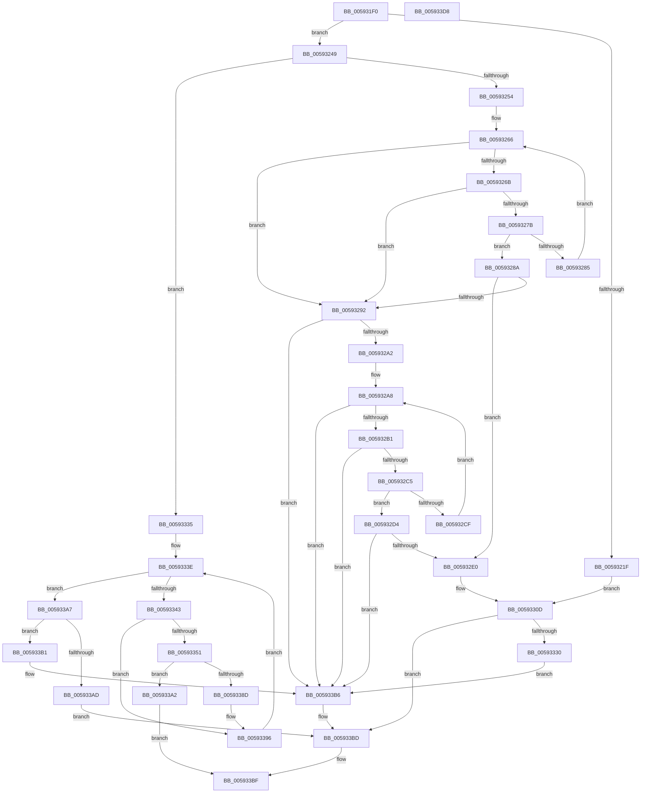

# IoSetDumpRange

- RVA: `0x005931F0`–`0x005933D9` (길이 `489` bytes)
- VA: `0x00000001405931F0`
- 실행 섹션: `.text`
- PDB 이름 있음: `예`; PDB Function 태그: `아니요`
- unwind 정보 RVA: `0x00093E28`
- 디코드: `140`개 명령, `489/489` bytes 표시
- 미해석 바이트: `0` (있으면 어셈블리에 `.byte`로 보존)

> 이 문서는 커널 이미지의 기계어와 PDB 기호를 분석해 생성했습니다. 4번과 5번은 함수 원형과 자료형을 바이너리 사용 방식에서 추정한 C 해석이며 원본 소스 복구 결과는 아닙니다.

## 1. Dependencies

- 직접 호출 지점: **5**; 고유 호출 대상: **3**
- 직접 호출자로 확인된 함수: **1**
- RIP 상대 이미지 참조: **2**

### Outgoing calls
- `0x00593222` → [MmGetPhysicalAddress](../23/MmGetPhysicalAddress_function_0023A500.md) (function, `0x0023A500`)
- `0x0059331E` → [IopAddPageToPageMap](IopAddPageToPageMap_function_00594594.md) (function, `0x00594594`)
- `0x00593348` → [MmIsAddressValidEx](../27/MmIsAddressValidEx_function_0027FDD0.md) (function, `0x0027FDD0`)
- `0x00593354` → [MmGetPhysicalAddress](../23/MmGetPhysicalAddress_function_0023A500.md) (function, `0x0023A500`)
- `0x00593383` → [IopAddPageToPageMap](IopAddPageToPageMap_function_00594594.md) (function, `0x00594594`)

### Direct callers
- [IopAddPageDumpRange](IopAddPageDumpRange_function_005943AC.md) at `0x00594488`

### Static image references
- `0x00593254` → RVA `0x00FC6B88` (`ALMOSTRO`; read)
- `0x00593292` → RVA `0x00E65EE0` (`.data`; read)

## 2. Other-region calls and transfers

- 다른 실행 섹션으로 향하는 call: **0**
- 별도 외부 분기/꼬리 이동을 확인하지 못했습니다.

## 3. Assembly (complete function range)

```asm
005931F0  48 89 5C 24 08                  mov qword ptr [rsp + 8], rbx
005931F5  48 89 6C 24 10                  mov qword ptr [rsp + 0x10], rbp
005931FA  48 89 74 24 18                  mov qword ptr [rsp + 0x18], rsi
005931FF  57                              push rdi
00593200  41 56                           push r14
00593202  41 57                           push r15
00593204  48 83 EC 40                     sub rsp, 0x40
00593208  41 8B C1                        mov eax, r9d
0059320B  45 8B F9                        mov r15d, r9d
0059320E  83 E0 0F                        and eax, 0xf
00593211  4D 8B F0                        mov r14, r8
00593214  48 8B FA                        mov rdi, rdx
00593217  48 8B E9                        mov rbp, rcx
0059321A  83 F8 01                        cmp eax, 1
0059321D  75 2A                           jne 0x140593249
0059321F  48 8B CA                        mov rcx, rdx
00593222  E8 D9 72 CA FF                  call 0x14023a500
00593227  48 8B 4D 18                     mov rcx, qword ptr [rbp + 0x18]
0059322B  48 8B F8                        mov rdi, rax
0059322E  8A 45 28                        mov al, byte ptr [rbp + 0x28]
00593231  48 8B 55 10                     mov rdx, qword ptr [rbp + 0x10]
00593235  24 01                           and al, 1
00593237  4C 8B 45 20                     mov r8, qword ptr [rbp + 0x20]
0059323B  48 C1 EF 0C                     shr rdi, 0xc
0059323F  33 DB                           xor ebx, ebx
00593241  44 8B FB                        mov r15d, ebx
00593244  E9 C4 00 00 00                  jmp 0x14059330d
00593249  33 DB                           xor ebx, ebx
0059324B  83 F8 02                        cmp eax, 2
0059324E  0F 85 E1 00 00 00               jne 0x140593335
00593254  4C 8B 0D 2D 39 A3 00            mov r9, qword ptr [rip + 0xa3392d]
0059325B  BA 41 01 00 C0                  mov edx, 0xc0000141
00593260  44 8B C3                        mov r8d, ebx
00593263  45 8B 11                        mov r10d, dword ptr [r9]
00593266  45 3B C2                        cmp r8d, r10d
00593269  73 27                           jae 0x140593292
0059326B  41 8B C0                        mov eax, r8d
0059326E  48 03 C0                        add rax, rax
00593271  49 8B 4C C1 10                  mov rcx, qword ptr [r9 + rax*8 + 0x10]
00593276  48 3B CF                        cmp rcx, rdi
00593279  77 17                           ja 0x140593292
0059327B  49 03 4C C1 18                  add rcx, qword ptr [r9 + rax*8 + 0x18]
00593280  48 3B CF                        cmp rcx, rdi
00593283  77 05                           ja 0x14059328a
00593285  41 FF C0                        inc r8d
00593288  EB DC                           jmp 0x140593266
0059328A  48 2B CF                        sub rcx, rdi
0059328D  4C 3B F1                        cmp r14, rcx
00593290  76 4E                           jbe 0x1405932e0
00593292  4C 8B 0D 47 2C 8D 00            mov r9, qword ptr [rip + 0x8d2c47]
00593299  4D 85 C9                        test r9, r9
0059329C  0F 84 14 01 00 00               je 0x1405933b6
005932A2  45 8B 11                        mov r10d, dword ptr [r9]
005932A5  44 8B C3                        mov r8d, ebx
005932A8  45 3B C2                        cmp r8d, r10d
005932AB  0F 83 05 01 00 00               jae 0x1405933b6
005932B1  41 8B C0                        mov eax, r8d
005932B4  48 03 C0                        add rax, rax
005932B7  49 8B 4C C1 10                  mov rcx, qword ptr [r9 + rax*8 + 0x10]
005932BC  48 3B CF                        cmp rcx, rdi
005932BF  0F 87 F1 00 00 00               ja 0x1405933b6
005932C5  49 03 4C C1 18                  add rcx, qword ptr [r9 + rax*8 + 0x18]
005932CA  48 3B CF                        cmp rcx, rdi
005932CD  77 05                           ja 0x1405932d4
005932CF  41 FF C0                        inc r8d
005932D2  EB D4                           jmp 0x1405932a8
005932D4  48 2B CF                        sub rcx, rdi
005932D7  4C 3B F1                        cmp r14, rcx
005932DA  0F 87 D6 00 00 00               ja 0x1405933b6
005932E0  B8 28 00 00 00                  mov eax, 0x28
005932E5  48 8B F5                        mov rsi, rbp
005932E8  4C 8B DD                        mov r11, rbp
005932EB  4C 8B D5                        mov r10, rbp
005932EE  4C 8B CD                        mov r9, rbp
005932F1  44 8D 40 F8                     lea r8d, [rax - 8]
005932F5  4D 8B 04 28                     mov r8, qword ptr [r8 + rbp]
005932F9  8D 50 E8                        lea edx, [rax - 0x18]
005932FC  48 8B 14 2A                     mov rdx, qword ptr [rdx + rbp]
00593300  8D 48 F0                        lea ecx, [rax - 0x10]
00593303  8A 04 28                        mov al, byte ptr [rax + rbp]
00593306  48 8B 4C 0D 00                  mov rcx, qword ptr [rbp + rcx]
0059330B  24 01                           and al, 1
0059330D  44 89 7C 24 30                  mov dword ptr [rsp + 0x30], r15d
00593312  4C 8B CF                        mov r9, rdi
00593315  88 44 24 28                     mov byte ptr [rsp + 0x28], al
00593319  4C 89 74 24 20                  mov qword ptr [rsp + 0x20], r14
0059331E  E8 71 12 00 00                  call 0x140594594
00593323  8B D0                           mov edx, eax
00593325  3D 41 01 00 C0                  cmp eax, 0xc0000141
0059332A  0F 85 8D 00 00 00               jne 0x1405933bd
00593330  E9 81 00 00 00                  jmp 0x1405933b6
00593335  40 B6 01                        mov sil, 1
00593338  41 BF 23 00 00 C0               mov r15d, 0xc0000023
0059333E  4D 85 F6                        test r14, r14
00593341  74 64                           je 0x1405933a7
00593343  33 D2                           xor edx, edx
00593345  48 8B CF                        mov rcx, rdi
00593348  E8 83 CA CE FF                  call 0x14027fdd0
0059334D  84 C0                           test al, al
0059334F  74 45                           je 0x140593396
00593351  48 8B CF                        mov rcx, rdi
00593354  E8 A7 71 CA FF                  call 0x14023a500
00593359  8A 4D 28                        mov cl, byte ptr [rbp + 0x28]
0059335C  4C 8B 45 20                     mov r8, qword ptr [rbp + 0x20]
00593360  80 E1 01                        and cl, 1
00593363  48 8B 55 10                     mov rdx, qword ptr [rbp + 0x10]
00593367  48 C1 E8 0C                     shr rax, 0xc
0059336B  89 5C 24 30                     mov dword ptr [rsp + 0x30], ebx
0059336F  4C 8B C8                        mov r9, rax
00593372  88 4C 24 28                     mov byte ptr [rsp + 0x28], cl
00593376  48 8B 4D 18                     mov rcx, qword ptr [rbp + 0x18]
0059337A  48 C7 44 24 20 01 00 00 00      mov qword ptr [rsp + 0x20], 1
00593383  E8 0C 12 00 00                  call 0x140594594
00593388  41 3B C7                        cmp eax, r15d
0059338B  74 15                           je 0x1405933a2
0059338D  85 C0                           test eax, eax
0059338F  40 0F B6 F6                     movzx esi, sil
00593393  0F 48 F3                        cmovs esi, ebx
00593396  48 81 C7 00 10 00 00            add rdi, 0x1000
0059339D  49 FF CE                        dec r14
005933A0  EB 9C                           jmp 0x14059333e
005933A2  41 8B C7                        mov eax, r15d
005933A5  EB 18                           jmp 0x1405933bf
005933A7  40 80 FE 01                     cmp sil, 1
005933AB  75 04                           jne 0x1405933b1
005933AD  8B D3                           mov edx, ebx
005933AF  EB 0C                           jmp 0x1405933bd
005933B1  BA 41 01 00 C0                  mov edx, 0xc0000141
005933B6  F6 45 28 01                     test byte ptr [rbp + 0x28], 1
005933BA  0F 45 D3                        cmovne edx, ebx
005933BD  8B C2                           mov eax, edx
005933BF  48 8B 5C 24 60                  mov rbx, qword ptr [rsp + 0x60]
005933C4  48 8B 6C 24 68                  mov rbp, qword ptr [rsp + 0x68]
005933C9  48 8B 74 24 70                  mov rsi, qword ptr [rsp + 0x70]
005933CE  48 83 C4 40                     add rsp, 0x40
005933D2  41 5F                           pop r15
005933D4  41 5E                           pop r14
005933D6  5F                              pop rdi
005933D7  C3                              ret
005933D8  CC                              int3
```

## 4. C-style interpretation (structured pseudocode)

```c
__int64 __fastcall IoSetDumpRange(__int64 a1, __int64 a2, __int64 a3, int a4)
{
    __int64 result;
    __int64 v_r14;
    __int64 v_rbx;
    __int64 v_rdi;
    __int64 v_rsi;
    __int64 v_rsp;
    unsigned int v_stack_m28;
    unsigned __int8 v_stack_m30;
    unsigned __int64 v_stack_m38;
    unsigned __int64 v_stack_p10;
    unsigned __int64 v_stack_p18;
    unsigned __int64 v_stack_p8;

    v_stack_p8 = v_rbx;
    v_stack_p10 = v_rbp;
    v_stack_p18 = v_rsi;
    v_rsp = (v_rsp) - (64);
    result = (unsigned int)(((unsigned int)(a4)) & (15));
    if (((unsigned int)(result)) != 1) goto loc_00593249;
    result = MmGetPhysicalAddress(a2, a2, a3, a4);
    result = (unsigned __int8)((*(unsigned __int8 *)(a1 + 40)) & (1));
    v_rdi = (result) >> (12);
    v_rbx = 0;
    goto loc_0059330D;
loc_00593249:
    v_rbx = 0;
    if (((unsigned int)(result)) != 2) goto loc_00593335;
loc_00593266:
    if (0 >= ((unsigned int)((unsigned int)(*(unsigned int *)(*(unsigned __int64 *)(v_rip + 10697005)))))) goto loc_00593292;
    result = (0) + (0);
    if ((*(unsigned __int64 *)(*(unsigned __int64 *)(v_rip + 10697005) + result * 8 + 16)) > v_rdi) goto loc_00593292;
    a1 = (*(unsigned __int64 *)(*(unsigned __int64 *)(v_rip + 10697005) + result * 8 + 16)) + (*(unsigned __int64 *)(*(unsigned __int64 *)(v_rip + 10697005) + result * 8 + 24));
    if (a1 > v_rdi) goto loc_0059328A;
    a3 = (unsigned int)((0) + 1);
    goto loc_00593266;
loc_0059328A:
    a1 = (a1) - (v_rdi);
    if (a3 <= a1) goto loc_005932E0;
loc_00593292:
    if (*(unsigned __int64 *)(v_rip + 9251911) == 0) goto loc_005933B6;
loc_005932A8:
    if (0 >= ((unsigned int)((unsigned int)(*(unsigned int *)(*(unsigned __int64 *)(v_rip + 9251911)))))) goto loc_005933B6;
    result = (0) + (0);
    if ((*(unsigned __int64 *)(*(unsigned __int64 *)(v_rip + 9251911) + result * 8 + 16)) > v_rdi) goto loc_005933B6;
    a1 = (*(unsigned __int64 *)(*(unsigned __int64 *)(v_rip + 9251911) + result * 8 + 16)) + (*(unsigned __int64 *)(*(unsigned __int64 *)(v_rip + 9251911) + result * 8 + 24));
    if (a1 > v_rdi) goto loc_005932D4;
    a3 = (unsigned int)((0) + 1);
    goto loc_005932A8;
loc_005932D4:
    a1 = (a1) - (v_rdi);
    if (a3 > a1) goto loc_005933B6;
loc_005932E0:
    result = (unsigned __int8)((*(unsigned __int8 *)(40 + a1 * 1)) & (1));
loc_0059330D:
    v_stack_m28 = 0;
    v_stack_m30 = (unsigned __int8)(result);
    v_stack_m38 = a3;
    result = IopAddPageToPageMap(*(unsigned __int64 *)(a1 + 40 - 16 * 1), *(unsigned __int64 *)(40 - 24 + a1 * 1), *(unsigned __int64 *)(40 - 8 + a1 * 1), v_rdi);
    if (((unsigned int)(result)) != 0xC0000141ULL) goto loc_005933BD;
    goto loc_005933B6;
loc_00593335:
loc_0059333E:
    if (a3 == 0) goto loc_005933A7;
    a2 = 0;
    result = MmIsAddressValidEx(v_rdi, a2, *(unsigned __int64 *)(40 - 8 + a1 * 1), v_rdi);
    if ((unsigned __int8)(result) == 0) goto loc_00593396;
    result = MmGetPhysicalAddress(v_rdi, a2, *(unsigned __int64 *)(40 - 8 + a1 * 1), v_rdi);
    a1 = (unsigned __int8)((*(unsigned __int8 *)(a1 + 40)) & (1));
    result = (result) >> (12);
    v_stack_m28 = 0;
    v_stack_m30 = (unsigned __int8)(a1);
    v_stack_m38 = 1;
    result = IopAddPageToPageMap(*(unsigned __int64 *)(a1 + 24), *(unsigned __int64 *)(a1 + 16), *(unsigned __int64 *)(a1 + 32), result);
    if (((unsigned int)(result)) == ((unsigned int)((unsigned int)(0xC0000023ULL)))) goto loc_005933A2;
    v_rsi = 1;
    if (sign_flag) { v_rsi = 0; }
loc_00593396:
    v_rdi = (v_rdi) + (0x1000ULL);
    v_r14 = (a3) - 1;
    goto loc_0059333E;
loc_005933A2:
    goto loc_005933BF;
loc_005933A7:
    if (((unsigned __int8)(v_rsi)) != 1) goto loc_005933B1;
    goto loc_005933BD;
loc_005933B1:
loc_005933B6:
    a2 = (unsigned int)(0xC0000141ULL);
    if (((*(unsigned __int8 *)(a1 + 40)) & (1)) != 0) { a2 = 0; }
loc_005933BD:
loc_005933BF:
    v_rsp = (v_rsp) + (64);
    return (unsigned int)((unsigned int)(a2));
}
```

## 5. (Beta) C Style

```c
int64_t IoSetDumpRange(void *Arg1, int64_t Arg2, int64_t Arg3, int32_t Arg4)
{
    uint8_t *arg1 = (uint8_t *)Arg1;

    int64_t result;
    int64_t local_r14;
    int64_t local_rbx;
    int64_t local_rdi;
    int64_t local_rsi;
    int64_t local_rsp;
    uint32_t v_stack_m28;
    uint8_t v_stack_m30;
    uint64_t v_stack_m38;
    uint64_t v_stack_p10;
    uint64_t v_stack_p18;
    uint64_t v_stack_p8;

    v_stack_p8 = local_rbx;
    v_stack_p10 = local_rbp;
    v_stack_p18 = local_rsi;
    local_rsp = (local_rsp) - (64);
    result = (uint32_t)(((uint32_t)(Arg4)) & (15));
    if (((uint32_t)(result)) != 1) goto loc_00593249;
    result = MmGetPhysicalAddress(Arg2, Arg2, Arg3, Arg4);
    result = (uint8_t)((*(uint8_t *)(arg1 + 0x28)) & (1));
    local_rdi = (result) >> (12);
    local_rbx = 0;
    goto loc_0059330D;
loc_00593249:
    local_rbx = 0;
    if (((uint32_t)(result)) != 2) goto loc_00593335;
loc_00593266:
    if (0 >= ((uint32_t)((uint32_t)(*(uint32_t *)(*(uint64_t *)(v_rip + 0xA3392D)))))) goto loc_00593292;
    result = (0) + (0);
    if ((*(uint64_t *)(*(uint64_t *)(v_rip + 0xA3392D) + result * 8 + 0x10)) > local_rdi) goto loc_00593292;
    Arg1 = (*(uint64_t *)(*(uint64_t *)(v_rip + 0xA3392D) + result * 8 + 0x10)) + (*(uint64_t *)(*(uint64_t *)(v_rip + 0xA3392D) + result * 8 + 0x18));
    if (Arg1 > local_rdi) goto loc_0059328A;
    Arg3 = (uint32_t)((0) + 1);
    goto loc_00593266;
loc_0059328A:
    Arg1 = (Arg1) - (local_rdi);
    if (Arg3 <= Arg1) goto loc_005932E0;
loc_00593292:
    if (*(uint64_t *)(v_rip + 0x8D2C47) == 0) goto loc_005933B6;
loc_005932A8:
    if (0 >= ((uint32_t)((uint32_t)(*(uint32_t *)(*(uint64_t *)(v_rip + 0x8D2C47)))))) goto loc_005933B6;
    result = (0) + (0);
    if ((*(uint64_t *)(*(uint64_t *)(v_rip + 0x8D2C47) + result * 8 + 0x10)) > local_rdi) goto loc_005933B6;
    Arg1 = (*(uint64_t *)(*(uint64_t *)(v_rip + 0x8D2C47) + result * 8 + 0x10)) + (*(uint64_t *)(*(uint64_t *)(v_rip + 0x8D2C47) + result * 8 + 0x18));
    if (Arg1 > local_rdi) goto loc_005932D4;
    Arg3 = (uint32_t)((0) + 1);
    goto loc_005932A8;
loc_005932D4:
    Arg1 = (Arg1) - (local_rdi);
    if (Arg3 > Arg1) goto loc_005933B6;
loc_005932E0:
    result = (uint8_t)((*(uint8_t *)(40 + arg1 * 1)) & (1));
loc_0059330D:
    v_stack_m28 = 0;
    v_stack_m30 = (uint8_t)(result);
    v_stack_m38 = Arg3;
    result = IopAddPageToPageMap(*(uint64_t *)(arg1 + 0x28 - 0x10 * 1), *(uint64_t *)(40 - 0x18 + arg1 * 1), *(uint64_t *)(40 - 0x8 + arg1 * 1), local_rdi);
    if (((uint32_t)(result)) != 0xC0000141ULL) goto loc_005933BD;
    goto loc_005933B6;
loc_00593335:
loc_0059333E:
    if (Arg3 == 0) goto loc_005933A7;
    Arg2 = 0;
    result = MmIsAddressValidEx(local_rdi, Arg2, *(uint64_t *)(40 - 0x8 + arg1 * 1), local_rdi);
    if ((uint8_t)(result) == 0) goto loc_00593396;
    result = MmGetPhysicalAddress(local_rdi, Arg2, *(uint64_t *)(40 - 0x8 + arg1 * 1), local_rdi);
    Arg1 = (uint8_t)((*(uint8_t *)(arg1 + 0x28)) & (1));
    result = (result) >> (12);
    v_stack_m28 = 0;
    v_stack_m30 = (uint8_t)(Arg1);
    v_stack_m38 = 1;
    result = IopAddPageToPageMap(*(uint64_t *)(arg1 + 0x18), *(uint64_t *)(arg1 + 0x10), *(uint64_t *)(arg1 + 0x20), result);
    if (((uint32_t)(result)) == ((uint32_t)((uint32_t)(0xC0000023ULL)))) goto loc_005933A2;
    local_rsi = 1;
    if (sign_flag) { local_rsi = 0; }
loc_00593396:
    local_rdi = (local_rdi) + (0x1000ULL);
    local_r14 = (Arg3) - 1;
    goto loc_0059333E;
loc_005933A2:
    goto loc_005933BF;
loc_005933A7:
    if (((uint8_t)(local_rsi)) != 1) goto loc_005933B1;
    goto loc_005933BD;
loc_005933B1:
loc_005933B6:
    Arg2 = (uint32_t)(0xC0000141ULL);
    if (((*(uint8_t *)(arg1 + 0x28)) & (1)) != 0) { Arg2 = 0; }
loc_005933BD:
loc_005933BF:
    local_rsp = (local_rsp) + (64);
    return (uint32_t)((uint32_t)(Arg2));
}
```

### 관측된 메모리 오프셋

구조체 형식이 확인되지 않은 접근은 인자 기준의 오프셋으로만 기록했습니다.

| 기준 인자 | 오프셋 표현 | 폭 (bit) | 접근 |
|---|---:|---:|---|
| `Arg1` | `+ 0x0 + rcx*1` | `64` | `R` |
| `Arg1` | `+ 0x10` | `64` | `R` |
| `Arg1` | `+ 0x18` | `64` | `R` |
| `Arg1` | `+ 0x20` | `64` | `R` |
| `Arg1` | `+ 0x28` | `8` | `R` |

## 6. Execution-region graph

[열기: 2D/3D 그래프와 함수 탐색 컨트롤 패널](../../../control-panel.html?section=text&rva=0x005931F0&view=graph)

- 2D 그래프는 위에서 아래로 흐르고, 3D 그래프는 빈 공간을 드래그해 회전합니다. Shift+드래그는 이동, 휠은 확대·축소, 함수 노드 선택은 대상 보고서 이동입니다.

### Static fallback


