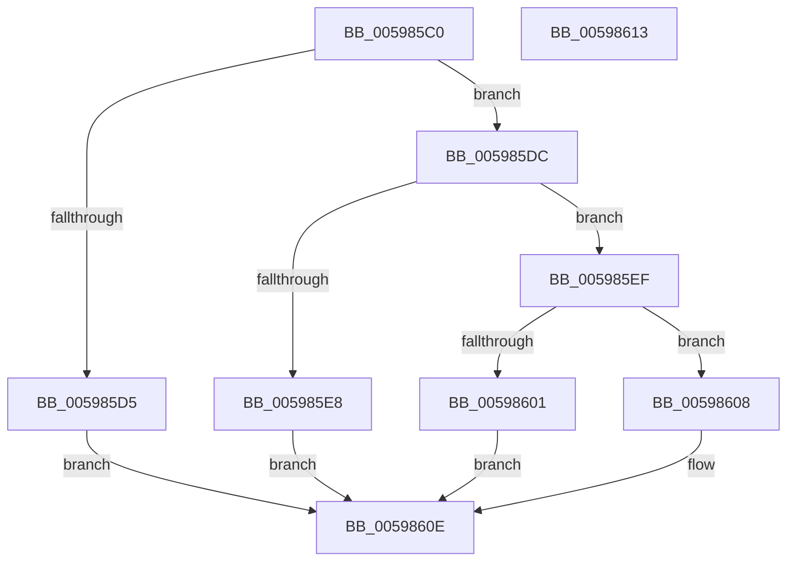

# IoSetFsZeroingOffsetRequired

- RVA: `0x005985C0`–`0x00598614` (길이 `84` bytes)
- VA: `0x00000001405985C0`
- 실행 섹션: `.text`
- PDB 이름 있음: `예`; PDB Function 태그: `아니요`
- unwind 정보 RVA: `0x0005C788`
- 디코드: `26`개 명령, `84/84` bytes 표시
- 미해석 바이트: `0` (있으면 어셈블리에 `.byte`로 보존)

> 이 문서는 커널 이미지의 기계어와 PDB 기호를 분석해 생성했습니다. 4번과 5번은 함수 원형과 자료형을 바이너리 사용 방식에서 추정한 C 해석이며 원본 소스 복구 결과는 아닙니다.

## 1. Dependencies

- 직접 호출 지점: **3**; 고유 호출 대상: **3**
- 직접 호출자로 확인된 함수: **0**
- RIP 상대 이미지 참조: **0**

### Outgoing calls
- `0x005985CC` → [IopIrpHasExtensionType](../3F/IopIrpHasExtensionType_function_003F4080.md) (function, `0x003F4080`)
- `0x005985DF` → [IopIrpHasValidCombinationOfExtensionTypes](../48/IopIrpHasValidCombinationOfExtensionTypes_function_0048C070.md) (function, `0x0048C070`)
- `0x005985F7` → [IopAllocateIrpExtension](../44/IopAllocateIrpExtension_function_00444F30.md) (function, `0x00444F30`)

### Direct callers
- 이 함수 시작 RVA로 연결되는 직접 call은 확인되지 않았습니다. 간접 호출은 완전히 역산할 수 없습니다.

### Static image references
- 디코드된 RIP-relative 메모리 참조가 없습니다.

## 2. Other-region calls and transfers

- 다른 실행 섹션으로 향하는 call: **0**
- 별도 외부 분기/꼬리 이동을 확인하지 못했습니다.

## 3. Assembly (complete function range)

```asm
005985C0  48 83 EC 28                     sub rsp, 0x28
005985C4  BA 04 00 00 00                  mov edx, 4
005985C9  4C 8B D9                        mov r11, rcx
005985CC  E8 AF BA E5 FF                  call 0x1403f4080
005985D1  84 C0                           test al, al
005985D3  74 07                           je 0x1405985dc
005985D5  B8 21 00 00 C0                  mov eax, 0xc0000021
005985DA  EB 32                           jmp 0x14059860e
005985DC  49 8B CB                        mov rcx, r11
005985DF  E8 8C 3A EF FF                  call 0x14048c070
005985E4  84 C0                           test al, al
005985E6  75 07                           jne 0x1405985ef
005985E8  B8 BB 00 00 C0                  mov eax, 0xc00000bb
005985ED  EB 1F                           jmp 0x14059860e
005985EF  BA 04 00 00 00                  mov edx, 4
005985F4  49 8B CB                        mov rcx, r11
005985F7  E8 34 C9 EA FF                  call 0x140444f30
005985FC  48 85 C0                        test rax, rax
005985FF  75 07                           jne 0x140598608
00598601  B8 9A 00 00 C0                  mov eax, 0xc000009a
00598606  EB 06                           jmp 0x14059860e
00598608  83 60 28 00                     and dword ptr [rax + 0x28], 0
0059860C  33 C0                           xor eax, eax
0059860E  48 83 C4 28                     add rsp, 0x28
00598612  C3                              ret
00598613  CC                              int3
```

## 4. C-style interpretation (structured pseudocode)

```c
__int64 __fastcall IoSetFsZeroingOffsetRequired(__int64 a1)
{
    __int64 result;
    __int64 v_rsp;

    v_rsp = (v_rsp) - (40);
    result = IopIrpHasExtensionType(a1, 4, a3, a4);
    if ((unsigned __int8)(result) == 0) goto loc_005985DC;
    goto loc_0059860E;
loc_005985DC:
    result = IopIrpHasValidCombinationOfExtensionTypes(a1, 4, a3, a4);
    if ((unsigned __int8)(result) != 0) goto loc_005985EF;
    goto loc_0059860E;
loc_005985EF:
    result = IopAllocateIrpExtension(a1, 4, a3, a4);
    if (result != 0) goto loc_00598608;
    goto loc_0059860E;
loc_00598608:
    result = 0;
loc_0059860E:
    v_rsp = (v_rsp) + (40);
    return result;
}
```

## 5. (Beta) C Style

```c
int64_t IoSetFsZeroingOffsetRequired(int64_t Arg1)
{
    int64_t result;
    int64_t local_rsp;

    local_rsp = (local_rsp) - (40);
    result = IopIrpHasExtensionType(Arg1, 4, a3, a4);
    if ((uint8_t)(result) == 0) goto loc_005985DC;
    goto loc_0059860E;
loc_005985DC:
    result = IopIrpHasValidCombinationOfExtensionTypes(Arg1, 4, a3, a4);
    if ((uint8_t)(result) != 0) goto loc_005985EF;
    goto loc_0059860E;
loc_005985EF:
    result = IopAllocateIrpExtension(Arg1, 4, a3, a4);
    if (result != 0) goto loc_00598608;
    goto loc_0059860E;
loc_00598608:
    result = 0;
loc_0059860E:
    local_rsp = (local_rsp) + (40);
    return result;
}
```

## 6. Execution-region graph

[열기: 2D/3D 그래프와 함수 탐색 컨트롤 패널](../../../control-panel.html?section=text&rva=0x005985C0&view=graph)

- 2D 그래프는 위에서 아래로 흐르고, 3D 그래프는 빈 공간을 드래그해 회전합니다. Shift+드래그는 이동, 휠은 확대·축소, 함수 노드 선택은 대상 보고서 이동입니다.

### Static fallback


