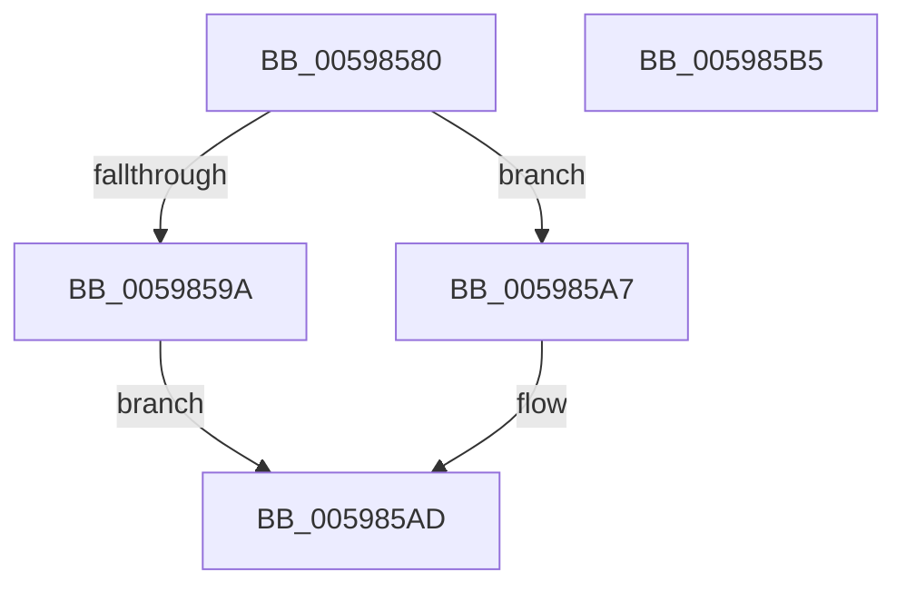

# IoSetFsZeroingOffset

- RVA: `0x00598580`–`0x005985B6` (길이 `54` bytes)
- VA: `0x0000000140598580`
- 실행 섹션: `.text`
- PDB 이름 있음: `예`; PDB Function 태그: `아니요`
- unwind 정보 RVA: `0x0005C788`
- 디코드: `16`개 명령, `54/54` bytes 표시
- 미해석 바이트: `0` (있으면 어셈블리에 `.byte`로 보존)

> 이 문서는 커널 이미지의 기계어와 PDB 기호를 분석해 생성했습니다. 4번과 5번은 함수 원형과 자료형을 바이너리 사용 방식에서 추정한 C 해석이며 원본 소스 복구 결과는 아닙니다.

## 1. Dependencies

- 직접 호출 지점: **1**; 고유 호출 대상: **1**
- 직접 호출자로 확인된 함수: **0**
- RIP 상대 이미지 참조: **0**

### Outgoing calls
- `0x00598591` → [IopIrpHasExtensionType](../3F/IopIrpHasExtensionType_function_003F4080.md) (function, `0x003F4080`)

### Direct callers
- 이 함수 시작 RVA로 연결되는 직접 call은 확인되지 않았습니다. 간접 호출은 완전히 역산할 수 없습니다.

### Static image references
- 디코드된 RIP-relative 메모리 참조가 없습니다.

## 2. Other-region calls and transfers

- 다른 실행 섹션으로 향하는 call: **0**
- 별도 외부 분기/꼬리 이동을 확인하지 못했습니다.

## 3. Assembly (complete function range)

```asm
00598580  48 83 EC 28                     sub rsp, 0x28
00598584  45 33 C0                        xor r8d, r8d
00598587  44 8B D2                        mov r10d, edx
0059858A  4C 8B C9                        mov r9, rcx
0059858D  41 8D 50 04                     lea edx, [r8 + 4]
00598591  E8 EA BA E5 FF                  call 0x1403f4080
00598596  84 C0                           test al, al
00598598  74 0D                           je 0x1405985a7
0059859A  49 8B 81 C8 00 00 00            mov rax, qword ptr [r9 + 0xc8]
005985A1  44 89 50 28                     mov dword ptr [rax + 0x28], r10d
005985A5  EB 06                           jmp 0x1405985ad
005985A7  41 B8 25 02 00 C0               mov r8d, 0xc0000225
005985AD  41 8B C0                        mov eax, r8d
005985B0  48 83 C4 28                     add rsp, 0x28
005985B4  C3                              ret
005985B5  CC                              int3
```

## 4. C-style interpretation (structured pseudocode)

```c
__int64 __fastcall IoSetFsZeroingOffset(__int64 a1, int a2, int a3)
{
    __int64 result;
    __int64 v_rsp;

    v_rsp = (v_rsp) - (40);
    a3 = 0;
    result = IopIrpHasExtensionType(a1, a3 + 4, a3, a1);
    if ((unsigned __int8)(result) == 0) goto loc_005985A7;
    *(unsigned int *)(*(unsigned __int64 *)(a1 + 200) + 40) = (unsigned int)((unsigned int)(a2));
    goto loc_005985AD;
loc_005985A7:
loc_005985AD:
    v_rsp = (v_rsp) + (40);
    return (unsigned int)((unsigned int)((unsigned int)(0xC0000225ULL)));
}
```

## 5. (Beta) C Style

```c
int64_t IoSetFsZeroingOffset(int64_t Arg1, int32_t Arg2, int32_t Arg3)
{
    int64_t result;
    int64_t local_rsp;

    local_rsp = (local_rsp) - (40);
    Arg3 = 0;
    result = IopIrpHasExtensionType(Arg1, Arg3 + 4, Arg3, Arg1);
    if ((uint8_t)(result) == 0) goto loc_005985A7;
    *(uint32_t *)(*(uint64_t *)(Arg1 + 0xC8) + 0x28) = (uint32_t)((uint32_t)(Arg2));
    goto loc_005985AD;
loc_005985A7:
loc_005985AD:
    local_rsp = (local_rsp) + (40);
    return (uint32_t)((uint32_t)((uint32_t)(0xC0000225ULL)));
}
```

## 6. Execution-region graph

[열기: 2D/3D 그래프와 함수 탐색 컨트롤 패널](../../../control-panel.html?section=text&rva=0x00598580&view=graph)

- 2D 그래프는 위에서 아래로 흐르고, 3D 그래프는 빈 공간을 드래그해 회전합니다. Shift+드래그는 이동, 휠은 확대·축소, 함수 노드 선택은 대상 보고서 이동입니다.

### Static fallback


