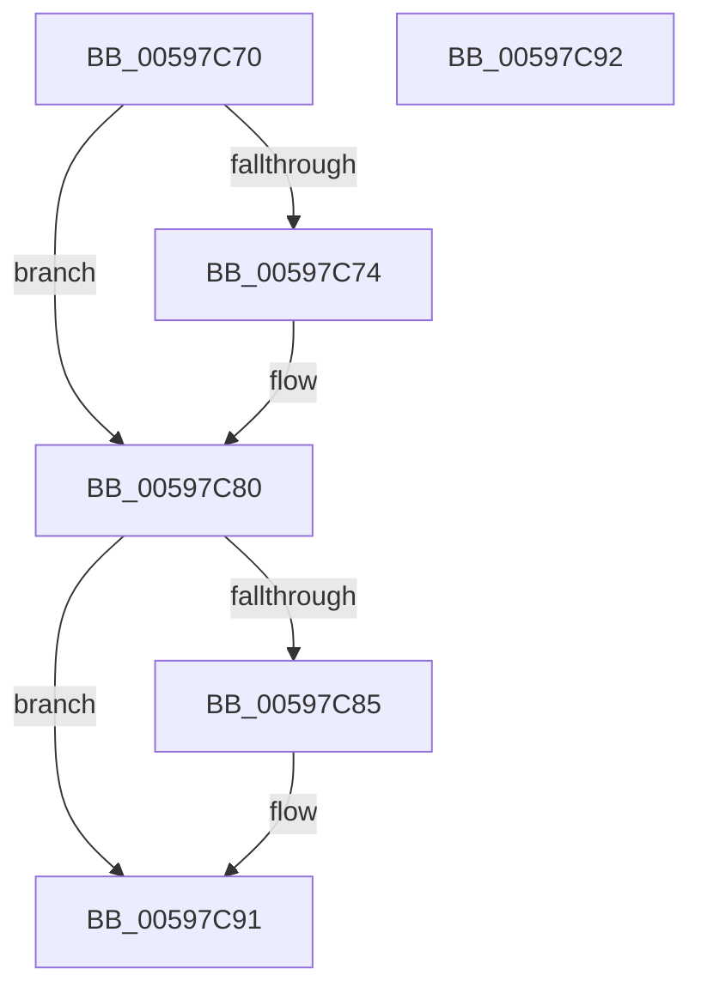

# IoSetStartIoAttributes

- RVA: `0x00597C70`–`0x00597C93` (길이 `35` bytes)
- VA: `0x0000000140597C70`
- 실행 섹션: `.text`
- PDB 이름 있음: `예`; PDB Function 태그: `아니요`
- unwind 정보 RVA: `0x000DB714`
- 디코드: `10`개 명령, `35/35` bytes 표시
- 미해석 바이트: `0` (있으면 어셈블리에 `.byte`로 보존)

> 이 문서는 커널 이미지의 기계어와 PDB 기호를 분석해 생성했습니다. 4번과 5번은 함수 원형과 자료형을 바이너리 사용 방식에서 추정한 C 해석이며 원본 소스 복구 결과는 아닙니다.

## 1. Dependencies

- 직접 호출 지점: **0**; 고유 호출 대상: **0**
- 직접 호출자로 확인된 함수: **0**
- RIP 상대 이미지 참조: **0**

### Outgoing calls
- 직접 디코드된 call 명령이 없습니다.

### Direct callers
- 이 함수 시작 RVA로 연결되는 직접 call은 확인되지 않았습니다. 간접 호출은 완전히 역산할 수 없습니다.

### Static image references
- 디코드된 RIP-relative 메모리 참조가 없습니다.

## 2. Other-region calls and transfers

- 다른 실행 섹션으로 향하는 call: **0**
- 별도 외부 분기/꼬리 이동을 확인하지 못했습니다.

## 3. Assembly (complete function range)

```asm
00597C70  84 D2                           test dl, dl
00597C72  74 0C                           je 0x140597c80
00597C74  48 8B 81 38 01 00 00            mov rax, qword ptr [rcx + 0x138]
00597C7B  0F BA 68 40 08                  bts dword ptr [rax + 0x40], 8
00597C80  45 84 C0                        test r8b, r8b
00597C83  74 0C                           je 0x140597c91
00597C85  48 8B 81 38 01 00 00            mov rax, qword ptr [rcx + 0x138]
00597C8C  0F BA 68 40 09                  bts dword ptr [rax + 0x40], 9
00597C91  C3                              ret
00597C92  CC                              int3
```

## 4. C-style interpretation (structured pseudocode)

```c
__int64 __fastcall IoSetStartIoAttributes(__int64 a1, unsigned __int8 a2, unsigned __int8 a3)
{
    __int64 result;

    if (a2 != 0) {
        result = *(unsigned __int64 *)(a1 + 312);
    }
    if (a3 != 0) {
        result = *(unsigned __int64 *)(a1 + 312);
    }
    return result;
}
```

## 5. (Beta) C Style

```c
int64_t IoSetStartIoAttributes(void *Arg1, uint8_t Arg2, uint8_t Arg3)
{
    uint8_t *arg1 = (uint8_t *)Arg1;

    int64_t result;

    if (Arg2 != 0) {
        result = *(uint64_t *)(arg1 + 0x138);
    }
    if (Arg3 != 0) {
        result = *(uint64_t *)(arg1 + 0x138);
    }
    return result;
}
```

### 관측된 메모리 오프셋

구조체 형식이 확인되지 않은 접근은 인자 기준의 오프셋으로만 기록했습니다.

| 기준 인자 | 오프셋 표현 | 폭 (bit) | 접근 |
|---|---:|---:|---|
| `Arg1` | `+ 0x138` | `64` | `R` |

## 6. Execution-region graph

[열기: 2D/3D 그래프와 함수 탐색 컨트롤 패널](../../../control-panel.html?section=text&rva=0x00597C70&view=graph)

- 2D 그래프는 위에서 아래로 흐르고, 3D 그래프는 빈 공간을 드래그해 회전합니다. Shift+드래그는 이동, 휠은 확대·축소, 함수 노드 선택은 대상 보고서 이동입니다.

### Static fallback


