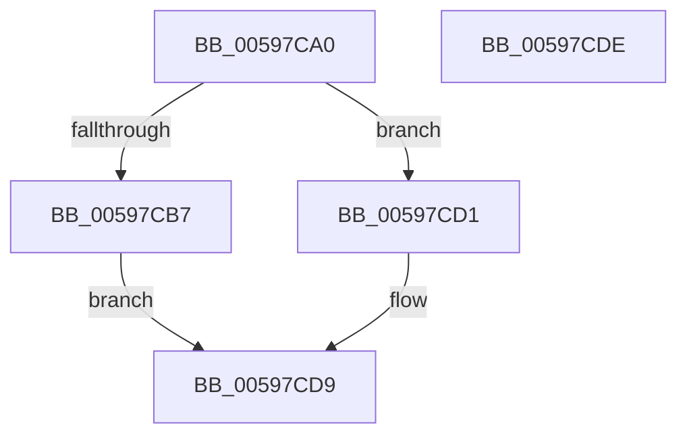

# IoStartNextPacketByKey

- RVA: `0x00597CA0`–`0x00597CDF` (길이 `63` bytes)
- VA: `0x0000000140597CA0`
- 실행 섹션: `.text`
- PDB 이름 있음: `예`; PDB Function 태그: `아니요`
- unwind 정보 RVA: `0x0005C788`
- 디코드: `17`개 명령, `63/63` bytes 표시
- 미해석 바이트: `0` (있으면 어셈블리에 `.byte`로 보존)

> 이 문서는 커널 이미지의 기계어와 PDB 기호를 분석해 생성했습니다. 4번과 5번은 함수 원형과 자료형을 바이너리 사용 방식에서 추정한 C 해석이며 원본 소스 복구 결과는 아닙니다.

## 1. Dependencies

- 직접 호출 지점: **2**; 고유 호출 대상: **2**
- 직접 호출자로 확인된 함수: **0**
- RIP 상대 이미지 참조: **0**

### Outgoing calls
- `0x00597CCA` → [IopStartNextPacketByKeyEx](../45/IopStartNextPacketByKeyEx_function_0045F8E4.md) (function, `0x0045F8E4`)
- `0x00597CD4` → [IopStartNextPacketByKey](../45/IopStartNextPacketByKey_function_0045FA64.md) (function, `0x0045FA64`)

### Direct callers
- 이 함수 시작 RVA로 연결되는 직접 call은 확인되지 않았습니다. 간접 호출은 완전히 역산할 수 없습니다.

### Static image references
- 디코드된 RIP-relative 메모리 참조가 없습니다.

## 2. Other-region calls and transfers

- 다른 실행 섹션으로 향하는 call: **0**
- 별도 외부 분기/꼬리 이동을 확인하지 못했습니다.

## 3. Assembly (complete function range)

```asm
00597CA0  48 83 EC 28                     sub rsp, 0x28
00597CA4  48 8B 81 38 01 00 00            mov rax, qword ptr [rcx + 0x138]
00597CAB  45 8B D0                        mov r10d, r8d
00597CAE  F7 40 40 00 01 00 00            test dword ptr [rax + 0x40], 0x100
00597CB5  74 1A                           je 0x140597cd1
00597CB7  F6 DA                           neg dl
00597CB9  41 8B D2                        mov edx, r10d
00597CBC  45 1B C0                        sbb r8d, r8d
00597CBF  41 81 E0 80 00 00 00            and r8d, 0x80
00597CC6  41 83 C0 40                     add r8d, 0x40
00597CCA  E8 15 7C EC FF                  call 0x14045f8e4
00597CCF  EB 08                           jmp 0x140597cd9
00597CD1  0F B6 D2                        movzx edx, dl
00597CD4  E8 8B 7D EC FF                  call 0x14045fa64
00597CD9  48 83 C4 28                     add rsp, 0x28
00597CDD  C3                              ret
00597CDE  CC                              int3
```

## 4. C-style interpretation (structured pseudocode)

```c
__int64 __fastcall IoStartNextPacketByKey(__int64 a1, unsigned __int8 a2, int a3)
{
    __int64 result;
    __int64 v_rsp;

    v_rsp = (v_rsp) - (40);
    if (((*(unsigned int *)(*(unsigned __int64 *)(a1 + 312) + 64)) & (256)) == 0) goto loc_00597CD1;
    a2 = (unsigned __int8)(-(a2));
    a3 = (unsigned int)((a3) & (128));
    a3 = (unsigned int)((a3) + (64));
    result = IopStartNextPacketByKeyEx(a1, (unsigned int)((unsigned int)((unsigned int)(a3))), a3, a4);
    goto loc_00597CD9;
loc_00597CD1:
    result = IopStartNextPacketByKey(a1, (unsigned __int8)((unsigned int)((unsigned int)((unsigned int)(a3)))), a3, a4);
loc_00597CD9:
    v_rsp = (v_rsp) + (40);
    return result;
}
```

## 5. (Beta) C Style

```c
int64_t IoStartNextPacketByKey(void *Arg1, uint8_t Arg2, int32_t Arg3)
{
    uint8_t *arg1 = (uint8_t *)Arg1;

    int64_t result;
    int64_t local_rsp;

    local_rsp = (local_rsp) - (40);
    if (((*(uint32_t *)(*(uint64_t *)(arg1 + 0x138) + 0x40)) & (256)) == 0) goto loc_00597CD1;
    Arg2 = (uint8_t)(-(Arg2));
    Arg3 = (uint32_t)((Arg3) & (128));
    Arg3 = (uint32_t)((Arg3) + (64));
    result = IopStartNextPacketByKeyEx(Arg1, (uint32_t)((uint32_t)((uint32_t)(Arg3))), Arg3, a4);
    goto loc_00597CD9;
loc_00597CD1:
    result = IopStartNextPacketByKey(Arg1, (uint8_t)((uint32_t)((uint32_t)((uint32_t)(Arg3)))), Arg3, a4);
loc_00597CD9:
    local_rsp = (local_rsp) + (40);
    return result;
}
```

### 관측된 메모리 오프셋

구조체 형식이 확인되지 않은 접근은 인자 기준의 오프셋으로만 기록했습니다.

| 기준 인자 | 오프셋 표현 | 폭 (bit) | 접근 |
|---|---:|---:|---|
| `Arg1` | `+ 0x138` | `64` | `R` |

## 6. Execution-region graph

[열기: 2D/3D 그래프와 함수 탐색 컨트롤 패널](../../../control-panel.html?section=text&rva=0x00597CA0&view=graph)

- 2D 그래프는 위에서 아래로 흐르고, 3D 그래프는 빈 공간을 드래그해 회전합니다. Shift+드래그는 이동, 휠은 확대·축소, 함수 노드 선택은 대상 보고서 이동입니다.

### Static fallback


