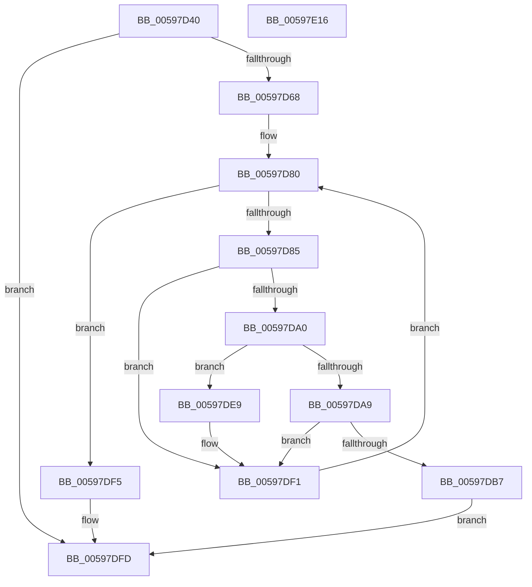

# IoUnregisterPriorityCallback

- RVA: `0x00597D40`–`0x00597E17` (길이 `215` bytes)
- VA: `0x0000000140597D40`
- 실행 섹션: `.text`
- PDB 이름 있음: `예`; PDB Function 태그: `아니요`
- unwind 정보 RVA: `0x00060300`
- 디코드: `59`개 명령, `215/215` bytes 표시
- 미해석 바이트: `0` (있으면 어셈블리에 `.byte`로 보존)

> 이 문서는 커널 이미지의 기계어와 PDB 기호를 분석해 생성했습니다. 4번과 5번은 함수 원형과 자료형을 바이너리 사용 방식에서 추정한 C 해석이며 원본 소스 복구 결과는 아닙니다.

## 1. Dependencies

- 직접 호출 지점: **8**; 고유 호출 대상: **6**
- 직접 호출자로 확인된 함수: **1**
- RIP 상대 이미지 참조: **2**

### Outgoing calls
- `0x00597D93` → [ExReferenceCallBackBlock](../2F/ExReferenceCallBackBlock_function_002F0040.md) (function, `0x002F0040`)
- `0x00597DAE` → [ExCompareExchangeCallBack](../41/ExCompareExchangeCallBack_function_0041BCD0.md) (function, `0x0041BCD0`)
- `0x00597DC5` → [ExDereferenceCallBackBlock](../44/ExDereferenceCallBackBlock_function_0044D730.md) (function, `0x0044D730`)
- `0x00597DCD` → [KiLeaveCriticalRegionUnsafe](../25/KiLeaveCriticalRegionUnsafe_function_0025F010.md) (function, `0x0025F010`)
- `0x00597DD5` → [ExWaitForCallBacks](../../page/AC/ExWaitForCallBacks_function_00ACFA04.md) (function, `0x00ACFA04`)
- `0x00597DDD` → [AlpcpFreeBuffer](../../page/90/AlpcpFreeBuffer_function_009071C0.md) (function, `0x009071C0`)
- `0x00597DEC` → [ExDereferenceCallBackBlock](../44/ExDereferenceCallBackBlock_function_0044D730.md) (function, `0x0044D730`)
- `0x00597DF8` → [KiLeaveCriticalRegionUnsafe](../25/KiLeaveCriticalRegionUnsafe_function_0025F010.md) (function, `0x0025F010`)

### Direct callers
- [IopDeleteDriver](../../page/AA/IopDeleteDriver_function_00AA2E50.md) at `0x00AA2EE9`

### Static image references
- `0x00597D85` → RVA `0x00F8D1A0` (`.data`; read)
- `0x00597DB7` → RVA `0x00E66124` (`.data`; read/write)

## 2. Other-region calls and transfers

- 다른 실행 섹션으로 향하는 call: **2**
  - `0x00597DD5` → [ExWaitForCallBacks](../../page/AC/ExWaitForCallBacks_function_00ACFA04.md) (`.text` → `PAGE`)
  - `0x00597DDD` → [AlpcpFreeBuffer](../../page/90/AlpcpFreeBuffer_function_009071C0.md) (`.text` → `PAGE`)
- 별도 외부 분기/꼬리 이동을 확인하지 못했습니다.

## 3. Assembly (complete function range)

```asm
00597D40  48 89 5C 24 08                  mov qword ptr [rsp + 8], rbx
00597D45  48 89 6C 24 10                  mov qword ptr [rsp + 0x10], rbp
00597D4A  48 89 74 24 18                  mov qword ptr [rsp + 0x18], rsi
00597D4F  57                              push rdi
00597D50  41 56                           push r14
00597D52  41 57                           push r15
00597D54  48 83 EC 20                     sub rsp, 0x20
00597D58  F7 41 10 00 02 00 00            test dword ptr [rcx + 0x10], 0x200
00597D5F  48 8B E9                        mov rbp, rcx
00597D62  0F 84 95 00 00 00               je 0x140597dfd
00597D68  65 48 8B 3C 25 88 01 00 00      mov rdi, qword ptr gs:[0x188]
00597D71  41 83 CF FF                     or r15d, 0xffffffff
00597D75  66 44 01 BF E4 01 00 00         add word ptr [rdi + 0x1e4], r15w
00597D7D  90                              nop
00597D7E  33 F6                           xor esi, esi
00597D80  83 FE 08                        cmp esi, 8
00597D83  73 70                           jae 0x140597df5
00597D85  48 8D 0D 14 54 9F 00            lea rcx, [rip + 0x9f5414]
00597D8C  4C 8D 34 F1                     lea r14, [rcx + rsi*8]
00597D90  49 8B CE                        mov rcx, r14
00597D93  E8 A8 82 D5 FF                  call 0x1402f0040
00597D98  48 8B D8                        mov rbx, rax
00597D9B  48 85 C0                        test rax, rax
00597D9E  74 51                           je 0x140597df1
00597DA0  49 8B CE                        mov rcx, r14
00597DA3  48 39 68 20                     cmp qword ptr [rax + 0x20], rbp
00597DA7  75 40                           jne 0x140597de9
00597DA9  4C 8B C0                        mov r8, rax
00597DAC  33 D2                           xor edx, edx
00597DAE  E8 1D 3F E8 FF                  call 0x14041bcd0
00597DB3  84 C0                           test al, al
00597DB5  74 3A                           je 0x140597df1
00597DB7  F0 44 01 3D 65 E3 8C 00         lock add dword ptr [rip + 0x8ce365], r15d
00597DBF  48 8B D3                        mov rdx, rbx
00597DC2  49 8B CE                        mov rcx, r14
00597DC5  E8 66 59 EB FF                  call 0x14044d730
00597DCA  48 8B CF                        mov rcx, rdi
00597DCD  E8 3E 72 CC FF                  call 0x14025f010
00597DD2  48 8B CB                        mov rcx, rbx
00597DD5  E8 2A 7C 53 00                  call 0x140acfa04
00597DDA  48 8B CB                        mov rcx, rbx
00597DDD  E8 DE F3 36 00                  call 0x1409071c0
00597DE2  0F BA 75 10 09                  btr dword ptr [rbp + 0x10], 9
00597DE7  EB 14                           jmp 0x140597dfd
00597DE9  48 8B D3                        mov rdx, rbx
00597DEC  E8 3F 59 EB FF                  call 0x14044d730
00597DF1  FF C6                           inc esi
00597DF3  EB 8B                           jmp 0x140597d80
00597DF5  48 8B CF                        mov rcx, rdi
00597DF8  E8 13 72 CC FF                  call 0x14025f010
00597DFD  48 8B 5C 24 40                  mov rbx, qword ptr [rsp + 0x40]
00597E02  48 8B 6C 24 48                  mov rbp, qword ptr [rsp + 0x48]
00597E07  48 8B 74 24 50                  mov rsi, qword ptr [rsp + 0x50]
00597E0C  48 83 C4 20                     add rsp, 0x20
00597E10  41 5F                           pop r15
00597E12  41 5E                           pop r14
00597E14  5F                              pop rdi
00597E15  C3                              ret
00597E16  CC                              int3
```

## 4. C-style interpretation (structured pseudocode)

```c
__int64 __fastcall IoUnregisterPriorityCallback(__int64 a1, int a2)
{
    __int64 result;
    __int64 v_r15;
    __int64 v_rsi;
    __int64 v_rsp;
    unsigned __int64 v_stack_p10;
    unsigned __int64 v_stack_p18;
    unsigned __int64 v_stack_p8;

    v_stack_p8 = v_rbx;
    v_stack_p10 = v_rbp;
    v_stack_p18 = v_rsi;
    v_rsp = (v_rsp) - (32);
    if (((*(unsigned int *)(a1 + 16)) & (512)) == 0) goto loc_00597DFD;
    v_r15 = (unsigned int)((v_r15) | (0xFFFFFFFFULL));
    v_rsi = 0;
loc_00597D80:
    if (0 >= 8) goto loc_00597DF5;
    result = ExReferenceCallBackBlock(v_rip + 10441748 + v_rsi * 8, a2, a3, a4);
    if (result == 0) goto loc_00597DF1;
    if ((*(unsigned __int64 *)(result + 32)) != a1) goto loc_00597DE9;
    a2 = 0;
    result = ExCompareExchangeCallBack(v_rip + 10441748 + v_rsi * 8, a2, result, a4);
    if ((unsigned __int8)(result) == 0) goto loc_00597DF1;
    result = ExDereferenceCallBackBlock(v_rip + 10441748 + v_rsi * 8, result, result, a4);
    result = KiLeaveCriticalRegionUnsafe(*(unsigned __int64 *)(gs_base + (0 + 392)), result, result, a4);
    result = ExWaitForCallBacks(result, result, result, a4);
    result = AlpcpFreeBuffer(result, result, result, a4);
    goto loc_00597DFD;
loc_00597DE9:
    result = ExDereferenceCallBackBlock(result, result, result, a4);
loc_00597DF1:
    v_rsi = (unsigned int)((v_rsi) + 1);
    goto loc_00597D80;
loc_00597DF5:
    result = KiLeaveCriticalRegionUnsafe(*(unsigned __int64 *)(gs_base + (0 + 392)), result, result, a4);
loc_00597DFD:
    v_rsp = (v_rsp) + (32);
    return result;
}
```

## 5. (Beta) C Style

```c
int64_t IoUnregisterPriorityCallback(void *Arg1, int32_t Arg2)
{
    uint8_t *arg1 = (uint8_t *)Arg1;

    int64_t result;
    int64_t local_r15;
    int64_t local_rsi;
    int64_t local_rsp;
    uint64_t v_stack_p10;
    uint64_t v_stack_p18;
    uint64_t v_stack_p8;

    v_stack_p8 = local_rbx;
    v_stack_p10 = local_rbp;
    v_stack_p18 = local_rsi;
    local_rsp = (local_rsp) - (32);
    if (((*(uint32_t *)(arg1 + 0x10)) & (512)) == 0) goto loc_00597DFD;
    local_r15 = (uint32_t)((local_r15) | (0xFFFFFFFFULL));
    local_rsi = 0;
loc_00597D80:
    if (0 >= 8) goto loc_00597DF5;
    result = ExReferenceCallBackBlock(v_rip + 10441748 + local_rsi * 8, Arg2, a3, a4);
    if (result == 0) goto loc_00597DF1;
    if ((*(uint64_t *)(result + 0x20)) != Arg1) goto loc_00597DE9;
    Arg2 = 0;
    result = ExCompareExchangeCallBack(v_rip + 10441748 + local_rsi * 8, Arg2, result, a4);
    if ((uint8_t)(result) == 0) goto loc_00597DF1;
    result = ExDereferenceCallBackBlock(v_rip + 10441748 + local_rsi * 8, result, result, a4);
    result = KiLeaveCriticalRegionUnsafe(*(uint64_t *)(gs_base + (0 + 0x188)), result, result, a4);
    result = ExWaitForCallBacks(result, result, result, a4);
    result = AlpcpFreeBuffer(result, result, result, a4);
    goto loc_00597DFD;
loc_00597DE9:
    result = ExDereferenceCallBackBlock(result, result, result, a4);
loc_00597DF1:
    local_rsi = (uint32_t)((local_rsi) + 1);
    goto loc_00597D80;
loc_00597DF5:
    result = KiLeaveCriticalRegionUnsafe(*(uint64_t *)(gs_base + (0 + 0x188)), result, result, a4);
loc_00597DFD:
    local_rsp = (local_rsp) + (32);
    return result;
}
```

### 관측된 메모리 오프셋

구조체 형식이 확인되지 않은 접근은 인자 기준의 오프셋으로만 기록했습니다.

| 기준 인자 | 오프셋 표현 | 폭 (bit) | 접근 |
|---|---:|---:|---|
| `Arg1` | `+ 0x10` | `32` | `R` |
| `Arg1` | `+ 0x10` | `32` | `R/W` |

## 6. Execution-region graph

[열기: 2D/3D 그래프와 함수 탐색 컨트롤 패널](../../../control-panel.html?section=text&rva=0x00597D40&view=graph)

- 2D 그래프는 위에서 아래로 흐르고, 3D 그래프는 빈 공간을 드래그해 회전합니다. Shift+드래그는 이동, 휠은 확대·축소, 함수 노드 선택은 대상 보고서 이동입니다.

### Static fallback


