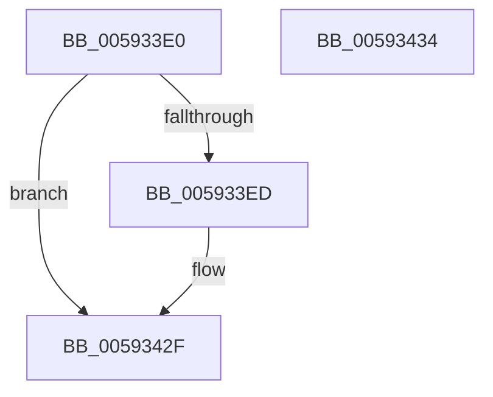

# IoUpdateBugCheckProgressEnvVariable

- RVA: `0x005933E0`–`0x00593435` (길이 `85` bytes)
- VA: `0x00000001405933E0`
- 실행 섹션: `.text`
- PDB 이름 있음: `예`; PDB Function 태그: `아니요`
- unwind 정보 RVA: `0x0005D2F4`
- 디코드: `18`개 명령, `85/85` bytes 표시
- 미해석 바이트: `0` (있으면 어셈블리에 `.byte`로 보존)

> 이 문서는 커널 이미지의 기계어와 PDB 기호를 분석해 생성했습니다. 4번과 5번은 함수 원형과 자료형을 바이너리 사용 방식에서 추정한 C 해석이며 원본 소스 복구 결과는 아닙니다.

## 1. Dependencies

- 직접 호출 지점: **2**; 고유 호출 대상: **2**
- 직접 호출자로 확인된 함수: **3**
- RIP 상대 이미지 참조: **6**

### Outgoing calls
- `0x005933E4` → [IopBugCheckProgressEfiVariableServicesAvailable](IopBugCheckProgressEfiVariableServicesAvailable_function_00594708.md) (function, `0x00594708`)
- `0x00593423` → [guard_dispatch_icall](../6B/guard_dispatch_icall_function_006BAAD0.md) (function, `0x006BAAD0`)

### Direct callers
- [IoSaveBugCheckProgress](IoSaveBugCheckProgress_function_00592E10.md) at `0x00592E56`
- [IoSetBugCheckProgressFlag](IoSetBugCheckProgressFlag_function_005931C0.md) at `0x005931D6`
- [IoWriteCrashDump](IoWriteCrashDump_function_005936D8.md) at `0x00593DFF`

### Static image references
- `0x005933ED` → RVA `0x00E66050` (`.data`; read)
- `0x005933F4` → RVA `0x00020910` (`.rdata`; read)
- `0x005933FB` → RVA `0x00F8E968` (`.data`; read)
- `0x00593407` → RVA `0x00E65ED8` (`.data`; write)
- `0x0059341C` → RVA `0x006C9E40` (` ?? ::FNODOBFM::`string'`; read)
- `0x00593428` → RVA `0x00E65ED8` (`.data`; read/write)

## 2. Other-region calls and transfers

- 다른 실행 섹션으로 향하는 call: **0**
- 별도 외부 분기/꼬리 이동을 확인하지 못했습니다.

## 3. Assembly (complete function range)

```asm
005933E0  48 83 EC 38                     sub rsp, 0x38
005933E4  E8 1F 13 00 00                  call 0x140594708
005933E9  84 C0                           test al, al
005933EB  74 42                           je 0x14059342f
005933ED  4C 8B 05 5C 2C 8D 00            mov r8, qword ptr [rip + 0x8d2c5c]
005933F4  48 8D 15 15 D5 A8 FF            lea rdx, [rip - 0x572aeb]
005933FB  48 8B 05 66 B5 9F 00            mov rax, qword ptr [rip + 0x9fb566]
00593402  B9 01 00 00 00                  mov ecx, 1
00593407  89 0D CB 2A 8D 00               mov dword ptr [rip + 0x8d2acb], ecx
0059340D  49 81 C0 7C 05 00 00            add r8, 0x57c
00593414  89 4C 24 20                     mov dword ptr [rsp + 0x20], ecx
00593418  44 8D 49 03                     lea r9d, [rcx + 3]
0059341C  48 8D 0D 1D 6A 13 00            lea rcx, [rip + 0x136a1d]
00593423  E8 A8 76 12 00                  call 0x1406baad0
00593428  83 25 A9 2A 8D 00 00            and dword ptr [rip + 0x8d2aa9], 0
0059342F  48 83 C4 38                     add rsp, 0x38
00593433  C3                              ret
00593434  CC                              int3
```

## 4. C-style interpretation (structured pseudocode)

```c
__int64 __fastcall IoUpdateBugCheckProgressEnvVariable(void)
{
    __int64 result;
    __int64 v_rsp;
    unsigned int v_stack_m18;

    v_rsp = (v_rsp) - (56);
    result = IopBugCheckProgressEfiVariableServicesAvailable(a1, a2, a3, a4);
    if ((unsigned __int8)(result) != 0) {
        a3 = *(unsigned __int64 *)(v_rip + 9251932);
        a2 = v_rip - 5712619;
        result = *(unsigned __int64 *)(v_rip + 10466662);
        a1 = 1;
        *(unsigned int *)(v_rip + 9251531) = (unsigned int)(a1);
        a3 = (a3) + (0x57CULL);
        v_stack_m18 = (unsigned int)(a1);
        a4 = a1 + 3;
        a1 = v_rip + 1272349;
        result = guard_dispatch_icall(a1, a2, a3, a4);
    }
    v_rsp = (v_rsp) + (56);
    return result;
}
```

## 5. (Beta) C Style

```c
void IoUpdateBugCheckProgressEnvVariable(void)
{
    int64_t result;
    int64_t local_rsp;
    uint32_t v_stack_m18;

    local_rsp = (local_rsp) - (56);
    result = IopBugCheckProgressEfiVariableServicesAvailable(a1, a2, a3, a4);
    if ((uint8_t)(result) != 0) {
        a3 = *(uint64_t *)(v_rip + 0x8D2C5C);
        a2 = v_rip - 5712619;
        result = *(uint64_t *)(v_rip + 0x9FB566);
        a1 = 1;
        *(uint32_t *)(v_rip + 0x8D2ACB) = (uint32_t)(a1);
        a3 = (a3) + (0x57CULL);
        v_stack_m18 = (uint32_t)(a1);
        a4 = a1 + 3;
        a1 = v_rip + 1272349;
        result = guard_dispatch_icall(a1, a2, a3, a4);
    }
    local_rsp = (local_rsp) + (56);
    return result;
}
```

## 6. Execution-region graph

[열기: 2D/3D 그래프와 함수 탐색 컨트롤 패널](../../../control-panel.html?section=text&rva=0x005933E0&view=graph)

- 2D 그래프는 위에서 아래로 흐르고, 3D 그래프는 빈 공간을 드래그해 회전합니다. Shift+드래그는 이동, 휠은 확대·축소, 함수 노드 선택은 대상 보고서 이동입니다.

### Static fallback


