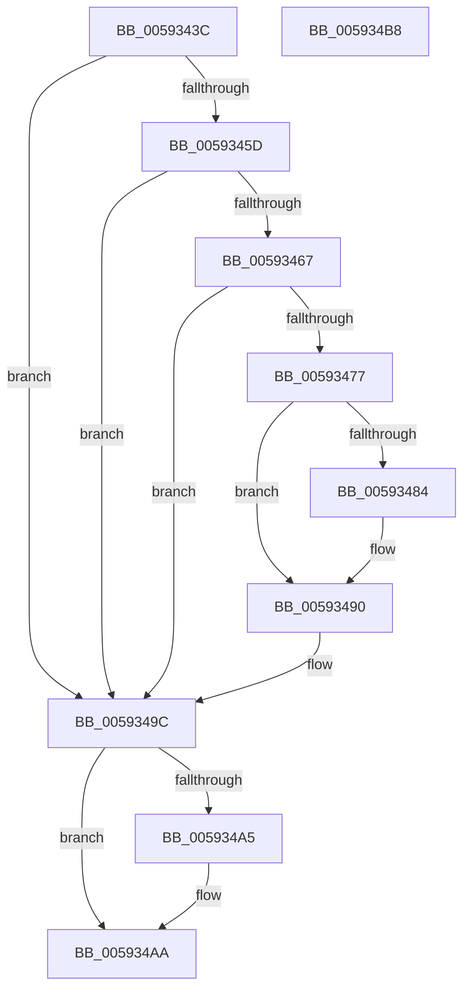

# IoUpdateDumpPhysicalRanges

- RVA: `0x0059343C`–`0x005934B9` (길이 `125` bytes)
- VA: `0x000000014059343C`
- 실행 섹션: `.text`
- PDB 이름 있음: `예`; PDB Function 태그: `아니요`
- unwind 정보 RVA: `0x0005CF00`
- 디코드: `31`개 명령, `125/125` bytes 표시
- 미해석 바이트: `0` (있으면 어셈블리에 `.byte`로 보존)

> 이 문서는 커널 이미지의 기계어와 PDB 기호를 분석해 생성했습니다. 4번과 5번은 함수 원형과 자료형을 바이너리 사용 방식에서 추정한 C 해석이며 원본 소스 복구 결과는 아닙니다.

## 1. Dependencies

- 직접 호출 지점: **6**; 고유 호출 대상: **6**
- 직접 호출자로 확인된 함수: **4**
- RIP 상대 이미지 참조: **5**

### Outgoing calls
- `0x0059346E` → [ExAcquireResourceExclusiveLite](../21/ExAcquireResourceExclusiveLite_function_00214E20.md) (function, `0x00214E20`)
- `0x00593477` → [IopGetPhysicalMemoryBlock](IopGetPhysicalMemoryBlock_function_00595690.md) (function, `0x00595690`)
- `0x0059348B` → [guard_dispatch_icall](../6B/guard_dispatch_icall_function_006BAAD0.md) (function, `0x006BAAD0`)
- `0x00593497` → [ExReleaseResourceLite](../25/ExReleaseResourceLite_function_0025FA10.md) (function, `0x0025FA10`)
- `0x005934A5` → [IopConstructInMemoryDumpHeader](IopConstructInMemoryDumpHeader_function_005948A0.md) (function, `0x005948A0`)
- `0x005934AD` → [KeLeaveCriticalRegionThread](../25/KeLeaveCriticalRegionThread_function_0025EFF0.md) (function, `0x0025EFF0`)

### Direct callers
- [MiRemovePhysicalMemoryBatchComplete](../67/MiRemovePhysicalMemoryBatchComplete_function_00673B98.md) at `0x00673BAC`
- [MiAddPhysicalMemoryChunks](../../page/7F/MiAddPhysicalMemoryChunks_function_007F98D4.md) at `0x007F9E0F`
- [MiRemovePhysicalMemory](../../page/7F/MiRemovePhysicalMemory_function_007FAD3C.md) at `0x007FB026`
- [MiHotAddPartitionMemory](../../page/80/MiHotAddPartitionMemory_function_0080D5B4.md) at `0x0080D858`

### Static image references
- `0x00593453` → RVA `0x00E66058` (`.data`; read)
- `0x0059345F` → RVA `0x00E66068` (`.data`; read)
- `0x00593467` → RVA `0x00F8E900` (`.data`; read)
- `0x00593484` → RVA `0x00E66010` (`.data`; read)
- `0x0059349C` → RVA `0x00E65F50` (`.data`; read)

## 2. Other-region calls and transfers

- 다른 실행 섹션으로 향하는 call: **0**
- 별도 외부 분기/꼬리 이동을 확인하지 못했습니다.

## 3. Assembly (complete function range)

```asm
0059343C  40 53                           push rbx
0059343E  48 83 EC 20                     sub rsp, 0x20
00593442  65 48 8B 1C 25 88 01 00 00      mov rbx, qword ptr gs:[0x188]
0059344B  66 FF 8B E4 01 00 00            dec word ptr [rbx + 0x1e4]
00593452  90                              nop
00593453  48 83 3D FD 2B 8D 00 00         cmp qword ptr [rip + 0x8d2bfd], 0
0059345B  74 3F                           je 0x14059349c
0059345D  B2 01                           mov dl, 1
0059345F  38 15 03 2C 8D 00               cmp byte ptr [rip + 0x8d2c03], dl
00593465  75 35                           jne 0x14059349c
00593467  48 8D 0D 92 B4 9F 00            lea rcx, [rip + 0x9fb492]
0059346E  E8 AD 19 C8 FF                  call 0x140214e20
00593473  84 C0                           test al, al
00593475  74 25                           je 0x14059349c
00593477  E8 14 22 00 00                  call 0x140595690
0059347C  48 8B C8                        mov rcx, rax
0059347F  48 85 C0                        test rax, rax
00593482  74 0C                           je 0x140593490
00593484  48 8B 05 85 2B 8D 00            mov rax, qword ptr [rip + 0x8d2b85]
0059348B  E8 40 76 12 00                  call 0x1406baad0
00593490  48 8D 0D 69 B4 9F 00            lea rcx, [rip + 0x9fb469]
00593497  E8 74 C5 CC FF                  call 0x14025fa10
0059349C  80 3D AD 2A 8D 00 00            cmp byte ptr [rip + 0x8d2aad], 0
005934A3  74 05                           je 0x1405934aa
005934A5  E8 F6 13 00 00                  call 0x1405948a0
005934AA  48 8B CB                        mov rcx, rbx
005934AD  E8 3E BB CC FF                  call 0x14025eff0
005934B2  48 83 C4 20                     add rsp, 0x20
005934B6  5B                              pop rbx
005934B7  C3                              ret
005934B8  CC                              int3
```

## 4. C-style interpretation (structured pseudocode)

```c
__int64 __fastcall IoUpdateDumpPhysicalRanges(void)
{
    __int64 result;
    __int64 v_rsp;

    v_rsp = (v_rsp) - (32);
    if ((*(unsigned __int64 *)(v_rip + 9251837)) == 0) goto loc_0059349C;
    if ((*(unsigned __int8 *)(v_rip + 9251843)) != 1) goto loc_0059349C;
    result = ExAcquireResourceExclusiveLite(v_rip + 10466450, 1, a3, a4);
    if ((unsigned __int8)(result) == 0) goto loc_0059349C;
    result = IopGetPhysicalMemoryBlock(v_rip + 10466450, 1, a3, a4);
    if (result != 0) {
        result = *(unsigned __int64 *)(v_rip + 9251717);
        result = guard_dispatch_icall(result, 1, a3, a4);
    }
    result = ExReleaseResourceLite(v_rip + 10466409, 1, a3, a4);
loc_0059349C:
    if ((*(unsigned __int8 *)(v_rip + 9251501)) != 0) {
        result = IopConstructInMemoryDumpHeader(v_rip + 10466409, 1, a3, a4);
    }
    result = KeLeaveCriticalRegionThread(*(unsigned __int64 *)(gs_base + (0 + 392)), 1, a3, a4);
    v_rsp = (v_rsp) + (32);
    return result;
}
```

## 5. (Beta) C Style

```c
void IoUpdateDumpPhysicalRanges(void)
{
    int64_t result;
    int64_t local_rsp;

    local_rsp = (local_rsp) - (32);
    if ((*(uint64_t *)(v_rip + 0x8D2BFD)) == 0) goto loc_0059349C;
    if ((*(uint8_t *)(v_rip + 0x8D2C03)) != 1) goto loc_0059349C;
    result = ExAcquireResourceExclusiveLite(v_rip + 10466450, 1, a3, a4);
    if ((uint8_t)(result) == 0) goto loc_0059349C;
    result = IopGetPhysicalMemoryBlock(v_rip + 10466450, 1, a3, a4);
    if (result != 0) {
        result = *(uint64_t *)(v_rip + 0x8D2B85);
        result = guard_dispatch_icall(result, 1, a3, a4);
    }
    result = ExReleaseResourceLite(v_rip + 10466409, 1, a3, a4);
loc_0059349C:
    if ((*(uint8_t *)(v_rip + 0x8D2AAD)) != 0) {
        result = IopConstructInMemoryDumpHeader(v_rip + 10466409, 1, a3, a4);
    }
    result = KeLeaveCriticalRegionThread(*(uint64_t *)(gs_base + (0 + 0x188)), 1, a3, a4);
    local_rsp = (local_rsp) + (32);
    return result;
}
```

## 6. Execution-region graph

[열기: 2D/3D 그래프와 함수 탐색 컨트롤 패널](../../../control-panel.html?section=text&rva=0x0059343C&view=graph)

- 2D 그래프는 위에서 아래로 흐르고, 3D 그래프는 빈 공간을 드래그해 회전합니다. Shift+드래그는 이동, 휠은 확대·축소, 함수 노드 선택은 대상 보고서 이동입니다.

### Static fallback


