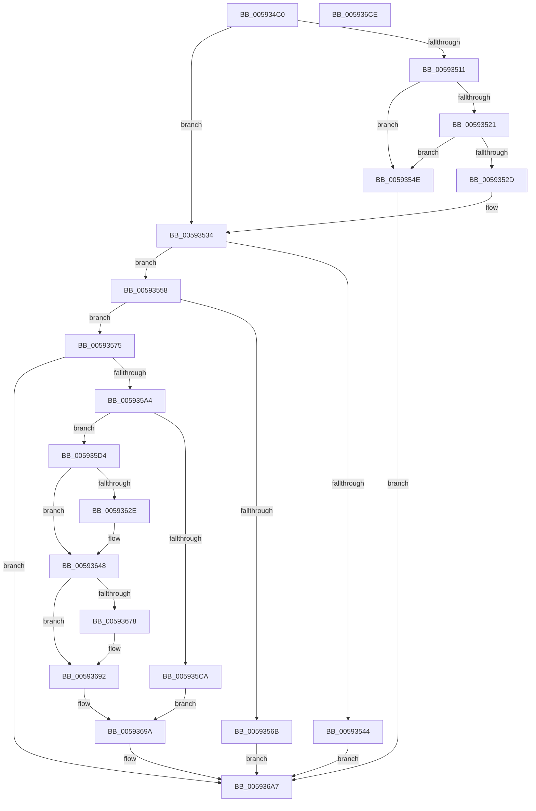

# IoWriteCapturedPristineTriageDumpToDedicatedDumpFile

- RVA: `0x005934C0`–`0x005936CF` (길이 `527` bytes)
- VA: `0x00000001405934C0`
- 실행 섹션: `.text`
- PDB 이름 있음: `예`; PDB Function 태그: `아니요`
- unwind 정보 RVA: `0x000C7050`
- 디코드: `125`개 명령, `527/527` bytes 표시
- 미해석 바이트: `0` (있으면 어셈블리에 `.byte`로 보존)

> 이 문서는 커널 이미지의 기계어와 PDB 기호를 분석해 생성했습니다. 4번과 5번은 함수 원형과 자료형을 바이너리 사용 방식에서 추정한 C 해석이며 원본 소스 복구 결과는 아닙니다.

## 1. Dependencies

- 직접 호출 지점: **10**; 고유 호출 대상: **9**
- 직접 호출자로 확인된 함수: **1**
- RIP 상대 이미지 참조: **5**

### Outgoing calls
- `0x00593595` → [ObReferenceObjectByHandle](../../page/86/ObReferenceObjectByHandle_function_00868DB0.md) (function, `0x00868DB0`)
- `0x005935B9` → [IoAllocateMdl](../29/IoAllocateMdl_function_0029EBF0.md) (function, `0x0029EBF0`)
- `0x005935D7` → [MmBuildMdlForNonPagedPool](../23/MmBuildMdlForNonPagedPool_function_0023A870.md) (function, `0x0023A870`)
- `0x00593622` → [ZwQueryInformationFile](../6A/ZwQueryInformationFile_function_006AD2F0.md) (function, `0x006AD2F0`)
- `0x00593643` → [KeWaitForSingleObject](../20/KeWaitForSingleObject_function_0020E6B0.md) (function, `0x0020E6B0`)
- `0x0059366A` → [IoSynchronousPageWriteEx](../29/IoSynchronousPageWriteEx_function_0029A860.md) (function, `0x0029A860`)
- `0x0059368A` → [KeWaitForSingleObject](../20/KeWaitForSingleObject_function_0020E6B0.md) (function, `0x0020E6B0`)
- `0x00593695` → [IoFreeMdl](../29/IoFreeMdl_function_0029EA80.md) (function, `0x0029EA80`)
- `0x005936A2` → [ObfDereferenceObjectWithTag](../2F/ObfDereferenceObjectWithTag_function_002F78E0.md) (function, `0x002F78E0`)
- `0x005936B0` → [_security_check_cookie](../6A/_security_check_cookie_function_006AC640.md) (function, `0x006AC640`)

### Direct callers
- [KiDeferredBugcheckRecoveryWorker](../5C/KiDeferredBugcheckRecoveryWorker_function_005C75A0.md) at `0x005C75E5`

### Static image references
- `0x005934DB` → RVA `0x00E0A740` (`.data`; read)
- `0x005934E9` → RVA `0x00F10898` (`.data`; read)
- `0x00593511` → RVA `0x00E66050` (`.data`; read)
- `0x0059353B` → RVA `0x00E65EE8` (`.data`; read)
- `0x00593575` → RVA `0x00FC6AE0` (`ALMOSTRO`; read)

## 2. Other-region calls and transfers

- 다른 실행 섹션으로 향하는 call: **1**
  - `0x00593595` → [ObReferenceObjectByHandle](../../page/86/ObReferenceObjectByHandle_function_00868DB0.md) (`.text` → `PAGE`)
- 별도 외부 분기/꼬리 이동을 확인하지 못했습니다.

## 3. Assembly (complete function range)

```asm
005934C0  48 8B C4                        mov rax, rsp
005934C3  48 89 58 08                     mov qword ptr [rax + 8], rbx
005934C7  48 89 70 10                     mov qword ptr [rax + 0x10], rsi
005934CB  48 89 78 18                     mov qword ptr [rax + 0x18], rdi
005934CF  55                              push rbp
005934D0  48 8D 68 A1                     lea rbp, [rax - 0x5f]
005934D4  48 81 EC 90 00 00 00            sub rsp, 0x90
005934DB  48 8B 05 5E 72 87 00            mov rax, qword ptr [rip + 0x87725e]
005934E2  48 33 C4                        xor rax, rsp
005934E5  48 89 45 4F                     mov qword ptr [rbp + 0x4f], rax
005934E9  48 8B 3D A8 D3 97 00            mov rdi, qword ptr [rip + 0x97d3a8]
005934F0  33 C0                           xor eax, eax
005934F2  48 89 45 1F                     mov qword ptr [rbp + 0x1f], rax
005934F6  0F 57 C0                        xorps xmm0, xmm0
005934F9  48 89 45 47                     mov qword ptr [rbp + 0x47], rax
005934FD  0F 57 C9                        xorps xmm1, xmm1
00593500  0F 11 45 0F                     movups xmmword ptr [rbp + 0xf], xmm0
00593504  0F 11 4D 37                     movups xmmword ptr [rbp + 0x37], xmm1
00593508  0F 11 45 27                     movups xmmword ptr [rbp + 0x27], xmm0
0059350C  48 85 FF                        test rdi, rdi
0059350F  75 23                           jne 0x140593534
00593511  48 8B 05 38 2B 8D 00            mov rax, qword ptr [rip + 0x8d2b38]
00593518  83 B8 38 05 00 00 04            cmp dword ptr [rax + 0x538], 4
0059351F  75 2D                           jne 0x14059354e
00593521  48 8B B8 30 05 00 00            mov rdi, qword ptr [rax + 0x530]
00593528  48 85 FF                        test rdi, rdi
0059352B  74 21                           je 0x14059354e
0059352D  48 81 C7 00 E0 FF FF            add rdi, -0x2000
00593534  48 8D 87 00 20 00 00            lea rax, [rdi + 0x2000]
0059353B  48 3B 05 A6 29 8D 00            cmp rax, qword ptr [rip + 0x8d29a6]
00593542  74 14                           je 0x140593558
00593544  BB EF 00 00 C0                  mov ebx, 0xc00000ef
00593549  E9 59 01 00 00                  jmp 0x1405936a7
0059354E  BB 9A 00 00 C0                  mov ebx, 0xc000009a
00593553  E9 4F 01 00 00                  jmp 0x1405936a7
00593558  48 8B 05 F1 2A 8D 00            mov rax, qword ptr [rip + 0x8d2af1]
0059355F  48 8B 88 48 05 00 00            mov rcx, qword ptr [rax + 0x548]
00593566  48 85 C9                        test rcx, rcx
00593569  75 0A                           jne 0x140593575
0059356B  BB BB 00 00 C0                  mov ebx, 0xc00000bb
00593570  E9 32 01 00 00                  jmp 0x1405936a7
00593575  4C 8B 05 64 35 A3 00            mov r8, qword ptr [rip + 0xa33564]
0059357C  48 8D 45 07                     lea rax, [rbp + 7]
00593580  48 83 64 24 28 00               and qword ptr [rsp + 0x28], 0
00593586  45 33 C9                        xor r9d, r9d
00593589  48 83 65 07 00                  and qword ptr [rbp + 7], 0
0059358E  33 D2                           xor edx, edx
00593590  48 89 44 24 20                  mov qword ptr [rsp + 0x20], rax
00593595  E8 16 58 2D 00                  call 0x140868db0
0059359A  8B D8                           mov ebx, eax
0059359C  85 C0                           test eax, eax
0059359E  0F 88 03 01 00 00               js 0x1405936a7
005935A4  8B 97 04 20 00 00               mov edx, dword ptr [rdi + 0x2004]
005935AA  45 33 C9                        xor r9d, r9d
005935AD  48 83 64 24 20 00               and qword ptr [rsp + 0x20], 0
005935B3  45 33 C0                        xor r8d, r8d
005935B6  48 8B CF                        mov rcx, rdi
005935B9  E8 32 B6 D0 FF                  call 0x14029ebf0
005935BE  48 8B 75 07                     mov rsi, qword ptr [rbp + 7]
005935C2  48 8B F8                        mov rdi, rax
005935C5  48 85 C0                        test rax, rax
005935C8  75 0A                           jne 0x1405935d4
005935CA  BB 9A 00 00 C0                  mov ebx, 0xc000009a
005935CF  E9 C6 00 00 00                  jmp 0x14059369a
005935D4  48 8B CF                        mov rcx, rdi
005935D7  E8 94 72 CA FF                  call 0x14023a870
005935DC  48 8B 0D 6D 2A 8D 00            mov rcx, qword ptr [rip + 0x8d2a6d]
005935E3  48 8D 45 17                     lea rax, [rbp + 0x17]
005935E7  66 83 65 0F 00                  and word ptr [rbp + 0xf], 0
005935EC  4C 8D 45 37                     lea r8, [rbp + 0x37]
005935F0  83 65 13 00                     and dword ptr [rbp + 0x13], 0
005935F4  48 8D 55 27                     lea rdx, [rbp + 0x27]
005935F8  48 83 65 07 00                  and qword ptr [rbp + 7], 0
005935FD  41 B9 18 00 00 00               mov r9d, 0x18
00593603  48 89 45 1F                     mov qword ptr [rbp + 0x1f], rax
00593607  48 8D 45 17                     lea rax, [rbp + 0x17]
0059360B  48 89 45 17                     mov qword ptr [rbp + 0x17], rax
0059360F  C6 45 11 06                     mov byte ptr [rbp + 0x11], 6
00593613  48 8B 89 48 05 00 00            mov rcx, qword ptr [rcx + 0x548]
0059361A  C7 44 24 20 05 00 00 00         mov dword ptr [rsp + 0x20], 5
00593622  E8 C9 9C 11 00                  call 0x1406ad2f0
00593627  3D 03 01 00 00                  cmp eax, 0x103
0059362C  75 1A                           jne 0x140593648
0059362E  48 83 64 24 20 00               and qword ptr [rsp + 0x20], 0
00593634  48 8D 8E 98 00 00 00            lea rcx, [rsi + 0x98]
0059363B  45 33 C9                        xor r9d, r9d
0059363E  45 33 C0                        xor r8d, r8d
00593641  33 D2                           xor edx, edx
00593643  E8 68 B0 C7 FF                  call 0x14020e6b0
00593648  48 8D 45 27                     lea rax, [rbp + 0x27]
0059364C  48 8B D7                        mov rdx, rdi
0059364F  48 89 44 24 30                  mov qword ptr [rsp + 0x30], rax
00593654  4C 8D 4D 0F                     lea r9, [rbp + 0xf]
00593658  48 83 64 24 28 00               and qword ptr [rsp + 0x28], 0
0059365E  4C 8D 45 07                     lea r8, [rbp + 7]
00593662  48 8B CE                        mov rcx, rsi
00593665  C6 44 24 20 00                  mov byte ptr [rsp + 0x20], 0
0059366A  E8 F1 71 D0 FF                  call 0x14029a860
0059366F  8B D8                           mov ebx, eax
00593671  3D 03 01 00 00                  cmp eax, 0x103
00593676  75 1A                           jne 0x140593692
00593678  48 83 64 24 20 00               and qword ptr [rsp + 0x20], 0
0059367E  48 8D 4D 0F                     lea rcx, [rbp + 0xf]
00593682  45 33 C9                        xor r9d, r9d
00593685  45 33 C0                        xor r8d, r8d
00593688  33 D2                           xor edx, edx
0059368A  E8 21 B0 C7 FF                  call 0x14020e6b0
0059368F  8B 5D 27                        mov ebx, dword ptr [rbp + 0x27]
00593692  48 8B CF                        mov rcx, rdi
00593695  E8 E6 B3 D0 FF                  call 0x14029ea80
0059369A  BA 44 66 6C 74                  mov edx, 0x746c6644
0059369F  48 8B CE                        mov rcx, rsi
005936A2  E8 39 42 D6 FF                  call 0x1402f78e0
005936A7  8B C3                           mov eax, ebx
005936A9  48 8B 4D 4F                     mov rcx, qword ptr [rbp + 0x4f]
005936AD  48 33 CC                        xor rcx, rsp
005936B0  E8 8B 8F 11 00                  call 0x1406ac640
005936B5  4C 8D 9C 24 90 00 00 00         lea r11, [rsp + 0x90]
005936BD  49 8B 5B 10                     mov rbx, qword ptr [r11 + 0x10]
005936C1  49 8B 73 18                     mov rsi, qword ptr [r11 + 0x18]
005936C5  49 8B 7B 20                     mov rdi, qword ptr [r11 + 0x20]
005936C9  49 8B E3                        mov rsp, r11
005936CC  5D                              pop rbp
005936CD  C3                              ret
005936CE  CC                              int3
```

## 4. C-style interpretation (structured pseudocode)

```c
__int64 __fastcall IoWriteCapturedPristineTriageDumpToDedicatedDumpFile(__int64 a1, int a2, __int64 a3, int a4)
{
    __int64 result;
    __int64 v_rbx;
    __int64 v_rdi;
    __int64 v_rsp;
    unsigned __int64 v_stack_m68;
    unsigned __int64 v_stack_m70;
    unsigned __int64 v_stack_m78;
    unsigned __int64 v_stack_m8;

    *(unsigned __int64 *)(v_rsp + 8) = v_rbx;
    *(unsigned __int64 *)(v_rsp + 16) = v_rsi;
    *(unsigned __int64 *)(v_rsp + 24) = v_rdi;
    v_rsp = (v_rsp) - (144);
    result = (*(unsigned __int64 *)(v_rip + 8876638)) ^ (v_rsp);
    *(unsigned __int64 *)(v_rsp - 95 + 79) = result;
    result = 0;
    *(unsigned __int64 *)(v_rsp - 95 + 31) = 0;
    *(unsigned __int64 *)(v_rsp - 95 + 71) = 0;
    *(unsigned __int64 *)(v_rsp - 95 + 15) = v_xmm0;
    *(unsigned __int64 *)(v_rsp - 95 + 55) = v_xmm1;
    *(unsigned __int64 *)(v_rsp - 95 + 39) = v_xmm0;
    if (*(unsigned __int64 *)(v_rip + 9950120) != 0) goto loc_00593534;
    if ((*(unsigned int *)(*(unsigned __int64 *)(v_rip + 9251640) + 1336)) != 4) goto loc_0059354E;
    if (*(unsigned __int64 *)(*(unsigned __int64 *)(v_rip + 9251640) + 1328) == 0) goto loc_0059354E;
    v_rdi = (*(unsigned __int64 *)(*(unsigned __int64 *)(v_rip + 9251640) + 1328)) + (0xFFFFFFFFFFFFE000ULL);
loc_00593534:
    if ((v_rdi + 8192) == (*(unsigned __int64 *)(v_rip + 9251238))) goto loc_00593558;
    goto loc_005936A7;
loc_0059354E:
    goto loc_005936A7;
loc_00593558:
    if (*(unsigned __int64 *)(*(unsigned __int64 *)(v_rip + 9251569) + 1352) != 0) goto loc_00593575;
    goto loc_005936A7;
loc_00593575:
    a4 = 0;
    a2 = 0;
    v_stack_m78 = v_rsp - 95 + 7;
    result = ObReferenceObjectByHandle(*(unsigned __int64 *)(*(unsigned __int64 *)(v_rip + 9251569) + 1352), a2, *(unsigned __int64 *)(v_rip + 10696036), a4);
    if (sign_flag) goto loc_005936A7;
    a4 = 0;
    a3 = 0;
    result = IoAllocateMdl(v_rdi, (unsigned int)(*(unsigned int *)(v_rdi + 8196)), a3, a4);
    if (result != 0) goto loc_005935D4;
    goto loc_0059369A;
loc_005935D4:
    result = MmBuildMdlForNonPagedPool(result, (unsigned int)(*(unsigned int *)(v_rdi + 8196)), a3, a4);
    *(unsigned __int64 *)(v_rsp - 95 + 31) = v_rsp - 95 + 23;
    *(unsigned __int64 *)(v_rsp - 95 + 23) = v_rsp - 95 + 23;
    *(unsigned __int8 *)(v_rsp - 95 + 17) = 6;
    v_stack_m78 = 5;
    result = ZwQueryInformationFile(*(unsigned __int64 *)(*(unsigned __int64 *)(v_rip + 9251437) + 1352), v_rsp - 95 + 39, v_rsp - 95 + 55, 24);
    if (((unsigned int)(result)) == 259) {
        a1 = *(unsigned __int64 *)(v_rsp - 95 + 7) + 152;
        a4 = 0;
        a3 = 0;
        a2 = 0;
        result = KeWaitForSingleObject(a1, a2, a3, a4);
    }
    v_stack_m68 = v_rsp - 95 + 39;
    v_stack_m78 = 0;
    result = IoSynchronousPageWriteEx(*(unsigned __int64 *)(v_rsp - 95 + 7), result, v_rsp - 95 + 7, v_rsp - 95 + 15);
    v_rbx = (unsigned int)((unsigned int)(result));
    if (((unsigned int)(result)) == 259) {
        a1 = v_rsp - 95 + 15;
        a4 = 0;
        a3 = 0;
        a2 = 0;
        result = KeWaitForSingleObject(a1, a2, a3, a4);
        v_rbx = *(unsigned int *)(v_rsp - 95 + 39);
    }
    result = IoFreeMdl(result, a2, a3, a4);
loc_0059369A:
    result = ObfDereferenceObjectWithTag(*(unsigned __int64 *)(v_rsp - 95 + 7), (unsigned int)(0x746C6644ULL), a3, a4);
loc_005936A7:
    a1 = (*(unsigned __int64 *)(v_rsp - 95 + 79)) ^ (v_rsp);
    result = _security_check_cookie(a1, (unsigned int)(0x746C6644ULL), a3, a4);
    return result;
}
```

## 5. (Beta) C Style

```c
int64_t IoWriteCapturedPristineTriageDumpToDedicatedDumpFile(int64_t Arg1, int32_t Arg2, int64_t Arg3, int32_t Arg4)
{
    int64_t result;
    int64_t local_rbx;
    int64_t local_rdi;
    int64_t local_rsp;
    uint64_t v_stack_m68;
    uint64_t v_stack_m70;
    uint64_t v_stack_m78;
    uint64_t v_stack_m8;

    *(uint64_t *)(local_rsp + 0x8) = local_rbx;
    *(uint64_t *)(local_rsp + 0x10) = local_rsi;
    *(uint64_t *)(local_rsp + 0x18) = local_rdi;
    local_rsp = (local_rsp) - (144);
    result = (*(uint64_t *)(v_rip + 0x87725E)) ^ (local_rsp);
    *(uint64_t *)(local_rsp - 0x5F + 0x4F) = result;
    result = 0;
    *(uint64_t *)(local_rsp - 0x5F + 0x1F) = 0;
    *(uint64_t *)(local_rsp - 0x5F + 0x47) = 0;
    *(uint64_t *)(local_rsp - 0x5F + 0xF) = v_xmm0;
    *(uint64_t *)(local_rsp - 0x5F + 0x37) = v_xmm1;
    *(uint64_t *)(local_rsp - 0x5F + 0x27) = v_xmm0;
    if (*(uint64_t *)(v_rip + 0x97D3A8) != 0) goto loc_00593534;
    if ((*(uint32_t *)(*(uint64_t *)(v_rip + 0x8D2B38) + 0x538)) != 4) goto loc_0059354E;
    if (*(uint64_t *)(*(uint64_t *)(v_rip + 0x8D2B38) + 0x530) == 0) goto loc_0059354E;
    local_rdi = (*(uint64_t *)(*(uint64_t *)(v_rip + 0x8D2B38) + 0x530)) + (0xFFFFFFFFFFFFE000ULL);
loc_00593534:
    if ((local_rdi + 8192) == (*(uint64_t *)(v_rip + 0x8D29A6))) goto loc_00593558;
    goto loc_005936A7;
loc_0059354E:
    goto loc_005936A7;
loc_00593558:
    if (*(uint64_t *)(*(uint64_t *)(v_rip + 0x8D2AF1) + 0x548) != 0) goto loc_00593575;
    goto loc_005936A7;
loc_00593575:
    Arg4 = 0;
    Arg2 = 0;
    v_stack_m78 = local_rsp - 95 + 7;
    result = ObReferenceObjectByHandle(*(uint64_t *)(*(uint64_t *)(v_rip + 0x8D2AF1) + 0x548), Arg2, *(uint64_t *)(v_rip + 0xA33564), Arg4);
    if (sign_flag) goto loc_005936A7;
    Arg4 = 0;
    Arg3 = 0;
    result = IoAllocateMdl(local_rdi, (uint32_t)(*(uint32_t *)(local_rdi + 0x2004)), Arg3, Arg4);
    if (result != 0) goto loc_005935D4;
    goto loc_0059369A;
loc_005935D4:
    result = MmBuildMdlForNonPagedPool(result, (uint32_t)(*(uint32_t *)(local_rdi + 0x2004)), Arg3, Arg4);
    *(uint64_t *)(local_rsp - 0x5F + 0x1F) = local_rsp - 95 + 23;
    *(uint64_t *)(local_rsp - 0x5F + 0x17) = local_rsp - 95 + 23;
    *(uint8_t *)(local_rsp - 0x5F + 0x11) = 6;
    v_stack_m78 = 5;
    result = ZwQueryInformationFile(*(uint64_t *)(*(uint64_t *)(v_rip + 0x8D2A6D) + 0x548), local_rsp - 95 + 39, local_rsp - 95 + 55, 24);
    if (((uint32_t)(result)) == 259) {
        Arg1 = *(uint64_t *)(local_rsp - 0x5F + 0x7) + 152;
        Arg4 = 0;
        Arg3 = 0;
        Arg2 = 0;
        result = KeWaitForSingleObject(Arg1, Arg2, Arg3, Arg4);
    }
    v_stack_m68 = local_rsp - 95 + 39;
    v_stack_m78 = 0;
    result = IoSynchronousPageWriteEx(*(uint64_t *)(local_rsp - 0x5F + 0x7), result, local_rsp - 95 + 7, local_rsp - 95 + 15);
    local_rbx = (uint32_t)((uint32_t)(result));
    if (((uint32_t)(result)) == 259) {
        Arg1 = local_rsp - 95 + 15;
        Arg4 = 0;
        Arg3 = 0;
        Arg2 = 0;
        result = KeWaitForSingleObject(Arg1, Arg2, Arg3, Arg4);
        local_rbx = *(uint32_t *)(local_rsp - 0x5F + 0x27);
    }
    result = IoFreeMdl(result, Arg2, Arg3, Arg4);
loc_0059369A:
    result = ObfDereferenceObjectWithTag(*(uint64_t *)(local_rsp - 0x5F + 0x7), (uint32_t)(0x746C6644ULL), Arg3, Arg4);
loc_005936A7:
    Arg1 = (*(uint64_t *)(local_rsp - 0x5F + 0x4F)) ^ (local_rsp);
    result = _security_check_cookie(Arg1, (uint32_t)(0x746C6644ULL), Arg3, Arg4);
    return result;
}
```

## 6. Execution-region graph

[열기: 2D/3D 그래프와 함수 탐색 컨트롤 패널](../../../control-panel.html?section=text&rva=0x005934C0&view=graph)

- 2D 그래프는 위에서 아래로 흐르고, 3D 그래프는 빈 공간을 드래그해 회전합니다. Shift+드래그는 이동, 휠은 확대·축소, 함수 노드 선택은 대상 보고서 이동입니다.

### Static fallback


