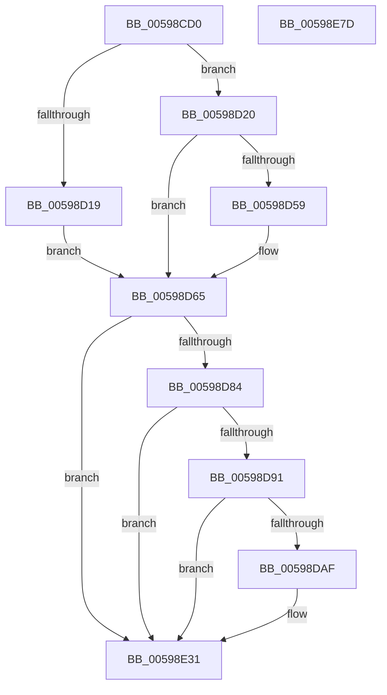

# IoWriteDeferredLiveDumpData

- RVA: `0x00598CD0`–`0x00598E7E` (길이 `430` bytes)
- VA: `0x0000000140598CD0`
- 실행 섹션: `.text`
- PDB 이름 있음: `예`; PDB Function 태그: `아니요`
- unwind 정보 RVA: `0x000C7C70`
- 디코드: `101`개 명령, `430/430` bytes 표시
- 미해석 바이트: `0` (있으면 어셈블리에 `.byte`로 보존)

> 이 문서는 커널 이미지의 기계어와 PDB 기호를 분석해 생성했습니다. 4번과 5번은 함수 원형과 자료형을 바이너리 사용 방식에서 추정한 C 해석이며 원본 소스 복구 결과는 아닙니다.

## 1. Dependencies

- 직접 호출 지점: **13**; 고유 호출 대상: **12**
- 직접 호출자로 확인된 함수: **1**
- RIP 상대 이미지 참조: **4**

### Outgoing calls
- `0x00598D02` → [IopLiveDumpTraceInterfaceStart](IopLiveDumpTraceInterfaceStart_function_0059EE0C.md) (function, `0x0059EE0C`)
- `0x00598D0E` → [IopLiveDumpTraceNoArgs](../5A/IopLiveDumpTraceNoArgs_function_005A43C0.md) (function, `0x005A43C0`)
- `0x00598D22` → [IopLiveDumpGetMillisecondCounter](../3F/IopLiveDumpGetMillisecondCounter_function_003F5964.md) (function, `0x003F5964`)
- `0x00598D2D` → [IopLiveDumpWriteDumpFile](../3F/IopLiveDumpWriteDumpFile_function_003F6360.md) (function, `0x003F6360`)
- `0x00598D36` → [IopLiveDumpGetMillisecondCounter](../3F/IopLiveDumpGetMillisecondCounter_function_003F5964.md) (function, `0x003F5964`)
- `0x00598D50` → [IopLiveDumpTraceDumpFileWriteEnd](IopLiveDumpTraceDumpFileWriteEnd_function_0059EB00.md) (function, `0x0059EB00`)
- `0x00598D73` → [IopLiveDumpTraceInterfaceEnd](IopLiveDumpTraceInterfaceEnd_function_0059EC24.md) (function, `0x0059EC24`)
- `0x00598DA2` → [tlgKeywordOn](../42/tlgKeywordOn_function_0042EAA0.md) (function, `0x0042EAA0`)
- `0x00598E2C` → [tlgWriteTransfer_EtwWriteTransfer](../42/tlgWriteTransfer_EtwWriteTransfer_function_004260E0.md) (function, `0x004260E0`)
- `0x00598E3D` → [EtwActivityIdControl](../41/EtwActivityIdControl_function_0041E720.md) (function, `0x0041E720`)
- `0x00598E45` → [IopLiveDumpReleaseResources](IopLiveDumpReleaseResources_function_0059DF1C.md) (function, `0x0059DF1C`)
- `0x00598E52` → [ExFreePoolWithTag](../../poolcode/B8/ExFreePoolWithTag_function_00B82870.md) (function, `0x00B82870`)
- `0x00598E60` → [_security_check_cookie](../6A/_security_check_cookie_function_006AC640.md) (function, `0x006AC640`)

### Direct callers
- [DbgkpWerDeferredWriteRoutine](../../page/71/DbgkpWerDeferredWriteRoutine_function_00712340.md) at `0x007123CB`

### Static image references
- `0x00598CEA` → RVA `0x00E0A740` (`.data`; read)
- `0x00598D07` → RVA `0x00022BA8` (`.rdata`; read)
- `0x00598D84` → RVA `0x00E06EA0` (`.data`; read)
- `0x00598DE6` → RVA `0x00046633` (`.rdata`; read)

## 2. Other-region calls and transfers

- 다른 실행 섹션으로 향하는 call: **1**
  - `0x00598E52` → [ExFreePoolWithTag](../../poolcode/B8/ExFreePoolWithTag_function_00B82870.md) (`.text` → `POOLCODE`)
- 별도 외부 분기/꼬리 이동을 확인하지 못했습니다.

## 3. Assembly (complete function range)

```asm
00598CD0  48 89 5C 24 10                  mov qword ptr [rsp + 0x10], rbx
00598CD5  48 89 74 24 18                  mov qword ptr [rsp + 0x18], rsi
00598CDA  55                              push rbp
00598CDB  57                              push rdi
00598CDC  41 56                           push r14
00598CDE  48 8D 6C 24 B9                  lea rbp, [rsp - 0x47]
00598CE3  48 81 EC B0 00 00 00            sub rsp, 0xb0
00598CEA  48 8B 05 4F 1A 87 00            mov rax, qword ptr [rip + 0x871a4f]
00598CF1  48 33 C4                        xor rax, rsp
00598CF4  48 89 45 37                     mov qword ptr [rbp + 0x37], rax
00598CF8  48 8B F9                        mov rdi, rcx
00598CFB  45 33 F6                        xor r14d, r14d
00598CFE  41 8D 4E 01                     lea ecx, [r14 + 1]
00598D02  E8 05 61 00 00                  call 0x14059ee0c
00598D07  48 8D 0D 9A 9E A8 FF            lea rcx, [rip - 0x576166]
00598D0E  E8 AD B6 00 00                  call 0x1405a43c0
00598D13  4C 39 77 40                     cmp qword ptr [rdi + 0x40], r14
00598D17  75 07                           jne 0x140598d20
00598D19  BE 08 00 00 C0                  mov esi, 0xc0000008
00598D1E  EB 45                           jmp 0x140598d65
00598D20  33 C9                           xor ecx, ecx
00598D22  E8 3D CC E5 FF                  call 0x1403f5964
00598D27  48 8B CF                        mov rcx, rdi
00598D2A  48 8B D8                        mov rbx, rax
00598D2D  E8 2E D6 E5 FF                  call 0x1403f6360
00598D32  33 C9                           xor ecx, ecx
00598D34  8B F0                           mov esi, eax
00598D36  E8 29 CC E5 FF                  call 0x1403f5964
00598D3B  4C 8B F0                        mov r14, rax
00598D3E  44 8B CE                        mov r9d, esi
00598D41  4C 2B F3                        sub r14, rbx
00598D44  41 B8 01 00 00 00               mov r8d, 1
00598D4A  49 8B D6                        mov rdx, r14
00598D4D  48 8B CF                        mov rcx, rdi
00598D50  E8 AB 5D 00 00                  call 0x14059eb00
00598D55  85 F6                           test esi, esi
00598D57  78 0C                           js 0x140598d65
00598D59  F6 47 50 02                     test byte ptr [rdi + 0x50], 2
00598D5D  B8 05 01 00 00                  mov eax, 0x105
00598D62  0F 45 F0                        cmovne esi, eax
00598D65  4D 8B CE                        mov r9, r14
00598D68  44 8B C6                        mov r8d, esi
00598D6B  BA 01 00 00 00                  mov edx, 1
00598D70  48 8B CF                        mov rcx, rdi
00598D73  E8 AC 5E 00 00                  call 0x14059ec24
00598D78  81 FE 08 00 00 C0               cmp esi, 0xc0000008
00598D7E  0F 84 AD 00 00 00               je 0x140598e31
00598D84  83 3D 15 E1 86 00 05            cmp dword ptr [rip + 0x86e115], 5
00598D8B  0F 86 A0 00 00 00               jbe 0x140598e31
00598D91  48 BA 00 00 00 00 00 40 00 00   movabs rdx, 0x400000000000
00598D9B  48 8D 0D FE E0 86 00            lea rcx, [rip + 0x86e0fe]
00598DA2  E8 F9 5C E9 FF                  call 0x14042eaa0
00598DA7  84 C0                           test al, al
00598DA9  0F 84 82 00 00 00               je 0x140598e31
00598DAF  83 65 13 00                     and dword ptr [rbp + 0x13], 0
00598DB3  48 8D 45 C7                     lea rax, [rbp - 0x39]
00598DB7  83 65 23 00                     and dword ptr [rbp + 0x23], 0
00598DBB  4C 8D 8F B8 03 00 00            lea r9, [rdi + 0x3b8]
00598DC2  83 65 33 00                     and dword ptr [rbp + 0x33], 0
00598DC6  4C 8D 87 C8 03 00 00            lea r8, [rdi + 0x3c8]
00598DCD  48 89 45 07                     mov qword ptr [rbp + 7], rax
00598DD1  BA 08 00 00 00                  mov edx, 8
00598DD6  48 8B 87 30 02 00 00            mov rax, qword ptr [rdi + 0x230]
00598DDD  89 55 0F                        mov dword ptr [rbp + 0xf], edx
00598DE0  89 55 1F                        mov dword ptr [rbp + 0x1f], edx
00598DE3  89 55 2F                        mov dword ptr [rbp + 0x2f], edx
00598DE6  48 8D 15 46 D8 AA FF            lea rdx, [rip - 0x5527ba]
00598DED  48 8B 88 A0 0F 00 00            mov rcx, qword ptr [rax + 0xfa0]
00598DF4  48 8D 45 CF                     lea rax, [rbp - 0x31]
00598DF8  48 89 45 17                     mov qword ptr [rbp + 0x17], rax
00598DFC  48 8D 45 D7                     lea rax, [rbp - 0x29]
00598E00  48 89 45 27                     mov qword ptr [rbp + 0x27], rax
00598E04  48 8D 45 E7                     lea rax, [rbp - 0x19]
00598E08  48 89 4D CF                     mov qword ptr [rbp - 0x31], rcx
00598E0C  48 8D 0D 8D E0 86 00            lea rcx, [rip + 0x86e08d]
00598E13  48 89 44 24 28                  mov qword ptr [rsp + 0x28], rax
00598E18  C7 44 24 20 05 00 00 00         mov dword ptr [rsp + 0x20], 5
00598E20  48 C7 45 C7 00 00 00 01         mov qword ptr [rbp - 0x39], 0x1000000
00598E28  4C 89 75 D7                     mov qword ptr [rbp - 0x29], r14
00598E2C  E8 AF D2 E8 FF                  call 0x1404260e0
00598E31  48 8D 97 B8 03 00 00            lea rdx, [rdi + 0x3b8]
00598E38  B9 02 00 00 00                  mov ecx, 2
00598E3D  E8 DE 58 E8 FF                  call 0x14041e720
00598E42  48 8B CF                        mov rcx, rdi
00598E45  E8 D2 50 00 00                  call 0x14059df1c
00598E4A  BA 4C 64 6D 70                  mov edx, 0x706d644c
00598E4F  48 8B CF                        mov rcx, rdi
00598E52  E8 19 9A 5E 00                  call 0x140b82870
00598E57  8B C6                           mov eax, esi
00598E59  48 8B 4D 37                     mov rcx, qword ptr [rbp + 0x37]
00598E5D  48 33 CC                        xor rcx, rsp
00598E60  E8 DB 37 11 00                  call 0x1406ac640
00598E65  4C 8D 9C 24 B0 00 00 00         lea r11, [rsp + 0xb0]
00598E6D  49 8B 5B 28                     mov rbx, qword ptr [r11 + 0x28]
00598E71  49 8B 73 30                     mov rsi, qword ptr [r11 + 0x30]
00598E75  49 8B E3                        mov rsp, r11
00598E78  41 5E                           pop r14
00598E7A  5F                              pop rdi
00598E7B  5D                              pop rbp
00598E7C  C3                              ret
00598E7D  CC                              int3
```

## 4. C-style interpretation (structured pseudocode)

```c
__int64 __fastcall IoWriteDeferredLiveDumpData(__int64 a1)
{
    __int64 result;
    __int64 v_r14;
    __int64 v_rsi;
    __int64 v_rsp;
    unsigned __int64 v_stack_m18;
    unsigned __int64 v_stack_m28;
    unsigned int v_stack_m2C;
    unsigned int v_stack_m30;
    unsigned __int64 v_stack_m38;
    unsigned int v_stack_m3C;
    unsigned int v_stack_m40;
    unsigned __int64 v_stack_m48;
    unsigned int v_stack_m4C;
    unsigned int v_stack_m50;
    unsigned __int64 v_stack_m58;
    unsigned __int64 v_stack_m5F;
    unsigned __int64 v_stack_m78;
    unsigned __int64 v_stack_m88;
    unsigned __int64 v_stack_m90;
    unsigned __int64 v_stack_m98;
    unsigned __int64 v_stack_mA0;
    unsigned int v_stack_mA8;
    unsigned __int64 v_stack_p10;
    unsigned __int64 v_stack_p18;

    v_stack_p10 = v_rbx;
    v_stack_p18 = v_rsi;
    v_rsp = (v_rsp) - (176);
    result = (*(unsigned __int64 *)(v_rip + 8854095)) ^ (v_rsp);
    v_stack_m28 = result;
    v_r14 = 0;
    result = IopLiveDumpTraceInterfaceStart(v_r14 + 1, a2, a3, a4);
    result = IopLiveDumpTraceNoArgs(v_rip - 5726566, a2, a3, a4);
    if ((*(unsigned __int64 *)(a1 + 64)) != 0) goto loc_00598D20;
    goto loc_00598D65;
loc_00598D20:
    a1 = 0;
    result = IopLiveDumpGetMillisecondCounter(a1, a2, a3, a4);
    result = IopLiveDumpWriteDumpFile(0, a2, a3, a4);
    a1 = 0;
    result = IopLiveDumpGetMillisecondCounter(a1, a2, a3, a4);
    v_r14 = (result) - (result);
    result = IopLiveDumpTraceDumpFileWriteEnd(0, v_r14, 1, (unsigned int)((unsigned int)((unsigned int)((unsigned int)(result)))));
    v_rsi = (unsigned int)((unsigned int)(result));
    if (!(sign_flag)) {
        result = 261;
        v_rsi = (unsigned int)((unsigned int)(result));
        if (((*(unsigned __int8 *)(a1 + 80)) & (2)) != 0) { v_rsi = (unsigned int)(result); }
    }
    result = IopLiveDumpTraceInterfaceEnd(0, 1, (unsigned int)((unsigned int)(v_rsi)), v_r14);
    if (((unsigned int)(v_rsi)) == 0xC0000008ULL) goto loc_00598E31;
    if ((*(unsigned int *)(v_rip + 8839445)) <= 5) goto loc_00598E31;
    result = tlgKeywordOn(v_rip + 8839422, 1, (unsigned int)((unsigned int)(v_rsi)), v_r14);
    if ((unsigned __int8)(result) != 0) {
        result = v_stack_m98;
        a4 = a1 + 952;
        a3 = a1 + 968;
        v_stack_m58 = result;
        a2 = 8;
        result = *(unsigned __int64 *)(a1 + 560);
        v_stack_m50 = (unsigned int)(a2);
        v_stack_m40 = (unsigned int)(a2);
        v_stack_m30 = (unsigned int)(a2);
        a2 = v_rip - 5580730;
        a1 = *(unsigned __int64 *)(result + 4000);
        result = v_stack_m90;
        v_stack_m48 = result;
        result = v_stack_m88;
        v_stack_m38 = result;
        result = v_stack_m78;
        v_stack_m90 = a1;
        a1 = v_rip + 8839309;
        v_stack_mA0 = result;
        v_stack_mA8 = 5;
        v_stack_m98 = 0x1000000ULL;
        v_stack_m88 = v_r14;
        result = tlgWriteTransfer_EtwWriteTransfer(a1, a2, a3, a4);
    }
    result = EtwActivityIdControl(2, a1 + 952, a3, a4);
    result = IopLiveDumpReleaseResources(a1, a1 + 952, a3, a4);
    result = ExFreePoolWithTag(a1, (unsigned int)(0x706D644CULL), a3, a4);
    a1 = (v_stack_m28) ^ (v_rsp);
    result = _security_check_cookie(a1, (unsigned int)(0x706D644CULL), a3, a4);
    return result;
}
```

## 5. (Beta) C Style

```c
int64_t IoWriteDeferredLiveDumpData(void *Arg1)
{
    uint8_t *arg1 = (uint8_t *)Arg1;

    int64_t result;
    int64_t local_r14;
    int64_t local_rsi;
    int64_t local_rsp;
    uint64_t v_stack_m18;
    uint64_t v_stack_m28;
    uint32_t v_stack_m2C;
    uint32_t v_stack_m30;
    uint64_t v_stack_m38;
    uint32_t v_stack_m3C;
    uint32_t v_stack_m40;
    uint64_t v_stack_m48;
    uint32_t v_stack_m4C;
    uint32_t v_stack_m50;
    uint64_t v_stack_m58;
    uint64_t v_stack_m5F;
    uint64_t v_stack_m78;
    uint64_t v_stack_m88;
    uint64_t v_stack_m90;
    uint64_t v_stack_m98;
    uint64_t v_stack_mA0;
    uint32_t v_stack_mA8;
    uint64_t v_stack_p10;
    uint64_t v_stack_p18;

    v_stack_p10 = local_rbx;
    v_stack_p18 = local_rsi;
    local_rsp = (local_rsp) - (176);
    result = (*(uint64_t *)(v_rip + 0x871A4F)) ^ (local_rsp);
    v_stack_m28 = result;
    local_r14 = 0;
    result = IopLiveDumpTraceInterfaceStart(local_r14 + 1, a2, a3, a4);
    result = IopLiveDumpTraceNoArgs(v_rip - 5726566, a2, a3, a4);
    if ((*(uint64_t *)(arg1 + 0x40)) != 0) goto loc_00598D20;
    goto loc_00598D65;
loc_00598D20:
    Arg1 = 0;
    result = IopLiveDumpGetMillisecondCounter(Arg1, a2, a3, a4);
    result = IopLiveDumpWriteDumpFile(0, a2, a3, a4);
    Arg1 = 0;
    result = IopLiveDumpGetMillisecondCounter(Arg1, a2, a3, a4);
    local_r14 = (result) - (result);
    result = IopLiveDumpTraceDumpFileWriteEnd(0, local_r14, 1, (uint32_t)((uint32_t)((uint32_t)((uint32_t)(result)))));
    local_rsi = (uint32_t)((uint32_t)(result));
    if (!(sign_flag)) {
        result = 261;
        local_rsi = (uint32_t)((uint32_t)(result));
        if (((*(uint8_t *)(arg1 + 0x50)) & (2)) != 0) { local_rsi = (uint32_t)(result); }
    }
    result = IopLiveDumpTraceInterfaceEnd(0, 1, (uint32_t)((uint32_t)(local_rsi)), local_r14);
    if (((uint32_t)(local_rsi)) == 0xC0000008ULL) goto loc_00598E31;
    if ((*(uint32_t *)(v_rip + 0x86E115)) <= 5) goto loc_00598E31;
    result = tlgKeywordOn(v_rip + 8839422, 1, (uint32_t)((uint32_t)(local_rsi)), local_r14);
    if ((uint8_t)(result) != 0) {
        result = v_stack_m98;
        a4 = Arg1 + 952;
        a3 = Arg1 + 968;
        v_stack_m58 = result;
        a2 = 8;
        result = *(uint64_t *)(arg1 + 0x230);
        v_stack_m50 = (uint32_t)(a2);
        v_stack_m40 = (uint32_t)(a2);
        v_stack_m30 = (uint32_t)(a2);
        a2 = v_rip - 5580730;
        Arg1 = *(uint64_t *)(result + 0xFA0);
        result = v_stack_m90;
        v_stack_m48 = result;
        result = v_stack_m88;
        v_stack_m38 = result;
        result = v_stack_m78;
        v_stack_m90 = Arg1;
        Arg1 = v_rip + 8839309;
        v_stack_mA0 = result;
        v_stack_mA8 = 5;
        v_stack_m98 = 0x1000000ULL;
        v_stack_m88 = local_r14;
        result = tlgWriteTransfer_EtwWriteTransfer(Arg1, a2, a3, a4);
    }
    result = EtwActivityIdControl(2, Arg1 + 952, a3, a4);
    result = IopLiveDumpReleaseResources(Arg1, Arg1 + 952, a3, a4);
    result = ExFreePoolWithTag(Arg1, (uint32_t)(0x706D644CULL), a3, a4);
    Arg1 = (v_stack_m28) ^ (local_rsp);
    result = _security_check_cookie(Arg1, (uint32_t)(0x706D644CULL), a3, a4);
    return result;
}
```

### 관측된 메모리 오프셋

구조체 형식이 확인되지 않은 접근은 인자 기준의 오프셋으로만 기록했습니다.

| 기준 인자 | 오프셋 표현 | 폭 (bit) | 접근 |
|---|---:|---:|---|
| `Arg1` | `+ 0x40` | `64` | `R` |
| `Arg1` | `+ 0x50` | `8` | `R` |
| `Arg1` | `+ 0x230` | `64` | `R` |
| `Arg1` | `+ 0x3B8` | `64` | `R` |
| `Arg1` | `+ 0x3C8` | `64` | `R` |

## 6. Execution-region graph

[열기: 2D/3D 그래프와 함수 탐색 컨트롤 패널](../../../control-panel.html?section=text&rva=0x00598CD0&view=graph)

- 2D 그래프는 위에서 아래로 흐르고, 3D 그래프는 빈 공간을 드래그해 회전합니다. Shift+드래그는 이동, 휠은 확대·축소, 함수 노드 선택은 대상 보고서 이동입니다.

### Static fallback


