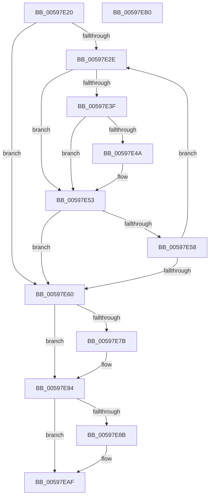

# IopAddBootDiskInformation

- RVA: `0x00597E20`–`0x00597EB1` (길이 `145` bytes)
- VA: `0x0000000140597E20`
- 실행 섹션: `.text`
- PDB 이름 있음: `예`; PDB Function 태그: `아니요`
- unwind 정보 RVA: `0x000DB714`
- 디코드: `42`개 명령, `145/145` bytes 표시
- 미해석 바이트: `0` (있으면 어셈블리에 `.byte`로 보존)

> 이 문서는 커널 이미지의 기계어와 PDB 기호를 분석해 생성했습니다. 4번과 5번은 함수 원형과 자료형을 바이너리 사용 방식에서 추정한 C 해석이며 원본 소스 복구 결과는 아닙니다.

## 1. Dependencies

- 직접 호출 지점: **0**; 고유 호출 대상: **0**
- 직접 호출자로 확인된 함수: **1**
- RIP 상대 이미지 참조: **0**

### Outgoing calls
- 직접 디코드된 call 명령이 없습니다.

### Direct callers
- [IopGetBootDiskInformationLite](../../init/C2/IopGetBootDiskInformationLite_function_00C2DF64.md) at `0x00C2E12F`
- [IopGetBootDiskInformationLite](../../init/C2/IopGetBootDiskInformationLite_function_00C2DF64.md) at `0x00C2E1EF`

### Static image references
- 디코드된 RIP-relative 메모리 참조가 없습니다.

## 2. Other-region calls and transfers

- 다른 실행 섹션으로 향하는 call: **0**
- 별도 외부 분기/꼬리 이동을 확인하지 못했습니다.

## 3. Assembly (complete function range)

```asm
00597E20  44 8B 19                        mov r11d, dword ptr [rcx]
00597E23  45 33 C0                        xor r8d, r8d
00597E26  4C 8B CA                        mov r9, rdx
00597E29  45 85 DB                        test r11d, r11d
00597E2C  74 32                           je 0x140597e60
00597E2E  41 8B C0                        mov eax, r8d
00597E31  4C 6B D0 1C                     imul r10, rax, 0x1c
00597E35  49 8B 54 0A 04                  mov rdx, qword ptr [r10 + rcx + 4]
00597E3A  49 2B 11                        sub rdx, qword ptr [r9]
00597E3D  75 14                           jne 0x140597e53
00597E3F  49 8B 54 0A 0C                  mov rdx, qword ptr [r10 + rcx + 0xc]
00597E44  49 2B 51 08                     sub rdx, qword ptr [r9 + 8]
00597E48  75 09                           jne 0x140597e53
00597E4A  49 8B 54 0A 14                  mov rdx, qword ptr [r10 + rcx + 0x14]
00597E4F  49 2B 51 10                     sub rdx, qword ptr [r9 + 0x10]
00597E53  48 85 D2                        test rdx, rdx
00597E56  74 08                           je 0x140597e60
00597E58  41 FF C0                        inc r8d
00597E5B  45 3B C3                        cmp r8d, r11d
00597E5E  72 CE                           jb 0x140597e2e
00597E60  41 8B 51 18                     mov edx, dword ptr [r9 + 0x18]
00597E64  41 8B C0                        mov eax, r8d
00597E67  4C 6B D0 1C                     imul r10, rax, 0x1c
00597E6B  41 0B 54 0A 1C                  or edx, dword ptr [r10 + rcx + 0x1c]
00597E70  41 89 54 0A 1C                  mov dword ptr [r10 + rcx + 0x1c], edx
00597E75  0F BA E2 08                     bt edx, 8
00597E79  73 09                           jae 0x140597e84
00597E7B  0F BA F2 16                     btr edx, 0x16
00597E7F  41 89 54 0A 1C                  mov dword ptr [r10 + rcx + 0x1c], edx
00597E84  8B 01                           mov eax, dword ptr [rcx]
00597E86  44 3B C0                        cmp r8d, eax
00597E89  75 24                           jne 0x140597eaf
00597E8B  FF C0                           inc eax
00597E8D  89 01                           mov dword ptr [rcx], eax
00597E8F  41 0F 10 01                     movups xmm0, xmmword ptr [r9]
00597E93  41 0F 11 44 0A 04               movups xmmword ptr [r10 + rcx + 4], xmm0
00597E99  F2 41 0F 10 49 10               movsd xmm1, qword ptr [r9 + 0x10]
00597E9F  F2 41 0F 11 4C 0A 14            movsd qword ptr [r10 + rcx + 0x14], xmm1
00597EA6  41 8B 41 18                     mov eax, dword ptr [r9 + 0x18]
00597EAA  41 89 44 0A 1C                  mov dword ptr [r10 + rcx + 0x1c], eax
00597EAF  C3                              ret
00597EB0  CC                              int3
```

## 4. C-style interpretation (structured pseudocode)

```c
__int64 __fastcall IopAddBootDiskInformation(__int64 a1, __int64 a2, int a3)
{
    __int64 result;
    __int64 v_r10;

    a3 = 0;
    if ((unsigned int)((unsigned int)(*(unsigned int *)(a1))) == 0) goto loc_00597E60;
loc_00597E2E:
    v_r10 = (v_r10) * (0);
    a2 = (*(unsigned __int64 *)(v_r10 + a1 * 1 + 4)) - (*(unsigned __int64 *)(a2));
    if (condition_is_not_equal) goto loc_00597E53;
    a2 = (*(unsigned __int64 *)(v_r10 + a1 * 1 + 12)) - (*(unsigned __int64 *)(a2 + 8));
    if (!(condition_is_not_equal)) {
        a2 = *(unsigned __int64 *)(v_r10 + a1 * 1 + 20);
        a2 = (a2) - (*(unsigned __int64 *)(a2 + 16));
    }
    if (a2 == 0) goto loc_00597E60;
    a3 = (unsigned int)((a3) + 1);
    if (a3 < ((unsigned int)((unsigned int)(*(unsigned int *)(a1))))) goto loc_00597E2E;
loc_00597E60:
    v_r10 = (v_r10) * ((unsigned int)(a3));
    a2 = (unsigned int)(((unsigned int)(*(unsigned int *)(a2 + 24))) | (*(unsigned int *)(v_r10 + a1 * 1 + 28)));
    *(unsigned int *)(v_r10 + a1 * 1 + 28) = (unsigned int)(a2);
    if (!(condition_is_above_or_equal)) {
        *(unsigned int *)(v_r10 + a1 * 1 + 28) = (unsigned int)(a2);
    }
    result = (unsigned int)(*(unsigned int *)(a1));
    if (a3 == ((unsigned int)((unsigned int)(*(unsigned int *)(a1))))) {
        result = (unsigned int)(((unsigned int)(*(unsigned int *)(a1))) + 1);
        *(unsigned int *)(a1) = (unsigned int)(result);
        *(unsigned __int64 *)(v_r10 + a1 * 1 + 4) = v_xmm0;
        *(unsigned __int64 *)(v_r10 + a1 * 1 + 20) = v_xmm1;
        result = *(unsigned int *)(a2 + 24);
        *(unsigned int *)(v_r10 + a1 * 1 + 28) = (unsigned int)(result);
    }
    return result;
}
```

## 5. (Beta) C Style

```c
int64_t IopAddBootDiskInformation(void *Arg1, void *Arg2, int32_t Arg3)
{
    uint8_t *arg1 = (uint8_t *)Arg1;
    uint8_t *arg2 = (uint8_t *)Arg2;

    int64_t result;
    int64_t local_r10;

    Arg3 = 0;
    if ((uint32_t)((uint32_t)(*(uint32_t *)(arg1))) == 0) goto loc_00597E60;
loc_00597E2E:
    local_r10 = (local_r10) * (0);
    Arg2 = (*(uint64_t *)(local_r10 + arg1 * 1 + 0x4)) - (*(uint64_t *)(arg2));
    if (condition_is_not_equal) goto loc_00597E53;
    Arg2 = (*(uint64_t *)(local_r10 + arg1 * 1 + 0xC)) - (*(uint64_t *)(arg2 + 0x8));
    if (!(condition_is_not_equal)) {
        Arg2 = *(uint64_t *)(local_r10 + arg1 * 1 + 0x14);
        Arg2 = (Arg2) - (*(uint64_t *)(arg2 + 0x10));
    }
    if (Arg2 == NULL) goto loc_00597E60;
    Arg3 = (uint32_t)((Arg3) + 1);
    if (Arg3 < ((uint32_t)((uint32_t)(*(uint32_t *)(arg1))))) goto loc_00597E2E;
loc_00597E60:
    local_r10 = (local_r10) * ((uint32_t)(Arg3));
    Arg2 = (uint32_t)(((uint32_t)(*(uint32_t *)(arg2 + 0x18))) | (*(uint32_t *)(local_r10 + arg1 * 1 + 0x1C)));
    *(uint32_t *)(local_r10 + arg1 * 1 + 0x1C) = (uint32_t)(Arg2);
    if (!(condition_is_above_or_equal)) {
        *(uint32_t *)(local_r10 + arg1 * 1 + 0x1C) = (uint32_t)(Arg2);
    }
    result = (uint32_t)(*(uint32_t *)(arg1));
    if (Arg3 == ((uint32_t)((uint32_t)(*(uint32_t *)(arg1))))) {
        result = (uint32_t)(((uint32_t)(*(uint32_t *)(arg1))) + 1);
        *(uint32_t *)(arg1) = (uint32_t)(result);
        *(uint64_t *)(local_r10 + arg1 * 1 + 0x4) = v_xmm0;
        *(uint64_t *)(local_r10 + arg1 * 1 + 0x14) = v_xmm1;
        result = *(uint32_t *)(arg2 + 0x18);
        *(uint32_t *)(local_r10 + arg1 * 1 + 0x1C) = (uint32_t)(result);
    }
    return result;
}
```

### 관측된 메모리 오프셋

구조체 형식이 확인되지 않은 접근은 인자 기준의 오프셋으로만 기록했습니다.

| 기준 인자 | 오프셋 표현 | 폭 (bit) | 접근 |
|---|---:|---:|---|
| `Arg1` | `+ 0x0` | `32` | `R` |
| `Arg1` | `+ 0x0` | `32` | `W` |
| `Arg2` | `+ 0x0` | `64` | `R` |
| `Arg2` | `+ 0x0` | `128` | `R` |
| `Arg2` | `+ 0x8` | `64` | `R` |
| `Arg2` | `+ 0x10` | `64` | `R` |
| `Arg2` | `+ 0x18` | `32` | `R` |

## 6. Execution-region graph

[열기: 2D/3D 그래프와 함수 탐색 컨트롤 패널](../../../control-panel.html?section=text&rva=0x00597E20&view=graph)

- 2D 그래프는 위에서 아래로 흐르고, 3D 그래프는 빈 공간을 드래그해 회전합니다. Shift+드래그는 이동, 휠은 확대·축소, 함수 노드 선택은 대상 보고서 이동입니다.

### Static fallback


