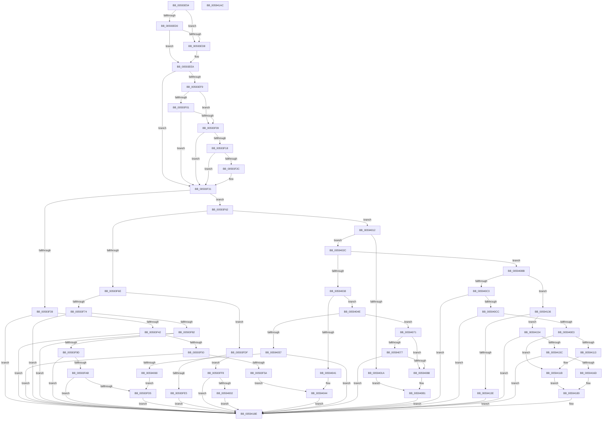

# IopAddBugcheckTriageDataFromParameters

- RVA: `0x00593E54`–`0x005941AD` (길이 `857` bytes)
- VA: `0x0000000140593E54`
- 실행 섹션: `.text`
- PDB 이름 있음: `예`; PDB Function 태그: `아니요`
- unwind 정보 RVA: `0x000C4294`
- 디코드: `218`개 명령, `857/857` bytes 표시
- 미해석 바이트: `0` (있으면 어셈블리에 `.byte`로 보존)

> 이 문서는 커널 이미지의 기계어와 PDB 기호를 분석해 생성했습니다. 4번과 5번은 함수 원형과 자료형을 바이너리 사용 방식에서 추정한 C 해석이며 원본 소스 복구 결과는 아닙니다.

## 1. Dependencies

- 직접 호출 지점: **34**; 고유 호출 대상: **14**
- 직접 호출자로 확인된 함수: **1**
- RIP 상대 이미지 참조: **0**

### Outgoing calls
- `0x00593E91` → [IoAddTriageDumpDataBlock](../42/IoAddTriageDumpDataBlock_function_00428374.md) (function, `0x00428374`)
- `0x00593E9F` → [IoAddTriageDumpDataBlock](../42/IoAddTriageDumpDataBlock_function_00428374.md) (function, `0x00428374`)
- `0x00593EAD` → [IoAddTriageDumpDataBlock](../42/IoAddTriageDumpDataBlock_function_00428374.md) (function, `0x00428374`)
- `0x00593EC3` → [IoAddTriageDumpDataBlock](../42/IoAddTriageDumpDataBlock_function_00428374.md) (function, `0x00428374`)
- `0x00593EE5` → [IoAddTriageDumpDataBlock](../42/IoAddTriageDumpDataBlock_function_00428374.md) (function, `0x00428374`)
- `0x00593EEA` → [Feature_14FBugcheckMinidumpDiagnostics__private_IsEnabledDeviceUsageNoInline](Feature_14FBugcheckMinidumpDiagnostics__private_IsEnabledDeviceUsageNoInline_function_005919CC.md) (function, `0x005919CC`)
- `0x00593F0F` → [IopIsAddressRangeValid](../4B/IopIsAddressRangeValid_function_004B6CBC.md) (function, `0x004B6CBC`)
- `0x00593F1E` → [IoAddTriageDumpDataBlock](../42/IoAddTriageDumpDataBlock_function_00428374.md) (function, `0x00428374`)
- `0x00593F2C` → [IopAddBugcheckTriageThread](../5A/IopAddBugcheckTriageThread_function_005A0CF8.md) (function, `0x005A0CF8`)
- `0x00593F74` → [PnpSaveGlobalsToMinidump](../5A/PnpSaveGlobalsToMinidump_function_005A6440.md) (function, `0x005A6440`)
- `0x00593F85` → [IopAddBugcheckTriageThread](../5A/IopAddBugcheckTriageThread_function_005A0CF8.md) (function, `0x005A0CF8`)
- `0x00593F90` → [IopIsAddressRangeValid](../4B/IopIsAddressRangeValid_function_004B6CBC.md) (function, `0x004B6CBC`)
- `0x00593FB1` → [IoAddTriageDumpDataBlock](../42/IoAddTriageDumpDataBlock_function_00428374.md) (function, `0x00428374`)
- `0x00593FBA` → [IopAddBugcheckTriageCompletionQueue](../5A/IopAddBugcheckTriageCompletionQueue_function_005A0758.md) (function, `0x005A0758`)
- `0x00593FC3` → [IopAddBugcheckTriageWorkQueue](../5A/IopAddBugcheckTriageWorkQueue_function_005A0E88.md) (function, `0x005A0E88`)
- `0x00593FD5` → [IopAddBugcheckTriageDeviceNode](../5A/IopAddBugcheckTriageDeviceNode_function_005A091C.md) (function, `0x005A091C`)
- `0x00593FEE` → [IopAddBugcheckPowerTriageData](../5A/IopAddBugcheckPowerTriageData_function_005A06C8.md) (function, `0x005A06C8`)
- `0x00594008` → [IopAddBugcheckDirectedTransitionTriageData](../5A/IopAddBugcheckDirectedTransitionTriageData_function_005A0518.md) (function, `0x005A0518`)
- `0x0059401A` → [PnpSaveGlobalsToMinidump](../5A/PnpSaveGlobalsToMinidump_function_005A6440.md) (function, `0x005A6440`)
- `0x00594044` → [IopAddBugcheckTriageThread](../5A/IopAddBugcheckTriageThread_function_005A0CF8.md) (function, `0x005A0CF8`)
- `0x0059405B` → [IopAddBugcheckTriageDeviceNode](../5A/IopAddBugcheckTriageDeviceNode_function_005A091C.md) (function, `0x005A091C`)
- `0x00594093` → [memset](../6C/memset_function_006C6C40.md) (function, `0x006C6C40`)
- `0x00594098` → [PnpSaveGlobalsToMinidump](../5A/PnpSaveGlobalsToMinidump_function_005A6440.md) (function, `0x005A6440`)
- `0x005940A2` → [PnpInitializeTriageBlock](../5A/PnpInitializeTriageBlock_function_005A63C8.md) (function, `0x005A63C8`)
- `0x005940B1` → [IopAddBugcheckPnpWatchdogTriageData](../5A/IopAddBugcheckPnpWatchdogTriageData_function_005A0608.md) (function, `0x005A0608`)
- `0x005940D6` → [IopIsAddressRangeValid](../4B/IopIsAddressRangeValid_function_004B6CBC.md) (function, `0x004B6CBC`)
- `0x005940E8` → [IoAddTriageDumpDataBlock](../42/IoAddTriageDumpDataBlock_function_00428374.md) (function, `0x00428374`)
- `0x005940F9` → [IoAddTriageDumpDataBlock](../42/IoAddTriageDumpDataBlock_function_00428374.md) (function, `0x00428374`)
- `0x0059410A` → [IopIsAddressRangeValid](../4B/IopIsAddressRangeValid_function_004B6CBC.md) (function, `0x004B6CBC`)
- `0x00594116` → [IopAddBugcheckTriageThread](../5A/IopAddBugcheckTriageThread_function_005A0CF8.md) (function, `0x005A0CF8`)
- `0x00594141` → [IopAddBugcheckTriageThread](../5A/IopAddBugcheckTriageThread_function_005A0CF8.md) (function, `0x005A0CF8`)
- `0x0059414D` → [PopInternalAddToDumpFile](../5C/PopInternalAddToDumpFile_function_005CE634.md) (function, `0x005CE634`)
- `0x00594164` → [IopIsAddressRangeValid](../4B/IopIsAddressRangeValid_function_004B6CBC.md) (function, `0x004B6CBC`)
- `0x00594189` → [IoAddTriageDumpDataBlock](../42/IoAddTriageDumpDataBlock_function_00428374.md) (function, `0x00428374`)

### Direct callers
- [IopUpdateMinidumpContext](IopUpdateMinidumpContext_function_00596360.md) at `0x0059663A`

### Static image references
- 디코드된 RIP-relative 메모리 참조가 없습니다.

## 2. Other-region calls and transfers

- 다른 실행 섹션으로 향하는 call: **0**
- 별도 외부 분기/꼬리 이동을 확인하지 못했습니다.

## 3. Assembly (complete function range)

```asm
00593E54  48 89 5C 24 08                  mov qword ptr [rsp + 8], rbx
00593E59  48 89 6C 24 10                  mov qword ptr [rsp + 0x10], rbp
00593E5E  48 89 74 24 18                  mov qword ptr [rsp + 0x18], rsi
00593E63  57                              push rdi
00593E64  41 54                           push r12
00593E66  41 55                           push r13
00593E68  41 56                           push r14
00593E6A  41 57                           push r15
00593E6C  48 83 EC 70                     sub rsp, 0x70
00593E70  8B F1                           mov esi, ecx
00593E72  48 8B EA                        mov rbp, rdx
00593E75  48 8B CA                        mov rcx, rdx
00593E78  49 C7 C4 00 F0 FF FF            mov r12, 0xfffffffffffff000
00593E7F  41 BD 00 10 00 00               mov r13d, 0x1000
00593E85  49 23 CC                        and rcx, r12
00593E88  41 8B D5                        mov edx, r13d
00593E8B  4D 8B F1                        mov r14, r9
00593E8E  49 8B F8                        mov rdi, r8
00593E91  E8 DE 44 E9 FF                  call 0x140428374
00593E96  48 8B CF                        mov rcx, rdi
00593E99  41 8B D5                        mov edx, r13d
00593E9C  49 23 CC                        and rcx, r12
00593E9F  E8 D0 44 E9 FF                  call 0x140428374
00593EA4  49 8B CE                        mov rcx, r14
00593EA7  41 8B D5                        mov edx, r13d
00593EAA  49 23 CC                        and rcx, r12
00593EAD  E8 C2 44 E9 FF                  call 0x140428374
00593EB2  48 8B 9C 24 C0 00 00 00         mov rbx, qword ptr [rsp + 0xc0]
00593EBA  41 8B D5                        mov edx, r13d
00593EBD  48 8B CB                        mov rcx, rbx
00593EC0  49 23 CC                        and rcx, r12
00593EC3  E8 AC 44 E9 FF                  call 0x140428374
00593EC8  81 FE CD 00 00 00               cmp esi, 0xcd
00593ECE  74 08                           je 0x140593ed8
00593ED0  81 FE D6 00 00 00               cmp esi, 0xd6
00593ED6  75 12                           jne 0x140593eea
00593ED8  48 8D 8D 00 F0 FF FF            lea rcx, [rbp - 0x1000]
00593EDF  41 8B D5                        mov edx, r13d
00593EE2  49 23 CC                        and rcx, r12
00593EE5  E8 8A 44 E9 FF                  call 0x140428374
00593EEA  E8 DD DA FF FF                  call 0x1405919cc
00593EEF  41 BF 28 00 00 00               mov r15d, 0x28
00593EF5  85 C0                           test eax, eax
00593EF7  75 38                           jne 0x140593f31
00593EF9  81 FE 4F 01 00 00               cmp esi, 0x14f
00593EFF  74 08                           je 0x140593f09
00593F01  81 FE 5C 01 00 00               cmp esi, 0x15c
00593F07  75 28                           jne 0x140593f31
00593F09  49 8B D7                        mov rdx, r15
00593F0C  48 8B CB                        mov rcx, rbx
00593F0F  E8 A8 2D F2 FF                  call 0x1404b6cbc
00593F14  84 C0                           test al, al
00593F16  74 19                           je 0x140593f31
00593F18  41 8B D7                        mov edx, r15d
00593F1B  48 8B CB                        mov rcx, rbx
00593F1E  E8 51 44 E9 FF                  call 0x140428374
00593F23  48 8B 4B 08                     mov rcx, qword ptr [rbx + 8]
00593F27  48 85 C9                        test rcx, rcx
00593F2A  74 05                           je 0x140593f31
00593F2C  E8 C7 CD 00 00                  call 0x1405a0cf8
00593F31  81 FE 9C 01 00 00               cmp esi, 0x19c
00593F37  75 29                           jne 0x140593f62
00593F39  48 85 FF                        test rdi, rdi
00593F3C  0F 84 4C 02 00 00               je 0x14059418e
00593F42  48 83 C5 F0                     add rbp, -0x10
00593F46  48 83 FD 40                     cmp rbp, 0x40
00593F4A  0F 87 3E 02 00 00               ja 0x14059418e
00593F50  40 F6 C5 0F                     test bpl, 0xf
00593F54  0F 85 34 02 00 00               jne 0x14059418e
00593F5A  48 8B CF                        mov rcx, rdi
00593F5D  E9 E2 00 00 00                  jmp 0x140594044
00593F62  81 FE 9F 00 00 00               cmp esi, 0x9f
00593F68  0F 85 A4 00 00 00               jne 0x140594012
00593F6E  48 83 FD 04                     cmp rbp, 4
00593F72  75 6B                           jne 0x140593fdf
00593F74  E8 C7 24 01 00                  call 0x1405a6440
00593F79  4D 85 F6                        test r14, r14
00593F7C  0F 84 0C 02 00 00               je 0x14059418e
00593F82  49 8B CE                        mov rcx, r14
00593F85  E8 6E CD 00 00                  call 0x1405a0cf8
00593F8A  49 8B D7                        mov rdx, r15
00593F8D  48 8B CB                        mov rcx, rbx
00593F90  E8 27 2D F2 FF                  call 0x1404b6cbc
00593F95  84 C0                           test al, al
00593F97  0F 84 F1 01 00 00               je 0x14059418e
00593F9D  B8 01 80 00 00                  mov eax, 0x8001
00593FA2  66 39 03                        cmp word ptr [rbx], ax
00593FA5  0F 85 E3 01 00 00               jne 0x14059418e
00593FAB  41 8B D7                        mov edx, r15d
00593FAE  48 8B CB                        mov rcx, rbx
00593FB1  E8 BE 43 E9 FF                  call 0x140428374
00593FB6  48 8B 4B 08                     mov rcx, qword ptr [rbx + 8]
00593FBA  E8 99 C7 00 00                  call 0x1405a0758
00593FBF  48 8B 4B 10                     mov rcx, qword ptr [rbx + 0x10]
00593FC3  E8 C0 CE 00 00                  call 0x1405a0e88
00593FC8  48 8B 4B 20                     mov rcx, qword ptr [rbx + 0x20]
00593FCC  48 85 C9                        test rcx, rcx
00593FCF  0F 84 B9 01 00 00               je 0x14059418e
00593FD5  E8 42 C9 00 00                  call 0x1405a091c
00593FDA  E9 AF 01 00 00                  jmp 0x14059418e
00593FDF  48 83 FD 03                     cmp rbp, 3
00593FE3  75 13                           jne 0x140593ff8
00593FE5  4C 8B C3                        mov r8, rbx
00593FE8  49 8B D6                        mov rdx, r14
00593FEB  48 8B CF                        mov rcx, rdi
00593FEE  E8 D5 C6 00 00                  call 0x1405a06c8
00593FF3  E9 96 01 00 00                  jmp 0x14059418e
00593FF8  48 83 FD 05                     cmp rbp, 5
00593FFC  0F 85 8C 01 00 00               jne 0x14059418e
00594002  48 8B D3                        mov rdx, rbx
00594005  48 8B CF                        mov rcx, rdi
00594008  E8 0B C5 00 00                  call 0x1405a0518
0059400D  E9 7C 01 00 00                  jmp 0x14059418e
00594012  81 FE D5 01 00 00               cmp esi, 0x1d5
00594018  75 12                           jne 0x14059402c
0059401A  E8 21 24 01 00                  call 0x1405a6440
0059401F  4D 8B C6                        mov r8, r14
00594022  B2 01                           mov dl, 1
00594024  48 8B CF                        mov rcx, rdi
00594027  E9 85 00 00 00                  jmp 0x1405940b1
0059402C  81 FE A0 00 00 00               cmp esi, 0xa0
00594032  0F 85 83 00 00 00               jne 0x1405940bb
00594038  48 81 FD 18 06 00 00            cmp rbp, 0x618
0059403F  75 0D                           jne 0x14059404e
00594041  49 8B CE                        mov rcx, r14
00594044  E8 AF CC 00 00                  call 0x1405a0cf8
00594049  E9 40 01 00 00                  jmp 0x14059418e
0059404E  48 81 FD 19 06 00 00            cmp rbp, 0x619
00594055  75 1A                           jne 0x140594071
00594057  48 8B 4F 30                     mov rcx, qword ptr [rdi + 0x30]
0059405B  E8 BC C8 00 00                  call 0x1405a091c
00594060  48 85 DB                        test rbx, rbx
00594063  0F 84 25 01 00 00               je 0x14059418e
00594069  48 8B CB                        mov rcx, rbx
0059406C  E9 64 FF FF FF                  jmp 0x140593fd5
00594071  48 83 FD 0F                     cmp rbp, 0xf
00594075  74 11                           je 0x140594088
00594077  48 8D 85 10 FF FF FF            lea rax, [rbp - 0xf0]
0059407E  48 83 F8 01                     cmp rax, 1
00594082  0F 87 06 01 00 00               ja 0x14059418e
00594088  33 D2                           xor edx, edx
0059408A  48 8D 4C 24 20                  lea rcx, [rsp + 0x20]
0059408F  44 8D 42 50                     lea r8d, [rdx + 0x50]
00594093  E8 A8 2B 13 00                  call 0x1406c6c40
00594098  E8 A3 23 01 00                  call 0x1405a6440
0059409D  48 8D 4C 24 20                  lea rcx, [rsp + 0x20]
005940A2  E8 21 23 01 00                  call 0x1405a63c8
005940A7  4C 8B C3                        mov r8, rbx
005940AA  48 8D 4C 24 20                  lea rcx, [rsp + 0x20]
005940AF  33 D2                           xor edx, edx
005940B1  E8 52 C5 00 00                  call 0x1405a0608
005940B6  E9 D3 00 00 00                  jmp 0x14059418e
005940BB  81 FE 01 01 00 00               cmp esi, 0x101
005940C1  75 73                           jne 0x140594136
005940C3  48 85 FF                        test rdi, rdi
005940C6  0F 85 C2 00 00 00               jne 0x14059418e
005940CC  BB 00 CF 00 00                  mov ebx, 0xcf00
005940D1  49 8B CE                        mov rcx, r14
005940D4  8B D3                           mov edx, ebx
005940D6  E8 E1 2B F2 FF                  call 0x1404b6cbc
005940DB  84 C0                           test al, al
005940DD  0F 84 AB 00 00 00               je 0x14059418e
005940E3  8B D3                           mov edx, ebx
005940E5  49 8B CE                        mov rcx, r14
005940E8  E8 87 42 E9 FF                  call 0x140428374
005940ED  49 8B 8E C0 8F 00 00            mov rcx, qword ptr [r14 + 0x8fc0]
005940F4  BA D0 04 00 00                  mov edx, 0x4d0
005940F9  E8 76 42 E9 FF                  call 0x140428374
005940FE  49 8B 5E 08                     mov rbx, qword ptr [r14 + 8]
00594102  BA 98 07 00 00                  mov edx, 0x798
00594107  48 8B CB                        mov rcx, rbx
0059410A  E8 AD 2B F2 FF                  call 0x1404b6cbc
0059410F  84 C0                           test al, al
00594111  74 08                           je 0x14059411b
00594113  48 8B CB                        mov rcx, rbx
00594116  E8 DD CB 00 00                  call 0x1405a0cf8
0059411B  49 8B 86 C0 8F 00 00            mov rax, qword ptr [r14 + 0x8fc0]
00594122  BA 00 20 00 00                  mov edx, 0x2000
00594127  48 8B 88 98 00 00 00            mov rcx, qword ptr [rax + 0x98]
0059412E  49 2B CD                        sub rcx, r13
00594131  49 23 CC                        and rcx, r12
00594134  EB 53                           jmp 0x140594189
00594136  81 FE A0 01 00 00               cmp esi, 0x1a0
0059413C  75 16                           jne 0x140594154
0059413E  49 8B CE                        mov rcx, r14
00594141  E8 B2 CB 00 00                  call 0x1405a0cf8
00594146  45 33 C0                        xor r8d, r8d
00594149  33 D2                           xor edx, edx
0059414B  33 C9                           xor ecx, ecx
0059414D  E8 E2 A4 03 00                  call 0x1405ce634
00594152  EB 3A                           jmp 0x14059418e
00594154  81 FE 24 01 00 00               cmp esi, 0x124
0059415A  75 32                           jne 0x14059418e
0059415C  BA 80 00 00 00                  mov edx, 0x80
00594161  48 8B CF                        mov rcx, rdi
00594164  E8 53 2B F2 FF                  call 0x1404b6cbc
00594169  84 C0                           test al, al
0059416B  74 21                           je 0x14059418e
0059416D  44 8B 47 14                     mov r8d, dword ptr [rdi + 0x14]
00594171  0F B7 47 0A                     movzx eax, word ptr [rdi + 0xa]
00594175  8D 0C C0                        lea ecx, [rax + rax*8]
00594178  8D 14 CD 80 00 00 00            lea edx, [rcx*8 + 0x80]
0059417F  48 8B CF                        mov rcx, rdi
00594182  44 3B C2                        cmp r8d, edx
00594185  41 0F 43 D0                     cmovae edx, r8d
00594189  E8 E6 41 E9 FF                  call 0x140428374
0059418E  4C 8D 5C 24 70                  lea r11, [rsp + 0x70]
00594193  49 8B 5B 30                     mov rbx, qword ptr [r11 + 0x30]
00594197  49 8B 6B 38                     mov rbp, qword ptr [r11 + 0x38]
0059419B  49 8B 73 40                     mov rsi, qword ptr [r11 + 0x40]
0059419F  49 8B E3                        mov rsp, r11
005941A2  41 5F                           pop r15
005941A4  41 5E                           pop r14
005941A6  41 5D                           pop r13
005941A8  41 5C                           pop r12
005941AA  5F                              pop rdi
005941AB  C3                              ret
005941AC  CC                              int3
```

## 4. C-style interpretation (structured pseudocode)

```c
__int64 __fastcall IopAddBugcheckTriageDataFromParameters(int a1, __int64 a2, __int64 a3, __int64 a4, __int64 a5)
{
    __int64 result;
    __int64 v_rbp;
    __int64 v_rsp;
    unsigned __int64 v_stack_m28;
    unsigned __int64 v_stack_m78;
    unsigned __int64 v_stack_p10;
    unsigned __int64 v_stack_p18;
    unsigned __int64 v_stack_p8;

    v_stack_p8 = v_rbx;
    v_stack_p10 = v_rbp;
    v_stack_p18 = v_rsi;
    v_rsp = (v_rsp) - (112);
    a1 = (a2) & (0xFFFFFFFFFFFFF000ULL);
    result = IoAddTriageDumpDataBlock(a1, (unsigned int)((unsigned int)((unsigned int)(0x1000ULL))), a3, a4);
    a1 = (a3) & (0xFFFFFFFFFFFFF000ULL);
    result = IoAddTriageDumpDataBlock(a1, (unsigned int)((unsigned int)((unsigned int)(0x1000ULL))), a3, a4);
    a1 = (a4) & (0xFFFFFFFFFFFFF000ULL);
    result = IoAddTriageDumpDataBlock(a1, (unsigned int)((unsigned int)((unsigned int)(0x1000ULL))), a3, a4);
    a1 = (a5) & (0xFFFFFFFFFFFFF000ULL);
    result = IoAddTriageDumpDataBlock(a1, (unsigned int)((unsigned int)((unsigned int)(0x1000ULL))), a3, a4);
    if (((unsigned int)((unsigned int)(a1))) == 205) goto loc_00593ED8;
    if (((unsigned int)((unsigned int)(a1))) == 214) {
        a1 = a2 - 4096;
        a2 = (unsigned int)((unsigned int)(0x1000ULL));
        a1 = (a1) & (0xFFFFFFFFFFFFF000ULL);
        result = IoAddTriageDumpDataBlock(a1, a2, a3, a4);
    }
    result = Feature_14FBugcheckMinidumpDiagnostics__private_IsEnabledDeviceUsageNoInline(a1, a2, a3, a4);
    if ((unsigned int)(result) != 0) goto loc_00593F31;
    if (((unsigned int)((unsigned int)(a1))) == 335) goto loc_00593F09;
    if (((unsigned int)((unsigned int)(a1))) != 348) goto loc_00593F31;
loc_00593F09:
    result = IopIsAddressRangeValid(a5, 40, a3, a4);
    if ((unsigned __int8)(result) == 0) goto loc_00593F31;
    result = IoAddTriageDumpDataBlock(a5, 40, a3, a4);
    if (*(unsigned __int64 *)(a5 + 8) != 0) {
        result = IopAddBugcheckTriageThread(*(unsigned __int64 *)(a5 + 8), 40, a3, a4);
    }
    if (((unsigned int)((unsigned int)(a1))) != 412) goto loc_00593F62;
    if (a3 == 0) goto loc_0059418E;
    v_rbp = (a2) + (-16);
    if (v_rbp > 64) goto loc_0059418E;
    if ((((unsigned __int8)(v_rbp)) & (15)) != 0) goto loc_0059418E;
    goto loc_00594044;
loc_00593F62:
    if (((unsigned int)((unsigned int)(a1))) != 159) goto loc_00594012;
    if (v_rbp != 4) goto loc_00593FDF;
    result = PnpSaveGlobalsToMinidump(a3, 40, a3, a4);
    if (a4 == 0) goto loc_0059418E;
    result = IopAddBugcheckTriageThread(a4, 40, a3, a4);
    result = IopIsAddressRangeValid(a5, 40, a3, a4);
    if ((unsigned __int8)(result) == 0) goto loc_0059418E;
    if ((*(unsigned __int16 *)(a5)) != ((unsigned __int16)((unsigned int)(0x8001ULL)))) goto loc_0059418E;
    result = IoAddTriageDumpDataBlock(a5, 40, a3, a4);
    result = IopAddBugcheckTriageCompletionQueue(*(unsigned __int64 *)(a5 + 8), 40, a3, a4);
    result = IopAddBugcheckTriageWorkQueue(*(unsigned __int64 *)(a5 + 16), 40, a3, a4);
    if (*(unsigned __int64 *)(a5 + 32) == 0) goto loc_0059418E;
loc_00593FD5:
    result = IopAddBugcheckTriageDeviceNode(*(unsigned __int64 *)(a5 + 32), 40, a3, a4);
    goto loc_0059418E;
loc_00593FDF:
    if (v_rbp != 3) goto loc_00593FF8;
    result = IopAddBugcheckPowerTriageData(a3, a4, a5, a4);
    goto loc_0059418E;
loc_00593FF8:
    if (v_rbp != 5) goto loc_0059418E;
    result = IopAddBugcheckDirectedTransitionTriageData(a3, a5, a5, a4);
    goto loc_0059418E;
loc_00594012:
    if (((unsigned int)((unsigned int)(a1))) != 469) goto loc_0059402C;
    result = PnpSaveGlobalsToMinidump(a3, a5, a5, a4);
    goto loc_005940B1;
loc_0059402C:
    if (((unsigned int)((unsigned int)(a1))) != 160) goto loc_005940BB;
    if (v_rbp != 0x618ULL) goto loc_0059404E;
loc_00594044:
    result = IopAddBugcheckTriageThread(a4, 1, a4, a4);
    goto loc_0059418E;
loc_0059404E:
    if (v_rbp != 0x619ULL) goto loc_00594071;
    result = IopAddBugcheckTriageDeviceNode(*(unsigned __int64 *)(a3 + 48), 1, a4, a4);
    if (a5 == 0) goto loc_0059418E;
    goto loc_00593FD5;
loc_00594071:
    if (v_rbp == 15) goto loc_00594088;
    if ((v_rbp - 240) > 1) goto loc_0059418E;
loc_00594088:
    a2 = 0;
    result = memset(v_stack_m78, a2, a2 + 80, a4);
    result = PnpSaveGlobalsToMinidump(v_stack_m78, a2, a2 + 80, a4);
    result = PnpInitializeTriageBlock(v_stack_m78, a2, a2 + 80, a4);
    a2 = 0;
loc_005940B1:
    result = IopAddBugcheckPnpWatchdogTriageData(v_stack_m78, a2, a5, a4);
    goto loc_0059418E;
loc_005940BB:
    if (((unsigned int)((unsigned int)(a1))) != 257) goto loc_00594136;
    if (a3 != 0) goto loc_0059418E;
    result = IopIsAddressRangeValid(a4, (unsigned int)((unsigned int)((unsigned int)(0xCF00ULL))), a5, a4);
    if ((unsigned __int8)(result) == 0) goto loc_0059418E;
    result = IoAddTriageDumpDataBlock(a4, (unsigned int)((unsigned int)((unsigned int)(0xCF00ULL))), a5, a4);
    result = IoAddTriageDumpDataBlock(*(unsigned __int64 *)(a4 + 36800), (unsigned int)(0x4D0ULL), a5, a4);
    result = IopIsAddressRangeValid(*(unsigned __int64 *)(a4 + 8), (unsigned int)(0x798ULL), a5, a4);
    if ((unsigned __int8)(result) != 0) {
        a1 = *(unsigned __int64 *)(a4 + 8);
        result = IopAddBugcheckTriageThread(a1, (unsigned int)(0x798ULL), a5, a4);
    }
    a1 = (*(unsigned __int64 *)(*(unsigned __int64 *)(a4 + 36800) + 152)) - ((unsigned int)(0x1000ULL));
    a1 = (a1) & (0xFFFFFFFFFFFFF000ULL);
    goto loc_00594189;
loc_00594136:
    if (((unsigned int)((unsigned int)(a1))) != 416) goto loc_00594154;
    result = IopAddBugcheckTriageThread(a4, (unsigned int)(0x2000ULL), a5, a4);
    a3 = 0;
    a2 = 0;
    a1 = 0;
    result = PopInternalAddToDumpFile(a1, a2, a3, a4);
    goto loc_0059418E;
loc_00594154:
    if (((unsigned int)((unsigned int)(a1))) != 292) goto loc_0059418E;
    result = IopIsAddressRangeValid(0, 128, a3, a4);
    if ((unsigned __int8)(result) == 0) goto loc_0059418E;
    a2 = *(unsigned __int16 *)(a3 + 10) + *(unsigned __int16 *)(a3 + 10) * 8 * 8 + 128;
    if (((unsigned int)((unsigned int)(*(unsigned int *)(a3 + 20)))) >= ((unsigned int)(*(unsigned __int16 *)(a3 + 10) + *(unsigned __int16 *)(a3 + 10) * 8 * 8 + 128))) { a2 = (unsigned int)((unsigned int)(*(unsigned int *)(a3 + 20))); }
loc_00594189:
    result = IoAddTriageDumpDataBlock(0, a2, (unsigned int)(*(unsigned int *)(a3 + 20)), a4);
loc_0059418E:
    return result;
}
```

## 5. (Beta) C Style

```c
int64_t IopAddBugcheckTriageDataFromParameters(int32_t Arg1, void *Arg2, void *Arg3, void *Arg4, void *Arg5)
{
    uint8_t *arg2 = (uint8_t *)Arg2;
    uint8_t *arg3 = (uint8_t *)Arg3;
    uint8_t *arg4 = (uint8_t *)Arg4;
    uint8_t *arg5 = (uint8_t *)Arg5;

    int64_t result;
    int64_t local_rbp;
    int64_t local_rsp;
    uint64_t v_stack_m28;
    uint64_t v_stack_m78;
    uint64_t v_stack_p10;
    uint64_t v_stack_p18;
    uint64_t v_stack_p8;

    v_stack_p8 = local_rbx;
    v_stack_p10 = local_rbp;
    v_stack_p18 = local_rsi;
    local_rsp = (local_rsp) - (112);
    Arg1 = (Arg2) & (0xFFFFFFFFFFFFF000ULL);
    result = IoAddTriageDumpDataBlock(Arg1, (uint32_t)((uint32_t)((uint32_t)(0x1000ULL))), Arg3, Arg4);
    Arg1 = (Arg3) & (0xFFFFFFFFFFFFF000ULL);
    result = IoAddTriageDumpDataBlock(Arg1, (uint32_t)((uint32_t)((uint32_t)(0x1000ULL))), Arg3, Arg4);
    Arg1 = (Arg4) & (0xFFFFFFFFFFFFF000ULL);
    result = IoAddTriageDumpDataBlock(Arg1, (uint32_t)((uint32_t)((uint32_t)(0x1000ULL))), Arg3, Arg4);
    Arg1 = (Arg5) & (0xFFFFFFFFFFFFF000ULL);
    result = IoAddTriageDumpDataBlock(Arg1, (uint32_t)((uint32_t)((uint32_t)(0x1000ULL))), Arg3, Arg4);
    if (((uint32_t)((uint32_t)(Arg1))) == 205) goto loc_00593ED8;
    if (((uint32_t)((uint32_t)(Arg1))) == 214) {
        Arg1 = Arg2 - 4096;
        Arg2 = (uint32_t)((uint32_t)(0x1000ULL));
        Arg1 = (Arg1) & (0xFFFFFFFFFFFFF000ULL);
        result = IoAddTriageDumpDataBlock(Arg1, Arg2, Arg3, Arg4);
    }
    result = Feature_14FBugcheckMinidumpDiagnostics__private_IsEnabledDeviceUsageNoInline(Arg1, Arg2, Arg3, Arg4);
    if ((uint32_t)(result) != 0) goto loc_00593F31;
    if (((uint32_t)((uint32_t)(Arg1))) == 335) goto loc_00593F09;
    if (((uint32_t)((uint32_t)(Arg1))) != 348) goto loc_00593F31;
loc_00593F09:
    result = IopIsAddressRangeValid(Arg5, 40, Arg3, Arg4);
    if ((uint8_t)(result) == 0) goto loc_00593F31;
    result = IoAddTriageDumpDataBlock(Arg5, 40, Arg3, Arg4);
    if (*(uint64_t *)(arg5 + 0x8) != 0) {
        result = IopAddBugcheckTriageThread(*(uint64_t *)(arg5 + 0x8), 40, Arg3, Arg4);
    }
    if (((uint32_t)((uint32_t)(Arg1))) != 412) goto loc_00593F62;
    if (Arg3 == NULL) goto loc_0059418E;
    local_rbp = (Arg2) + (-16);
    if (local_rbp > 64) goto loc_0059418E;
    if ((((uint8_t)(local_rbp)) & (15)) != 0) goto loc_0059418E;
    goto loc_00594044;
loc_00593F62:
    if (((uint32_t)((uint32_t)(Arg1))) != 159) goto loc_00594012;
    if (local_rbp != 4) goto loc_00593FDF;
    result = PnpSaveGlobalsToMinidump(Arg3, 40, Arg3, Arg4);
    if (Arg4 == NULL) goto loc_0059418E;
    result = IopAddBugcheckTriageThread(Arg4, 40, Arg3, Arg4);
    result = IopIsAddressRangeValid(Arg5, 40, Arg3, Arg4);
    if ((uint8_t)(result) == 0) goto loc_0059418E;
    if ((*(uint16_t *)(arg5)) != ((uint16_t)((uint32_t)(0x8001ULL)))) goto loc_0059418E;
    result = IoAddTriageDumpDataBlock(Arg5, 40, Arg3, Arg4);
    result = IopAddBugcheckTriageCompletionQueue(*(uint64_t *)(arg5 + 0x8), 40, Arg3, Arg4);
    result = IopAddBugcheckTriageWorkQueue(*(uint64_t *)(arg5 + 0x10), 40, Arg3, Arg4);
    if (*(uint64_t *)(arg5 + 0x20) == 0) goto loc_0059418E;
loc_00593FD5:
    result = IopAddBugcheckTriageDeviceNode(*(uint64_t *)(arg5 + 0x20), 40, Arg3, Arg4);
    goto loc_0059418E;
loc_00593FDF:
    if (local_rbp != 3) goto loc_00593FF8;
    result = IopAddBugcheckPowerTriageData(Arg3, Arg4, Arg5, Arg4);
    goto loc_0059418E;
loc_00593FF8:
    if (local_rbp != 5) goto loc_0059418E;
    result = IopAddBugcheckDirectedTransitionTriageData(Arg3, Arg5, Arg5, Arg4);
    goto loc_0059418E;
loc_00594012:
    if (((uint32_t)((uint32_t)(Arg1))) != 469) goto loc_0059402C;
    result = PnpSaveGlobalsToMinidump(Arg3, Arg5, Arg5, Arg4);
    goto loc_005940B1;
loc_0059402C:
    if (((uint32_t)((uint32_t)(Arg1))) != 160) goto loc_005940BB;
    if (local_rbp != 0x618ULL) goto loc_0059404E;
loc_00594044:
    result = IopAddBugcheckTriageThread(Arg4, 1, Arg4, Arg4);
    goto loc_0059418E;
loc_0059404E:
    if (local_rbp != 0x619ULL) goto loc_00594071;
    result = IopAddBugcheckTriageDeviceNode(*(uint64_t *)(arg3 + 0x30), 1, Arg4, Arg4);
    if (Arg5 == NULL) goto loc_0059418E;
    goto loc_00593FD5;
loc_00594071:
    if (local_rbp == 15) goto loc_00594088;
    if ((local_rbp - 240) > 1) goto loc_0059418E;
loc_00594088:
    Arg2 = 0;
    result = memset(v_stack_m78, Arg2, Arg2 + 80, Arg4);
    result = PnpSaveGlobalsToMinidump(v_stack_m78, Arg2, Arg2 + 80, Arg4);
    result = PnpInitializeTriageBlock(v_stack_m78, Arg2, Arg2 + 80, Arg4);
    Arg2 = 0;
loc_005940B1:
    result = IopAddBugcheckPnpWatchdogTriageData(v_stack_m78, Arg2, Arg5, Arg4);
    goto loc_0059418E;
loc_005940BB:
    if (((uint32_t)((uint32_t)(Arg1))) != 257) goto loc_00594136;
    if (Arg3 != NULL) goto loc_0059418E;
    result = IopIsAddressRangeValid(Arg4, (uint32_t)((uint32_t)((uint32_t)(0xCF00ULL))), Arg5, Arg4);
    if ((uint8_t)(result) == 0) goto loc_0059418E;
    result = IoAddTriageDumpDataBlock(Arg4, (uint32_t)((uint32_t)((uint32_t)(0xCF00ULL))), Arg5, Arg4);
    result = IoAddTriageDumpDataBlock(*(uint64_t *)(arg4 + 0x8FC0), (uint32_t)(0x4D0ULL), Arg5, Arg4);
    result = IopIsAddressRangeValid(*(uint64_t *)(arg4 + 0x8), (uint32_t)(0x798ULL), Arg5, Arg4);
    if ((uint8_t)(result) != 0) {
        Arg1 = *(uint64_t *)(arg4 + 0x8);
        result = IopAddBugcheckTriageThread(Arg1, (uint32_t)(0x798ULL), Arg5, Arg4);
    }
    Arg1 = (*(uint64_t *)(*(uint64_t *)(arg4 + 0x8FC0) + 0x98)) - ((uint32_t)(0x1000ULL));
    Arg1 = (Arg1) & (0xFFFFFFFFFFFFF000ULL);
    goto loc_00594189;
loc_00594136:
    if (((uint32_t)((uint32_t)(Arg1))) != 416) goto loc_00594154;
    result = IopAddBugcheckTriageThread(Arg4, (uint32_t)(0x2000ULL), Arg5, Arg4);
    Arg3 = 0;
    Arg2 = 0;
    Arg1 = 0;
    result = PopInternalAddToDumpFile(Arg1, Arg2, Arg3, Arg4);
    goto loc_0059418E;
loc_00594154:
    if (((uint32_t)((uint32_t)(Arg1))) != 292) goto loc_0059418E;
    result = IopIsAddressRangeValid(0, 128, Arg3, Arg4);
    if ((uint8_t)(result) == 0) goto loc_0059418E;
    Arg2 = *(uint16_t *)(arg3 + 0xA) + *(uint16_t *)(arg3 + 0xA) * 8 * 8 + 128;
    if (((uint32_t)((uint32_t)(*(uint32_t *)(arg3 + 0x14)))) >= ((uint32_t)(*(uint16_t *)(arg3 + 0xA) + *(uint16_t *)(arg3 + 0xA) * 8 * 8 + 128))) { Arg2 = (uint32_t)((uint32_t)(*(uint32_t *)(arg3 + 0x14))); }
loc_00594189:
    result = IoAddTriageDumpDataBlock(0, Arg2, (uint32_t)(*(uint32_t *)(arg3 + 0x14)), Arg4);
loc_0059418E:
    return result;
}
```

### 관측된 메모리 오프셋

구조체 형식이 확인되지 않은 접근은 인자 기준의 오프셋으로만 기록했습니다.

| 기준 인자 | 오프셋 표현 | 폭 (bit) | 접근 |
|---|---:|---:|---|
| `Arg2` | `- 0x1000` | `64` | `R` |
| `Arg3` | `+ 0xA` | `16` | `R` |
| `Arg3` | `+ 0x14` | `32` | `R` |
| `Arg3` | `+ 0x30` | `64` | `R` |
| `Arg4` | `+ 0x8` | `64` | `R` |
| `Arg4` | `+ 0x8FC0` | `64` | `R` |
| `Arg5` | `+ 0x0` | `16` | `R` |
| `Arg5` | `+ 0x8` | `64` | `R` |
| `Arg5` | `+ 0x10` | `64` | `R` |
| `Arg5` | `+ 0x20` | `64` | `R` |

## 6. Execution-region graph

[열기: 2D/3D 그래프와 함수 탐색 컨트롤 패널](../../../control-panel.html?section=text&rva=0x00593E54&view=graph)

- 2D 그래프는 위에서 아래로 흐르고, 3D 그래프는 빈 공간을 드래그해 회전합니다. Shift+드래그는 이동, 휠은 확대·축소, 함수 노드 선택은 대상 보고서 이동입니다.

### Static fallback


