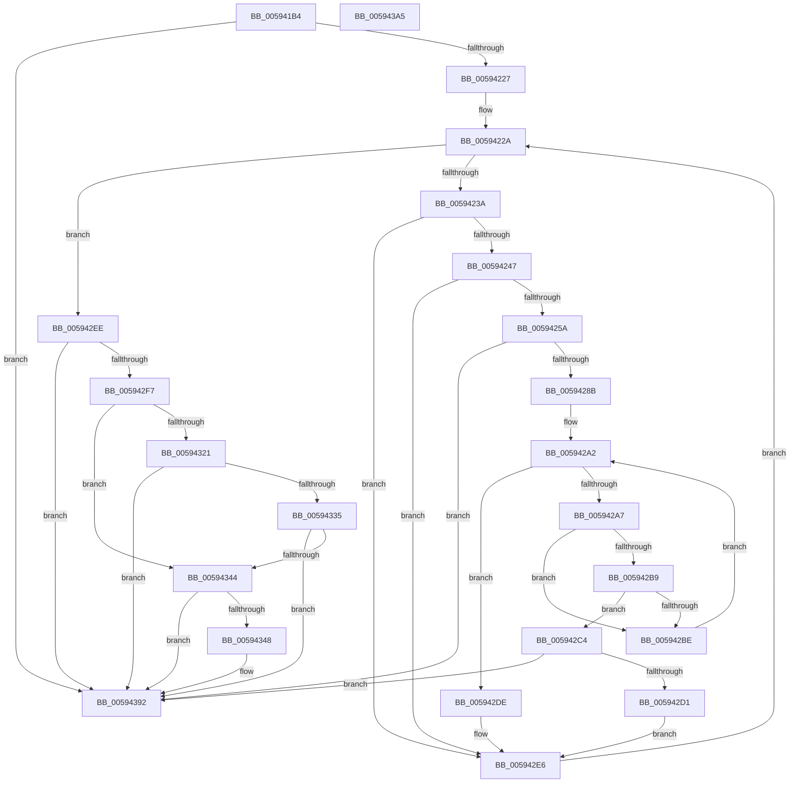

# IopAddCodeRegion

- RVA: `0x005941B4`–`0x005943A6` (길이 `498` bytes)
- VA: `0x00000001405941B4`
- 실행 섹션: `.text`
- PDB 이름 있음: `예`; PDB Function 태그: `아니요`
- unwind 정보 RVA: `0x000C6FBC`
- 디코드: `129`개 명령, `498/498` bytes 표시
- 미해석 바이트: `0` (있으면 어셈블리에 `.byte`로 보존)

> 이 문서는 커널 이미지의 기계어와 PDB 기호를 분석해 생성했습니다. 4번과 5번은 함수 원형과 자료형을 바이너리 사용 방식에서 추정한 C 해석이며 원본 소스 복구 결과는 아닙니다.

## 1. Dependencies

- 직접 호출 지점: **4**; 고유 호출 대상: **4**
- 직접 호출자로 확인된 함수: **1**
- RIP 상대 이미지 참조: **1**

### Outgoing calls
- `0x0059420B` → [IopValidateSectionSize](../4E/IopValidateSectionSize_function_004E27C0.md) (function, `0x004E27C0`)
- `0x00594275` → [RtlImageNtHeaderEx](../41/RtlImageNtHeaderEx_function_0041EAA0.md) (function, `0x0041EAA0`)
- `0x0059432C` → [RtlULongLongSub](../48/RtlULongLongSub_function_004831AC.md) (function, `0x004831AC`)
- `0x0059438B` → [memcpy](../6C/memcpy_function_006C6840.md) (function, `0x006C6840`)

### Direct callers
- [sub_006EEE7E](../6E/Unknown_function_006EEE7E.md) at `0x006EEF93`

### Static image references
- `0x00594217` → RVA `0x00EF54C0` (`.data`; read)

## 2. Other-region calls and transfers

- 다른 실행 섹션으로 향하는 call: **0**
- 별도 외부 분기/꼬리 이동을 확인하지 못했습니다.

## 3. Assembly (complete function range)

```asm
005941B4  48 8B C4                        mov rax, rsp
005941B7  48 89 48 08                     mov qword ptr [rax + 8], rcx
005941BB  53                              push rbx
005941BC  55                              push rbp
005941BD  56                              push rsi
005941BE  57                              push rdi
005941BF  41 54                           push r12
005941C1  41 55                           push r13
005941C3  41 56                           push r14
005941C5  41 57                           push r15
005941C7  48 83 EC 38                     sub rsp, 0x38
005941CB  4C 8B A1 F8 00 00 00            mov r12, qword ptr [rcx + 0xf8]
005941D2  44 8D 52 07                     lea r10d, [rdx + 7]
005941D6  48 83 60 A8 00                  and qword ptr [rax - 0x58], 0
005941DB  41 83 E2 F8                     and r10d, 0xfffffff8
005941DF  8B FA                           mov edi, edx
005941E1  C7 40 18 10 10 00 00            mov dword ptr [rax + 0x18], 0x1010
005941E8  45 32 DB                        xor r11b, r11b
005941EB  44 89 94 24 98 00 00 00         mov dword ptr [rsp + 0x98], r10d
005941F3  41 8B CA                        mov ecx, r10d
005941F6  44 88 9C 24 88 00 00 00         mov byte ptr [rsp + 0x88], r11b
005941FE  48 8D 50 18                     lea rdx, [rax + 0x18]
00594202  4D 8B E8                        mov r13, r8
00594205  33 F6                           xor esi, esi
00594207  49 83 CF FF                     or r15, 0xffffffffffffffff
0059420B  E8 B0 E5 F4 FF                  call 0x1404e27c0
00594210  8B 9C 24 90 00 00 00            mov ebx, dword ptr [rsp + 0x90]
00594217  4C 8B 35 A2 12 96 00            mov r14, qword ptr [rip + 0x9612a2]
0059421E  83 FB 10                        cmp ebx, 0x10
00594221  0F 86 6B 01 00 00               jbe 0x140594392
00594227  83 C3 F0                        add ebx, -0x10
0059422A  48 8D 05 8F 12 96 00            lea rax, [rip + 0x96128f]
00594231  4C 3B F0                        cmp r14, rax
00594234  0F 84 B4 00 00 00               je 0x1405942ee
0059423A  49 8B 6E 30                     mov rbp, qword ptr [r14 + 0x30]
0059423E  4C 3B E5                        cmp r12, rbp
00594241  0F 82 9F 00 00 00               jb 0x1405942e6
00594247  41 8B 86 98 00 00 00            mov eax, dword ptr [r14 + 0x98]
0059424E  48 03 C5                        add rax, rbp
00594251  4C 3B E0                        cmp r12, rax
00594254  0F 83 8C 00 00 00               jae 0x1405942e6
0059425A  48 83 A4 24 90 00 00 00 00      and qword ptr [rsp + 0x90], 0
00594263  4C 8D 8C 24 90 00 00 00         lea r9, [rsp + 0x90]
0059426B  45 33 C0                        xor r8d, r8d
0059426E  48 8B D5                        mov rdx, rbp
00594271  41 8D 48 01                     lea ecx, [r8 + 1]
00594275  E8 26 A8 E8 FF                  call 0x14041eaa0
0059427A  48 8B 8C 24 90 00 00 00         mov rcx, qword ptr [rsp + 0x90]
00594282  48 85 C9                        test rcx, rcx
00594285  0F 84 07 01 00 00               je 0x140594392
0059428B  0F B7 51 14                     movzx edx, word ptr [rcx + 0x14]
0059428F  0F B7 41 06                     movzx eax, word ptr [rcx + 6]
00594293  48 83 C2 18                     add rdx, 0x18
00594297  48 03 D1                        add rdx, rcx
0059429A  48 8D 0C 80                     lea rcx, [rax + rax*4]
0059429E  48 8D 04 CA                     lea rax, [rdx + rcx*8]
005942A2  48 3B D0                        cmp rdx, rax
005942A5  73 37                           jae 0x1405942de
005942A7  8B 72 0C                        mov esi, dword ptr [rdx + 0xc]
005942AA  44 8B 7A 08                     mov r15d, dword ptr [rdx + 8]
005942AE  48 03 F5                        add rsi, rbp
005942B1  4C 03 FE                        add r15, rsi
005942B4  4C 3B E6                        cmp r12, rsi
005942B7  72 05                           jb 0x1405942be
005942B9  4D 3B E7                        cmp r12, r15
005942BC  72 06                           jb 0x1405942c4
005942BE  48 83 C2 28                     add rdx, 0x28
005942C2  EB DE                           jmp 0x1405942a2
005942C4  F7 42 24 00 00 00 02            test dword ptr [rdx + 0x24], 0x2000000
005942CB  0F 85 C1 00 00 00               jne 0x140594392
005942D1  41 B3 01                        mov r11b, 1
005942D4  44 88 9C 24 88 00 00 00         mov byte ptr [rsp + 0x88], r11b
005942DC  EB 08                           jmp 0x1405942e6
005942DE  44 8A 9C 24 88 00 00 00         mov r11b, byte ptr [rsp + 0x88]
005942E6  4D 8B 36                        mov r14, qword ptr [r14]
005942E9  E9 3C FF FF FF                  jmp 0x14059422a
005942EE  45 84 DB                        test r11b, r11b
005942F1  0F 84 9B 00 00 00               je 0x140594392
005942F7  48 8B 84 24 80 00 00 00         mov rax, qword ptr [rsp + 0x80]
005942FF  8B D3                           mov edx, ebx
00594301  48 D1 EA                        shr rdx, 1
00594304  48 8B 80 F8 00 00 00            mov rax, qword ptr [rax + 0xf8]
0059430B  48 2B C2                        sub rax, rdx
0059430E  48 FF C0                        inc rax
00594311  48 3B C6                        cmp rax, rsi
00594314  48 0F 43 F0                     cmovae rsi, rax
00594318  48 8D 04 1E                     lea rax, [rsi + rbx]
0059431C  49 3B C7                        cmp rax, r15
0059431F  76 23                           jbe 0x140594344
00594321  4C 8D 44 24 20                  lea r8, [rsp + 0x20]
00594326  48 8B D6                        mov rdx, rsi
00594329  49 8B CF                        mov rcx, r15
0059432C  E8 7B EE EE FF                  call 0x1404831ac
00594331  85 C0                           test eax, eax
00594333  78 5D                           js 0x140594392
00594335  48 8B 5C 24 20                  mov rbx, qword ptr [rsp + 0x20]
0059433A  B8 FF FF FF FF                  mov eax, 0xffffffff
0059433F  48 3B D8                        cmp rbx, rax
00594342  77 4E                           ja 0x140594392
00594344  85 DB                           test ebx, ebx
00594346  74 4A                           je 0x140594392
00594348  41 0F BA AD 38 10 00 00 0B      bts dword ptr [r13 + 0x1038], 0xb
00594351  48 8B D6                        mov rdx, rsi
00594354  8B BC 24 98 00 00 00            mov edi, dword ptr [rsp + 0x98]
0059435B  41 89 BD 78 20 00 00            mov dword ptr [r13 + 0x2078], edi
00594362  8B CF                           mov ecx, edi
00594364  41 C7 85 7C 20 00 00 01 00 00 00  mov dword ptr [r13 + 0x207c], 1
0059436F  83 C7 17                        add edi, 0x17
00594372  83 E7 F8                        and edi, 0xfffffff8
00594375  44 8B C3                        mov r8d, ebx
00594378  4A 89 34 29                     mov qword ptr [rcx + r13], rsi
0059437C  42 89 5C 29 0C                  mov dword ptr [rcx + r13 + 0xc], ebx
00594381  42 89 7C 29 08                  mov dword ptr [rcx + r13 + 8], edi
00594386  8B CF                           mov ecx, edi
00594388  49 03 CD                        add rcx, r13
0059438B  E8 B0 24 13 00                  call 0x1406c6840
00594390  03 FB                           add edi, ebx
00594392  8B C7                           mov eax, edi
00594394  48 83 C4 38                     add rsp, 0x38
00594398  41 5F                           pop r15
0059439A  41 5E                           pop r14
0059439C  41 5D                           pop r13
0059439E  41 5C                           pop r12
005943A0  5F                              pop rdi
005943A1  5E                              pop rsi
005943A2  5D                              pop rbp
005943A3  5B                              pop rbx
005943A4  C3                              ret
005943A5  CC                              int3
```

## 4. C-style interpretation (structured pseudocode)

```c
__int64 __fastcall IopAddCodeRegion(__int64 a1, __int64 a2, __int64 a3)
{
    __int64 result;
    __int64 v_r10;
    __int64 v_r11;
    __int64 v_r15;
    __int64 v_rbx;
    __int64 v_rdi;
    __int64 v_rsi;
    __int64 v_rsp;
    unsigned __int64 v_stack_m58;
    unsigned __int8 v_stack_p10;
    unsigned int v_stack_p18;
    unsigned int v_stack_p20;
    unsigned __int64 v_stack_p8;

    *(unsigned __int64 *)(v_rsp + 8) = a1;
    v_rsp = (v_rsp) - (56);
    v_r10 = (unsigned int)((a2 + 7) & (0xFFFFFFF8ULL));
    *(unsigned int *)(v_rsp + 24) = 0x1010ULL;
    v_r11 = 0;
    v_stack_p20 = (unsigned int)(v_r10);
    v_stack_p10 = 0;
    v_rsi = 0;
    v_r15 = (v_r15) | (-1);
    result = IopValidateSectionSize((unsigned int)((unsigned int)(v_r10)), v_rsp + 24, a3, a4);
    if (((unsigned int)((unsigned int)(v_stack_p18))) <= 16) goto loc_00594392;
    v_rbx = (unsigned int)(((unsigned int)(v_stack_p18)) + (-16));
loc_0059422A:
    if ((*(unsigned __int64 *)(v_rip + 9835170)) == (v_rip + 9835151)) goto loc_005942EE;
    if ((*(unsigned __int64 *)(a1 + 248)) < (*(unsigned __int64 *)(*(unsigned __int64 *)(v_rip + 9835170) + 48))) goto loc_005942E6;
    result = ((unsigned int)(*(unsigned int *)(*(unsigned __int64 *)(v_rip + 9835170) + 152))) + (*(unsigned __int64 *)(*(unsigned __int64 *)(v_rip + 9835170) + 48));
    if ((*(unsigned __int64 *)(a1 + 248)) >= result) goto loc_005942E6;
    a3 = 0;
    result = RtlImageNtHeaderEx(a3 + 1, *(unsigned __int64 *)(*(unsigned __int64 *)(v_rip + 9835170) + 48), a3, v_stack_p18);
    if (v_stack_p18 == 0) goto loc_00594392;
    a2 = (*(unsigned __int16 *)(v_stack_p18 + 20)) + (24);
    a2 = (a2) + (v_stack_p18);
loc_005942A2:
    if (a2 >= (a2 + *(unsigned __int16 *)(v_stack_p18 + 6) + *(unsigned __int16 *)(v_stack_p18 + 6) * 4 * 8)) goto loc_005942DE;
    v_rsi = ((unsigned int)(*(unsigned int *)(a2 + 12))) + (*(unsigned __int64 *)(*(unsigned __int64 *)(v_rip + 9835170) + 48));
    v_r15 = ((unsigned int)(*(unsigned int *)(a2 + 8))) + (v_rsi);
    if ((*(unsigned __int64 *)(a1 + 248)) < v_rsi) goto loc_005942BE;
    if ((*(unsigned __int64 *)(a1 + 248)) < v_r15) goto loc_005942C4;
loc_005942BE:
    a2 = (a2) + (40);
    goto loc_005942A2;
loc_005942C4:
    if (((*(unsigned int *)(a2 + 36)) & (0x2000000ULL)) != 0) goto loc_00594392;
    v_stack_p10 = 1;
    goto loc_005942E6;
loc_005942DE:
loc_005942E6:
    goto loc_0059422A;
loc_005942EE:
    if ((unsigned __int8)(v_stack_p10) == 0) goto loc_00594392;
    a2 = ((unsigned int)((unsigned int)(v_rbx))) >> (1);
    result = (*(unsigned __int64 *)(v_stack_p8 + 248)) - (a2);
    result = (result) + 1;
    if (result >= v_rsi) { v_rsi = result; }
    if ((v_rsi + v_rbx * 1) <= v_r15) goto loc_00594344;
    result = RtlULongLongSub(v_r15, v_rsi, v_stack_m58, v_stack_p18);
    if (sign_flag) goto loc_00594392;
    if (v_stack_m58 > ((unsigned int)(0xFFFFFFFFULL))) goto loc_00594392;
loc_00594344:
    result = (unsigned int)(0xFFFFFFFFULL);
    v_rdi = (unsigned int)((unsigned int)(a2));
    if ((unsigned int)(v_stack_m58) != 0) {
        a2 = v_rsi;
        v_rdi = v_stack_p20;
        *(unsigned int *)(a3 + 8312) = (unsigned int)(v_rdi);
        a1 = (unsigned int)(v_rdi);
        *(unsigned int *)(a3 + 8316) = 1;
        v_rdi = (unsigned int)((v_rdi) + (23));
        v_rdi = (unsigned int)((v_rdi) & (0xFFFFFFF8ULL));
        a3 = (unsigned int)(v_stack_m58);
        *(unsigned __int64 *)(a1 + a3 * 1) = v_rsi;
        *(unsigned int *)(a1 + a3 * 1 + 12) = (unsigned int)(v_stack_m58);
        *(unsigned int *)(a1 + a3 * 1 + 8) = (unsigned int)(v_rdi);
        a1 = (unsigned int)(v_rdi);
        a1 = (a1) + (a3);
        result = memcpy(a1, a2, a3, v_stack_p18);
        v_rdi = (unsigned int)((v_rdi) + ((unsigned int)(v_stack_m58)));
    }
    v_rsp = (v_rsp) + (56);
    return (unsigned int)((unsigned int)(v_rdi));
}
```

## 5. (Beta) C Style

```c
int64_t IopAddCodeRegion(void *Arg1, void *Arg2, void *Arg3)
{
    uint8_t *arg1 = (uint8_t *)Arg1;
    uint8_t *arg2 = (uint8_t *)Arg2;
    uint8_t *arg3 = (uint8_t *)Arg3;

    int64_t result;
    int64_t local_r10;
    int64_t local_r11;
    int64_t local_r15;
    int64_t local_rbx;
    int64_t local_rdi;
    int64_t local_rsi;
    int64_t local_rsp;
    uint64_t v_stack_m58;
    uint8_t v_stack_p10;
    uint32_t v_stack_p18;
    uint32_t v_stack_p20;
    uint64_t v_stack_p8;

    *(void **)(local_rsp + 0x8) = Arg1;
    local_rsp = (local_rsp) - (56);
    local_r10 = (uint32_t)((Arg2 + 7) & (0xFFFFFFF8ULL));
    *(uint32_t *)(local_rsp + 0x18) = 0x1010ULL;
    local_r11 = 0;
    v_stack_p20 = (uint32_t)(local_r10);
    v_stack_p10 = 0;
    local_rsi = 0;
    local_r15 = (local_r15) | (-1);
    result = IopValidateSectionSize((uint32_t)((uint32_t)(local_r10)), local_rsp + 24, Arg3, a4);
    if (((uint32_t)((uint32_t)(v_stack_p18))) <= 16) goto loc_00594392;
    local_rbx = (uint32_t)(((uint32_t)(v_stack_p18)) + (-16));
loc_0059422A:
    if ((*(uint64_t *)(v_rip + 0x9612A2)) == (v_rip + 9835151)) goto loc_005942EE;
    if ((*(uint64_t *)(arg1 + 0xF8)) < (*(uint64_t *)(*(uint64_t *)(v_rip + 0x9612A2) + 0x30))) goto loc_005942E6;
    result = ((uint32_t)(*(uint32_t *)(*(uint64_t *)(v_rip + 0x9612A2) + 0x98))) + (*(uint64_t *)(*(uint64_t *)(v_rip + 0x9612A2) + 0x30));
    if ((*(uint64_t *)(arg1 + 0xF8)) >= result) goto loc_005942E6;
    Arg3 = 0;
    result = RtlImageNtHeaderEx(Arg3 + 1, *(uint64_t *)(*(uint64_t *)(v_rip + 0x9612A2) + 0x30), Arg3, v_stack_p18);
    if (v_stack_p18 == 0) goto loc_00594392;
    Arg2 = (*(uint16_t *)(v_stack_p18 + 0x14)) + (24);
    Arg2 = (Arg2) + (v_stack_p18);
loc_005942A2:
    if (Arg2 >= (Arg2 + *(uint16_t *)(v_stack_p18 + 0x6) + *(uint16_t *)(v_stack_p18 + 0x6) * 4 * 8)) goto loc_005942DE;
    local_rsi = ((uint32_t)(*(uint32_t *)(arg2 + 0xC))) + (*(uint64_t *)(*(uint64_t *)(v_rip + 0x9612A2) + 0x30));
    local_r15 = ((uint32_t)(*(uint32_t *)(arg2 + 0x8))) + (local_rsi);
    if ((*(uint64_t *)(arg1 + 0xF8)) < local_rsi) goto loc_005942BE;
    if ((*(uint64_t *)(arg1 + 0xF8)) < local_r15) goto loc_005942C4;
loc_005942BE:
    Arg2 = (Arg2) + (40);
    goto loc_005942A2;
loc_005942C4:
    if (((*(uint32_t *)(arg2 + 0x24)) & (0x2000000ULL)) != 0) goto loc_00594392;
    v_stack_p10 = 1;
    goto loc_005942E6;
loc_005942DE:
loc_005942E6:
    goto loc_0059422A;
loc_005942EE:
    if ((uint8_t)(v_stack_p10) == 0) goto loc_00594392;
    Arg2 = ((uint32_t)((uint32_t)(local_rbx))) >> (1);
    result = (*(uint64_t *)(v_stack_p8 + 0xF8)) - (Arg2);
    result = (result) + 1;
    if (result >= local_rsi) { local_rsi = result; }
    if ((local_rsi + local_rbx * 1) <= local_r15) goto loc_00594344;
    result = RtlULongLongSub(local_r15, local_rsi, v_stack_m58, v_stack_p18);
    if (sign_flag) goto loc_00594392;
    if (v_stack_m58 > ((uint32_t)(0xFFFFFFFFULL))) goto loc_00594392;
loc_00594344:
    result = (uint32_t)(0xFFFFFFFFULL);
    local_rdi = (uint32_t)((uint32_t)(Arg2));
    if ((uint32_t)(v_stack_m58) != 0) {
        Arg2 = local_rsi;
        local_rdi = v_stack_p20;
        *(uint32_t *)(arg3 + 0x2078) = (uint32_t)(local_rdi);
        Arg1 = (uint32_t)(local_rdi);
        *(uint32_t *)(arg3 + 0x207C) = 1;
        local_rdi = (uint32_t)((local_rdi) + (23));
        local_rdi = (uint32_t)((local_rdi) & (0xFFFFFFF8ULL));
        Arg3 = (uint32_t)(v_stack_m58);
        *(uint64_t *)(arg1 + arg3 * 1) = local_rsi;
        *(uint32_t *)(arg1 + arg3 * 1 + 0xC) = (uint32_t)(v_stack_m58);
        *(uint32_t *)(arg1 + arg3 * 1 + 0x8) = (uint32_t)(local_rdi);
        Arg1 = (uint32_t)(local_rdi);
        Arg1 = (Arg1) + (Arg3);
        result = memcpy(Arg1, Arg2, Arg3, v_stack_p18);
        local_rdi = (uint32_t)((local_rdi) + ((uint32_t)(v_stack_m58)));
    }
    local_rsp = (local_rsp) + (56);
    return (uint32_t)((uint32_t)(local_rdi));
}
```

### 관측된 메모리 오프셋

구조체 형식이 확인되지 않은 접근은 인자 기준의 오프셋으로만 기록했습니다.

| 기준 인자 | 오프셋 표현 | 폭 (bit) | 접근 |
|---|---:|---:|---|
| `Arg1` | `+ 0xF8` | `64` | `R` |
| `Arg2` | `+ 0x7` | `32` | `R` |
| `Arg3` | `+ 0x1038` | `32` | `R/W` |
| `Arg3` | `+ 0x2078` | `32` | `W` |
| `Arg3` | `+ 0x207C` | `32` | `W` |

## 6. Execution-region graph

[열기: 2D/3D 그래프와 함수 탐색 컨트롤 패널](../../../control-panel.html?section=text&rva=0x005941B4&view=graph)

- 2D 그래프는 위에서 아래로 흐르고, 3D 그래프는 빈 공간을 드래그해 회전합니다. Shift+드래그는 이동, 휠은 확대·축소, 함수 노드 선택은 대상 보고서 이동입니다.

### Static fallback


