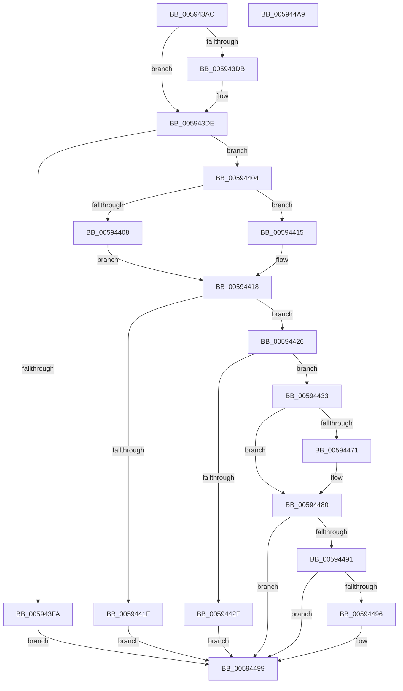

# IopAddPageDumpRange

- RVA: `0x005943AC`–`0x005944AA` (길이 `254` bytes)
- VA: `0x00000001405943AC`
- 실행 섹션: `.text`
- PDB 이름 있음: `예`; PDB Function 태그: `아니요`
- unwind 정보 RVA: `0x000BE5B4`
- 디코드: `73`개 명령, `254/254` bytes 표시
- 미해석 바이트: `0` (있으면 어셈블리에 `.byte`로 보존)

> 이 문서는 커널 이미지의 기계어와 PDB 기호를 분석해 생성했습니다. 4번과 5번은 함수 원형과 자료형을 바이너리 사용 방식에서 추정한 C 해석이며 원본 소스 복구 결과는 아닙니다.

## 1. Dependencies

- 직접 호출 지점: **1**; 고유 호출 대상: **1**
- 직접 호출자로 확인된 함수: **1**
- RIP 상대 이미지 참조: **2**

### Outgoing calls
- `0x00594488` → [IoSetDumpRange](IoSetDumpRange_function_005931F0.md) (function, `0x005931F0`)

### Direct callers
- [IopDumpCallAddPagesCallbacks](IopDumpCallAddPagesCallbacks_function_005949FC.md) at `0x00594AF0`

### Static image references
- `0x00594433` → RVA `0x00E66050` (`.data`; read)
- `0x00594475` → RVA `0x00E66198` (`.data`; read)

## 2. Other-region calls and transfers

- 다른 실행 섹션으로 향하는 call: **0**
- 별도 외부 분기/꼬리 이동을 확인하지 못했습니다.

## 3. Assembly (complete function range)

```asm
005943AC  48 89 5C 24 08                  mov qword ptr [rsp + 8], rbx
005943B1  48 89 7C 24 10                  mov qword ptr [rsp + 0x10], rdi
005943B6  55                              push rbp
005943B7  48 8B EC                        mov rbp, rsp
005943BA  48 83 EC 60                     sub rsp, 0x60
005943BE  48 83 65 D0 00                  and qword ptr [rbp - 0x30], 0
005943C3  0F 57 C0                        xorps xmm0, xmm0
005943C6  48 83 65 D8 00                  and qword ptr [rbp - 0x28], 0
005943CB  48 8B DA                        mov rbx, rdx
005943CE  4C 8B D1                        mov r10, rcx
005943D1  F3 0F 7F 45 F0                  movdqu xmmword ptr [rbp - 0x10], xmm0
005943D6  48 85 D2                        test rdx, rdx
005943D9  74 03                           je 0x1405943de
005943DB  C6 02 00                        mov byte ptr [rdx], 0
005943DE  8B 49 08                        mov ecx, dword ptr [rcx + 8]
005943E1  44 8B C9                        mov r9d, ecx
005943E4  41 81 E1 F0 0F 00 00            and r9d, 0xff0
005943EB  41 33 C9                        xor ecx, r9d
005943EE  41 89 4A 08                     mov dword ptr [r10 + 8], ecx
005943F2  F7 C1 FC FF FF 7F               test ecx, 0x7ffffffc
005943F8  74 0A                           je 0x140594404
005943FA  B8 F2 00 00 C0                  mov eax, 0xc00000f2
005943FF  E9 95 00 00 00                  jmp 0x140594499
00594404  85 C9                           test ecx, ecx
00594406  79 0D                           jns 0x140594415
00594408  0F BA F1 1F                     btr ecx, 0x1f
0059440C  40 B7 01                        mov dil, 1
0059440F  41 89 4A 08                     mov dword ptr [r10 + 8], ecx
00594413  EB 03                           jmp 0x140594418
00594415  40 32 FF                        xor dil, dil
00594418  8D 41 FF                        lea eax, [rcx - 1]
0059441B  85 C1                           test ecx, eax
0059441D  74 07                           je 0x140594426
0059441F  B8 0D 00 00 C0                  mov eax, 0xc000000d
00594424  EB 73                           jmp 0x140594499
00594426  4D 8B 42 18                     mov r8, qword ptr [r10 + 0x18]
0059442A  4D 85 C0                        test r8, r8
0059442D  75 04                           jne 0x140594433
0059442F  33 C0                           xor eax, eax
00594431  EB 66                           jmp 0x140594499
00594433  48 8B 15 16 1C 8D 00            mov rdx, qword ptr [rip + 0x8d1c16]
0059443A  41 8B C1                        mov eax, r9d
0059443D  83 C8 02                        or eax, 2
00594440  F6 C1 01                        test cl, 1
00594443  48 8B 4A 08                     mov rcx, qword ptr [rdx + 8]
00594447  44 0F 44 C8                     cmove r9d, eax
0059444B  48 89 4D E8                     mov qword ptr [rbp - 0x18], rcx
0059444F  48 8B 41 30                     mov rax, qword ptr [rcx + 0x30]
00594453  48 89 45 C0                     mov qword ptr [rbp - 0x40], rax
00594457  48 8D 41 38                     lea rax, [rcx + 0x38]
0059445B  48 89 45 C8                     mov qword ptr [rbp - 0x38], rax
0059445F  48 8D 45 C0                     lea rax, [rbp - 0x40]
00594463  48 89 45 E0                     mov qword ptr [rbp - 0x20], rax
00594467  8B 82 58 05 00 00               mov eax, dword ptr [rdx + 0x558]
0059446D  A8 04                           test al, 4
0059446F  74 0F                           je 0x140594480
00594471  83 4D F8 03                     or dword ptr [rbp - 8], 3
00594475  48 8D 05 1C 1D 8D 00            lea rax, [rip + 0x8d1d1c]
0059447C  48 89 45 F0                     mov qword ptr [rbp - 0x10], rax
00594480  49 8B 52 10                     mov rdx, qword ptr [r10 + 0x10]
00594484  48 8D 4D D0                     lea rcx, [rbp - 0x30]
00594488  E8 63 ED FF FF                  call 0x1405931f0
0059448D  85 C0                           test eax, eax
0059448F  78 08                           js 0x140594499
00594491  48 85 DB                        test rbx, rbx
00594494  74 03                           je 0x140594499
00594496  40 88 3B                        mov byte ptr [rbx], dil
00594499  48 8B 5C 24 70                  mov rbx, qword ptr [rsp + 0x70]
0059449E  48 8B 7C 24 78                  mov rdi, qword ptr [rsp + 0x78]
005944A3  48 83 C4 60                     add rsp, 0x60
005944A7  5D                              pop rbp
005944A8  C3                              ret
005944A9  CC                              int3
```

## 4. C-style interpretation (structured pseudocode)

```c
__int64 __fastcall IopAddPageDumpRange(__int64 a1, __int64 a2)
{
    __int64 result;
    __int64 v_rdi;
    __int64 v_rsp;
    unsigned int v_stack_m10;
    unsigned __int64 v_stack_m18;
    unsigned __int64 v_stack_m20;
    unsigned __int64 v_stack_m28;
    unsigned __int64 v_stack_m30;
    unsigned __int64 v_stack_m38;
    unsigned __int64 v_stack_m40;
    unsigned __int64 v_stack_m48;
    unsigned __int64 v_stack_p10;
    unsigned __int64 v_stack_p8;

    v_stack_p8 = v_rbx;
    v_stack_p10 = v_rdi;
    v_rsp = (v_rsp) - (96);
    v_stack_m18 = v_xmm0;
    if (a2 != 0) {
        *(unsigned __int8 *)(a2) = 0;
    }
    a4 = (unsigned int)(((unsigned int)((unsigned int)((unsigned int)(*(unsigned int *)(a1 + 8))))) & (0xFF0ULL));
    a1 = (unsigned int)(((unsigned int)(*(unsigned int *)(a1 + 8))) ^ ((unsigned int)(a4)));
    *(unsigned int *)(a1 + 8) = (unsigned int)(a1);
    if ((((unsigned int)(a1)) & (0x7FFFFFFCULL)) == 0) goto loc_00594404;
    goto loc_00594499;
loc_00594404:
    if (!sign_flag) goto loc_00594415;
    *(unsigned int *)(a1 + 8) = (unsigned int)(a1);
    goto loc_00594418;
loc_00594415:
    v_rdi = 0;
loc_00594418:
    if ((((unsigned int)(a1)) & ((unsigned int)(a1 - 1))) == 0) goto loc_00594426;
    goto loc_00594499;
loc_00594426:
    if (*(unsigned __int64 *)(a1 + 24) != 0) goto loc_00594433;
    result = 0;
    goto loc_00594499;
loc_00594433:
    result = (unsigned int)(((unsigned int)((unsigned int)(a4))) | (2));
    if ((((unsigned __int8)(a1)) & (1)) == 0) { a4 = (unsigned int)(result); }
    v_stack_m20 = *(unsigned __int64 *)(*(unsigned __int64 *)(v_rip + 9247766) + 8);
    v_stack_m48 = *(unsigned __int64 *)(*(unsigned __int64 *)(*(unsigned __int64 *)(v_rip + 9247766) + 8) + 48);
    v_stack_m40 = *(unsigned __int64 *)(*(unsigned __int64 *)(v_rip + 9247766) + 8) + 56;
    v_stack_m28 = v_stack_m48;
    result = (unsigned int)(*(unsigned int *)(*(unsigned __int64 *)(v_rip + 9247766) + 1368));
    if ((((unsigned __int8)((unsigned int)(*(unsigned int *)(*(unsigned __int64 *)(v_rip + 9247766) + 1368)))) & (4)) != 0) {
        result = v_rip + 9248028;
        v_stack_m18 = result;
    }
    result = IoSetDumpRange(v_stack_m38, *(unsigned __int64 *)(a1 + 16), *(unsigned __int64 *)(a1 + 24), a4);
    if (sign_flag) goto loc_00594499;
    if (a2 != 0) {
        *(unsigned __int8 *)(a2) = 0;
    }
    v_rsp = (v_rsp) + (96);
    return result;
}
```

## 5. (Beta) C Style

```c
int64_t IopAddPageDumpRange(void *Arg1, int64_t Arg2)
{
    uint8_t *arg1 = (uint8_t *)Arg1;

    int64_t result;
    int64_t local_rdi;
    int64_t local_rsp;
    uint32_t v_stack_m10;
    uint64_t v_stack_m18;
    uint64_t v_stack_m20;
    uint64_t v_stack_m28;
    uint64_t v_stack_m30;
    uint64_t v_stack_m38;
    uint64_t v_stack_m40;
    uint64_t v_stack_m48;
    uint64_t v_stack_p10;
    uint64_t v_stack_p8;

    v_stack_p8 = local_rbx;
    v_stack_p10 = local_rdi;
    local_rsp = (local_rsp) - (96);
    v_stack_m18 = v_xmm0;
    if (Arg2 != 0) {
        *(uint8_t *)(Arg2) = 0;
    }
    a4 = (uint32_t)(((uint32_t)((uint32_t)((uint32_t)(*(uint32_t *)(arg1 + 0x8))))) & (0xFF0ULL));
    Arg1 = (uint32_t)(((uint32_t)(*(uint32_t *)(arg1 + 0x8))) ^ ((uint32_t)(a4)));
    *(uint32_t *)(arg1 + 0x8) = (uint32_t)(Arg1);
    if ((((uint32_t)(Arg1)) & (0x7FFFFFFCULL)) == 0) goto loc_00594404;
    goto loc_00594499;
loc_00594404:
    if (!sign_flag) goto loc_00594415;
    *(uint32_t *)(arg1 + 0x8) = (uint32_t)(Arg1);
    goto loc_00594418;
loc_00594415:
    local_rdi = 0;
loc_00594418:
    if ((((uint32_t)(Arg1)) & ((uint32_t)(Arg1 - 1))) == 0) goto loc_00594426;
    goto loc_00594499;
loc_00594426:
    if (*(uint64_t *)(arg1 + 0x18) != 0) goto loc_00594433;
    result = 0;
    goto loc_00594499;
loc_00594433:
    result = (uint32_t)(((uint32_t)((uint32_t)(a4))) | (2));
    if ((((uint8_t)(Arg1)) & (1)) == 0) { a4 = (uint32_t)(result); }
    v_stack_m20 = *(uint64_t *)(*(uint64_t *)(v_rip + 0x8D1C16) + 0x8);
    v_stack_m48 = *(uint64_t *)(*(uint64_t *)(*(uint64_t *)(v_rip + 0x8D1C16) + 0x8) + 0x30);
    v_stack_m40 = *(uint64_t *)(*(uint64_t *)(v_rip + 0x8D1C16) + 0x8) + 56;
    v_stack_m28 = v_stack_m48;
    result = (uint32_t)(*(uint32_t *)(*(uint64_t *)(v_rip + 0x8D1C16) + 0x558));
    if ((((uint8_t)((uint32_t)(*(uint32_t *)(*(uint64_t *)(v_rip + 0x8D1C16) + 0x558)))) & (4)) != 0) {
        result = v_rip + 9248028;
        v_stack_m18 = result;
    }
    result = IoSetDumpRange(v_stack_m38, *(uint64_t *)(arg1 + 0x10), *(uint64_t *)(arg1 + 0x18), a4);
    if (sign_flag) goto loc_00594499;
    if (Arg2 != 0) {
        *(uint8_t *)(Arg2) = 0;
    }
    local_rsp = (local_rsp) + (96);
    return result;
}
```

### 관측된 메모리 오프셋

구조체 형식이 확인되지 않은 접근은 인자 기준의 오프셋으로만 기록했습니다.

| 기준 인자 | 오프셋 표현 | 폭 (bit) | 접근 |
|---|---:|---:|---|
| `Arg1` | `+ 0x8` | `32` | `R` |
| `Arg1` | `+ 0x8` | `32` | `W` |
| `Arg1` | `+ 0x10` | `64` | `R` |
| `Arg1` | `+ 0x18` | `64` | `R` |

## 6. Execution-region graph

[열기: 2D/3D 그래프와 함수 탐색 컨트롤 패널](../../../control-panel.html?section=text&rva=0x005943AC&view=graph)

- 2D 그래프는 위에서 아래로 흐르고, 3D 그래프는 빈 공간을 드래그해 회전합니다. Shift+드래그는 이동, 휠은 확대·축소, 함수 노드 선택은 대상 보고서 이동입니다.

### Static fallback


