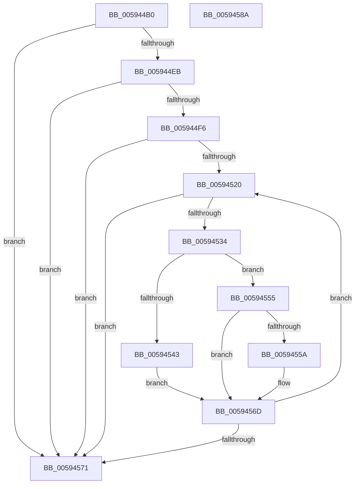

# IopAddPageRangeToPageMaps

- RVA: `0x005944B0`–`0x0059458B` (길이 `219` bytes)
- VA: `0x00000001405944B0`
- 실행 섹션: `.text`
- PDB 이름 있음: `예`; PDB Function 태그: `아니요`
- unwind 정보 RVA: `0x00084C9C`
- 디코드: `66`개 명령, `219/219` bytes 표시
- 미해석 바이트: `0` (있으면 어셈블리에 `.byte`로 보존)

> 이 문서는 커널 이미지의 기계어와 PDB 기호를 분석해 생성했습니다. 4번과 5번은 함수 원형과 자료형을 바이너리 사용 방식에서 추정한 C 해석이며 원본 소스 복구 결과는 아닙니다.

## 1. Dependencies

- 직접 호출 지점: **3**; 고유 호출 대상: **2**
- 직접 호출자로 확인된 함수: **1**
- RIP 상대 이미지 참조: **0**

### Outgoing calls
- `0x005944DD` → [RtlSetBitsEx](../3B/RtlSetBitsEx_function_003B6570.md) (function, `0x003B6570`)
- `0x0059454E` → [RtlSetBitsEx](../3B/RtlSetBitsEx_function_003B6570.md) (function, `0x003B6570`)
- `0x00594565` → [RtlClearBitsEx](../29/RtlClearBitsEx_function_00297740.md) (function, `0x00297740`)

### Direct callers
- [IopSearchAndAddPageRangeToPageMaps](IopSearchAndAddPageRangeToPageMaps_function_005961B8.md) at `0x005961FB`
- [IopSearchAndAddPageRangeToPageMaps](IopSearchAndAddPageRangeToPageMaps_function_005961B8.md) at `0x0059632D`
- [IopSearchAndAddPageRangeToPageMaps](IopSearchAndAddPageRangeToPageMaps_function_005961B8.md) at `0x00596347`

### Static image references
- 디코드된 RIP-relative 메모리 참조가 없습니다.

## 2. Other-region calls and transfers

- 다른 실행 섹션으로 향하는 call: **0**
- 별도 외부 분기/꼬리 이동을 확인하지 못했습니다.

## 3. Assembly (complete function range)

```asm
005944B0  48 89 5C 24 08                  mov qword ptr [rsp + 8], rbx
005944B5  48 89 6C 24 10                  mov qword ptr [rsp + 0x10], rbp
005944BA  48 89 74 24 18                  mov qword ptr [rsp + 0x18], rsi
005944BF  57                              push rdi
005944C0  41 56                           push r14
005944C2  41 57                           push r15
005944C4  48 83 EC 30                     sub rsp, 0x30
005944C8  4D 8B F8                        mov r15, r8
005944CB  48 8B FA                        mov rdi, rdx
005944CE  48 8B E9                        mov rbp, rcx
005944D1  49 8B D7                        mov rdx, r15
005944D4  48 8B CF                        mov rcx, rdi
005944D7  4D 8B C1                        mov r8, r9
005944DA  4D 8B F1                        mov r14, r9
005944DD  E8 8E 20 E2 FF                  call 0x1403b6570
005944E2  48 85 ED                        test rbp, rbp
005944E5  0F 84 86 00 00 00               je 0x140594571
005944EB  8B 44 24 70                     mov eax, dword ptr [rsp + 0x70]
005944EF  A9 F0 0F 00 00                  test eax, 0xff0
005944F4  74 7B                           je 0x140594571
005944F6  0F 10 07                        movups xmm0, xmmword ptr [rdi]
005944F9  48 8B 7D 30                     mov rdi, qword ptr [rbp + 0x30]
005944FD  BE 38 00 00 00                  mov esi, 0x38
00594502  48 83 C7 07                     add rdi, 7
00594506  C1 E8 04                        shr eax, 4
00594509  48 C1 EF 03                     shr rdi, 3
0059450D  83 C7 07                        add edi, 7
00594510  0F B6 D8                        movzx ebx, al
00594513  83 E7 F8                        and edi, 0xfffffff8
00594516  F3 0F 7F 44 24 20               movdqu xmmword ptr [rsp + 0x20], xmm0
0059451C  84 C0                           test al, al
0059451E  74 51                           je 0x140594571
00594520  48 8B 45 20                     mov rax, qword ptr [rbp + 0x20]
00594524  03 F7                           add esi, edi
00594526  48 2D 00 20 00 00               sub rax, 0x2000
0059452C  8D 0C 3E                        lea ecx, [rsi + rdi]
0059452F  48 3B C8                        cmp rcx, rax
00594532  77 3D                           ja 0x140594571
00594534  8B C6                           mov eax, esi
00594536  48 03 C5                        add rax, rbp
00594539  48 89 44 24 28                  mov qword ptr [rsp + 0x28], rax
0059453E  F6 C3 01                        test bl, 1
00594541  74 12                           je 0x140594555
00594543  4D 8B C6                        mov r8, r14
00594546  48 8D 4C 24 20                  lea rcx, [rsp + 0x20]
0059454B  49 8B D7                        mov rdx, r15
0059454E  E8 1D 20 E2 FF                  call 0x1403b6570
00594553  EB 18                           jmp 0x14059456d
00594555  F6 C3 10                        test bl, 0x10
00594558  74 13                           je 0x14059456d
0059455A  4D 8B C6                        mov r8, r14
0059455D  48 8D 4C 24 20                  lea rcx, [rsp + 0x20]
00594562  49 8B D7                        mov rdx, r15
00594565  E8 D6 31 D0 FF                  call 0x140297740
0059456A  83 E3 EF                        and ebx, 0xffffffef
0059456D  D1 EB                           shr ebx, 1
0059456F  75 AF                           jne 0x140594520
00594571  48 8B 5C 24 50                  mov rbx, qword ptr [rsp + 0x50]
00594576  48 8B 6C 24 58                  mov rbp, qword ptr [rsp + 0x58]
0059457B  48 8B 74 24 60                  mov rsi, qword ptr [rsp + 0x60]
00594580  48 83 C4 30                     add rsp, 0x30
00594584  41 5F                           pop r15
00594586  41 5E                           pop r14
00594588  5F                              pop rdi
00594589  C3                              ret
0059458A  CC                              int3
```

## 4. C-style interpretation (structured pseudocode)

```c
__int64 __fastcall IopAddPageRangeToPageMaps(__int64 a1, __int64 a2, __int64 a3, __int64 a4, unsigned int a5)
{
    __int64 result;
    __int64 v_rbx;
    __int64 v_rdi;
    __int64 v_rsi;
    __int64 v_rsp;
    unsigned __int64 v_stack_m20;
    unsigned __int64 v_stack_m28;
    unsigned __int64 v_stack_p10;
    unsigned __int64 v_stack_p18;
    unsigned __int64 v_stack_p8;

    v_stack_p8 = v_rbx;
    v_stack_p10 = v_rbp;
    v_stack_p18 = v_rsi;
    v_rsp = (v_rsp) - (48);
    result = RtlSetBitsEx(a2, a3, a4, a4);
    if (a1 == 0) goto loc_00594571;
    if ((((unsigned int)((unsigned int)(a5))) & (0xFF0ULL)) == 0) goto loc_00594571;
    v_rdi = (*(unsigned __int64 *)(a1 + 48)) + (7);
    result = (unsigned int)(((unsigned int)(a5)) >> (4));
    v_rdi = (v_rdi) >> (3);
    v_rdi = (unsigned int)((v_rdi) + (7));
    v_rdi = (unsigned int)((v_rdi) & (0xFFFFFFF8ULL));
    v_stack_m28 = v_xmm0;
    if ((unsigned __int8)(result) == 0) goto loc_00594571;
loc_00594520:
    v_rsi = (unsigned int)((56) + ((unsigned int)(v_rdi)));
    result = (*(unsigned __int64 *)(a1 + 32)) - (0x2000ULL);
    if ((v_rsi + v_rdi * 1) > result) goto loc_00594571;
    result = ((unsigned int)((unsigned int)(v_rsi))) + (a1);
    v_stack_m20 = result;
    if ((((unsigned __int8)((unsigned __int8)(result))) & (1)) == 0) goto loc_00594555;
    result = RtlSetBitsEx(v_stack_m28, a3, a4, a4);
    goto loc_0059456D;
loc_00594555:
    v_rbx = (unsigned __int8)(result);
    if ((((unsigned __int8)((unsigned __int8)(result))) & (16)) != 0) {
        a3 = a4;
        a1 = v_stack_m28;
        a2 = a3;
        result = RtlClearBitsEx(a1, a2, a3, a4);
        v_rbx = (unsigned int)(((unsigned __int8)(result)) & (0xFFFFFFEFULL));
    }
    v_rbx = (unsigned int)((v_rbx) >> (1));
    if (condition_is_not_equal) goto loc_00594520;
loc_00594571:
    v_rsp = (v_rsp) + (48);
    return result;
}
```

## 5. (Beta) C Style

```c
int64_t IopAddPageRangeToPageMaps(int64_t Arg1, void *Arg2, int64_t Arg3, int64_t Arg4, uint32_t Arg5)
{
    uint8_t *arg2 = (uint8_t *)Arg2;

    int64_t result;
    int64_t local_rbx;
    int64_t local_rdi;
    int64_t local_rsi;
    int64_t local_rsp;
    uint64_t v_stack_m20;
    uint64_t v_stack_m28;
    uint64_t v_stack_p10;
    uint64_t v_stack_p18;
    uint64_t v_stack_p8;

    v_stack_p8 = local_rbx;
    v_stack_p10 = local_rbp;
    v_stack_p18 = local_rsi;
    local_rsp = (local_rsp) - (48);
    result = RtlSetBitsEx(Arg2, Arg3, Arg4, Arg4);
    if (Arg1 == 0) goto loc_00594571;
    if ((((uint32_t)((uint32_t)(Arg5))) & (0xFF0ULL)) == 0) goto loc_00594571;
    local_rdi = (*(uint64_t *)(Arg1 + 0x30)) + (7);
    result = (uint32_t)(((uint32_t)(Arg5)) >> (4));
    local_rdi = (local_rdi) >> (3);
    local_rdi = (uint32_t)((local_rdi) + (7));
    local_rdi = (uint32_t)((local_rdi) & (0xFFFFFFF8ULL));
    v_stack_m28 = v_xmm0;
    if ((uint8_t)(result) == 0) goto loc_00594571;
loc_00594520:
    local_rsi = (uint32_t)((56) + ((uint32_t)(local_rdi)));
    result = (*(uint64_t *)(Arg1 + 0x20)) - (0x2000ULL);
    if ((local_rsi + local_rdi * 1) > result) goto loc_00594571;
    result = ((uint32_t)((uint32_t)(local_rsi))) + (Arg1);
    v_stack_m20 = result;
    if ((((uint8_t)((uint8_t)(result))) & (1)) == 0) goto loc_00594555;
    result = RtlSetBitsEx(v_stack_m28, Arg3, Arg4, Arg4);
    goto loc_0059456D;
loc_00594555:
    local_rbx = (uint8_t)(result);
    if ((((uint8_t)((uint8_t)(result))) & (16)) != 0) {
        Arg3 = Arg4;
        Arg1 = v_stack_m28;
        Arg2 = Arg3;
        result = RtlClearBitsEx(Arg1, Arg2, Arg3, Arg4);
        local_rbx = (uint32_t)(((uint8_t)(result)) & (0xFFFFFFEFULL));
    }
    local_rbx = (uint32_t)((local_rbx) >> (1));
    if (condition_is_not_equal) goto loc_00594520;
loc_00594571:
    local_rsp = (local_rsp) + (48);
    return result;
}
```

### 관측된 메모리 오프셋

구조체 형식이 확인되지 않은 접근은 인자 기준의 오프셋으로만 기록했습니다.

| 기준 인자 | 오프셋 표현 | 폭 (bit) | 접근 |
|---|---:|---:|---|
| `Arg2` | `+ 0x0` | `128` | `R` |

## 6. Execution-region graph

[열기: 2D/3D 그래프와 함수 탐색 컨트롤 패널](../../../control-panel.html?section=text&rva=0x005944B0&view=graph)

- 2D 그래프는 위에서 아래로 흐르고, 3D 그래프는 빈 공간을 드래그해 회전합니다. Shift+드래그는 이동, 휠은 확대·축소, 함수 노드 선택은 대상 보고서 이동입니다.

### Static fallback


