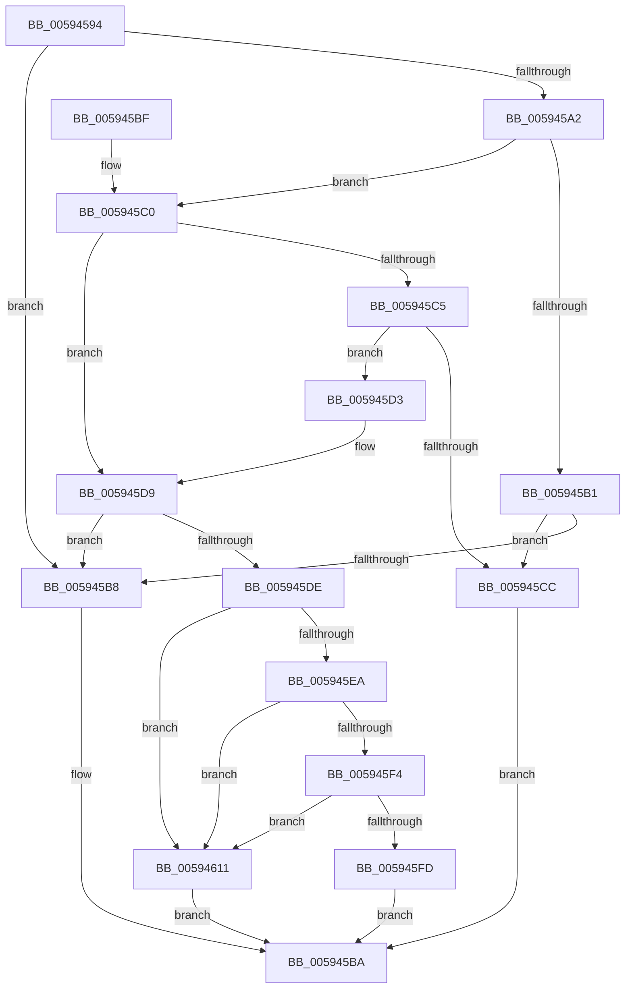

# IopAddPageToPageMap

- RVA: `0x00594594`–`0x00594625` (길이 `145` bytes)
- VA: `0x0000000140594594`
- 실행 섹션: `.text`
- PDB 이름 있음: `예`; PDB Function 태그: `아니요`
- unwind 정보 RVA: `0x000C7024`
- 디코드: `43`개 명령, `145/145` bytes 표시
- 미해석 바이트: `0` (있으면 어셈블리에 `.byte`로 보존)

> 이 문서는 커널 이미지의 기계어와 PDB 기호를 분석해 생성했습니다. 4번과 5번은 함수 원형과 자료형을 바이너리 사용 방식에서 추정한 C 해석이며 원본 소스 복구 결과는 아닙니다.

## 1. Dependencies

- 직접 호출 지점: **2**; 고유 호출 대상: **2**
- 직접 호출자로 확인된 함수: **1**
- RIP 상대 이미지 참조: **2**

### Outgoing calls
- `0x0059460A` → [IopFilterAndAddPageRangeToPageMaps](../5A/IopFilterAndAddPageRangeToPageMaps_function_005A1B3C.md) (function, `0x005A1B3C`)
- `0x0059461E` → [IopSearchAndAddPageRangeToPageMaps](IopSearchAndAddPageRangeToPageMaps_function_005961B8.md) (function, `0x005961B8`)

### Direct callers
- [IoSetDumpRange](IoSetDumpRange_function_005931F0.md) at `0x0059331E`
- [IoSetDumpRange](IoSetDumpRange_function_005931F0.md) at `0x00593383`

### Static image references
- `0x005945DE` → RVA `0x00E66050` (`.data`; read)
- `0x005945F4` → RVA `0x00E0A9D8` (`.data`; read)

## 2. Other-region calls and transfers

- 다른 실행 섹션으로 향하는 call: **0**
- 별도 외부 분기/꼬리 이동을 확인하지 못했습니다.

## 3. Assembly (complete function range)

```asm
00594594  48 83 EC 38                     sub rsp, 0x38
00594598  4C 8B 54 24 60                  mov r10, qword ptr [rsp + 0x60]
0059459D  4D 85 D2                        test r10, r10
005945A0  74 16                           je 0x1405945b8
005945A2  48 8B 02                        mov rax, qword ptr [rdx]
005945A5  4D 8D 5A FF                     lea r11, [r10 - 1]
005945A9  4D 03 D9                        add r11, r9
005945AC  4C 3B C8                        cmp r9, rax
005945AF  72 0F                           jb 0x1405945c0
005945B1  80 7C 24 68 00                  cmp byte ptr [rsp + 0x68], 0
005945B6  74 14                           je 0x1405945cc
005945B8  33 C0                           xor eax, eax
005945BA  48 83 C4 38                     add rsp, 0x38
005945BE  C3                              ret
005945BF  CC                              int3
005945C0  4C 3B D8                        cmp r11, rax
005945C3  72 14                           jb 0x1405945d9
005945C5  80 7C 24 68 00                  cmp byte ptr [rsp + 0x68], 0
005945CA  75 07                           jne 0x1405945d3
005945CC  B8 41 01 00 C0                  mov eax, 0xc0000141
005945D1  EB E7                           jmp 0x1405945ba
005945D3  4C 8B D0                        mov r10, rax
005945D6  4D 2B D1                        sub r10, r9
005945D9  4D 85 D2                        test r10, r10
005945DC  74 DA                           je 0x1405945b8
005945DE  48 8B 05 6B 1A 8D 00            mov rax, qword ptr [rip + 0x8d1a6b]
005945E5  48 85 C0                        test rax, rax
005945E8  74 27                           je 0x140594611
005945EA  8B 80 58 05 00 00               mov eax, dword ptr [rax + 0x558]
005945F0  A8 04                           test al, 4
005945F2  74 1D                           je 0x140594611
005945F4  83 3D DD 63 87 00 01            cmp dword ptr [rip + 0x8763dd], 1
005945FB  75 14                           jne 0x140594611
005945FD  8B 44 24 70                     mov eax, dword ptr [rsp + 0x70]
00594601  89 44 24 28                     mov dword ptr [rsp + 0x28], eax
00594605  4C 89 54 24 20                  mov qword ptr [rsp + 0x20], r10
0059460A  E8 2D D5 00 00                  call 0x1405a1b3c
0059460F  EB A9                           jmp 0x1405945ba
00594611  8B 44 24 70                     mov eax, dword ptr [rsp + 0x70]
00594615  89 44 24 28                     mov dword ptr [rsp + 0x28], eax
00594619  4C 89 54 24 20                  mov qword ptr [rsp + 0x20], r10
0059461E  E8 95 1B 00 00                  call 0x1405961b8
00594623  EB 95                           jmp 0x1405945ba
```

## 4. C-style interpretation (structured pseudocode)

```c
__int64 __fastcall IopAddPageToPageMap(__int64 a1, __int64 a2, __int64 a3, __int64 a4, __int64 a5, unsigned __int8 a6, unsigned int a7)
{
    __int64 result;
    __int64 v_r10;
    __int64 v_r11;
    __int64 v_rsp;
    unsigned __int64 v_stack_p20;
    unsigned int v_stack_p28;

    v_rsp = (v_rsp) - (56);
    if (a5 == 0) goto loc_005945B8;
    v_r11 = (a5 - 1) + (a4);
    if (a4 < (*(unsigned __int64 *)(a2))) goto loc_005945C0;
    if (a6 == 0) goto loc_005945CC;
loc_005945B8:
    result = 0;
loc_005945BA:
    v_rsp = (v_rsp) + (56);
    return result;
loc_005945C0:
    if (v_r11 < 0) goto loc_005945D9;
    if (a6 != 0) goto loc_005945D3;
loc_005945CC:
    goto loc_005945BA;
loc_005945D3:
    v_r10 = ((unsigned int)(0xC0000141ULL)) - (a4);
loc_005945D9:
    if (v_r10 == 0) goto loc_005945B8;
    if (*(unsigned __int64 *)(v_rip + 9247339) == 0) goto loc_00594611;
    if ((((unsigned __int8)((unsigned int)(*(unsigned int *)(*(unsigned __int64 *)(v_rip + 9247339) + 1368)))) & (4)) == 0) goto loc_00594611;
    if ((*(unsigned int *)(v_rip + 8872925)) != 1) goto loc_00594611;
    v_stack_p28 = (unsigned int)((unsigned int)(a7));
    v_stack_p20 = v_r10;
    result = IopFilterAndAddPageRangeToPageMaps(a1, a2, a3, a4);
    goto loc_005945BA;
loc_00594611:
    v_stack_p28 = (unsigned int)((unsigned int)(a7));
    v_stack_p20 = v_r10;
    result = IopSearchAndAddPageRangeToPageMaps(a1, a2, a3, a4);
    goto loc_005945BA;
}
```

## 5. (Beta) C Style

```c
int64_t IopAddPageToPageMap(int64_t Arg1, void *Arg2, int64_t Arg3, int64_t Arg4, int64_t Arg5, uint8_t Arg6, uint32_t Arg7)
{
    uint8_t *arg2 = (uint8_t *)Arg2;

    int64_t result;
    int64_t local_r10;
    int64_t local_r11;
    int64_t local_rsp;
    uint64_t v_stack_p20;
    uint32_t v_stack_p28;

    local_rsp = (local_rsp) - (56);
    if (Arg5 == 0) goto loc_005945B8;
    local_r11 = (Arg5 - 1) + (Arg4);
    if (Arg4 < (*(uint64_t *)(arg2))) goto loc_005945C0;
    if (Arg6 == 0) goto loc_005945CC;
loc_005945B8:
    result = 0;
loc_005945BA:
    local_rsp = (local_rsp) + (56);
    return result;
loc_005945C0:
    if (local_r11 < 0) goto loc_005945D9;
    if (Arg6 != 0) goto loc_005945D3;
loc_005945CC:
    goto loc_005945BA;
loc_005945D3:
    local_r10 = ((uint32_t)(0xC0000141ULL)) - (Arg4);
loc_005945D9:
    if (local_r10 == 0) goto loc_005945B8;
    if (*(uint64_t *)(v_rip + 0x8D1A6B) == 0) goto loc_00594611;
    if ((((uint8_t)((uint32_t)(*(uint32_t *)(*(uint64_t *)(v_rip + 0x8D1A6B) + 0x558)))) & (4)) == 0) goto loc_00594611;
    if ((*(uint32_t *)(v_rip + 0x8763DD)) != 1) goto loc_00594611;
    v_stack_p28 = (uint32_t)((uint32_t)(Arg7));
    v_stack_p20 = local_r10;
    result = IopFilterAndAddPageRangeToPageMaps(Arg1, Arg2, Arg3, Arg4);
    goto loc_005945BA;
loc_00594611:
    v_stack_p28 = (uint32_t)((uint32_t)(Arg7));
    v_stack_p20 = local_r10;
    result = IopSearchAndAddPageRangeToPageMaps(Arg1, Arg2, Arg3, Arg4);
    goto loc_005945BA;
}
```

### 관측된 메모리 오프셋

구조체 형식이 확인되지 않은 접근은 인자 기준의 오프셋으로만 기록했습니다.

| 기준 인자 | 오프셋 표현 | 폭 (bit) | 접근 |
|---|---:|---:|---|
| `Arg2` | `+ 0x0` | `64` | `R` |

## 6. Execution-region graph

[열기: 2D/3D 그래프와 함수 탐색 컨트롤 패널](../../../control-panel.html?section=text&rva=0x00594594&view=graph)

- 2D 그래프는 위에서 아래로 흐르고, 3D 그래프는 빈 공간을 드래그해 회전합니다. Shift+드래그는 이동, 휠은 확대·축소, 함수 노드 선택은 대상 보고서 이동입니다.

### Static fallback


